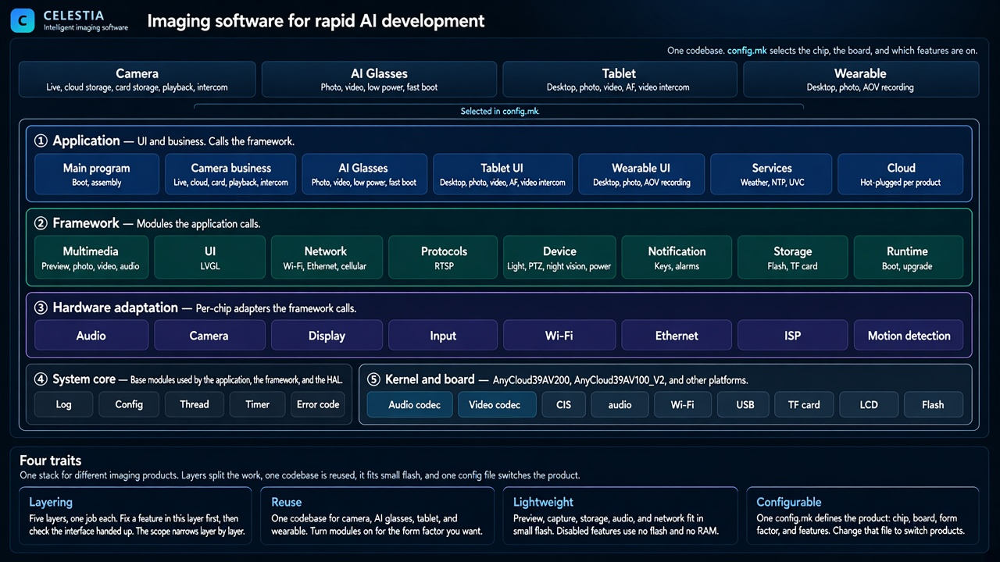

<p align="right"><b>English</b> | <a href="README.md">中文</a></p>

<div align="center">

# Celestia

**Image software stack for Anyka image SoCs**

[Quick start](#5-quick-start) · [Architecture](architecture/overview.en.md) ·
[Form factors](architecture/form-factor.en.md) · [Glossary](glossary.en.md)

`Apache-2.0` · docs `CC BY 4.0` · embedded C / C++ · Linux and AOS RTOS

</div>

---

## 1. What this tree is

Celestia sits on the **Anyka image SoC vendor SDK**. Five fixed layers and one configuration entry separate application, framework, hardware adaptation, system base, and kernel/board support. The same tree targets cameras, AI glasses, tablets, and wearables. Upper layers do not name the chip. **A new chip replaces the adaptation layer. A new form factor replaces one configuration.**

| | |
|:---|:---|
| **What is in git** | Application framework, HAL, and base libraries, built into one main program plus business shared libraries |
| **What it runs on** | Anyka SDK: `AnyCloud39AV200` (RISC-V / Linux), `AnyCloud39AV100_V2` (ARM / Linux), `Sky39AV130` (ARM / AOS RTOS) |
| **Only legal product difference** | `project/<product>/config.mk` generates `config.h`. Runtime settings come from `settings.json` |
| **Process model** | One process, many threads. Business modules are `.so` files (statically linked on AOS) |
| **Output** | One main executable per product, business shared libraries, rootfs / kernel / burn image under `out/<product>/` |
| **Tier C, in `project/`** | Overlay `.ko` / `.so` / `.a`, `libak_nne` / `libak_nna` / `libmpi_svp`, models, fonts, burn images. Shipped, not Apache-2.0 |
| **Not in this tree (tier D)** | Chip SDK under `system/AnyCloud*` and `system/Sky39AV130`, plus closed libraries under `application/cloud` |

Terms (`AOS`, `IOTCamera`, `AI_GLASSES`, `TABLET`, `WEARABLE`, EVB, PDK, …) are defined only in the [glossary](glossary.en.md). Form-factor rules are in [form factors](architecture/form-factor.en.md).

---

## 2. Design rules

| Rule | How | Why |
|:-----|:----|:----|
| **Layers** | Five layers. Cross-layer calls use the other layer's public `include/` only | Faults stay inside one layer |
| **One config entry** | Product differences live only in `project/<product>/config.mk` | A new product does not fork the sources |
| **Compile what you enable** | Disabled features are not compiled or linked | A 16 MB NOR device still fits |
| **Contract calls** | Upper layers take handles with `app_main_get_*()` and `*_open()` | Business code does not change when the SoC changes |

---

## 3. Architecture



The picture is the five layers and the config entry. Contracts, runtime, boot, and build outputs are in the [architecture overview](architecture/overview.en.md).

| Layer | Directory | Responsibility | Public contract |
|:---|:-----|:-----------|:---------|
| 1 Application | `application/` | Main program, UI, business, cloud | `app_main_get_*()` + `*_open()` |
| 2 Framework | `framework/` | Multimedia, network, device, notification, storage, runtime, protocols | `framework/**/include/*.h` |
| 3 HAL | `hardware/` | SoC peripherals and media, one ops surface upward | `hardware/include/*.h` |
| 4 System core | `system/core/` | Log, config, threads, timers, errors, memory, crypto | `system/core/include/*.h` |
| 5 Kernel and board | `system/<SoC>/<SDK>/`, `project/*/system/` | Vendor SDK, U-Boot/OpenSBI, kernel, DTS, rootfs | Device nodes, ioctl, sysfs |

**Dependencies:** 1 → 2 → 3 → 5 downward. Layers 1, 2, and 3 also use 4. A reverse dependency is a design break.

---

## 4. Form factors

The form factor is fixed by compile-time switches, not by the product name. It decides the display, the application package, who owns the main loop, and who keeps the process alive.

| Form factor | Display | Compile-time test | Main loop | Who stays alive |
|:-----|:----------------|:-----------|:-------|:---------|
| `IOTCamera` | None | `PACKAGES_IPCAMERA=y` + `LCD=n` | None | `module_start()` in the business `.so` |
| `AI_GLASSES` (port in progress) | None | `PACKAGES_AIGLASS=y` + `LCD=n` | None | Fast record, fast still |
| `TABLET` | Tablet panel, 800×480 to 1024×600 | `PACKAGES_TABLET=y` + `LCD=y` | `tablet_run()` | GUI framework |
| `WEARABLE` | Small panel, ≤ 320×320 (current 240×240) | `PACKAGES_WEARABLE=y` + `LCD=y` | `app_gui_run()` | GUI framework |

The camera is not a form-factor test. Every form factor has one. It is an input path.

**AI glasses** (being ported): chip `KM02G`, first-person image, fast preview (`FASTSYS`), on-device AI (NNE / NNA), low-power resident, light interaction. There is no product directory or `PACKAGES_*` switch yet, so it is not a selection criterion until the port lands. See [form factors](architecture/form-factor.en.md).

Every current product sets `CONFIG_HW_CAMERA=y` and `CONFIG_FW_MULTIMEDIA_CAMERA=y`. The difference is where the picture goes: stream and storage (`IOTCamera`), first-person capture and on-device AI (`AI_GLASSES`, in progress), or a local display (`TABLET` / `WEARABLE`).

### Products

| Product | SoC / SDK | BOARD | Form factor | Display | Main | OS |
|:-----|:----------|:------|:----:|:----------------|:-------|:---|
| `anypi_nova` | AnyCloud39AV200 / V1.04 | `PDB_MBD_AK3918AV200_ACTCAM` | `TABLET` | 800×480 | `ipc_main` | linux |
| `anypi_nova_dev` | AnyCloud39AV200 / V1.04 | `EVB_MBD_AK3918AV200` | `TABLET` (EVB) | 1024×600 | `nova_main` | linux |
| `anypi_luna` | AnyCloud39AV100_V2 / V2.05 | `PDB_MBD_KM01W_ACTCAM` | `WEARABLE` | 240×240 | `luna_main` | linux |
| `anypi_luna_dev` | AnyCloud39AV100_V2 / V2.04 | `EVB_MBD_KM01A` | `IOTCamera` | none | `luna_dev_main` | linux |
| `anypi_mira_dev` | Sky39AV130 / V1.01 | `EVB_CBD_AK3918AV130` | `IOTCamera` | none | `mira_main` | **aos** |

Selection and boot split: [form factors](architecture/form-factor.en.md).

---

## 5. Quick start

```bash
repo init -u https://github.com/celestia-release/manifest.git -b main -m default.xml
repo sync -c -j4

# Vendor SDK is not in git. Unpack it at system/<SoC>/<SDK_VERSION>/
./build.sh --product-name anypi_nova
```

| Step | Action | Doc |
|:----:|:-----|:-----|
| 1 | Source and toolchain | [download.en.md](quick-start/download.en.md) |
| 2 | Vendor SDK | [download.en.md](quick-start/download.en.md) |
| 3 | Pick a product and build | [build.en.md](quick-start/build.en.md) |
| 4 | Flash and board check (PASS/FAIL) | [deploy.en.md](quick-start/deploy.en.md) |

```bash
./build.sh
./build.sh --product-name anypi_nova
./build.sh -h -f -a --product-name anypi_luna
./build.sh --product-name anypi_nova -c -f -a
```

Layer switches: `-t` third_party, `-s` system/core, `-h` hardware, `-f` framework, `-a` application, `-k` kernel/BSP.

Order: `third_party → system/core → hardware → framework → application → package`.

---

## 6. Tree

```text
celestia/
├── build.sh -> scripts/build.sh
├── application/     # 1 application
├── framework/       # 2 framework
├── hardware/        # 3 HAL
├── system/core/     # 4 system core
├── project/<product>/
├── scripts/
├── third_party/
└── docs/
```

Where a new file goes: [directory map](architecture/directory-map.en.md).

---

## 7. Where to read next

| I want to… | Read |
|:------|:-------|
| Look up a name | [glossary.en.md](glossary.en.md) |
| Name a directory, macro, or file | [glossary §11](glossary.en.md) |
| See layer boundaries | [architecture/overview.en.md](architecture/overview.en.md) |
| Pick a form factor | [architecture/form-factor.en.md](architecture/form-factor.en.md) |
| Place a new file | [architecture/directory-map.en.md](architecture/directory-map.en.md) |
| Build and flash | [download](quick-start/download.en.md) → [build](quick-start/build.en.md) → [deploy](quick-start/deploy.en.md) |
| Add a board or SoC | [bsp-and-products.en.md](quick-start/bsp-and-products.en.md) |
| Look up an API | [api-index.en.md](guide/api-index.en.md) |
| Doc and code rules | [conventions.en.md](guide/conventions.en.md) |
| Use the AI role skills | [roles.en.md](quick-start/roles.en.md) → [skills](skills/README.en.md) |
| Push an app with Studio | [studio_agents.en.md](guide/studio_agents.en.md) |
| Debug on a board | [celestia-debug.en.md](skills/celestia-debug.en.md) |
| See what was removed before GitHub | [open-source.en.md](open-source.en.md) |

---

## 8. Skills

Source of truth: [skills/README.en.md](skills/README.en.md). Copies under `.claude/skills/` and `.cursor/skills/` are not the source.

| Skill | Scope |
|:------|:------|
| [celestia](skills/celestia.en.md) | Routing, cross-layer rules, layered build |
| [celestia-aos-port](skills/celestia-aos-port.en.md) | Linux product to AOS |
| [celestia-application](skills/celestia-application.en.md) | Apps, cloud, IOTCamera `.so` |
| [celestia-framework](skills/celestia-framework.en.md) | Services |
| [celestia-hardware](skills/celestia-hardware.en.md) | HAL, new SoC |
| [celestia-system-core](skills/celestia-system-core.en.md) | system/core |
| [celestia-project](skills/celestia-project.en.md) | Product, BOARD, BSP |
| [celestia-scripts](skills/celestia-scripts.en.md) | build.sh |
| [celestia-third-party](skills/celestia-third-party.en.md) | third_party |
| [celestia-debug](skills/celestia-debug.en.md) | On-board PASS/FAIL, bug classes A–G |
| [celestia-contributing](skills/celestia-contributing.en.md) | Conventions |

---

## 9. License and third parties

- Tiers (A Apache-2.0 sources, B third-party, C prebuilts kept under `project/`, D chip SDK and cloud binaries left out) and credentials that must be rotated in the vendor console: [open-source risks](open-source.en.md).
- First-party code is **Apache-2.0**. See `LICENSE` and `NOTICE` in each repository.
- **Tier C** (kept under `project/`, not Apache-2.0): `libak_nne` / `libak_nna` / `libmpi_svp` and the other overlay binaries, plus models, fonts, and burn images.
- **Tier D** (not in this tree): `system/AnyCloud39AV*` and `Sky39AV130` chip SDKs, and the closed libraries under `application/cloud`.
- Third-party list: `third_party/THIRD_PARTY_NOTICES.md` and [glossary §9](glossary.en.md).

---

<div align="center">

[Top](#celestia) · [Architecture](architecture/overview.en.md) ·
[Form factors](architecture/form-factor.en.md) · [Glossary](glossary.en.md) ·
[Conventions](guide/conventions.en.md) · [Studio](guide/studio_agents.en.md)

</div>
