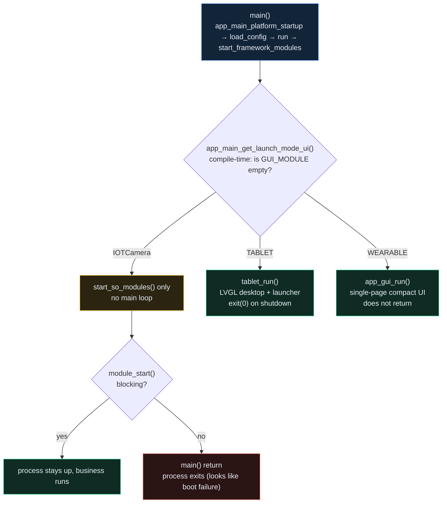
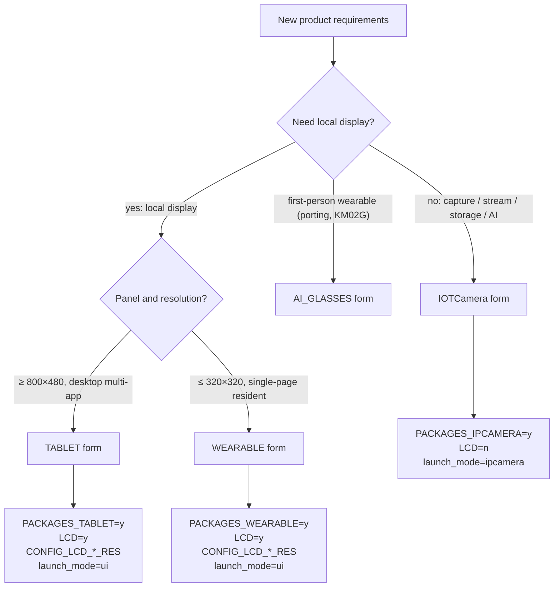

<p align="right"><b>English</b> | <a href="form-factor.md">中文</a></p>

# Product Form Factor

> **Document scope**: This document defines Celestia **product form factors**, with criteria, startup branching, keep-alive responsibility, and selection workflow.
>
> In one sentence: **form factor decides whether the product has a display, where video goes, who keeps the process alive, and which package holds business logic**,
> uniquely determined at compile time by switches in `project/<product>/config.mk`, not inferred from the product name.

---

## 1. What Form Factor Describes

Product form factor combines **display mode** and **interaction density** into one enum value, constraining **four things** at once:

| Dimension | Description | Where criteria live in code |
|:----------|:------------|:----------------------------|
| Display | Display-enabled or headless (`IOTCamera`) | `CONFIG_BOARD_SUPPORT_LCD`, `app_main_get_launch_mode_ui()` |
| Resolution band | Tablet-class ≥ 800×480; wearable-class ≤ 320×320; headless uses `LCD=n` | `CONFIG_LCD_HOR_RES` / `CONFIG_LCD_VER_RES` |
| Main loop owner | GUI framework runs the main loop, or there is no main loop | `tablet_run()` / `app_gui_run()` / none |
| Keep-alive | GUI framework keeps alive, or business SO blocks itself | Business SO `module_start()` |

**Form factor** is the naming used because it matches code identifiers —
`CONFIG_APP_PACKAGES_TABLET`, `CONFIG_APP_PACKAGES_WEARABLE`, `CONFIG_APP_PACKAGES_IPCAMERA`
are symbols you can grep directly; docs and code need no second translation. See the glossary in
[glossary §2](../glossary.en.md#2-product-form-factors-iotcamera-ai_glasses-tablet-wearable-focus).

---

## 2. Form Factor Definitions

| Form ID | Name | Display | One-liner |
|:--------|:-----|:--------|:----------|
| `IOTCamera` | IP camera | **No display** | No GUI main loop; capture → encode → stream / storage / AI; business SO keeps process alive |
| `AI_GLASSES` | AI glasses (**porting form**) | Porting | Porting: chip `KM02G`, first-person capture + fast first frame + on-device AI, being ported to this stack |
| `TABLET` | Tablet-class | Display-enabled | Desktop-style multi-app UI, LVGL + launcher + dynamic app SO load |
| `WEARABLE` | Wearable-class | Display-enabled (small panel) | Single-page compact UI, one resident app, tightest resource budget |

> **AI glasses (`AI_GLASSES`, porting to this stack)**: Chip `KM02G`, target is first-person imaging products. Key traits:
>
> 1. **Fast first frame**: Short time from power-on to first frame; uses `FASTSYS` fast-boot path (`CONFIG_CELESTIA_FASTSYS`);
> 2. **First-person capture**: Camera as primary input, portable shoot / record;
> 3. **On-device AI**: Recognition models on NNE / NNA;
> 4. **Low-power always-on**: Battery powered; work / standby transitions and wake paths are hard requirements;
> 5. **Light interaction**: No full desktop; mainly voice / keys plus status hints.
>
> The source tree currently has no `project/anypi_*` product dir and no `CONFIG_APP_PACKAGES_*` switch for this form; **excluded from criteria and selection until port completes**; display and interaction TBD as port progresses.

### 2.1 Criteria Matrix

| Criterion | `IOTCamera` | `AI_GLASSES` | `TABLET` | `WEARABLE` |
|:----------|:-----------:|:------------:|:--------:|:----------:|
| Display | **No display** | Porting | Display-enabled, tablet-class | Display-enabled, wearable-class |
| Resolution band | — | Porting | 800×480 ~ 1024×600 | ≤ 320×320 (currently 240×240) |
| `CONFIG_BOARD_SUPPORT_LCD` | `n` | Porting | `y` | `y` |
| `CONFIG_APP_PACKAGES_IPCAMERA` | **`y`** | Porting | `n` | `n` |
| `CONFIG_APP_PACKAGES_TABLET` | `n` | Porting | **`y`** | `n` |
| `CONFIG_APP_PACKAGES_WEARABLE` | `n` | Porting | `n` | **`y`** |
| `settings.json` → `launch_mode` | `ipcamera` (also accepts `headless`) | Porting | `ui` | `ui` |
| `app_main_get_launch_mode_ui()` | `false` | Porting | `true` | `true` |
| Main loop | **None** | Porting | `tablet_run()` | `app_gui_run()` |
| Keep-alive | **Business SO `module_start()`** | Porting | GUI main loop | GUI main loop |
| App package dir | `packages/ipcamera/` | Porting | `packages/tablet/` | `packages/wearable/` |

**Three hard rules**:

1. `PACKAGES_TABLET` and `PACKAGES_WEARABLE` are **mutually exclusive at compile time**; both must not be `= y`.
2. **Compile-time over runtime**: If GUI packages are not built in, `launch_mode="ui"` is ineffective; headless path still runs.
3. Resolution is determined only by `CONFIG_LCD_HOR_RES` / `CONFIG_LCD_VER_RES`, independent of physical panel size;
   headless form (`LCD=n`) does not define resolution.

> **Camera is not a form criterion**: This is an imaging software stack; all five products use
> `CONFIG_HW_CAMERA=y` + `CONFIG_FW_MULTIMEDIA_CAMERA=y`. Form differs in **where frames go** —
> `IOTCamera` → stream / storage / AI; `AI_GLASSES` → first-person + on-device AI (display TBD while porting);
> `TABLET` / `WEARABLE` → local display.

### 2.2 Compile-Time Source of Truth: `GUI_MODULE` in `app_main/Makefile`

At compile time, form is translated into `GUI_MODULE`, which decides which launcher is linked. **Priority order**
(`application/app_main/Makefile`):

```makefile
GUI_MODULE :=
ifeq ($(CONFIG_APP_PACKAGES_MODULE),)      # explicit wins
else
  GUI_MODULE := $(CONFIG_APP_PACKAGES_MODULE)
endif
# then fallbacks in order:
#   CONFIG_APP_PACKAGES_TABLET=y   → tablet
#   CONFIG_APP_PACKAGES_WEARABLE=y → wearable
#   CONFIG_APP_GUI_NOVA=y          → tablet    (alias)
#   CONFIG_APP_GUI_LUNA=y          → wearable  (alias)
#   CONFIG_APP_GUI_MODULE=nova     → tablet    (alias)
#   CONFIG_APP_GUI_MODULE=luna     → wearable  (alias)
ifneq ($(GUI_MODULE),)
    GUI_BUILD_DIR := $(BUILD_APPLICATION_DIR)/packages/$(GUI_MODULE)
endif
```

> **All miss ⇒ empty `GUI_MODULE` ⇒ `IOTCamera` form**. This is the sole compile-time definition of headless:
> no launcher linked, hence no GUI main loop.

---

## 3. Startup Path Branching

### 3.1 Branch Point at End of `main.c`

After platform startup, config parse, SO load, and framework services open,
`application/app_main/main.c` `app_main_entry()` picks one of three paths by compile-time macros:

```c
#if defined(CONFIG_APP_PACKAGES_WEARABLE) || defined(CONFIG_APP_GUI_LUNA)
    app_main_start_so_modules();  /* non-blocking for UI companion SOs */
    app_gui_run();                /* does not return */
#elif defined(CONFIG_APP_PACKAGES_TABLET) || defined(CONFIG_APP_GUI_NOVA)
    app_main_start_so_modules();
    tablet_run();                 /* exits via exit(0) after graceful teardown */
#else
    /* ipcamera: module_start must block to keep ipc_main alive. */
    log_warn("no UI package linked (PACKAGES_WEARABLE/TABLET unset); running SO modules only");
    app_main_start_so_modules();
#endif
    return APP_MAIN_OK;
```



### 3.2 Keep-Alive Ownership (Most Important)

| Form | Main loop owner | Who keeps alive | Typical failure symptom |
|:-----|:----------------|:----------------|:------------------------|
| `IOTCamera` | **None** | **Business SO itself** | **Process exits in seconds** → `module_start()` not blocking |
| `TABLET` | `tablet_run()` | GUI framework | Black screen → check LVGL init and IPU channel order |
| `WEARABLE` | `app_gui_run()` | GUI framework | Same; also check `CONFIG_LCD_*_RES` and panel params |

> **Top pitfall for headless**: Main reaches normal `return` at end of `main()`; process exits immediately;
> serial log looks fine but "boot failed". **This is not a bug** — keep-alive was not implemented —
> the only place to block in headless form is business SO `module_start()`.

**Business SO contract**:

```c
int module_init(const char *config_path);  /* init, return quickly */
int module_start(void);                    /* main loop; headless form must block and not return */
```

### 3.3 First-Frame Optimization for Display Forms (Optional)

`TABLET` can enable `CONFIG_APP_MAIN_DEFER_HEAVY_SO`, pulling FreeType / libpng out of `DT_NEEDED`,
`dlopen` after first frame:

| File | Role |
|:-----|:-----|
| `app_main_defer_gui_stubs.c` | Trampolines; `dlopen` shared lib on first use |
| `app_main_defer_gui_noop.c` | No-op when switch off (e.g. `anypi_nova_dev`) |

> See [celestia-application](../skills/celestia-application.en.md).

---

## 4. Choosing a Form for a New Product



After selection, changes should **all live in `project/<product>/config.mk` and board `settings.json`**
(the only legal product-diff source); no product branches in source.

### 4.1 Per-Form Configuration Checklists

**`IOTCamera` (camera, no display)**

```makefile
CONFIG_BOARD_SUPPORT_LCD      = n
CONFIG_APP_PACKAGES_TABLET    = n
CONFIG_APP_PACKAGES_WEARABLE  = n
CONFIG_APP_PACKAGES_IPCAMERA  = y
CONFIG_APP_MAIN_TARGET        = luna_dev_main
```

```json
{
  "program": "/usr/sbin/luna_dev_main",
  "launch_mode": "ipcamera",
  "modules": {
    "ipc_cam": {
      "enable": true,
      "type": "so",
      "so_path": "/usr/lib/libipc_cam_app.so",
      "config_path": "/etc/config/fw_video_config.json"
    }
  }
}
```

**`TABLET` (tablet-class, display-enabled)**

```makefile
CONFIG_BOARD_SUPPORT_LCD      = y
CONFIG_LCD_HOR_RES            = 800      # or 1024
CONFIG_LCD_VER_RES            = 480      # or 600
CONFIG_APP_PACKAGES_TABLET    = y
CONFIG_APP_PACKAGES_WEARABLE  = n
CONFIG_APP_PACKAGES_IPCAMERA  = n
CONFIG_APP_MAIN_TARGET        = ipc_main
```

```json
{ "program": "/usr/sbin/ipc_main", "launch_mode": "ui" }
```

**`WEARABLE` (wearable-class, small panel)**

```makefile
CONFIG_BOARD_SUPPORT_LCD      = y
CONFIG_LCD_HOR_RES            = 240
CONFIG_LCD_VER_RES            = 240
CONFIG_APP_PACKAGES_TABLET    = n
CONFIG_APP_PACKAGES_WEARABLE  = y
CONFIG_APP_PACKAGES_IPCAMERA  = n
CONFIG_APP_MAIN_TARGET        = luna_main
```

```json
{ "program": "/usr/sbin/luna_main", "launch_mode": "ui" }
```

> The three blocks above are taken from `project/anypi_luna_dev/config.mk`, `project/anypi_nova/config.mk`,
> `project/anypi_luna/config.mk`, and respective board `settings.json` values.
> All three also have `CONFIG_HW_CAMERA = y` and `CONFIG_FW_MULTIMEDIA_CAMERA = y`.

---

## 5. Adding a New Form Factor

Existing forms cover all current products; `AI_GLASSES` (chip `KM02G`) is the only new form actively being ported. To add a form, change in this order;
**public headers and framework APIs should not change**:

| Step | Location | Notes |
|:----:|:---------|:------|
| 1 | `application/packages/<new>/` | New app package dir with `Makefile` and `launcher/` |
| 2 | `application/app_main/Makefile` | Add `CONFIG_APP_PACKAGES_<NEW>` branch in `GUI_MODULE` chain |
| 3 | `application/app_main/main.c` | New `#elif` at branch with main-loop entry for the form |
| 4 | `application/app_main/app_config.c` | Parse new `launch_mode` value if introduced |
| 5 | `project/<product>/config.mk` | New `CONFIG_APP_PACKAGES_<NEW>` and `CONFIG_LCD_*_RES` |
| 6 | This doc + [glossary §2](../glossary.en.md#2-product-form-factors-iotcamera-ai_glasses-tablet-wearable-focus) | Sync criteria matrix and product mapping |

> If the new form **has no display**, use headless path (no launcher link);
> clarify keep-alive in §3.2; no new `GUI_MODULE` branch required.

---

## 6. Common Misconceptions

| Misconception | Fact |
|:--------------|:-----|
| "Display-enabled means `TABLET`" | Display only means LCD + GUI main loop; `TABLET` / `WEARABLE` depend on which package set is built |
| "`IOTCamera` means no business logic" | Headless business is often heavier (stream, storage, AI); just no UI |
| "Change `launch_mode` to switch form" | Compile switches decide *can*; if GUI package not built, `launch_mode="ui"` is ineffective |
| "Instant exit means boot failure" | Headless: `module_start()` did not block so `main()` returned normally — keep-alive gap |
| "Headless can omit camera" | Camera is required input for imaging stack; headless only drops local display |
| "Fill resolution from physical size" | Only logical `CONFIG_LCD_HOR_RES` / `VER_RES`; unrelated to physical dimensions |

---

## 7. Related Documentation

| Topic | Document |
|:------|:---------|
| Glossary §2 | [glossary.en.md §2](../glossary.en.md#2-product-form-factors-iotcamera-ai_glasses-tablet-wearable-focus) |
| Layering · contracts · runtime · startup · build | [overview.en.md](overview.en.md) |
| Directory duties and placement | [directory-map.en.md](directory-map.en.md) |
| Application layer (incl. headless business SO) | [skills/celestia-application.en.md](../skills/celestia-application.en.md) |
| New products and BOARD | [quick-start/bsp-and-products.en.md](../quick-start/bsp-and-products.en.md) |
| On-board debugging | [skills/celestia-debug.en.md](../skills/celestia-debug.en.md) |

---

[← Back to docs home](../README.en.md) · [Architecture Overview](overview.en.md) · [Glossary](../glossary.en.md)