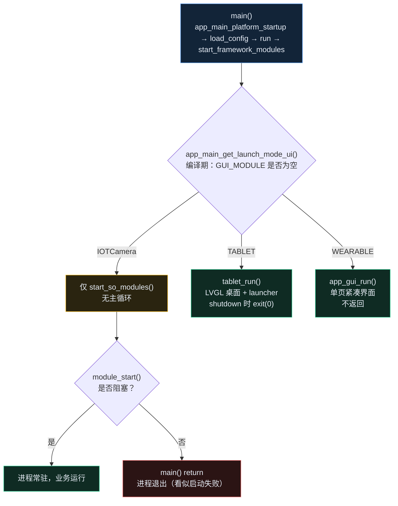
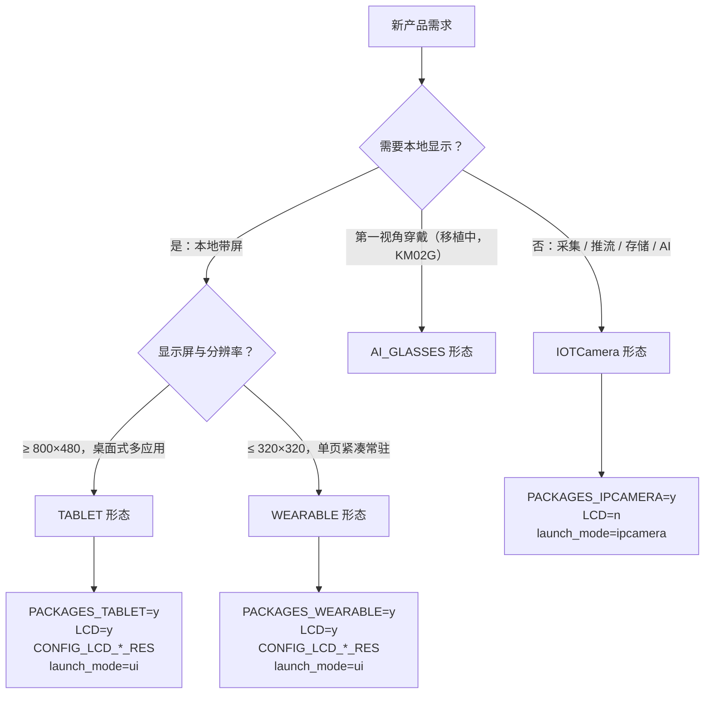

<p align="right"><a href="form-factor.en.md">English</a> | <b>中文</b></p>

# 产品形态（Form Factor）

> **文档定位**：本文定义 Celestia 的**产品形态**，并给出判据、启动分岔、保活责任与选型流程。
>
> 一句话：**形态决定"这个产品带不带显示屏、画面送到哪里、由谁保活、业务放在哪个包"**，
> 它由 `project/<product>/config.mk` 的编译期开关唯一确定，不靠产品名推断。

---

## 1. 形态描述什么

产品形态（form factor）把**显示方式**与**交互密度**两个维度合成一个枚举值，一次约束**四件事**：

| 维度 | 说明 | 判据落在代码哪里 |
|:-----|:-----|:-----------------|
| 显示屏 | 带显示屏（display-enabled）还是无显示（`IOTCamera`） | `CONFIG_BOARD_SUPPORT_LCD`、`app_main_get_launch_mode_ui()` |
| 分辨率区间 | 平板级 ≥ 800×480；穿戴级 ≤ 320×320；无显示为 `LCD=n` | `CONFIG_LCD_HOR_RES` / `CONFIG_LCD_VER_RES` |
| 主循环归属 | 由 GUI 框架跑主循环，还是根本没有主循环 | `tablet_run()` / `app_gui_run()` / 无 |
| 保活责任 | GUI 框架保活，还是业务 SO 自己阻塞保活 | 业务 SO 的 `module_start()` |

采用 **form factor** 这一命名，是因为它与代码里的标识符同名 ——
`CONFIG_APP_PACKAGES_TABLET`、`CONFIG_APP_PACKAGES_WEARABLE`、`CONFIG_APP_PACKAGES_IPCAMERA`
都是可以直接 grep 到的符号，读代码和读文档不需要二次翻译。术语表见
[glossary §2](../glossary.md#2-产品形态-iotcamera-ai_glasses-tablet-wearable重点)。

---

## 2. 形态定义

| 形态 ID | 中文名 | 显示屏 | 一句话 |
|:--------|:-------|:-------|:-------|
| `IOTCamera` | 摄像机 | **无显示屏** | 无 GUI 主循环，采集 → 编码 → 推流 / 存储 / AI，由业务 SO 保活 |
| `AI_GLASSES` | AI 眼镜（**移植中形态**） | 移植中 | 移植中：对应芯片 `KM02G`，第一视角拍摄 + 快速出图 + 端侧 AI，正在移植到本系统 |
| `TABLET` | 平板级 | 带显示屏 | 桌面式多应用界面，LVGL + launcher + 动态加载 App SO |
| `WEARABLE` | 穿戴级 | 带显示屏（小屏） | 单页紧凑界面，常驻单应用，资源预算最紧 |

> **AI 眼镜（`AI_GLASSES`，正在移植到本系统）**：对应芯片 `KM02G`，目标是第一视角影像产品。关键特点：
>
> 1. **快速出图**：上电到首帧的时间要短，走 `FASTSYS` 快启链路（`CONFIG_CELESTIA_FASTSYS`）；
> 2. **第一视角采集**：摄像头即主输入，随身拍摄 / 录像；
> 3. **端侧 AI**：用 NNE / NNA 跑识别类模型；
> 4. **低功耗常驻**：电池供电，工作 / 待机切换与唤醒链路是硬要求；
> 5. **轻量交互**：不做完整桌面，以语音 / 按键 + 状态提示为主。
>
> 源码树当前无 `project/anypi_*` 产品目录、无 `CONFIG_APP_PACKAGES_*` 开关，移植完成前**不参与判据与选型**；显示与交互方案随移植推进确定。

### 2.1 判据矩阵

| 判据 | `IOTCamera` | `AI_GLASSES` | `TABLET` | `WEARABLE` |
|:-----|:----------:|:------------:|:--------:|:----------:|
| 显示屏 | **无显示屏** | 移植中 | 带显示屏，平板级 | 带显示屏，穿戴级 |
| 分辨率区间 | — | 移植中 | 800×480 ～ 1024×600 | ≤ 320×320（当前 240×240） |
| `CONFIG_BOARD_SUPPORT_LCD` | `n` | 移植中 | `y` | `y` |
| `CONFIG_APP_PACKAGES_IPCAMERA` | **`y`** | 移植中 | `n` | `n` |
| `CONFIG_APP_PACKAGES_TABLET` | `n` | 移植中 | **`y`** | `n` |
| `CONFIG_APP_PACKAGES_WEARABLE` | `n` | 移植中 | `n` | **`y`** |
| `settings.json` → `launch_mode` | `ipcamera`（亦接受 `headless`） | 移植中 | `ui` | `ui` |
| `app_main_get_launch_mode_ui()` | `false` | 移植中 | `true` | `true` |
| 主循环 | **无** | 移植中 | `tablet_run()` | `app_gui_run()` |
| 保活责任 | **业务 SO 的 `module_start()`** | 移植中 | GUI 主循环 | GUI 主循环 |
| 应用包目录 | `packages/ipcamera/` | 移植中 | `packages/tablet/` | `packages/wearable/` |

**三条硬规则**：

1. `PACKAGES_TABLET` 与 `PACKAGES_WEARABLE` **编译期互斥**，不得同时 `= y`。
2. **编译期优先于运行期**：GUI 包未编入时，`launch_mode="ui"` 无效，实际仍走无显示路径。
3. 分辨率只由 `CONFIG_LCD_HOR_RES` / `CONFIG_LCD_VER_RES` 决定，与屏幕物理尺寸无关；
   无显示形态（`LCD=n`）不定义分辨率。

> **摄像头不是形态判据**：本项目是影像软件系统，全部 5 个产品均为
> `CONFIG_HW_CAMERA=y` + `CONFIG_FW_MULTIMEDIA_CAMERA=y`。形态差别在**画面送到哪里** ——
> `IOTCamera` 送推流 / 存储 / AI，`AI_GLASSES` 按第一视角拍摄 + 端侧 AI 分析移植
> （显示与交互方案随移植推进确定），`TABLET` / `WEARABLE` 送本地显示。

### 2.2 编译期真源：`app_main/Makefile` 的 `GUI_MODULE`

形态在编译期被翻译成一个 `GUI_MODULE` 变量，决定了链接哪个 launcher。判定的**优先级顺序**如下
（`application/app_main/Makefile`）：

```makefile
GUI_MODULE :=
ifeq ($(CONFIG_APP_PACKAGES_MODULE),)      # 显式指定优先
else
  GUI_MODULE := $(CONFIG_APP_PACKAGES_MODULE)
endif
# 其后依次回退：
#   CONFIG_APP_PACKAGES_TABLET=y   → tablet
#   CONFIG_APP_PACKAGES_WEARABLE=y → wearable
#   CONFIG_APP_GUI_NOVA=y          → tablet    （别名）
#   CONFIG_APP_GUI_LUNA=y          → wearable  （别名）
#   CONFIG_APP_GUI_MODULE=nova     → tablet    （别名）
#   CONFIG_APP_GUI_MODULE=luna     → wearable  （别名）
ifneq ($(GUI_MODULE),)
    GUI_BUILD_DIR := $(BUILD_APPLICATION_DIR)/packages/$(GUI_MODULE)
endif
```

> **全部落空 ⇒ `GUI_MODULE` 为空 ⇒ `IOTCamera` 形态**。这是"无显示"的唯一编译期定义：
> 不链任何 launcher，也就没有 GUI 主循环。

---

## 3. 启动链路的分岔

### 3.1 分岔点在 `main.c` 末尾

`application/app_main/main.c` 的 `app_main_entry()` 在完成平台启动、配置解析、SO 加载、
框架服务打开之后，按编译期宏三选一：

```c
#if defined(CONFIG_APP_PACKAGES_WEARABLE) || defined(CONFIG_APP_GUI_LUNA)
    app_main_start_so_modules();  /* non-blocking for UI companion SOs */
    app_gui_run();                /* does not return */
#elif defined(CONFIG_APP_PACKAGES_TABLET) || defined(CONFIG_APP_GUI_NOVA)
    app_main_start_so_modules();
    tablet_run();                 /* exits via exit(0) after graceful teardown */
#else
    /* ipcamera: module_start must block to keep ipc_main alive. */
    log_warn("no UI package linked (PACKAGES_WEARABLE/TABLET unset); running SO modules only");
    app_main_start_so_modules();
#endif
    return APP_MAIN_OK;
```



### 3.2 保活责任归属（最重要的一节）

| 形态 | 主循环归属 | 保活责任人 | 典型故障现象 |
|:-----|:-----------|:-----------|:-------------|
| `IOTCamera` | **无** | **业务 SO 自己** | **进程秒退** → `module_start()` 未阻塞 |
| `TABLET` | `tablet_run()` | GUI 框架 | 界面黑屏 → 查 LVGL 初始化与 IPU 通道序 |
| `WEARABLE` | `app_gui_run()` | GUI 框架 | 同上；另查 `CONFIG_LCD_*_RES` 与屏参 |

> **无显示形态的头号坑**：主程序执行到 `main()` 末尾正常 `return`，进程随即退出，
> 串口日志看起来一切正常却"启动失败"。**这不是 bug**，而是保活责任没落实 ——
> 无显示形态下唯一能阻塞的地方就是业务 SO 的 `module_start()`。

**业务 SO 的契约**：

```c
int module_init(const char *config_path);  /* 初始化，快速返回 */
int module_start(void);                    /* 主循环，无显示形态必须阻塞不返回 */
```

### 3.3 带显示屏形态的首帧优化（可选）

`TABLET` 形态可开启 `CONFIG_APP_MAIN_DEFER_HEAVY_SO`，把 FreeType / libpng 从 `DT_NEEDED` 中摘出，
改为首帧后再 `dlopen`：

| 文件 | 作用 |
|:-----|:-----|
| `app_main_defer_gui_stubs.c` | 提供 trampoline，首次使用时 `dlopen` 共享库 |
| `app_main_defer_gui_noop.c` | 未开启该开关时的空实现（如 `anypi_nova_dev`） |

> 详见 [celestia-application](../skills/celestia-application.md)。

---

## 4. 为新产品选形态



选完之后，改动应**全部落在 `project/<product>/config.mk` 与板级 `settings.json`**
（唯一合法的产品差异来源），源码不得出现产品分支。

### 4.1 各形态配置清单

**`IOTCamera`（摄像机，无显示屏）**

```makefile
CONFIG_BOARD_SUPPORT_LCD      = n
CONFIG_APP_PACKAGES_TABLET    = n
CONFIG_APP_PACKAGES_WEARABLE  = n
CONFIG_APP_PACKAGES_IPCAMERA  = y
CONFIG_APP_MAIN_TARGET        = luna_dev_main
```

```json
{
  "program": "/usr/sbin/luna_dev_main",
  "launch_mode": "ipcamera",
  "modules": {
    "ipc_cam": {
      "enable": true,
      "type": "so",
      "so_path": "/usr/lib/libipc_cam_app.so",
      "config_path": "/etc/config/fw_video_config.json"
    }
  }
}
```

**`TABLET`（平板级，带显示屏）**

```makefile
CONFIG_BOARD_SUPPORT_LCD      = y
CONFIG_LCD_HOR_RES            = 800      # 或 1024
CONFIG_LCD_VER_RES            = 480      # 或 600
CONFIG_APP_PACKAGES_TABLET    = y
CONFIG_APP_PACKAGES_WEARABLE  = n
CONFIG_APP_PACKAGES_IPCAMERA  = n
CONFIG_APP_MAIN_TARGET        = ipc_main
```

```json
{ "program": "/usr/sbin/ipc_main", "launch_mode": "ui" }
```

**`WEARABLE`（穿戴级，带小屏）**

```makefile
CONFIG_BOARD_SUPPORT_LCD      = y
CONFIG_LCD_HOR_RES            = 240
CONFIG_LCD_VER_RES            = 240
CONFIG_APP_PACKAGES_TABLET    = n
CONFIG_APP_PACKAGES_WEARABLE  = y
CONFIG_APP_PACKAGES_IPCAMERA  = n
CONFIG_APP_MAIN_TARGET        = luna_main
```

```json
{ "program": "/usr/sbin/luna_main", "launch_mode": "ui" }
```

> 上面三段分别取自 `project/anypi_luna_dev/config.mk`、`project/anypi_nova/config.mk`、
> `project/anypi_luna/config.mk` 及各自板级 `settings.json` 的实际取值。
> 三段都另有 `CONFIG_HW_CAMERA = y` 与 `CONFIG_FW_MULTIMEDIA_CAMERA = y`。

---

## 5. 新增一个形态

现有形态覆盖当前全部产品；`AI_GLASSES`（对应芯片 `KM02G`）正在移植到本系统，是当前唯一在推进的新形态。新增形态按下列顺序改动，
**公开头文件与框架层接口不应变化**：

| 步骤 | 改动位置 | 说明 |
|:----:|:---------|:-----|
| 1 | `application/packages/<new>/` | 新建应用包目录，含 `Makefile` 与 `launcher/` |
| 2 | `application/app_main/Makefile` | 在 `GUI_MODULE` 判定链中新增 `CONFIG_APP_PACKAGES_<NEW>` 分支 |
| 3 | `application/app_main/main.c` | 在分岔处新增 `#elif`，给出该形态的主循环入口 |
| 4 | `application/app_main/app_config.c` | 若引入新的 `launch_mode` 取值，在此解析 |
| 5 | `project/<product>/config.mk` | 新增 `CONFIG_APP_PACKAGES_<NEW>` 开关与 `CONFIG_LCD_*_RES` |
| 6 | 本文档 + [glossary §2](../glossary.md#2-产品形态-iotcamera-ai_glasses-tablet-wearable重点) | 同步判据矩阵与产品对照表 |

> 若新形态**不带显示屏**，走无显示路径即可（不链 launcher），
> 只需在 §3.2 明确保活责任归属，不必新增 `GUI_MODULE` 分支。

---

## 6. 常见误区

| 误区 | 事实 |
|:-----|:-----|
| "带显示屏就是 `TABLET`" | 带显示屏只表示有 LCD 且有 GUI 主循环；`TABLET` / `WEARABLE` 看编入哪套包 |
| "`IOTCamera` 就是没有业务" | 无显示形态的业务往往更重（推流、存储、AI），只是没有界面 |
| "改 `launch_mode` 就能切换形态" | 编译期开关决定"能不能"；GUI 包未编入时 `launch_mode="ui"` 无效 |
| "进程秒退是启动失败" | 无显示形态下是 `module_start()` 未阻塞导致 `main()` 正常返回，属保活责任未落实 |
| "无显示形态可以不接摄像头" | 摄像头是影像软件系统的必备输入；无显示只是没有本地显示环节 |
| "分辨率按屏幕尺寸填" | 只填逻辑分辨率 `CONFIG_LCD_HOR_RES` / `VER_RES`，与物理尺寸无关 |

---

## 7. 相关文档

| 主题 | 文档 |
|:-----|:-----|
| 术语与命名对照表 §2 | [glossary.md §2](../glossary.md#2-产品形态-iotcamera-ai_glasses-tablet-wearable重点) |
| 分层 · 契约 · 运行期 · 启动链路 · 构建 | [overview.md](overview.md) |
| 目录职责与新文件放置 | [directory-map.md](directory-map.md) |
| 应用层开发（含无显示业务 SO） | [skills/celestia-application.md](../skills/celestia-application.md) |
| 新增产品与 BOARD | [quick-start/bsp-and-products.md](../quick-start/bsp-and-products.md) |
| 上板排障 | [skills/celestia-debug.md](../skills/celestia-debug.md) |

---

[← 返回文档首页](../README.md) · [架构总览](overview.md) · [术语对照表](../glossary.md)
