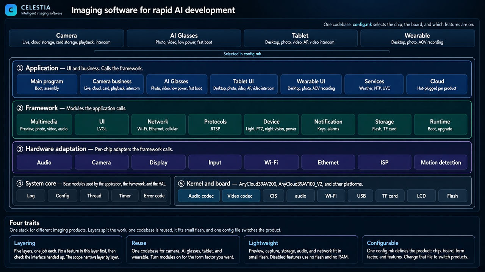
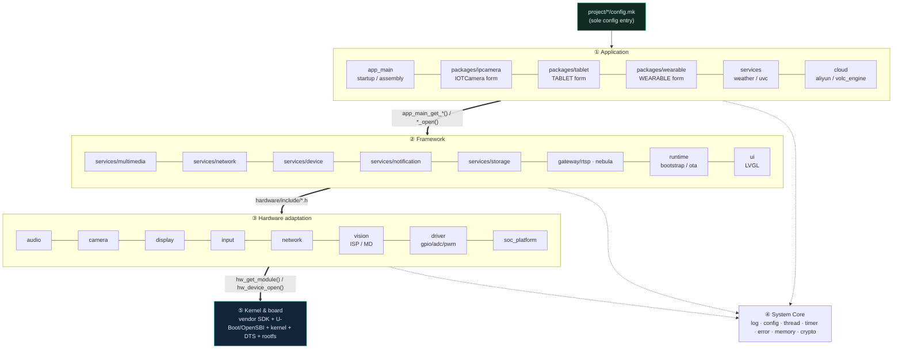
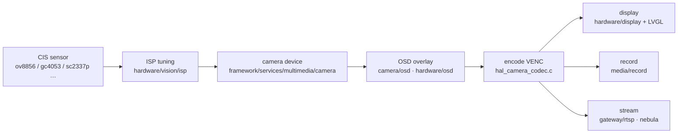

<p align="right"><b>English</b> | <a href="overview.md">中文</a></p>

# Architecture Overview

> **Scope**: Layering model, inter-layer contracts, runtime model, configuration model, startup path, data flow, and build artifacts.
>
> Imaging stack positioning and terminology: [Documentation home](../README.en.md#1-imaging-software-stack-positioning);
> form-factor criteria and selection: [Product Form Factor](form-factor.en.md).

## 1. Overview

Celestia is an **imaging software stack** for **Anyka imaging SoCs**, running on vendor SDKs (Linux or AOS RTOS).
It uses **fixed layering + a single configuration entry** to decouple application / framework / hardware adaptation / system foundation / kernel and board support,
so the same upper-layer sources can build camera, AI glasses, tablet, and wearable form factors.

| Dimension | Conclusion |
|:----------|:-----------|
| **Software nature** | Source collection of application framework + hardware adaptation + foundation libs; builds one main binary + business SOs |
| **Lower dependencies** | Anyka SDK: `AnyCloud39AV200` (RISC-V/Linux), `AnyCloud39AV100_V2` (ARM/Linux), `Sky39AV130` (ARM/AOS RTOS) |
| **Sole legal source of product differences** | `project/<product>/config.mk` → generates `config.h`; runtime adds `settings.json` |
| **Runtime shape** | Single process + multiple threads; business as dynamically loaded `.so` (AOS: static link) |
| **Deliverables** | Per product: main executable + business SOs + rootfs / kernel / flash images (`out/<product>/`) |
| **Vendor-proprietary parts** (obtained separately) | Vendor SoC libs, binaries such as `libak_nne` / `libak_nna` / `libmpi_svp`, models/fonts/flash tools (not covered by Apache-2.0) |

### 1.1 Relationship to the OS

```text
┌──────────────────────────────────────────────────────────┐
│ Celestia (this stack): application / framework /       │
│ hardware / system/core — OS-agnostic, same source on    │
│ all three platforms                                      │
├──────────────────────────────────────────────────────────┤
│ Vendor SDK: Linux (musl / uClibc) or AOS RTOS (single    │
│ static ELF)                                              │
├──────────────────────────────────────────────────────────┤
│ SoC: AnyCloud39AV200 / AnyCloud39AV100_V2 / Sky39AV130   │
└──────────────────────────────────────────────────────────┘
```

**Key constraint**: Upper layers do not branch on OS. Linux vs AOS differences are confined to —
POSIX compatibility in `project/<product>/`, and chip implementations in `hardware/**/hal/<SoC>/`.
Cross-OS porting: [celestia-aos-port](../skills/celestia-aos-port.en.md).

## 2. Layering Model



> The figure maps to the text: top = form factor and config entry; middle = layers ①–⑤; bottom = four design traits.
> If the image does not render, see the equivalent Mermaid diagram at the end of this section.

| Layer | Directory | Responsibility | External contract |
|:------|:----------|:---------------|:------------------|
| **① Application** | `application/` | App UI and business; assemble and drive framework services | `app_main_get_*()` + `*_open()` |
| **② Framework** | `framework/` | Modular services with stable APIs to application | `framework/**/include/*.h` |
| **③ Hardware HAL** | `hardware/` | Per-chip peripherals and media; unified ops upward | `hardware/include/*.h` |
| **④ System Core** | `system/core/` | Business-agnostic foundation; ①②③ depend horizontally | `system/core/include/*.h` |
| **⑤ Kernel / BSP** | `system/<SoC>/<SDK>/`, `project/*/system/` | Vendor SDK, U-Boot/OpenSBI, kernel, DTS, rootfs | Device nodes, ioctl, sysfs |

**Dependency direction**: ① → ② → ③ → ⑤ **vertical**; ①②③ → ④ **horizontal**. Any reverse dependency violates design;
verify with [§10 Architecture constraint self-check](#10-architecture-constraint-self-check).



## 3. Inter-Layer Contracts

### 3.1 Allowed and Forbidden

| Direction | ✅ Allowed | ❌ Forbidden | Consequence if violated |
|:----------|:-----------|:-------------|:------------------------|
| Application → Framework | `app_main_get_*()` handles + matching `*_open()` + public headers | include `hardware/include/*.h` or SoC-private headers | App bound to one chip; SoC change needs business edits |
| Framework → HAL | `hardware/include/*.h` (public HAL contract) | include `hardware/*/hal/<SoC>/` private impl | Framework loses cross-chip reuse |
| Application / Framework / HAL → System Core | `system/core/include/*.h` | System Core depends upward | Circular deps; foundation cannot build alone |
| HAL → Kernel / BSP | `/dev/*` ioctl, sysfs, public SDK APIs | call other HAL modules' internal symbols | Board port drags unrelated modules |

### 3.2 Two Cross-Layer Rules

1. **Own layer first; callee only confirms interface**. When debugging, assume lower layer correct; read callee `include/*.h` signatures and
   `tests/` contracts; drill down only with error codes/logs as evidence. This sets bug triage speed.
2. **Product differences do not sink into shared source**. No `#ifdef CONFIG_SOC_*` product branches in shared code; use
   HAL ops, module switches (`config.mk`), or overlay files.

## 4. Runtime Model

### 4.1 Process and Threads

One resident main process (`CONFIG_APP_MAIN_TARGET`, e.g. `ipc_main`); business in threads and SO modules:

- **Main loop owner is form-dependent**: Display forms run GUI main loop; `IOTCamera` has no main loop,
  relies on blocking business SO `module_start()` (see [form-factor §3.2](form-factor.en.md#32-keep-alive-ownership-most-important)).
- **Threads created via `system/core/thread`**: `thread_create(&id, fn, param, name, stack_size, priority)`,
  **default stack 100KB** (raise via argument if needed), see `system/core/thread/thread.c`.
- **AOS entry differs**: AOS user stack is only 8KB (`0x2000`), insufficient for `multimedia_open()` and
  `module_start()` depth; `main()` spawns worker thread `appMain` first,
  then runs full startup on that thread (`application/app_main/main.c` `KERNEL_AOS` branch).

### 4.2 Business SO Loading

`settings.json` `modules` table declares modules; `app_main` loads at runtime:

```text
modules[].type = "so"
    → dlopen(so_path, RTLD_NOW | RTLD_GLOBAL)      # application/app_main/app_config.c
    → dlsym("module_init")  → init, return quickly
    → dlsym("module_start") → main loop; IOTCamera must block
```

**Why two phases**: `module_init()` only self-inits, runs **before** framework handles are ready;
`module_start()` runs **after** `app_main_start_framework_modules()`, so `app_main_get_*()` handles are safe.

> AOS has no `dlopen`; SOs become `.a` static link; entry names unchanged; see
> [celestia-aos-port](../skills/celestia-aos-port.en.md).

### 4.3 What Lives in One Process

| Component | Source | Notes |
|:----------|:-------|:------|
| Main program | `application/app_main/` | Startup, config parse, service registration, module load, form branch |
| Framework services | `framework/services/*` | In-process singletons; `*_open()` returns handle |
| Business SOs | `application/packages/*`, `application/cloud/*` | Dynamic load; cloud hot-pluggable |
| Resident services | `application/services/*` | Static link (e.g. `weather`, `uvc`) |

## 5. Configuration Model

Celestia has two configuration layers with **non-overlapping roles**:

| Config | When effective | Decides | Location |
|:-------|:---------------|:--------|:---------|
| **`config.mk` → `config.h`** | Compile-time | Chip, SDK version, board, OS, GUI package, feature switches, third-party libs/versions | Hand-written `project/<product>/config.mk` → generated `config.h` (`out/<product>/build/project/include/`) |
| **`settings.json`** | Runtime | `launch_mode`, language, Wi-Fi, storage mode, media paths, device ID, module table, installed apps | `.../board/<BOARD>/rootfs/utils/etc/config/settings.json` |

```text
project/<product>/config.mk
        │  build.sh parses =y entries
        ▼
config.h ──► compile-time trim (build/link or not)
        │
        ▼
main startup ──► settings.json ──► runtime choice (form, which modules)
```

**On conflict**: compile-time wins. If GUI package not built (`PACKAGES_TABLET=n`),
`settings.json` `launch_mode="ui"` will not show UI.

**Config search order**: `APP_SETTINGS_CONFIG` → `--config <path>` → `./settings.json` →
`/etc/config/settings.json`.

> `settings.json` is **source of truth** for product + runtime: `program`, `launch_mode`, `modules`,
> `installed_apps`, etc. New boards ship this one file; do not scatter
> `storage_mode.ini` / `media.ini` / `hal_wifi_config.ini`.

## 6. Startup Path

### 6.1 Common Skeleton (`application/app_main/main.c`)

```text
main()
 ├─ install_crash_handler()
 ├─ [AOS] thread_create("appMain") → run following steps on worker thread   # user stack 8KB only
 ├─ app_main_platform_startup()        # framework_init + notification init
 ├─ runtime_bootstrap_open()           # runtime (version / upgrade / bootstrap info)
 ├─ app_main_load_config()             # parse settings.json
 ├─ app_main_run()                     # dlopen modules and call module_init
 ├─ app_main_start_framework_modules() # multimedia_open / network_open → app_main_register_*
 │                                     # UI mode also runs app_02_load.sh and app_lv_open()
 ├─ app_main_start_so_modules()        # call each module_start()
 └─ enter main loop by form
      ├─ PACKAGES_TABLET=y   → tablet_run()    # TABLET: LVGL desktop, exit(0) on shutdown
      ├─ PACKAGES_WEARABLE=y → app_gui_run()   # WEARABLE: single-page UI, no return
      └─ neither set         → return          # IOTCamera: business SO module_start() must block
```

### 6.2 Form Branch Point

| Form | Main loop owner | Keep-alive | Typical failure |
|:-----|:----------------|:-----------|:----------------|
| `IOTCamera` | Business SO `module_start()` | **Business SO** | Process exits quickly → `module_start()` not blocking |
| Display (`TABLET` / `WEARABLE`) | GUI main loop (`tablet_run()` / `app_gui_run()`) | GUI framework | Black screen → LVGL init and IPU channel order |

> **`IOTCamera` top pitfall**: Normal `return` at end of `main()`; process exits;
> serial log looks like "boot failed". Not a bug — keep-alive not implemented.
> Full detail: [form-factor §3.2](form-factor.en.md#32-keep-alive-ownership-most-important).

### 6.3 Power-On to First Frame (incl. fastsys)

```text
ROM → SPL (fastsys dual DTB) → U-Boot → Kernel → rootfs → /usr/sbin/<main>
                                                       → GUI first frame / business SO stream start
```

Products with `CONFIG_CELESTIA_FASTSYS=y` (nova / nova_dev) use `patch_fastsys/` and fast-boot DTB,
shortening SPL→first frame; **do not mix** fast-boot and non-fast DTB or partition tables.

## 7. Data Flow: One Frame Through the Stack

Typical "capture → overlay → encode → output" path and code locations:



| Stage | Code location | Tunables / pitfalls |
|:------|:--------------|:--------------------|
| Sensor and ISP tuning | `hardware/camera/hal/<SoC>/`, `hardware/vision/isp/` | Per-board `isp_<sensor>_<iface>_<params>_<platform>.conf`; wrong file → color/noise |
| Capture and pipeline | `framework/services/multimedia/camera/` (`device` `core` `capture` `af` `ai`) | Resolution/FPS tied to `fw_video_config.json` |
| OSD overlay | `framework/services/multimedia/camera/osd/` (`osd_manager.c`), `hardware/osd/` | Time/text/logo and rotation |
| Encode | `hardware/include/camera.h` (VENC), `hardware/camera/hal/<SoC>/hal_camera_codec.c` | AV200 **no hardware VDEC**; decode via FFmpeg software |
| Display | `hardware/display/` (`fb_hw.c`), `framework/ui/` | BGR/RGB order via `CONFIG_LV_PORT_IPU_FB_RGB_SWAP` |
| Record | `framework/services/multimedia/media/record/` (`media_record.c`, `record_mamager.c`) | Index/replay: `record_index.c`, `media_replay.c` |
| External stream | `framework/gateway/rtsp_protocol/`, `framework/gateway/nebula_protocol/` | Switches `CONFIG_APP_RTSP` / `CONFIG_APP_NEBULA` |

> Each stage can be validated in that layer's `tests/`:
> `hardware/tests/`, `framework/tests/`, `framework/gateway/*/tests/`, `application/tests/`.

## 8. Build and Artifacts

### 8.1 Dependency Order and Layer Switches

```text
third_party → system/core → hardware → framework → application → package
```

Order matches dependencies; after lower-layer changes, rebuild upper layers.

| Switch | Layer | Switch | Layer |
|:-------|:------|:-------|:------|
| `-t` | third_party | `-f` | framework |
| `-s` | system/core | `-a` | application |
| `-h` | hardware | `-k` | kernel / BSP |

```bash
./build.sh --product-name anypi_nova          # full + package
./build.sh -h -f -a --product-name anypi_luna # changed lower three, rebuild in order
./build.sh --product-name anypi_nova -c -f -a # clean then rebuild
./build.sh --product-name anypi_nova --copy-build-src  # export minimal source only, no compile
./build.sh --product-name anypi_nova --jobs 8 # parallelism
```

Product selection: `--product-name` → cached `out/.build_product_name` → interactive prompt.

### 8.2 Output Layout

```text
out/<product>/
├── install/         # install tree (rootfs assembly source)
├── burntool/        # flash images and tools (.img / .bin / partition table)
├── build/           # intermediates; build/project/include/config.h is generated header
└── release-src/     # minimal source from --copy-build-src (no compile)
```

## 9. Product Matrix and Toolchains

| Product | SoC / SDK | BOARD | Form | Display / resolution | Main binary | OS |
|:--------|:----------|:------|:-----|:---------------------|:------------|:---|
| `anypi_nova` | AnyCloud39AV200 / V1.04 | `PDB_MBD_AK3918AV200_ACTCAM` | `TABLET` | 800×480 | `ipc_main` | linux |
| `anypi_nova_dev` | AnyCloud39AV200 / V1.04 | `EVB_MBD_AK3918AV200` | `TABLET` (EVB) | 1024×600 | `nova_main` | linux |
| `anypi_luna` | AnyCloud39AV100_V2 / V2.05 | `PDB_MBD_KM01W_ACTCAM` | `WEARABLE` | 240×240 | `luna_main` | linux |
| `anypi_luna_dev` | AnyCloud39AV100_V2 / V2.04 | `EVB_MBD_KM01A` | `IOTCamera` | No display | `luna_dev_main` | linux |
| `anypi_mira_dev` | Sky39AV130 / V1.01 | `EVB_CBD_AK3918AV130` | `IOTCamera` | No display | `mira_main` | **aos** |

Form criteria: [glossary §2](../glossary.en.md#2-product-form-factors-iotcamera-ai_glasses-tablet-wearable-focus);
matrix, selection, new form flow: **[Form Factor](form-factor.en.md)**.

**Toolchain by SoC (not product name)**:

| SoC | Toolchain | Third-party arch |
|:----|:----------|:-----------------|
| AnyCloud39AV200 | `riscv64-anyka-linux-musl-` | `riscv` |
| AnyCloud39AV100_V2 | `arm-anycloud-linux-uclibcgnueabi-` | `arm` |
| Sky39AV130 (aos) | `arm-none-eabi-` (`setup_toolchain.sh`, default `/opt/arm-alios-eabi`) | `arm` |

## 10. Architecture Constraint Self-Check

These commands should yield **zero hits** on current code; any hit means layering broken — restore contract calls.

```bash
# ① Application must not reference private HAL impl
grep -rn "hardware/.*hal/" application --include=*.c --include=*.h

# ② Framework must not reference private HAL impl
grep -rn "hardware/.*hal/" framework --include=*.c --include=*.h

# ③ Shared code must not branch products on chip macros
grep -rn "ifdef CONFIG_SOC_\|if defined(CONFIG_SOC_" application framework --include=*.c --include=*.h

# ④ system/core must not depend upward
grep -rn '#include ".*/\(application\|framework\|hardware\)/' system/core --include=*.c
```

## 11. Extension Points

| Goal | Where to change | Rebuild main? |
|:-----|:----------------|:--------------|
| New product (same SoC) | Copy `project/<prod>/`, edit `config.mk` + `board/` | Yes (main name/switches change) |
| New SoC | `hardware/**/hal/<new SoC>/` + `project/<prod>/system/<new SoC>/`, public headers unchanged | Yes |
| New `IOTCamera` business SO | `application/packages/ipcamera/<app>/` + `settings.json` `type: "so"` | No (dynamic SO) |
| New `TABLET` app | `application/packages/tablet/<app>/` + `installed_apps` | No (dynamic SO) |
| New `WEARABLE` app | `application/packages/wearable/<app>/` | No (dynamic SO) |
| New cloud platform | `application/cloud/<vendor>/`, `settings.json` `modules` `type: "so"` | No |
| New framework service | `framework/services/<svc>/` + public header + `*_open()` | Yes |
| Switch UI / headless mode | `settings.json` `launch_mode` (compile switches must enable it) | No |

## 12. Design Constraints and Common Misconceptions

| Misconception | Fact |
|:--------------|:-----|
| "Display means `TABLET`" | Display means LCD + GUI loop; `TABLET` / `WEARABLE` = `tablet` vs `wearable` package |
| "Switch form by `launch_mode` only" | Compile switches decide capability; no GUI package → `launch_mode="ui"` ineffective |
| "`IOTCamera` = no business" | Headless form; business often heavier (stream, storage, AI), no UI |
| "AOS is a separate codebase" | Same source; diff in project overlay POSIX + HAL; `CONFIG_OS_NAME` switch |
| "Change product → change source" | Change `config.mk`; product branches in source violate design |
| "Docs are always right" | On conflict: `tests/` › `*.c` › `*.h` › `Makefile`/`config.mk` › `docs/` |
| "AV200 can use arm third-party libs" | AV200 is RISC-V/musl; third-party must build for `riscv` |
| "Pick any thread stack size" | Default 100KB; AOS main thread 8KB; underflow → crash at startup, may lack logs |

## 13. Related Documentation

| Topic | Document |
|:------|:---------|
| Glossary (`AOS` / `IOTCamera` / `AI_GLASSES` / `TABLET` / `WEARABLE` / EVB …) | [glossary.en.md](../glossary.en.md) |
| Form factor: criteria · branch · selection | [form-factor.en.md](form-factor.en.md) |
| Directory duties and placement | [directory-map.en.md](directory-map.en.md) |
| Application concepts and API | [guide/application.en.md](../guide/application.en.md) · [guide/api-index.en.md](../guide/api-index.en.md) |
| Framework | [guide/framework.en.md](../guide/framework.en.md) · [guide/framework-api.en.md](../guide/framework-api.en.md) |
| Hardware HAL | [guide/hardware-hal.en.md](../guide/hardware-hal.en.md) · [guide/hardware-api.en.md](../guide/hardware-api.en.md) |
| System Core | [guide/system-core.en.md](../guide/system-core.en.md) · [guide/system-core-api.en.md](../guide/system-core-api.en.md) |
| Clone / build / flash | [quick-start/download.en.md](../quick-start/download.en.md) |
| BSP and new products | [quick-start/bsp-and-products.en.md](../quick-start/bsp-and-products.en.md) |

---

[← Back to docs home](../README.en.md) · [Form Factor](form-factor.en.md) · [Directory Map](directory-map.en.md) · [Glossary](../glossary.en.md)