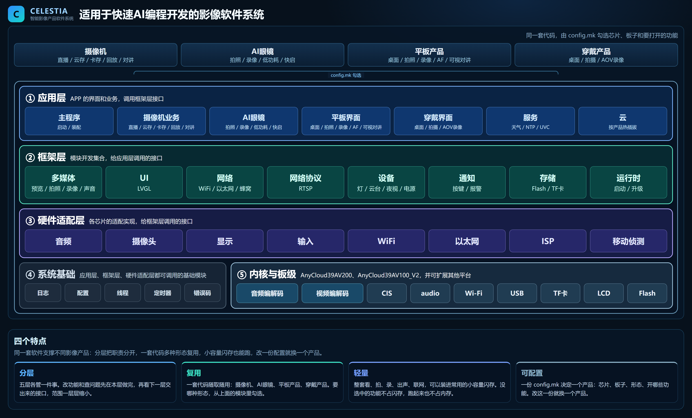
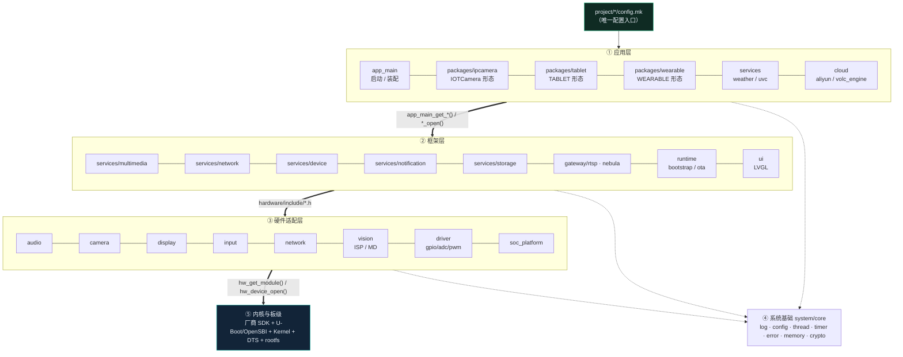
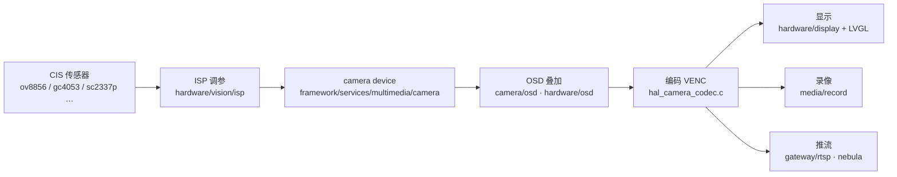

<p align="right"><a href="overview.en.md">English</a> | <b>中文</b></p>

# 架构总览

> **本文范围**：分层模型、层间契约、运行期模型、配置模型、启动链路、数据流与构建产物。
>
> 影像软件系统定位与术语说明见 [文档首页](../README.md#1-影像软件系统定位)；
> 产品形态的判据与选型见 [产品形态（Form Factor）](form-factor.md)。

## 1. 概述

Celestia 是面向**安凯微（Anyka）影像类 SoC** 的影像软件系统，跑在厂商 SDK（Linux 或 AOS RTOS）
之上，用**固定分层 + 单一配置入口**把"应用 / 框架 / 硬件适配 / 系统基础 / 内核与板级"解耦，
使同一套上层源码可以编译出摄像机、AI 眼镜、平板、穿戴四类形态。

| 维度 | 结论 |
|:-----|:-----|
| **软件性质** | 应用框架 + 硬件适配层 + 基础库的源码集合，编译为一个主程序 + 若干业务 SO |
| **依赖的下层** | 安凯微 SDK：`AnyCloud39AV200`（RISC-V/Linux）、`AnyCloud39AV100_V2`（ARM/Linux）、`Sky39AV130`（ARM/AOS RTOS） |
| **产品差异的唯一合法来源** | `project/<product>/config.mk` → 生成 `config.h`；运行期再叠加 `settings.json` |
| **运行形态** | 单进程 + 多线程；业务模块以 `.so` 动态加载（AOS 下改为静态链入） |
| **交付物** | 每产品一个主可执行文件 + 若干业务 SO + rootfs / 内核 / 烧录镜像（`out/<product>/`） |
| **厂商专有部分**（另行获取） | 厂商 SoC 库、`libak_nne` / `libak_nna` / `libmpi_svp` 等二进制、模型/字库/烧录工具（厂商专有，不受 Apache-2.0 覆盖） |

### 1.1 与操作系统的关系

```text
┌──────────────────────────────────────────────────────────┐
│ Celestia（本栈）：application / framework / hardware /    │
│                    system/core，OS 无关，源码三平台同源    │
├──────────────────────────────────────────────────────────┤
│ 厂商 SDK：Linux（musl / uClibc） 或 AOS RTOS（单静态 ELF） │
├──────────────────────────────────────────────────────────┤
│ SoC：AnyCloud39AV200 / AnyCloud39AV100_V2 / Sky39AV130    │
└──────────────────────────────────────────────────────────┘
```

**关键约束**：上层代码不感知 OS 差异。Linux 与 AOS 的差异被收敛到两处 ——
`project/<product>/` 下的 POSIX 兼容层，以及 `hardware/**/hal/<SoC>/` 的芯片实现。
跨 OS 移植流程见 [celestia-aos-port](../skills/celestia-aos-port.md)。

## 2. 分层模型



> 上图与下文一一对应：顶部为形态与配置入口，中间为 ①–⑤ 五层，底部为四个设计特点。
> 若图片无法显示，见本节末尾的 Mermaid 等价图。

| 层 | 目录 | 职责 | 对外契约 |
|:---|:-----|:-----|:---------|
| **① 应用层** Application | `application/` | App 的界面与业务，组装并驱动框架服务 | `app_main_get_*()` + `*_open()` |
| **② 框架层** Framework | `framework/` | 模块化服务集合，向应用层提供稳定接口 | `framework/**/include/*.h` |
| **③ 硬件适配层** Hardware HAL | `hardware/` | 按芯片实现外设与媒体能力，向上统一 ops | `hardware/include/*.h` |
| **④ 系统基础** System Core | `system/core/` | 与业务无关的基础库，被 ①②③ 横向依赖 | `system/core/include/*.h` |
| **⑤ 内核与板级** Kernel / BSP | `system/<SoC>/<SDK>/`、`project/*/system/` | 厂商 SDK、U-Boot/OpenSBI、内核、DTS、rootfs | 设备节点、ioctl、sysfs |

**依赖方向**：① → ② → ③ → ⑤ **纵向**；①②③ → ④ **横向**。任何反向依赖都是设计违规，
可用 [§10 架构约束自检](#10-架构约束自检) 的命令验证。



## 3. 层间契约

### 3.1 允许与禁止

| 方向 | ✅ 允许 | ❌ 禁止 | 违规后果 |
|:-----|:--------|:--------|:---------|
| Application → Framework | `app_main_get_*()` 取句柄 + 对应 `*_open()` + 公开头 | include `hardware/include/*.h` 或 SoC 私有头 | 应用被绑死到某一颗芯片，换 SoC 需改业务代码 |
| Framework → HAL | `hardware/include/*.h`（HAL 公开契约） | include `hardware/*/hal/<SoC>/` 私有实现 | 框架层失去跨芯片能力，多产品线无法复用 |
| Application / Framework / HAL → System Core | `system/core/include/*.h` | System Core 反向依赖任何上层 | 出现循环依赖，基础库无法独立编译 |
| HAL → Kernel / BSP | `/dev/*` ioctl、sysfs、SDK 公开 API | 直接调用其它 HAL 模块内部符号 | 板级移植时牵连无关模块 |

### 3.2 两条跨层规则

1. **本层为主，被调层只确认接口**。排障时先假设下层正确，读被调层 `include/*.h` 的签名与
   `tests/` 契约；只有拿到错误码/日志等证据才下钻。这决定了 bug 定位的收敛速度。
2. **产品差异不下沉到源码**。禁止在公用代码里用 `#ifdef CONFIG_SOC_*` 做产品分支；应通过
   HAL ops 多态、模块开关（`config.mk`）或 overlay 文件实现。

## 4. 运行期模型

### 4.1 进程与线程

单个主程序进程（`CONFIG_APP_MAIN_TARGET`，如 `ipc_main`）常驻，业务以线程与 SO 模块承载：

- **主循环归属由形态决定**：带显示屏的形态跑 GUI 主循环，`IOTCamera` 形态没有主循环，
  靠业务 SO 的 `module_start()` 阻塞（见 [形态 §3.2](form-factor.md#32-保活责任归属最重要的一节)）。
- **线程统一由 `system/core/thread` 创建**：`thread_create(&id, fn, param, name, stack_size, priority)`，
  **默认栈 100KB**（不足时按传入值上调），见 `system/core/thread/thread.c`。
- **AOS 产品的入口不同**：AOS 用户栈只有 8KB（`0x2000`），装不下 `multimedia_open()` 与
  `module_start()` 的调用深度，因此 `main()` 先起一个名为 `appMain` 的工作线程，
  再在工作线程里跑完整启动流程（`application/app_main/main.c` 的 `KERNEL_AOS` 分支）。

### 4.2 业务 SO 的加载

`settings.json` 的 `modules` 表声明模块，`app_main` 在运行时加载：

```text
modules[].type = "so"
    → dlopen(so_path, RTLD_NOW | RTLD_GLOBAL)      # application/app_main/app_config.c
    → dlsym("module_init")  → 初始化，快速返回
    → dlsym("module_start") → 主循环，IOTCamera 形态必须阻塞
```

**两阶段设计的原因**：`module_init()` 只做自身初始化，在框架服务句柄就绪**之前**执行；
`module_start()` 在 `app_main_start_framework_modules()` **之后**执行，此时才能安全调用
`app_main_get_*()` 取到的句柄。

> AOS 无 `dlopen`，SO 全部改为 `.a` 静态链入，入口名不变；详见
> [celestia-aos-port](../skills/celestia-aos-port.md)。

### 4.3 一个进程里有什么

| 组成 | 来源 | 说明 |
|:-----|:-----|:-----|
| 主程序 | `application/app_main/` | 启动、配置解析、服务注册、模块加载、形态分岔 |
| 框架服务 | `framework/services/*` | 进程内单例，`*_open()` 返回句柄 |
| 业务 SO | `application/packages/*`、`application/cloud/*` | 动态加载；云接入可热插拔 |
| 常驻服务 | `application/services/*` | 以 static 方式链入（如 `weather`、`uvc`） |

## 5. 配置模型

Celestia 有两套配置，**职责不重叠**：

| 配置 | 生效时机 | 决定什么 | 位置 |
|:-----|:---------|:---------|:-----|
| **`config.mk` → `config.h`** | 编译期 | 芯片、SDK 版本、板型、OS、GUI 包、功能开关、第三方库与版本 | `project/<product>/config.mk`（手写）→ 生成的 `config.h`（`out/<product>/build/project/include/`） |
| **`settings.json`** | 运行期 | `launch_mode`、语言、Wi-Fi、存储模式、媒体路径、设备 ID、模块加载表、已安装应用 | `.../board/<BOARD>/rootfs/utils/etc/config/settings.json` |

```text
project/<product>/config.mk
        │  build.sh 解析 =y 项
        ▼
config.h ──► 编译期裁剪（编不编、链不链）
        │
        ▼
主程序启动 ──► settings.json ──► 运行期选择（跑什么形态、加载哪些模块）
```

**冲突时的判定顺序**：编译期优先。若 GUI 包未编入（`PACKAGES_TABLET=n`），即使
`settings.json` 写了 `launch_mode="ui"` 也不会出现界面。

**配置搜索顺序**：`APP_SETTINGS_CONFIG` → `--config <path>` → `./settings.json` →
`/etc/config/settings.json`。

> `settings.json` 是产品 + 运行期配置的**唯一真源**：`program`、`launch_mode`、`modules`、
> `installed_apps` 等全部在此声明。新板只投放这一个文件，不要再投放分散的
> `storage_mode.ini` / `media.ini` / `hal_wifi_config.ini`。

## 6. 启动链路

### 6.1 通用骨架（`application/app_main/main.c`）

```text
main()
 ├─ install_crash_handler()
 ├─ [AOS] thread_create("appMain") → 在工作线程内跑下列步骤   # 用户栈仅 8KB
 ├─ app_main_platform_startup()        # framework_init + notification 初始化
 ├─ runtime_bootstrap_open()           # 运行时（版本 / 升级 / 引导信息）
 ├─ app_main_load_config()             # 解析 settings.json
 ├─ app_main_run()                     # dlopen 模块并调用 module_init
 ├─ app_main_start_framework_modules() # multimedia_open / network_open → app_main_register_*
 │                                     # UI 模式再执行 app_02_load.sh 与 app_lv_open()
 ├─ app_main_start_so_modules()        # 调用各模块 module_start()
 └─ 按形态进入主循环
      ├─ PACKAGES_TABLET=y   → tablet_run()    # TABLET：LVGL 桌面，shutdown 时 exit(0)
      ├─ PACKAGES_WEARABLE=y → app_gui_run()   # WEARABLE：单页界面，不返回
      └─ 两者皆无            → return          # IOTCamera：须由业务 SO 的 module_start() 阻塞保活
```

### 6.2 形态的分岔点

| 形态 | 主循环归属 | 保活责任 | 典型故障 |
|:-------|:-----------|:---------|:---------|
| `IOTCamera` | 业务 SO 的 `module_start()` | **业务 SO 自己** | 进程秒退 → `module_start()` 未阻塞 |
| 带显示（`TABLET` / `WEARABLE`） | GUI 主循环（`tablet_run()` / `app_gui_run()`） | GUI 框架 | 界面黑屏 → 查 LVGL 初始化与 IPU 通道序 |

> **`IOTCamera` 形态最容易踩的坑**：主程序执行到 `main()` 末尾正常 `return`，进程随即退出，
> 串口日志看起来一切正常却像"启动失败"。这不是 bug，而是保活责任没落实。
> 完整说明见 [形态 §3.2](form-factor.md#32-保活责任归属最重要的一节)。

### 6.3 上电到首帧（含 fastsys）

```text
ROM → SPL（fastsys 双 DTB） → U-Boot → Kernel → rootfs → /usr/sbin/<主程序>
                                                       → GUI 首帧 / 业务 SO 起流
```

`CONFIG_CELESTIA_FASTSYS=y` 的产品（nova / nova_dev）使用 `patch_fastsys/` 与快启 DTB，
压缩 SPL→首帧时间；**快启与非快启的 DTB、分区表不可混用**。

## 7. 数据流：一帧画面走完全栈

以最常见的"采集 → 叠加 → 编码 → 输出"为例，横向穿过的层次与代码位置：



| 环节 | 代码位置 | 可调 / 易错点 |
|:-----|:---------|:--------------|
| 传感器与 ISP 调参 | `hardware/camera/hal/<SoC>/`、`hardware/vision/isp/` | 每板一套 `isp_<sensor>_<接口>_<参数>_<平台>.conf`，放错表现为偏色/噪点 |
| 采集与出流 | `framework/services/multimedia/camera/`（`device` `core` `capture` `af` `ai`） | 分辨率/帧率与 `fw_video_config.json` 绑定 |
| OSD 叠加 | `framework/services/multimedia/camera/osd/`（`osd_manager.c`）、`hardware/osd/` | 时间/文字/Logo 与旋转处理 |
| 编码 | `hardware/include/camera.h`（VENC）、`hardware/camera/hal/<SoC>/hal_camera_codec.c` | AV200 **无硬件 VDEC**，下行走 FFmpeg 软解 |
| 显示 | `hardware/display/`（`fb_hw.c`）、`framework/ui/` | BGR/RGB 通道序由 `CONFIG_LV_PORT_IPU_FB_RGB_SWAP` 控制 |
| 录像 | `framework/services/multimedia/media/record/`（`media_record.c`、`record_mamager.c`） | 索引与回放：`record_index.c`、`media_replay.c` |
| 对外取流 | `framework/gateway/rtsp_protocol/`、`framework/gateway/nebula_protocol/` | 开关 `CONFIG_APP_RTSP` / `CONFIG_APP_NEBULA` |

> 这条链路的每一段都可以在对应层的 `tests/` 里单独验证：
> `hardware/tests/`、`framework/tests/`、`framework/gateway/*/tests/`、`application/tests/`。

## 8. 构建与产物

### 8.1 依赖顺序与分层开关

```text
third_party → system/core → hardware → framework → application → package
```

顺序与依赖方向一致；改下层后必须重编上层。

| 开关 | 层 | 开关 | 层 |
|:-----|:---|:-----|:---|
| `-t` | third_party | `-f` | framework |
| `-s` | system/core | `-a` | application |
| `-h` | hardware | `-k` | kernel / BSP |

```bash
./build.sh --product-name anypi_nova          # 全量 + 打包
./build.sh -h -f -a --product-name anypi_luna # 改了下三层，按序重编
./build.sh --product-name anypi_nova -c -f -a # 先清理再重编
./build.sh --product-name anypi_nova --copy-build-src  # 只导出最小源码集，不编译
./build.sh --product-name anypi_nova --jobs 8 # 并行度
```

产品选择顺序：`--product-name` → `out/.build_product_name` 缓存 → 交互选择。

### 8.2 产物布局

```text
out/<product>/
├── install/         # 安装树（rootfs 组装来源）
├── burntool/        # 烧录镜像与工具（.img / .bin / 分区表）
├── build/           # 中间产物；build/project/include/config.h 为生成头
└── release-src/     # --copy-build-src 生成的最小源码集（不编译）
```

## 9. 产品矩阵与工具链

| 产品 | SoC / SDK | BOARD | 形态 | 显示屏 / 分辨率 | 主程序 | OS |
|:-----|:----------|:------|:------:|:-------|:-------|:---|
| `anypi_nova` | AnyCloud39AV200 / V1.04 | `PDB_MBD_AK3918AV200_ACTCAM` | `TABLET` | 800×480 | `ipc_main` | linux |
| `anypi_nova_dev` | AnyCloud39AV200 / V1.04 | `EVB_MBD_AK3918AV200` | `TABLET`（EVB） | 1024×600 | `nova_main` | linux |
| `anypi_luna` | AnyCloud39AV100_V2 / V2.05 | `PDB_MBD_KM01W_ACTCAM` | `WEARABLE` | 240×240 | `luna_main` | linux |
| `anypi_luna_dev` | AnyCloud39AV100_V2 / V2.04 | `EVB_MBD_KM01A` | `IOTCamera` | 无显示屏 | `luna_dev_main` | linux |
| `anypi_mira_dev` | Sky39AV130 / V1.01 | `EVB_CBD_AK3918AV130` | `IOTCamera` | 无显示屏 | `mira_main` | **aos** |

形态判定标准见 [术语表 §2](../glossary.md#2-产品形态-iotcamera-ai_glasses-tablet-wearable重点)；
判据矩阵、选型决策与新增形态流程见 **[形态（Form Factor）](form-factor.md)**。

**工具链按 SoC（不是按产品名）**：

| SoC | 工具链 | 第三方库架构 |
|:----|:-------|:------------|
| AnyCloud39AV200 | `riscv64-anyka-linux-musl-` | `riscv` |
| AnyCloud39AV100_V2 | `arm-anycloud-linux-uclibcgnueabi-` | `arm` |
| Sky39AV130（aos） | `arm-none-eabi-`（`setup_toolchain.sh`，默认 `/opt/arm-alios-eabi`） | `arm` |

## 10. 架构约束自检

下列命令在当前代码上**期望输出 0 处**。出现命中即说明分层被破坏，应改回契约调用。

```bash
# ① 应用层不得直接引用 HAL 私有实现
grep -rn "hardware/.*hal/" application --include=*.c --include=*.h

# ② 框架层不得引用 HAL 私有实现
grep -rn "hardware/.*hal/" framework --include=*.c --include=*.h

# ③ 公用代码不得用芯片宏做产品分支
grep -rn "ifdef CONFIG_SOC_\|if defined(CONFIG_SOC_" application framework --include=*.c --include=*.h

# ④ system/core 不得反向依赖上层
grep -rn '#include ".*/\(application\|framework\|hardware\)/' system/core --include=*.c
```

## 11. 扩展点

| 要做什么 | 改哪里 | 是否重编主程序 |
|:---------|:-------|:--------------|
| 新增产品（同 SoC） | 复制 `project/<prod>/`，改 `config.mk` + `board/` | 是（主程序名/开关变化） |
| 新增 SoC | `hardware/**/hal/<新SoC>/` + `project/<prod>/system/<新SoC>/`，公开头不动 | 是 |
| 新增 `IOTCamera` 业务 SO | `application/packages/ipcamera/<app>/` + `settings.json` 声明 `type: "so"` | 否（SO 动态加载） |
| 新增 `TABLET` 形态 App | `application/packages/tablet/<app>/` + 挂进 `installed_apps` | 否（SO 动态加载） |
| 新增 `WEARABLE` 形态 App | `application/packages/wearable/<app>/` | 否（SO 动态加载） |
| 新增云平台 | `application/cloud/<vendor>/`，在 `settings.json` 的 `modules` 声明 `type: "so"` | 否 |
| 新增框架服务 | `framework/services/<svc>/` + 公开头 + `*_open()` | 是 |
| 切换 UI / 无显示运行模式 | `settings.json` 的 `launch_mode`（编译期开关须已编入） | 否 |

## 12. 设计约束与常见误区

| 误区 | 事实 |
|:-----|:-----|
| "带显示就是 `TABLET`" | 带显示只表示带 LCD 且有 GUI 主循环；`TABLET` / `WEARABLE` 看编入 `tablet` 还是 `wearable` 包 |
| "切换形态只是改 `launch_mode`" | 编译期开关决定"能不能"：GUI 包未编入时 `launch_mode="ui"` 无效 |
| "`IOTCamera` 就是没有业务" | `IOTCamera` 是无显示屏形态，业务往往更重（推流、存储、AI），只是没有界面 |
| "AOS 是另一套代码" | 同一套源码，差异收敛在 project overlay 的 POSIX 层与 HAL；`CONFIG_OS_NAME` 切换 |
| "改产品要改源码" | 应改 `config.mk`；源码里出现产品分支即为设计违规 |
| "文档说的一定对" | 冲突时以 `tests/` › `*.c` › `*.h` › `Makefile`/`config.mk` › `docs/` 为序 |
| "AV200 可以跑 arm 第三方库" | AV200 是 RISC-V/musl，第三方库必须按 `riscv` 重编 |
| "线程栈随便给个大值" | 默认 100KB，AOS 上主线程只有 8KB；栈不够表现为启动即崩，且不总有日志 |

## 13. 相关文档

| 主题 | 文档 |
|:-----|:-----|
| 术语与命名（`AOS` / `IOTCamera` / `AI_GLASSES` / `TABLET` / `WEARABLE` / EVB …） | [glossary.md](../glossary.md) |
| 产品形态：判据 · 分岔 · 选型 | [form-factor.md](form-factor.md) |
| 目录职责与新文件放置 | [directory-map.md](directory-map.md) |
| 应用层概念与 API | [guide/application.md](../guide/application.md) · [guide/api-index.md](../guide/api-index.md) |
| 框架层 | [guide/framework.md](../guide/framework.md) · [guide/framework-api.md](../guide/framework-api.md) |
| 硬件适配层 | [guide/hardware-hal.md](../guide/hardware-hal.md) · [guide/hardware-api.md](../guide/hardware-api.md) |
| 系统基础 | [guide/system-core.md](../guide/system-core.md) · [guide/system-core-api.md](../guide/system-core-api.md) |
| 拉码 / 编译 / 烧录 | [quick-start/download.md](../quick-start/download.md) |
| BSP 与新增产品 | [quick-start/bsp-and-products.md](../quick-start/bsp-and-products.md) |

---

[← 返回文档首页](../README.md) · [产品形态](form-factor.md) · [目录地图](directory-map.md) · [术语对照表](../glossary.md)
