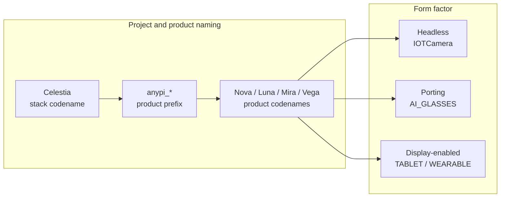

<p align="right"><b>English</b> | <a href="glossary.md">中文</a></p>

# Glossary and Naming Reference

> This is the **authoritative terminology source** for Celestia documentation. Abbreviations, codenames,
> product names, and form-factor descriptions in docs, code comments, and commit messages follow this table.
>
> **Style**: This table records **what terms mean in this project and where they live in code** — not etymology,
> literal translations, or generic industry definitions. When industry usage differs from this project, **this table
> (and the “Code basis” column) wins**.
>
> **Usage**: Read [§0.1 Column definitions](#01-table-style-column-definitions) and [§0.2 Writing rules](#02-writing-rules),
> then look up terms by section; for spelling rules see [§11 Identifier naming conventions](#11-identifier-naming-conventions).

## 0. Celestia in Three Sentences

| Question | Answer |
|:---------|:-------|
| **What is Celestia?** | An **imaging software stack** on top of **Anyka imaging SoC vendor SDKs**: a fixed five-layer split of application / framework / hardware adaptation / system foundation / kernel and board — upper source decoupled from chip and form factor — **change chip in the adaptation layer, change form in one config**. |
| **What problem does it solve?** | **One source tree for multiple imaging product forms** (camera, AI glasses, tablet, wearable), driven by one `project/<product>/config.mk` for chip, board, form, and feature switches — change that file to change product. |
| **Where does it run?** | Anyka SoCs: `AnyCloud39AV200` (RISC-V / Linux), `AnyCloud39AV100_V2` (ARM / Linux), `Sky39AV130` (ARM / AOS RTOS). The upper five layers share source across all three. |



### 0.1 Table Style — Column Definitions

The table uses **three columns by default** with consistent meaning; two exceptions noted below.

| Column | Question answered | Fill rules |
|:-------|:------------------|:-----------|
| **Term / abbreviation** | How the word is written | **Canonical spelling** (case, hyphens, underscores fixed); synonyms on one row |
| **Meaning in this project** | What it refers to in this repo | **Project-specific meaning only**; no generic industry gloss |
| **Code basis** | Where to verify | At least one **grep-friendly** anchor: dir / file / macro / function / command |
| Exception → `Constraints / pitfalls` (§2.3 only) | What people confuse | **Boundary conditions and consequences of misuse** |
| Exception → `Dependency constraints` (§5 only) | What this layer may call | Phrase as “may only / must not” |

**Admission rule for new terms**: Must have both defined meaning and code basis; otherwise not in this table.

### 0.2 Writing Rules

Docs, comments, and commits must follow:

1. **Form IDs ALL CAPS + backticks**: `IOTCamera` / `AI_GLASSES` / `TABLET` / `WEARABLE`;
   as adjectives use lowercase with hyphen: tablet-class, wearable-class, headless.
2. **Config macros ALL CAPS underscore**: `CONFIG_APP_PACKAGES_TABLET`; switches only `y` / `n` (lowercase),
   not `Y` / `1` / `true`.
3. **Paths and filenames verbatim + backticks**; dirs end with `/`: `application/packages/tablet/`,
   `isp_ov8856_mipi_4lane_av200.conf`. Case-sensitive; do not lowercase.
4. **Function names with parentheses**: `tablet_run()`, `module_start()`, `hw_get_module()`.
5. **Product / board / SoC names match code exactly**: `anypi_nova_dev`, `EVB_MBD_AK3918AV200`,
   `AnyCloud39AV200` — scripts concatenate these into paths; typos break build.
6. **Form descriptions use form IDs only**: `IOTCamera` / `AI_GLASSES` / `TABLET` / `WEARABLE`, not vague adjectives.
7. **Do not expand abbreviations elsewhere**: meaning is the “Meaning in this project” column.
8. **One term per concept**: one spelling everywhere; no synonym mixing.

---

## 1. Project, Products, and Codenames

| Term / abbreviation | Meaning in this project | Code basis |
|:--------------------|:------------------------|:-----------|
| **Celestia** | **Project codename** for this imaging stack on Anyka SoCs. Product lines reuse naming: Nova, Luna, Mira, Vega | `CONFIG_CELESTIA_FASTSYS`, `project/anypi_*/config.mk` |
| **anypi** | **Unified prefix** for product directories and names: `anypi_<codename>[_dev]` | `project/anypi_*` |
| **`_dev` suffix** | **EVB evaluation engineering** for development; without `_dev` = mass-production board engineering | `anypi_nova_dev`, `anypi_luna_dev`, `anypi_mira_dev` have `CONFIG_BOARD` = `EVB_*` |
| **Nova** | **`TABLET` product line** (tablet-class). Mass `anypi_nova` (800×480), EVB `anypi_nova_dev` (1024×600) | `project/anypi_nova*`, `application/packages/tablet/` |
| **Luna** | **`WEARABLE` line** (wearable, 240×240 display) `anypi_luna`; `anypi_luna_dev` is same series **`IOTCamera`** (no display) IPC EVB | `project/anypi_luna*`, `application/packages/wearable/` |
| **Mira** | **`IOTCamera` + AOS RTOS** line, EVB only `anypi_mira_dev` (`Sky39AV130`) | `project/anypi_mira_dev/config.mk` (`CONFIG_OS_NAME=aos`) |
| **Vega** | **Planned next-gen codename** (Kids KEY direction). **No product directory yet**; `application/packages/` currently `common` / `ipcamera` / `tablet` / `wearable` | `docs/guide/application.en.md` (placeholder scaffold); `framework/services/network/Makefile` cellular module note (EC200U) |
| **Main program target** | **Single main executable** per product from `CONFIG_APP_MAIN_TARGET` (default `ipc_main`), installed to `/usr/sbin/` | `ipc_main` · `nova_main` · `luna_main` · `luna_dev_main` · `mira_main` |

> **Do not memorize codename ↔ directory mapping**: `project/<product>/config.mk` `CONFIG_APP_MAIN_TARGET`
> sets main binary name; `CONFIG_APP_PACKAGES_*` sets GUI package; together they determine form.

---

## 2. Product Form Factors IOTCamera AI_GLASSES TABLET WEARABLE (Focus)

This project uses **product form factor** for display and interaction shape (device physical/interaction form). One value constrains
**display, resolution band, app package, main-loop owner, keep-alive**.

### 2.1 Form Overview

| Form ID | Name | Display | Resolution band | Code values |
|:--------|:-----|:--------|:----------------|:------------|
| `IOTCamera` | IP camera | **No display** | — | `CONFIG_APP_PACKAGES_IPCAMERA=y` + `launch_mode="ipcamera"` |
| `AI_GLASSES` | AI glasses (**porting form**) | Porting | Porting | Porting (chip `KM02G`), not landed yet |
| `TABLET` | Tablet-class | Display-enabled | 800×480 ~ 1024×600 | `CONFIG_APP_PACKAGES_TABLET=y` + `launch_mode="ui"` |
| `WEARABLE` | Wearable-class | Display-enabled (small) | ≤ 320×320 (currently 240×240) | `CONFIG_APP_PACKAGES_WEARABLE=y` + `launch_mode="ui"` |

> **No display = `IOTCamera`** (runtime mode `headless`); **display = `TABLET` ∪ `WEARABLE`**.
> `AI_GLASSES` is being ported; display scheme TBD; excluded from this rule until then.
> Code criterion (`application/app_main/main.c`):
> `int headless = !app_main_get_launch_mode_ui();`

> **Camera is not a form criterion**: All five products use `CONFIG_HW_CAMERA=y` +
> `CONFIG_FW_MULTIMEDIA_CAMERA=y`. Form differs in **where frames go**, not whether a camera exists.

### 2.2 Decision Matrix (map your product here)

| Criterion | `IOTCamera` | `AI_GLASSES` | `TABLET` | `WEARABLE` |
|:----------|:-----------:|:------------:|:--------:|:----------:|
| Display | **No display** | Porting | Display, tablet-class | Display, wearable-class |
| Resolution band | — | Porting | 800×480 ~ 1024×600 | ≤ 320×320 |
| `CONFIG_BOARD_SUPPORT_LCD` | `n` | Porting | `y` | `y` |
| `CONFIG_APP_PACKAGES_IPCAMERA` | **`y`** | Porting | `n` | `n` |
| `CONFIG_APP_PACKAGES_TABLET` | `n` | Porting | **`y`** | `n` |
| `CONFIG_APP_PACKAGES_WEARABLE` | `n` | Porting | `n` | **`y`** |
| `settings.json` → `launch_mode` | `ipcamera` (also `headless`) | Porting | `ui` | `ui` |
| Main loop | **None** | Porting | `tablet_run()` | `app_gui_run()` |
| Keep-alive | **Business SO `module_start()` blocks** | Porting | GUI main loop | GUI main loop |
| App package dir | `application/packages/ipcamera/` | Porting | `application/packages/tablet/` | `application/packages/wearable/` |

**Two hard rules**:

1. `TABLET` and `WEARABLE` **mutually exclusive at compile time**; not both `= y`.
2. **Compile-time first**: GUI package not built → `launch_mode="ui"` ineffective; headless path still runs.

### 2.3 Term Details

| Term | Meaning in this project | Constraints / pitfalls |
|:-----|:------------------------|:-----------------------|
| **IOTCamera** | **Camera form**: `PACKAGES_IPCAMERA` + `launch_mode="ipcamera"`, no display | Capture → encode → stream / storage / AI; business in `packages/ipcamera/` SO; keep-alive via `module_start()` |
| **ai_glasses** | **AI glasses form (porting)**: first-person + **fast first frame** + on-device AI; chip `KM02G` | Porting; no product dir or `PACKAGES_*` yet; display/interaction TBD |
| **display-enabled** | Device **has LCD and runs GUI main loop** | Means display + loop, not which form; `TABLET` vs `WEARABLE` from `PACKAGES_*` |
| **headless** | No LCD, no GUI main loop **runtime mode** | Same as code `headless`; currently `IOTCamera`; **must block in business SO** — top cause of “process exits on board” |
| **tablet-class** | **`packages/tablet` desktop multi-app UI**, display-enabled | Resolutions: `anypi_nova` 800×480, `anypi_nova_dev` 1024×600. Criterion `PACKAGES_TABLET=y`, **not physical panel size** |
| **wearable-class** | **`packages/wearable` single-page compact UI**, small display | Currently only `anypi_luna` 240×240. Much tighter flash/RAM than tablet |
| **tablet / wearable** | **Directory names** for the two GUI packages; two presentations under `launch_mode=ui` | Mutually exclusive at compile time; names match form IDs |
| **`CONFIG_LCD_HOR_RES` / `VER_RES`** | LCD **logical resolution** SSOT | From `config.mk` → `config.h`; `LCD_*_RES_MAX` in code are fallback defaults; undefined for headless |
| **`CONFIG_HW_CAMERA` / `CONFIG_FW_MULTIMEDIA_CAMERA`** | Camera path **HAL** and **framework** switches | All products `y`; camera is required input, not a form criterion |
| **launch_mode** | Runtime form switch in `settings.json` | Compile decides *can*; `launch_mode` decides *how*; compile wins on conflict |

### 2.4 Form × Product Map

| Product | Form | Display / resolution | App package | Main binary | `CONFIG_OS_NAME` |
|:--------|:----:|:---------------------|:------------|:------------|:-----------------:|
| `anypi_nova` | `TABLET` | Display 800×480 | `tablet` | `ipc_main` | `linux` |
| `anypi_nova_dev` | `TABLET` | Display 1024×600 | `tablet` | `nova_main` | `linux` |
| `anypi_luna` | `WEARABLE` | Display 240×240 | `wearable` | `luna_main` | `linux` |
| `anypi_luna_dev` | `IOTCamera` | No display | `ipcamera` | `luna_dev_main` | `linux` |
| `anypi_mira_dev` | `IOTCamera` | No display | `ipcamera` | `mira_main` | **`aos`** |

> Full criteria, startup branch, new form flow: **[Product Form Factor](architecture/form-factor.en.md)**.

---

## 3. OS and Runtime

| Term / abbreviation | Meaning in this project | Code basis |
|:--------------------|:------------------------|:-----------|
| **AOS** | **RTOS runtime on Anyka platform**, `CONFIG_OS_NAME=aos`. Currently only `anypi_mira_dev` (`Sky39AV130`). Traits: **single static user ELF**, no MMU / no processes / no dynamic libs; all `.so` → `.a` static link; `dlopen` stubbed | `project/anypi_mira_dev/config.mk`, `project/anypi_mira_dev/setup_toolchain.sh`, `scripts/build.sh` (`CONFIG_OS_NAME = aos` branch) |
| **AOS toolchain** | `arm-none-eabi-`, default `/opt/arm-alios-eabi`; if missing, SDK tarball auto-extracts to `out/<product>/toolchain/` | `setup_toolchain.sh` |
| ↳ Naming note | Toolchain dir `arm-alios-eabi` is **historical Anyka SDK naming**; not AliOS app framework dependency; docs/code use `aos` as OS id | Same as above |
| **Linux** | `CONFIG_OS_NAME=linux`: processes, shared libs, full POSIX | `project/anypi_nova*`, `project/anypi_luna*` |
| **musl / uClibc** | RISC-V (AV200) **musl** (`riscv64-anyka-linux-musl-`); ARM (AV100_V2) **uClibc** (`arm-anycloud-linux-uclibcgnueabi-`). **Different C libs ⇒ do not mix prebuilt artifacts** | Per-SoC SDK `rules.mk`, `docs/skills/celestia-scripts.en.md` |
| **rootfs** | Read-only root filesystem image; product diff via `project/<product>/system/<SoC>/<SDK>/board/<BOARD>/rootfs/` overlay | `build_rootfs.sh` |
| ↳ Path difference | Linux: `rootfs/utils/etc/config/`; AOS (`anypi_mira_dev`): `rootfs/resource/etc/config/` | `project/anypi_mira_dev/system/Sky39AV130/V1.01/board/.../rootfs/resource/etc/config/` |
| **POSIX compatibility layer** | AOS shims (thread/signal/time/socket, etc.) only in project overlay and HAL; **must not pollute shared code** | `docs/skills/celestia-aos-port.en.md` |

---

## 4. Chips, SDK, and Board

| Term / abbreviation | Meaning in this project | Code basis |
|:--------------------|:------------------------|:-----------|
| **SoC** | Chip model. Three in this project: `AnyCloud39AV200`, `AnyCloud39AV100_V2`, `Sky39AV130` | `CONFIG_SOC_PLATFORM` |
| **AV200 / AV100_V2 / AV130** | **Short names** for above SoCs (`AnyCloud39AV200` → AV200). “Nova uses AV200” means this | Same |
| **AK3918AV200 / AK3918AV130 / KM01W / KM01A** | **Board/module chip identifiers** in board names, not full SoC platform names | `CONFIG_BOARD` |
| **SDK** | **Vendor chip software package**: toolchain rules, libs, headers, flash tools | `system/<SoC>/<SDK_VERSION>/` (vendor-provided, placed per product) |
| **PDK** | Doc term for “vendor platform bundle”, same layer as SDK: `system/<SoC>/<SDK_VERSION>/` | `docs/README.en.md`, `docs/quick-start/*` |
| **SDK version** | `CONFIG_SOC_SDK_VERSION`, e.g. `V1.04` / `V2.05` / `V1.01`, matches SDK dir name (some comments say `CONFIG_SDK_VERSION`; prefer `CONFIG_SOC_SDK_VERSION`) | Each `config.mk` |
| **BSP** | **Board support package**: U-Boot / OpenSBI / kernel / DTS / rootfs / flash config. Lives in `system/<SoC>/<SDK>/` and `project/<product>/system/.../board/<BOARD>/` | `build.sh -k` |
| **BOARD** | Board name `<board-form>_<carrier-type>_<chip/module>[_<product-form>]`, must match dir under `system/<SoC>/<SDK>/board/` | `CONFIG_BOARD` |
| ↳ **EVB** | Evaluation board, development (all `_dev` products) | `EVB_MBD_AK3918AV200`, `EVB_MBD_KM01A`, `EVB_CBD_AK3918AV130` |
| ↳ **PDB** | Product / mass-production board engineering | `PDB_MBD_AK3918AV200_ACTCAM`, `PDB_MBD_KM01W_ACTCAM` |
| ↳ **MBD** | **Carrier type**: mainboard | `PDB_MBD_*` / `EVB_MBD_*` |
| ↳ **CBD** | **Carrier type**: core board (module carrier) | `EVB_CBD_AK3918AV130` |
| ↳ **ACTCAM** | **Product form marker**: action camera | `PDB_MBD_AK3918AV200_ACTCAM` |
| **overlay** | Product **incremental layer** over vendor SDK: same name overrides, new files append; do not edit SDK originals | `project/<product>/system/<SoC>/<SDK>/` |
| **patch** | **Patch set** applied to SDK sources before build | `.../patch/`, `.../patch_fastsys/` |
| **fastsys** | **SPL fast-boot scheme**: dual DTB + `patch_fastsys/`, shorter reset→first frame | `CONFIG_CELESTIA_FASTSYS=y` (nova / nova_dev), plus `CONFIG_FAST_*` |
| **DTB / DTS** | Device tree binary/source; board `config.mk` `CONFIG_DTB_NAME` selects which | `board/<BOARD>/config.mk` |
| **SPL** | Secondary program loader; fastsys touch point | `patch_fastsys/os/` |

> **Do not memorize board names**: `CONFIG_BOARD` equals the directory name under `system/<SoC>/<SDK>/board/`,
> which contains `config.mk` (DTB, partitions, wpa_supplicant, etc.) and `README.md`.

---

## 5. Architecture Layers and Interfaces

| Layer / term | Meaning in this project | Dependency constraints | Code basis |
|:-------------|:------------------------|:-------------------------|:-----------|
| **Application** | UI and business: main assembly, GUI apps, cloud, system services | May only call framework via `app_main_get_*()` + `*_open()`; **must not** include HAL or BSP private headers | `application/` |
| **Framework** | Modular services: multimedia, network, device, notification, storage; plus `runtime/`, `ui/` | May only include `hardware/include/*.h`; **must not** include `hardware/*/hal/<SoC>/` private impl | `framework/` |
| **Hardware HAL** | Per-chip peripheral/media impl, unified ops upward | Down via `/dev/*` ioctl / sysfs to BSP; **must not** depend on Framework | `hardware/` |
| **System Core** | Business-agnostic foundation: log, config, thread, timer, errors, containers, memory, crypto | **Horizontally** used by upper three; **must not** depend upward | `system/core/` |
| **BSP / Kernel** | Vendor SDK + board config | — | `system/<SoC>/<SDK>/` |
| **`*_open()`** | Framework service **init entry**, returns handle | Sole legal app entry | `multimedia_open()`, `network_open()`, etc. |
| **`app_main_get_*()`** | App accessors for registered service handles | Pair with `*_open()` | `application/app_main/` |
| **`hw_get_module()` / `hw_device_open()`** | HAL module/device load (Android HAL-style) | Sole Framework→HAL entry | `hardware/include/hardware.h` |
| **service** | Framework capability unit | One service one dir, one public header | `framework/services/*` |
| **gateway** | External protocol stacks (`nebula_protocol`, `rtsp_protocol`) | Same level as service, network-facing | `framework/gateway/*` |
| **package** | Independently buildable/loadable app business unit | `tablet` / `wearable` / `ipcamera` / `common` (`vega` planned, not landed) | `application/packages/*` |
| **SO module** | Business module `dlopen`'d by main | Entry contract `module_init(config_path)` / `module_start()` | `application/app_main/app_config.c` |
| **`module_init` / `module_start`** | SO **init** and **main loop** entry | `module_start()` must block; `IOTCamera` keep-alive | Same |
| **Horizontal foundation / vertical layering** | Two words for dependency direction | Vertical: App → FW → HAL → BSP; horizontal: any layer → System Core | — |

---

## 6. Configuration and Runtime

| Term / abbreviation | Meaning in this project | Code basis |
|:--------------------|:------------------------|:-----------|
| **`config.mk`** | **Sole product config entry**: chip, SDK, board, form, features. One per product | `project/<product>/config.mk` |
| **`config.h`** | C macro header **auto-generated** from `config.mk` `CONFIG_*`; compile-time; **artifact under out/**, not in source tree | `scripts/build.sh` (`PROJECT_GEN_INCLUDE_DIR=$OUT_ROOT/build/project/include`) |
| ↳ Hand-written headers | `project/<product>/include/` **hand-written**, not generated: `app_globle_config.h`, `app_product_config.h`, `lv_conf.h` | `project/anypi_nova/include/` |
| **`settings.json`** | **Product + runtime config SSOT**: `program`, `launch_mode`, `language`, `wifi`, `storage`, `media`, `device`, `dormancy`, `modules`, `installed_apps` | `board/<BOARD>/rootfs/utils/etc/config/settings.json` (AOS: `rootfs/resource/etc/config/`) |
| **Config search order** | `APP_SETTINGS_CONFIG` env → `--config` arg → `./settings.json` → `/etc/config/settings.json` | `application/app_main/` |
| **`installed_apps.json`** | App manifest (legacy); prefer `settings.json` `installed_apps` | `tablet_app_registry` |
| **`fw_*` / `hal_*` config** | Framework and HAL INI/JSON (video, audio, ISP, MD, etc.); merged parts in `settings.json` keep legacy files as fallback | `board/<BOARD>/rootfs/utils/etc/config/` |
| **`modules`** | `settings.json` table for app/service load: `type` (`so` / `static`), `config_path`, enable bit | Same |

---

## 7. Business and Imaging Capabilities

| Term / abbreviation | Meaning in this project | Code basis |
|:--------------------|:------------------------|:-----------|
| **ISP** | Image signal processing: 3A, denoise, color. Per-board tuning files vary with sensor and lane count | `hardware/vision/isp/`; e.g. `board/<BOARD>/rootfs/utils/etc/config/isp_ov8856_mipi_4lane_av200.conf` |
| **CIS** | Image sensor. Model in ISP filename (e.g. `ov8856`, `gc4053`, `sc2337p`, `os05a20`) | `hardware/camera/`; `isp_<sensor>_<iface>_<params>_<platform>.conf` |
| **IPU** | Display-side image processing. BGR/RGB order from board macro; wrong → color cast | `hardware/display/` (`fb_hw.c`); `CONFIG_LV_PORT_IPU_FB_RGB_SWAP` |
| **OSD** | Video overlay: time, text, logo (`osd_time` / `osd_text` / `osd_logo`), rotation | `hardware/osd/` (`osd_hw.c`, `osd_rotation.c`) |
| **AF** | Autofocus via VCM (voice coil motor) | `hardware/camera/hal/<SoC>/hal_camera_vcm.c` |
| **AOV** | Low-power always-recording: record while screen off/low FPS; key for wearable | Board `config.mk` fast-boot/AOV items (`fast_aov` / `aov`) |
| **VENC / VDEC** | Video encode/decode. AV200 **no hardware VDEC**; video call decode via **software H.264** | `third_party/ffmpeg` (`DECODE_ONLY` trim), `hardware/vision/` |
| **DMIC / ADC MIC** | Digital vs analog mic, per board capability | `CONFIG_BOARD_SUPPORT_DMIC`; `hardware/audio/` |
| **IRCut** | IR filter switch; merged into night vision module, not standalone | — |
| **PTZ** | Pan-tilt-zoom | `CONFIG_FW_DEVICE_PTZ` |
| **RTSP** | Real-time streaming, external pull path | `framework/gateway/rtsp_protocol`; `CONFIG_APP_RTSP` |
| **Nebula** | P2P and signaling for intercom, cloud preview | `framework/gateway/nebula_protocol`; `CONFIG_APP_NEBULA` |
| **UVC** | USB video class, device as USB camera | `application/services/uvc` (static); `CONFIG_APP_UVC` |
| **Cloud platform** | Hot-pluggable cloud SO: `aliyun`, `volc_engine` | `application/cloud/`; `CONFIG_APP_CLOUD_*` (`tuya` switch exists, not implemented) |

---

## 8. Build, Deploy, and Ops

| Term / abbreviation | Meaning in this project | Code basis |
|:--------------------|:------------------------|:-----------|
| **Layered build** | Build one layer in dependency order, validate per layer | `-t` third_party · `-s` system/core · `-h` hardware · `-f` framework · `-a` application · `-k` kernel/BSP |
| **`build.sh`** | Sole build entry: product select, toolchain, layered build, package | `./build.sh --product-name <product>` |
| **`out/<product>/`** | Build output root: `install/`, `burntool/`, `release-src/`, `build/project/include/` (generated `config.h`) | `scripts/build.sh` |
| **PASS/FAIL** | On-board validation closure (serial log + key path checks) | `docs/quick-start/deploy.en.md` |
| **Bug A–G** | Debug skill fault taxonomy, maps symptoms to layer | `docs/skills/celestia-debug.en.md` |
| **16MB NOR** | Low-cost flash budget, drives partitions and trimming | `docs/skills/celestia-project.en.md` |

---

## 9. Third-Party Components (`third_party/`)

| Component | Meaning in this project | Code basis |
|:----------|:------------------------|:-----------|
| **LVGL** | Embedded GUI (9.3.0): main GUI for display forms (`TABLET` / `WEARABLE`); `liblvgl` static in main | `third_party/lvgl/`, `CONFIG_THIRD_PARTY_LVGL` |
| **AWTK** | Alternate GUI (1.7.1): retained, default off | `CONFIG_THIRD_PARTY_AWTK=n` |
| **FFmpeg** | A/V demux/codec (7.0): `MINIMAL` / `DECODE_ONLY` trim | `third_party/ffmpeg/` |
| **mbedTLS** | TLS/crypto (2.28.10): HTTPS via mbedTLS not OpenSSL, saves rootfs size | `third_party/mbedtls/` |
| **cJSON / minIni / iniparser** | Parsers: `settings.json` uses cJSON, `fw_*.ini` uses INI parsers | `third_party/` each |
| **tslib** | Touch calibration (1.22): params from board `ts.rgb.conf` / `ts_calibrate.rgb.conf` | `third_party/tslib/` |
| **zxing** | QR codes for scan apps | `third_party/zxing/` |
| **jerryscript** | Lightweight JS engine, default off | `CONFIG_THIRD_PARTY_JERRYSCRIPT=n` |
| **libwebsockets** | WebSocket, default off | `CONFIG_THIRD_PARTY_WSS=n` |
| **freetype / libpng / jpegdec** | Fonts and image decode, trimmed as needed (`freetype` `MINIMAL`) | `third_party/` each |

---

## 10. Documentation and Collaboration

| Term | Meaning in this project | Code basis |
|:-----|:------------------------|:-----------|
| **skill** | **Executable knowledge** for AI coding assistants: boundaries, commands, debug paths | `docs/skills/<name>.en.md` |
| **guide** | Human-facing **concepts and API** | `docs/guide/` |
| **quick-start** | Linear path: clone → build → flash → validate | `docs/quick-start/` |
| **Source-of-truth priority** | When docs vs code conflict: `tests/` › `*.c` › `*.h` › `Makefile` / `build.sh` / `config.mk` › `docs/` | `docs/CONTRIBUTING.en.md` |
| **DCO** | Developer Certificate of Origin; commits need `git commit -s` | `docs/CONTRIBUTING.en.md` |

---

## 11. Identifier Naming Conventions

This chapter defines **how names are spelled**. Follow when writing code, adding dirs, or writing docs.

### 11.1 Naming Rules

| Category | Rule | Good | Bad / pitfalls |
|:---------|:-----|:-----|:----------------|
| **Product directory** | `anypi_<codename>[_dev]`, all lower, `_` separator | `anypi_nova`, `anypi_nova_dev` | `anypiNova`, `nova_project`, `anypi-nova` |
| **Product codename** | Celestial names, **capitalized**; backticks optional in docs | Nova · Luna · Mira · Vega | `NOVA`, `vega` (as codename) |
| **SoC name** | Exact match to `CONFIG_SOC_PLATFORM`, case-sensitive | `AnyCloud39AV200`, `AnyCloud39AV100_V2`, `Sky39AV130` | `anycloud39av200`, `AK3918AV200` (silicon marking, not platform name) |
| **SoC short name** | Drop prefix, keep tail: `AnyCloud39AV200` → `AV200` | AV200 · AV100_V2 · AV130 | `av200`, `AV200_V2` (redundant) |
| **SDK version dir** | `V<major>.<minor>`, capital V, two-digit minor | `V1.04`, `V2.05`, `V1.01` | `v1.04`, `1.04` |
| **Board name** | `<EVB\|PDB>_<MBD\|CBD>_<chip/module>[_<form>]` | `PDB_MBD_AK3918AV200_ACTCAM`, `EVB_MBD_KM01A`, `EVB_CBD_AK3918AV130` | Invented name → no matching dir under `board/`, build fails |
| **Main program target** | `<suffix>_main`, from `CONFIG_APP_MAIN_TARGET`, default `ipc_main` | `nova_main`, `luna_dev_main` | Product prefix (`anypi_nova_main`), same as package name |
| **Config macro** | `CONFIG_<domain>_<object>`, ALL CAPS underscore | `CONFIG_APP_PACKAGES_TABLET`, `CONFIG_BOARD_SUPPORT_LCD` | `CONFIG_app_lcd`, `CONFIG-BOARD-LCD` |
| **Config values** | Binary switches only `y` / `n`; numbers/strings as typed | `= y`, `= n`, `= 1`, `= aos` | `= Y`, `= true`, `= yes` |
| **HAL impl dir** | `hardware/<capability>/hal/<full SoC name>/` | `hardware/camera/hal/AnyCloud39AV200/`, `hardware/vision/isp/hal/Sky39AV130/` | Short name (`hal/AV200/`), per-product dirs |
| **Framework service dir** | `framework/services/<name>/`, public entry `<name>_open()` | `framework/services/multimedia/` → `multimedia_open()` | Service name ≠ entry name |
| **App package dir** | `application/packages/<package>/`, name from form or business | `tablet`, `wearable`, `ipcamera`, `common` | Per-product (`packages/nova/`) |
| **SO module entry** | Fixed spelling `module_init(config_path)` + `module_start()` | — | Custom entry names (loader cannot find symbol) |
| **ISP tuning file** | `isp_<sensor>_<iface>_<params>[_slave]_<platform>.conf` | `isp_ov8856_mipi_4lane_av200.conf`, `isp_os05a20_mipi_2lane_km01a.conf`, `isp_sc2337p_mipi_2lane_slave_av130.conf` | Platform segment = full SoC name; lane count ≠ hardware |

### 11.2 Config Macro Prefix — Domain Map

The second segment of `CONFIG_*` is the **domain** — tells which layer consumes it.

| Prefix | Layer | Decides | Example macros |
|:-------|:------|:--------|:-----------------|
| `CONFIG_APP_*` | Application | App packages, main binary, cloud, RTSP / UVC / Nebula business switches | `CONFIG_APP_PACKAGES_TABLET`, `CONFIG_APP_MAIN_TARGET`, `CONFIG_APP_RTSP` |
| `CONFIG_BOARD_*` | Board | Board hardware caps (LCD, DMIC …) | `CONFIG_BOARD_SUPPORT_LCD`, `CONFIG_BOARD_SUPPORT_DMIC` |
| `CONFIG_FW_*` | Framework | Device / network / multimedia service switches | `CONFIG_FW_DEVICE_PTZ` |
| `CONFIG_HW_*` | HAL | HAL implementation detail | `CONFIG_HW_DISPLAY_COLOR_SWIZZLE` |
| `CONFIG_SOC_*` / `CONFIG_CHIP_*` | Chip | SoC platform, SDK version, chip family | `CONFIG_SOC_PLATFORM`, `CONFIG_SOC_SDK_VERSION`, `CONFIG_CHIP_TYPE` |
| `CONFIG_OS_NAME` | Runtime | Target OS: `linux` / `aos` | `CONFIG_OS_NAME` |
| `CONFIG_CELESTIA_*` / `CONFIG_FAST_*` | Project features | Fast-boot and project-level features | `CONFIG_CELESTIA_FASTSYS`, `CONFIG_FAST_MODE`, `CONFIG_FAST_SENSOR_NUM` |
| `CONFIG_THIRD_PARTY_*` | Third-party | Whether component is built in | `CONFIG_THIRD_PARTY_LVGL`, `CONFIG_THIRD_PARTY_AWTK` |
| `CONFIG_LV_*` / `CONFIG_LCD_*` | GUI | LVGL port and panel params | `CONFIG_LV_PORT_IPU_FB_RGB_SWAP`, `CONFIG_LCD_HOR_RES` |
| `CONFIG_DTB_NAME` | Board | Which device tree | `CONFIG_DTB_NAME` |

> Missing prefix is worse than wrong spelling: a macro in `config.mk` with no consumer in any `Makefile` / `.c`
> fails silently. Confirm a consumer before adding macros.

### 11.3 How to Read Compound Names

```
PDB_MBD_AK3918AV200_ACTCAM
 └┬┘ └┬┘ └────┬─────┘ └─┬─┘
  │   │       │         └─ product form: action camera
  │   │       └─────────── chip/module: AK3918AV200
  │   └─────────────────── carrier: MBD mainboard (CBD = core board)
  └─────────────────────── board form: PDB product (EVB = evaluation)

isp_ov8856_mipi_4lane_av200.conf
 └┬┘ └──┬──┘ └┬┘ └──┬─┘ └──┬┘
  │     │     │     │      └─ platform: AV200 (some boards use module name e.g. km01a)
  │     │     │     └──────── params: 4 lane (MIPI lanes; dual-cam uses _slave)
  │     │     └────────────── interface: mipi (also dvp variants)
  │     └──────────────────── sensor: ov8856
  └────────────────────────── fixed prefix: isp

anypi_nova_dev
 └─┬─┘ └─┬─┘ └┬┘
   │     │    └─ board form: _dev = EVB engineering (no suffix = mass prod)
   │     └────── product codename: Nova (`TABLET` form)
   └──────────── fixed prefix: anypi
```

> Naming rules evolve with code: when adding products, boards, or macro domains, **update this chapter**;
> on conflict code wins — update the table (see [§10 Source-of-truth priority](#10-documentation-and-collaboration)).

---

## Appendix: One-Page Cheat Sheet

| What you see | What it actually means |
|:-------------|:-----------------------|
| "`IOTCamera` form" | No display, `packages/ipcamera`, keep-alive via `module_start()`, e.g. luna_dev / mira_dev |
| "`AI_GLASSES` form" | Porting form (chip `KM02G`), first-person + fast first frame + on-device AI |
| "`TABLET` form" | Display + `PACKAGES_TABLET=y`, `packages/tablet` desktop multi-app, e.g. nova / nova_dev |
| "`WEARABLE` form" | Display + `PACKAGES_WEARABLE=y`, `packages/wearable` single-page, e.g. luna |
| "display-enabled" | `TABLET` or `WEARABLE`, i.e. `app_main_get_launch_mode_ui() == true` |
| "AOS product" | `CONFIG_OS_NAME=aos` (currently only `anypi_mira_dev`), single static ELF |
| "AV200 / AV100_V2 / AV130" | SoC short names for `AnyCloud39AV200` / `AnyCloud39AV100_V2` / `Sky39AV130` |
| "nova uses RISC-V" | AV200 SDK uses `riscv64-anyka-linux-musl-`; third-party must build for `riscv` |
| "EVB / PDB" | Evaluation / product board; `_dev` products are always EVB |
| "One config.mk changes product" | `project/<product>/config.mk` → `config.h`, sole legal cross-product diff point |
| A `CONFIG_*` macro | Second segment = domain: `APP` app / `BOARD` board / `FW` framework / `HW` HAL / `SOC` chip — see [§11.2](#112-config-macro-prefix--domain-map) |
| A board name / ISP filename | Split on `_`; templates in [§11.3](#113-how-to-read-compound-names) |

---

[← Back to docs home](README.en.md) · [Architecture Overview](architecture/overview.en.md) · [Form Factor](architecture/form-factor.en.md) · [Directory Map](architecture/directory-map.en.md) · [Naming conventions](#11-identifier-naming-conventions)