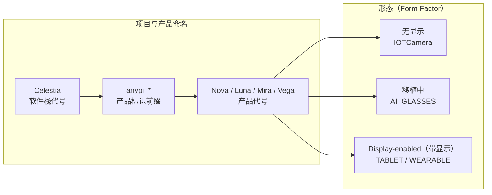

<p align="right"><a href="glossary.en.md">English</a> | <b>中文</b></p>

# 术语与命名对照表

> 本文是 Celestia 文档的**术语唯一解释源**。文档、代码注释、提交信息中出现的缩写、代号、
> 产品名与形态描述，均以本表为准。
>
> **体例**：本表只记录**术语在本项目里的实际所指与代码位置**，不列出词源、字面出处或行业
> 通用定义。当某个词的行业含义与本项目用法不一致时，**一律以本表（及"代码依据"列）为准**。
>
> **用法**：先读 [§0.1 列名定义](#01-本表体例-列名定义) 与 [§0.2 书写规范](#02-书写规范)，
> 再按章节查词；想知道某个名字该怎么拼，直接翻 [§11 标识符命名规范](#11-标识符命名规范)。

## 0. 三句话认识 Celestia

| 问题 | 答案 |
|:-----|:-----|
| **Celestia 是什么？** | 跑在**安凯微（Anyka）影像 SoC 的厂商 SDK** 之上的一套**影像软件系统**：用固定的五层结构把"应用 / 框架 / 硬件适配 / 系统基础 / 内核与板级"分开，上层源码与芯片、与产品形态解耦 —— **换芯片只换适配层，换形态只换一份配置**。 |
| **它解决什么问题？** | **同一套源码支撑多种影像产品形态**（摄像机、AI 眼镜、平板、穿戴），靠一份 `project/<product>/config.mk` 勾选芯片、板子、形态与功能开关；改这一份配置就换一个产品。 |
| **它跑在哪？** | 安凯微 SoC：`AnyCloud39AV200`（RISC-V / Linux）、`AnyCloud39AV100_V2`（ARM / Linux）、`Sky39AV130`（ARM / AOS RTOS）。上层 5 层源码在三者之间同源。 |



### 0.1 本表体例 列名定义

全表**默认三列**，各章节列名与填法一致；只有两处例外，已在下表注明。

| 列名 | 回答什么问题 | 填写要求 |
|:-----|:-------------|:---------|
| **术语 / 缩写** | 这个词长什么样 | 写**规范写法**（大小写、连字符、下划线固定）；同义词合并到同一行，不另起行 |
| **本项目含义** | 它在本仓库里指什么 | 只写**本项目的实际所指**；不写行业通义、不写词源、不做字面翻译 |
| **代码依据** | 去哪儿能验证 | 至少给一处**可 grep 的落点**：目录 / 文件 / 宏 / 函数 / 命令 |
| 例外 → `约束 / 易错点`（仅 §2.3） | 容易搞错什么 | 只写**边界条件与误用后果** |
| 例外 → `依赖约束`（仅 §5） | 这一层能调谁、不能调谁 | 用"只能 / 禁止"表述 |

**新增术语的准入条件**：必须同时满足"有确定含义 + 有代码依据"。两者缺一，不进本表。

### 0.2 书写规范

文档、注释、提交信息一律遵守：

1. **形态 ID 全大写 + 反引号**：`IOTCamera` / `AI_GLASSES` / `TABLET` / `WEARABLE`；
   作形容词描述时小写加连字符：tablet-class、wearable-class、headless。
2. **配置宏全大写下划线**：`CONFIG_APP_PACKAGES_TABLET`；开关值只写 `y` / `n`（小写），
   不写 `Y` / `1` / `true`。
3. **路径与文件名原样照抄 + 反引号**，目录以 `/` 结尾：`application/packages/tablet/`、
   `isp_ov8856_mipi_4lane_av200.conf`。大小写敏感，不得改写为小写。
4. **函数名带括号**：`tablet_run()`、`module_start()`、`hw_get_module()`。
5. **产品名 / 板型名 / SoC 名与代码完全一致**：`anypi_nova_dev`、`EVB_MBD_AK3918AV200`、
   `AnyCloud39AV200`——这些字符串会被脚本拼接成路径，写错即编译失败。
6. **形态描述只写形态 ID**：`IOTCamera` / `AI_GLASSES` / `TABLET` / `WEARABLE`，不用口语形容词代替。
7. **缩写不二次展开**：含义以"本项目含义"列为准，不追加英文全称。
8. **一处一词**：同一个概念在全文档只用一种写法，不混用同义词。

---

## 1. 项目、产品与代号

| 术语 / 缩写 | 本项目含义 | 代码依据 |
|:-----------|:-----------|:---------|
| **Celestia** | 本软件系统的**项目代号**：一套面向安凯微影像 SoC 的影像软件系统。产品代号沿用同一套命名：Nova、Luna、Mira、Vega | `CONFIG_CELESTIA_FASTSYS`、`project/anypi_*/config.mk` |
| **anypi** | **产品目录与产品名的统一前缀**，形如 `anypi_<代号>[_dev]` | `project/anypi_*` |
| **`_dev` 后缀** | **EVB 评估板工程**，用于开发验证；不带 `_dev` 的是量产板工程 | `anypi_nova_dev`、`anypi_luna_dev`、`anypi_mira_dev` 的 `CONFIG_BOARD` 均为 `EVB_*` |
| **Nova** | **`TABLET` 形态产品线**（平板级）。量产机 `anypi_nova`（800×480），评估机 `anypi_nova_dev`（1024×600） | `project/anypi_nova*`、`application/packages/tablet/` |
| **Luna** | **`WEARABLE` 形态产品线**（穿戴级，带 240×240 显示屏）`anypi_luna`；`anypi_luna_dev` 是同系列的 **`IOTCamera` 形态**（无显示屏）IPC 评估机 | `project/anypi_luna*`、`application/packages/wearable/` |
| **Mira** | **`IOTCamera` 形态 + AOS RTOS** 产品线，仅评估机 `anypi_mira_dev`（`Sky39AV130`） | `project/anypi_mira_dev/config.mk`（`CONFIG_OS_NAME=aos`） |
| **Vega** | **规划中的下一代产品代号**（Kids KEY 方向）。源码树中**尚无对应产品目录**，`application/packages/` 当前只有 `common` / `ipcamera` / `tablet` / `wearable` 四个包 | `docs/guide/application.md`（占位脚手架说明）；`framework/services/network/Makefile` 蜂窝模组注释（EC200U） |
| **主程序 target** | 每个产品编译出的**唯一主可执行文件**名，由 `CONFIG_APP_MAIN_TARGET` 决定（默认 `ipc_main`），装到 `/usr/sbin/` | `ipc_main` · `nova_main` · `luna_main` · `luna_dev_main` · `mira_main` |

> **代号与目录的对应关系不要靠记忆**：`project/<product>/config.mk` 的 `CONFIG_APP_MAIN_TARGET`
> 决定主程序名，`CONFIG_APP_PACKAGES_*` 决定用哪套 GUI 包，两者共同确定产品形态。

---

## 2. 产品形态 IOTCamera AI_GLASSES TABLET WEARABLE（重点）

本项目用**产品形态（Form factor）**描述产品的显示与交互方式（设备的物理与交互形态）。一个取值即同时约束
**显示屏、分辨率区间、应用包、主循环归属、保活责任**。

### 2.1 形态总览

| 形态 ID | 中文名 | 显示屏 | 分辨率区间 | 代码取值 |
|:--------|:-------|:-------|:-----------|:---------|
| `IOTCamera` | 摄像机 | **无显示屏** | — | `CONFIG_APP_PACKAGES_IPCAMERA=y` + `launch_mode="ipcamera"` |
| `AI_GLASSES` | AI 眼镜（**移植中形态**） | 移植中 | 移植中 | 移植中（芯片 `KM02G`），尚未落地 |
| `TABLET` | 平板级 | 带显示屏 | 800×480 ～ 1024×600 | `CONFIG_APP_PACKAGES_TABLET=y` + `launch_mode="ui"` |
| `WEARABLE` | 穿戴级 | 带显示屏（小屏） | ≤ 320×320（当前 240×240） | `CONFIG_APP_PACKAGES_WEARABLE=y` + `launch_mode="ui"` |

> **不带显示屏 = `IOTCamera`**（运行模式即 `headless`）；**带显示屏 = `TABLET` ∪ `WEARABLE`**。
> `AI_GLASSES` 正在移植到本系统，显示方案随移植推进确定，暂不参与此项判定。
> 代码里的判据就是这一句（`application/app_main/main.c`）：
> `int headless = !app_main_get_launch_mode_ui();`

> **摄像头不是形态判据**：本项目是影像软件系统，全部 5 个产品均为 `CONFIG_HW_CAMERA=y` +
> `CONFIG_FW_MULTIMEDIA_CAMERA=y`。形态差别在**画面送到哪里**，不在有没有摄像头。

### 2.2 判定矩阵（照此对号入座）

| 判据 | `IOTCamera` | `AI_GLASSES` | `TABLET` | `WEARABLE` |
|:-----|:----------:|:------------:|:--------:|:----------:|
| 显示屏 | **无显示屏** | 移植中 | 带显示屏，平板级 | 带显示屏，穿戴级 |
| 分辨率区间 | — | 移植中 | 800×480 ～ 1024×600 | ≤ 320×320 |
| `CONFIG_BOARD_SUPPORT_LCD` | `n` | 移植中 | `y` | `y` |
| `CONFIG_APP_PACKAGES_IPCAMERA` | **`y`** | 移植中 | `n` | `n` |
| `CONFIG_APP_PACKAGES_TABLET` | `n` | 移植中 | **`y`** | `n` |
| `CONFIG_APP_PACKAGES_WEARABLE` | `n` | 移植中 | `n` | **`y`** |
| `settings.json` → `launch_mode` | `ipcamera`（亦接受 `headless`） | 移植中 | `ui` | `ui` |
| 主循环 | **无** | 移植中 | `tablet_run()` | `app_gui_run()` |
| 保活责任 | **业务 SO 的 `module_start()` 阻塞** | 移植中 | GUI 主循环 | GUI 主循环 |
| 应用包目录 | `application/packages/ipcamera/` | 移植中 | `application/packages/tablet/` | `application/packages/wearable/` |

**两条硬规则**：

1. `TABLET` 与 `WEARABLE` **编译期互斥**，不得同时 `= y`。
2. **编译期优先**：GUI 包未编入时，`launch_mode="ui"` 无效，实际仍走无显示路径。

### 2.3 术语细则

| 术语 | 本项目含义 | 约束 / 易错点 |
|:-----|:-----------|:-------------|
| **IOTCamera** | **摄像机形态**：`PACKAGES_IPCAMERA` + `launch_mode="ipcamera"`，无显示屏 | 采集 → 编码 → 推流 / 存储 / AI；业务在 `packages/ipcamera/` 的 SO 里，靠 `module_start()` 保活 |
| **ai_glasses** | **AI 眼镜形态（移植中）**：第一视角拍摄 + **快速出图** + 端侧 AI；对应芯片 `KM02G` | 正在移植到本系统，源码树中尚无产品目录与 `PACKAGES_*` 开关；显示与交互方案随移植推进确定 |
| **display-enabled（带显示）** | 设备**带 LCD 且运行 GUI 主循环** | 只说明"能显示、有主循环"，不指定形态；归 `TABLET` 还是 `WEARABLE` 看 `PACKAGES_*` 选了哪套包 |
| **headless（无显示）** | 无 LCD、无 GUI 主循环的**运行模式** | 与代码变量 `headless` 同义；当前对应 `IOTCamera` 形态；**必须靠业务 SO 阻塞保活**，这是"上板后进程秒退"的头号根因 |
| **tablet-class（平板级）** | 走 `packages/tablet` 的**桌面式多应用**界面，带显示屏 | 当前分辨率：`anypi_nova` 800×480、`anypi_nova_dev` 1024×600。判据是 `PACKAGES_TABLET=y`，**不是屏幕物理尺寸** |
| **wearable-class（穿戴级）** | 走 `packages/wearable` 的**单页紧凑**界面，带小屏 | 当前仅 `anypi_luna` 240×240。闪存 / 内存预算远小于平板级，功能裁剪更激进 |
| **tablet / wearable** | 两套 GUI 包的**目录名**，也是 `launch_mode=ui` 下的两种呈现 | 编译期互斥；目录名与形态 ID 同名，便于对号入座 |
| **`CONFIG_LCD_HOR_RES` / `VER_RES`** | LCD **逻辑分辨率**的唯一真源（SSOT） | 由 `config.mk` 定义并生成到 `config.h`；代码中的 `LCD_*_RES_MAX` 只是兜底默认值；无显示形态不定义 |
| **`CONFIG_HW_CAMERA` / `CONFIG_FW_MULTIMEDIA_CAMERA`** | 摄像头链路的**硬件适配**与**框架服务**开关 | 全部产品均为 `y`；摄像头是影像软件系统的必备输入，不作为形态判据 |
| **launch_mode** | `settings.json` 里的运行期形态开关 | 编译期开关决定"能不能"，`launch_mode` 决定"这次怎么跑"；冲突时以编译期为准 |

### 2.4 形态 × 产品对照

| 产品 | 形态 | 显示屏 / 分辨率 | 应用包 | 主程序 | `CONFIG_OS_NAME` |
|:-----|:----:|:----------------|:-------|:-------|:-----------------:|
| `anypi_nova` | `TABLET` | 带显示屏 800×480 | `tablet` | `ipc_main` | `linux` |
| `anypi_nova_dev` | `TABLET` | 带显示屏 1024×600 | `tablet` | `nova_main` | `linux` |
| `anypi_luna` | `WEARABLE` | 带显示屏 240×240 | `wearable` | `luna_main` | `linux` |
| `anypi_luna_dev` | `IOTCamera` | 无显示屏 | `ipcamera` | `luna_dev_main` | `linux` |
| `anypi_mira_dev` | `IOTCamera` | 无显示屏 | `ipcamera` | `mira_main` | **`aos`** |

> 形态的完整判据、启动分岔与新增形态流程见 **[产品形态（Form Factor）](architecture/form-factor.md)**。

---

## 3. 操作系统与运行时

| 术语 / 缩写 | 本项目含义 | 代码依据 |
|:-----------|:-----------|:---------|
| **AOS** | **安凯微平台上的 RTOS 运行形态**，由 `CONFIG_OS_NAME=aos` 标识。当前仅 `anypi_mira_dev`（`Sky39AV130`）使用。特征：**用户态单静态 ELF**，无 MMU / 无进程 / 无动态库，所有 `.so` 须改为 `.a` 静态链入，`dlopen` 由静态桩替代 | `project/anypi_mira_dev/config.mk`、`project/anypi_mira_dev/setup_toolchain.sh`、`scripts/build.sh`（`CONFIG_OS_NAME = aos` 分支） |
| **AOS 工具链** | `arm-none-eabi-`，默认安装于 `/opt/arm-alios-eabi`，缺失时从 SDK 内 tarball 自动解压到 `out/<product>/toolchain/` | `setup_toolchain.sh` |
| ↳ 命名提示 | 工具链目录名带 `alios`（`arm-alios-eabi`）是**安凯微 SDK 沿用的历史命名**，不代表本项目依赖 AliOS 应用框架；文档与代码一律以 `aos` 作为 OS 标识 | 同上 |
| **Linux** | `CONFIG_OS_NAME=linux` 的产品形态：多进程、动态库、POSIX 齐全 | `project/anypi_nova*`、`project/anypi_luna*` |
| **musl / uClibc** | RISC-V（AV200）用 **musl**（`riscv64-anyka-linux-musl-`）；ARM（AV100_V2）用 **uClibc**（`arm-anycloud-linux-uclibcgnueabi-`）。**C 库不同 ⇒ 不能混用预编译产物** | 各 SoC SDK 的 `rules.mk`、`docs/skills/celestia-scripts.md` |
| **rootfs** | 只读根文件系统镜像；产品差异通过 `project/<product>/system/<SoC>/<SDK>/board/<BOARD>/rootfs/` overlay 注入 | `build_rootfs.sh` |
| ↳ 路径差异 | Linux 产品为 `rootfs/utils/etc/config/`；AOS 产品（`anypi_mira_dev`）为 `rootfs/resource/etc/config/` | `project/anypi_mira_dev/system/Sky39AV130/V1.01/board/.../rootfs/resource/etc/config/` |
| **POSIX 兼容层** | AOS 移植时补的 shim（线程/信号/时间/socket 等），只放在 project overlay 与 HAL 里，**不污染公用代码** | `docs/skills/celestia-aos-port.md` |

---

## 4. 芯片、SDK 与板级

| 术语 / 缩写 | 本项目含义 | 代码依据 |
|:-----------|:-----------|:---------|
| **SoC** | 芯片型号。本项目出现三种：`AnyCloud39AV200`、`AnyCloud39AV100_V2`、`Sky39AV130` | `CONFIG_SOC_PLATFORM` |
| **AV200 / AV100_V2 / AV130** | 上述 SoC 的**简称**（`AnyCloud39AV200` → AV200）。文档里的"Nova 用 AV200"即此 | 同上 |
| **AK3918AV200 / AK3918AV130 / KM01W / KM01A** | **板级/模组侧的芯片或模组标识**，出现在板型名中，不是 SoC 全名 | `CONFIG_BOARD` |
| **SDK** | 安凯微提供的**芯片软件开发包**，含工具链规则、库、头文件、烧录工具 | `system/<SoC>/<SDK_VERSION>/`（SDK 本体由厂商提供，随产品工程落盘） |
| **PDK** | 本项目文档里对"厂商平台包"的称呼，与 SDK 同指 `system/<SoC>/<SDK_VERSION>/` 这一层 | `docs/README.md`、`docs/quick-start/*` |
| **SDK 版本** | `CONFIG_SOC_SDK_VERSION`，如 `V1.04` / `V2.05` / `V1.01`，与 SDK 目录名一致（部分注释里写作 `CONFIG_SDK_VERSION`，以 `CONFIG_SOC_SDK_VERSION` 为准） | 各 `config.mk` |
| **BSP** | **板级支持包**：U-Boot / OpenSBI / 内核 / DTS / rootfs / 烧录配置。在本项目中位于 `system/<SoC>/<SDK>/` 与 `project/<product>/system/.../board/<BOARD>/` | `build.sh -k` |
| **BOARD** | 板型名，格式 `<板级形态>_<载板类型>_<芯片/模组>[_<产品形态>]`，必须等于 `system/<SoC>/<SDK>/board/` 下的目录名 | `CONFIG_BOARD` |
| ↳ **EVB** | 评估板，开发验证用（所有 `_dev` 产品） | `EVB_MBD_AK3918AV200`、`EVB_MBD_KM01A`、`EVB_CBD_AK3918AV130` |
| ↳ **PDB** | 产品板 / 量产板工程 | `PDB_MBD_AK3918AV200_ACTCAM`、`PDB_MBD_KM01W_ACTCAM` |
| ↳ **MBD** | **载板类型**：主板 | `PDB_MBD_*` / `EVB_MBD_*` |
| ↳ **CBD** | **载板类型**：核心板（模组化载板） | `EVB_CBD_AK3918AV130` |
| ↳ **ACTCAM** | **产品形态标记**：运动相机/摄像机 | `PDB_MBD_AK3918AV200_ACTCAM` |
| **overlay** | 产品对厂商 SDK 的**增量覆盖层**：同名文件覆盖、新文件追加，不改动 SDK 原件 | `project/<product>/system/<SoC>/<SDK>/` |
| **patch** | 对 SDK 源码的**补丁集**，在编译前应用 | `.../patch/`、`.../patch_fastsys/` |
| **fastsys** | **SPL 快启方案**：双 DTB + `patch_fastsys/`，缩短从复位到首帧的时间 | `CONFIG_CELESTIA_FASTSYS=y`（nova / nova_dev），配套 `CONFIG_FAST_*` |
| **DTB / DTS** | 设备树二进制/源文件；板级 `config.mk` 的 `CONFIG_DTB_NAME` 决定用哪一份 | `board/<BOARD>/config.mk` |
| **SPL** | 二级引导程序；fastsys 的改动点之一 | `patch_fastsys/os/` |

> **板型名不要硬记**：`CONFIG_BOARD` 的值就是 `system/<SoC>/<SDK>/board/` 下的目录名，
> 目录里自带 `config.mk`（DTB、分区、wpa_supplicant 等）与 `README.md`（板级注意事项）。

---

## 5. 架构分层与接口

| 层 / 术语 | 本项目含义 | 依赖约束 | 代码依据 |
|:----------|:-----------|:---------|:---------|
| **Application（应用层）** | 界面与业务：主程序装配、GUI App、云、系统服务 | 只能经 `app_main_get_*()` + `*_open()` 调用框架层；**禁止** include HAL 或 BSP 私有头 | `application/` |
| **Framework（框架层）** | 模块化服务集合：多媒体、网络、设备、通知、存储；另有 `runtime/`（运行时）与 `ui/`（UI 基础设施） | 只能 include `hardware/include/*.h` 公开头；**禁止** include `hardware/*/hal/<SoC>/` 私有实现 | `framework/` |
| **Hardware HAL（硬件适配层）** | 按芯片实现的外设/媒体能力，向上提供统一 ops | 向下通过 `/dev/*` ioctl / sysfs 驱动 BSP；**禁止**向上依赖 Framework | `hardware/` |
| **System Core（系统基础）** | 与业务无关的基础库：日志、配置、线程、定时器、错误码、容器、内存、加密 | 被上面三层**横向依赖**；**禁止**反向依赖任何上层 | `system/core/` |
| **BSP / Kernel（内核与板级）** | 厂商 SDK + 板级配置 | — | `system/<SoC>/<SDK>/` |
| **`*_open()`** | 框架服务的**初始化入口**，返回服务句柄 | 应用层唯一合法入口 | `multimedia_open()`、`network_open()` 等 |
| **`app_main_get_*()`** | 应用层获取已注册服务句柄的访问器 | 与 `*_open()` 配对使用 | `application/app_main/` |
| **`hw_get_module()` / `hw_device_open()`** | HAL 的模块与设备加载接口（仿 Android HAL 的 `hw_get_module`） | Framework 访问 HAL 的唯一入口 | `hardware/include/hardware.h` |
| **service（服务）** | 框架层的能力单元 | 一个 service 一个目录、一个公开头 | `framework/services/*` |
| **gateway（网关/协议）** | 对外协议栈（`nebula_protocol`、`rtsp_protocol`） | 与 service 同级，但面向网络对端 | `framework/gateway/*` |
| **package（应用包）** | 应用层可独立编译/加载的业务单元 | 分 `tablet` / `wearable` / `ipcamera` / `common`（`vega` 规划中，尚未落地） | `application/packages/*` |
| **SO 模块** | 以 `.so` 形式被主程序 `dlopen` 的业务模块 | 入口约定 `module_init(config_path)` / `module_start()` | `application/app_main/app_config.c` |
| **`module_init` / `module_start`** | SO 模块的**初始化**与**主循环**入口 | `module_start()` 需自行阻塞；`IOTCamera` 形态（无显示）靠它保活 | 同上 |
| **横向基础 / 纵向分层** | 描述依赖方向的两个词 | 纵向：App → FW → HAL → BSP；横向：任意层 → System Core | — |

---

## 6. 配置与运行期

| 术语 / 缩写 | 本项目含义 | 代码依据 |
|:-----------|:-----------|:---------|
| **`config.mk`** | **产品配置唯一入口**：芯片、SDK、板子、形态、功能开关。一个产品一份 | `project/<product>/config.mk` |
| **`config.h`** | 由 `config.mk` 的 `CONFIG_*` 项**自动生成**的 C 宏头，编译期生效；**生成物在 out 目录**，不在源码树 | `scripts/build.sh`（`PROJECT_GEN_INCLUDE_DIR=$OUT_ROOT/build/project/include`） |
| ↳ 手写头 | `project/<product>/include/` 下是**手写**头，不参与生成、不被覆盖：`app_globle_config.h`、`app_product_config.h`、`lv_conf.h` | `project/anypi_nova/include/` |
| **`settings.json`** | **产品 + 运行期配置的唯一真源（SoT）**：`program`、`launch_mode`、`language`、`wifi`、`storage`、`media`、`device`、`dormancy`、`modules`、`installed_apps` | `board/<BOARD>/rootfs/utils/etc/config/settings.json`（AOS 产品为 `rootfs/resource/etc/config/`） |
| **配置搜索顺序** | `APP_SETTINGS_CONFIG` 环境变量 → `--config` 参数 → `./settings.json` → `/etc/config/settings.json` | `application/app_main/` |
| **`installed_apps.json`** | 应用清单（旧格式），现优先读 `settings.json` 的 `installed_apps` | `tablet_app_registry` |
| **`fw_*` / `hal_*` 配置** | 框架层与 HAL 的 INI/JSON（视频、音频、ISP、移动侦测等）；`settings.json` 已合并的部分保留旧文件兜底 | `board/<BOARD>/rootfs/utils/etc/config/` |
| **`modules`** | `settings.json` 里按应用/服务声明加载方式的表：`type`（`so` / `static`）、`config_path`、启用位 | 同上 |

---

## 7. 业务与影像能力

| 术语 / 缩写 | 本项目含义 | 代码依据 |
|:-----------|:-----------|:---------|
| **ISP** | 图像信号处理：3A、去噪、色彩校正。每个板型一套调参文件，随 sensor 与 lane 数变化 | `hardware/vision/isp/`；调参文件 `board/<BOARD>/rootfs/utils/etc/config/isp_ov8856_mipi_4lane_av200.conf` |
| **CIS** | 图像传感器本体。具体型号写在 ISP 调参文件名里（如 `ov8856`、`gc4053`、`sc2337p`、`os05a20`） | `hardware/camera/`；`isp_<sensor>_<接口>_<参数>_<平台>.conf` |
| **IPU** | 显示侧图像处理单元。BGR/RGB 通道序由板级宏控制，配错会整体偏色 | `hardware/display/`（`fb_hw.c`）；`CONFIG_LV_PORT_IPU_FB_RGB_SWAP` |
| **OSD** | 视频叠加层：时间、文字、Logo（`osd_time` / `osd_text` / `osd_logo`），含旋转处理 | `hardware/osd/`（`osd_hw.c`、`osd_rotation.c`） |
| **AF** | 自动对焦，由 VCM（音圈马达）驱动 | `hardware/camera/hal/<SoC>/hal_camera_vcm.c` |
| **AOV** | 低功耗常录：熄屏/低帧率下持续录像，穿戴产品关键能力 | 板级 `config.mk` 的快启/常录模式项（`fast_aov` / `aov`） |
| **VENC / VDEC** | 视频编码/解码。AV200 **无硬件 VDEC**，视频通话下行走**软件 H.264 解码** | `third_party/ffmpeg`（按 `DECODE_ONLY` 裁剪）、`hardware/vision/` |
| **DMIC / ADC MIC** | 数字麦克风 / 模拟麦克风，按板级能力二选一 | `CONFIG_BOARD_SUPPORT_DMIC`；`hardware/audio/` |
| **IRCut** | 红外滤光片切换，已并入夜视（night vision）模块，不单独成模块 | — |
| **PTZ** | 云台控制（上下左右 + 变倍） | `CONFIG_FW_DEVICE_PTZ` |
| **RTSP** | 实时流协议，对外的取流通道 | `framework/gateway/rtsp_protocol`；`CONFIG_APP_RTSP` |
| **Nebula** | P2P 与信令协议栈，支撑对讲、云预览 | `framework/gateway/nebula_protocol`；`CONFIG_APP_NEBULA` |
| **UVC** | USB 摄像头类协议，把设备暴露成 USB 摄像头 | `application/services/uvc`（static 服务）；`CONFIG_APP_UVC` |
| **云平台** | 以 SO 形式热插拔的云接入：`aliyun`、`volc_engine` | `application/cloud/`；`CONFIG_APP_CLOUD_*`（`tuya` 开关存在但未实现） |

---

## 8. 构建、部署与运维

| 术语 / 缩写 | 本项目含义 | 代码依据 |
|:-----------|:-----------|:---------|
| **分层编译** | 按依赖顺序单独编译某一层，供改一层验一层 | `-t` third_party · `-s` system/core · `-h` hardware · `-f` framework · `-a` application · `-k` kernel/BSP |
| **`build.sh`** | 唯一构建入口，含产品选择、工具链注入、分层编译、打包 | `./build.sh --product-name <product>` |
| **`out/<product>/`** | 构建输出根：`install/`（安装树）、`burntool/`（镜像与烧录工具）、`release-src/`（最小源码集）、`build/project/include/`（生成的 `config.h`） | `scripts/build.sh` |
| **PASS/FAIL** | 上板验证的闭环判据（串口日志 + 关键路径自查） | `docs/quick-start/deploy.md` |
| **Bug A–G** | 调试 skill 里的故障分类法，用于把现象映射到层 | `docs/skills/celestia-debug.md` |
| **16MB NOR** | 低成本机型的闪存预算约束，决定分区与裁剪策略 | `docs/skills/celestia-project.md` |

---

## 9. 第三方组件（`third_party/`）

| 组件 | 本项目含义 | 代码依据 |
|:-----|:-----------|:---------|
| **LVGL** | 嵌入式 GUI（9.3.0）：带显示形态（`TABLET` / `WEARABLE`）的主 GUI，`liblvgl` 静态编入主程序 | `third_party/lvgl/`、`CONFIG_THIRD_PARTY_LVGL` |
| **AWTK** | 另一套 GUI（1.7.1）：保留但默认关闭 | `CONFIG_THIRD_PARTY_AWTK=n` |
| **FFmpeg** | 音视频解封装/编解码（7.0）：按 `MINIMAL` / `DECODE_ONLY` 裁剪，只编需要的部分 | `third_party/ffmpeg/` |
| **mbedTLS** | TLS / 加密（2.28.10）：HTTPS 走 mbedTLS 而非 OpenSSL，省 rootfs 体积 | `third_party/mbedtls/` |
| **cJSON / minIni / iniparser** | 解析库：`settings.json` 用 cJSON，`fw_*.ini` 用 INI 解析器 | `third_party/` 各组件目录 |
| **tslib** | 触摸屏校准（1.22）：校准参数由板级 `ts.rgb.conf` / `ts_calibrate.rgb.conf` 提供 | `third_party/tslib/` |
| **zxing** | 二维码：扫码类 App 使用 | `third_party/zxing/` |
| **jerryscript** | 轻量 JS 引擎，默认关闭 | `CONFIG_THIRD_PARTY_JERRYSCRIPT=n` |
| **libwebsockets** | WebSocket，默认关闭 | `CONFIG_THIRD_PARTY_WSS=n` |
| **freetype / libpng / jpegdec** | 字体与图片解码，按需裁剪（`freetype` 用 `MINIMAL`） | `third_party/` 各组件目录 |

---

## 10. 文档与协作

| 术语 | 本项目含义 | 代码依据 |
|:-----|:-----------|:---------|
| **skill** | 面向 AI 编码助手的**可执行知识单元**，含边界、命令、排障路径 | `docs/skills/<name>.md` |
| **guide** | 面向人的**概念与 API 说明** | `docs/guide/` |
| **quick-start** | 拉码 → 编译 → 烧录 → 验证的线性路径 | `docs/quick-start/` |
| **事实优先级** | 文档与代码冲突时的采信顺序：`tests/` › `*.c` › `*.h` › `Makefile` / `build.sh` / `config.mk` › `docs/` | `docs/CONTRIBUTING.md` |
| **DCO** | Developer Certificate of Origin；提交需 `git commit -s` 签名 | `docs/CONTRIBUTING.md` |

---

## 11. 标识符命名规范

本章规定**名字怎么拼**。写代码、加目录、写文档时照此执行，避免"同一个东西多种写法"。

### 11.1 命名规则

| 类别 | 规范 | 正例 | 反例 / 易错 |
|:-----|:-----|:-----|:------------|
| **产品目录** | `anypi_<代号>[_dev]`，全小写，`_` 分词 | `anypi_nova`、`anypi_nova_dev` | `anypiNova`、`nova_project`、`anypi-nova` |
| **产品代号** | 天体名，**首字母大写**，文档里可不加反引号 | Nova · Luna · Mira · Vega | `NOVA`、`vega`（作代号时） |
| **SoC 名** | 与 `CONFIG_SOC_PLATFORM` 完全一致，区分大小写 | `AnyCloud39AV200`、`AnyCloud39AV100_V2`、`Sky39AV130` | `anycloud39av200`（目录拼不出）、`AK3918AV200`（那是芯片丝印，不是 SoC 平台名） |
| **SoC 简称** | 去前缀留尾部：`AnyCloud39AV200` → `AV200` | AV200 · AV100_V2 · AV130 | `av200`（小写）、`AV200_V2`（画蛇添足） |
| **SDK 版本目录** | `V<主>.<次>`，大写 V，两位次版本 | `V1.04`、`V2.05`、`V1.01` | `v1.04`、`1.04` |
| **板型名** | `<EVB\|PDB>_<MBD\|CBD>_<芯片/模组>[_<产品形态>]` | `PDB_MBD_AK3918AV200_ACTCAM`、`EVB_MBD_KM01A`、`EVB_CBD_AK3918AV130` | 自造板型名 → `system/<SoC>/<SDK>/board/` 下找不到同名目录，编译即失败 |
| **主程序 target** | `<后缀>_main`，由 `CONFIG_APP_MAIN_TARGET` 声明，默认 `ipc_main` | `nova_main`、`luna_dev_main` | 带产品前缀（`anypi_nova_main`）、与包名同名 |
| **配置宏** | `CONFIG_<域>_<对象>`，全大写 + 下划线 | `CONFIG_APP_PACKAGES_TABLET`、`CONFIG_BOARD_SUPPORT_LCD` | `CONFIG_app_lcd`、`CONFIG-BOARD-LCD` |
| **配置值** | 二值开关只写 `y` / `n`；数值/字符串按类型原样 | `= y`、`= n`、`= 1`、`= aos` | `= Y`、`= true`、`= yes` |
| **HAL 实现目录** | `hardware/<能力>/hal/<SoC 全名>/` | `hardware/camera/hal/AnyCloud39AV200/`、`hardware/vision/isp/hal/Sky39AV130/` | 用简称（`hal/AV200/`）、按产品分目录 |
| **框架服务目录** | `framework/services/<name>/`，对外入口 `<name>_open()` | `framework/services/multimedia/` → `multimedia_open()` | 服务名与入口名不一致 |
| **应用包目录** | `application/packages/<package>/`，包名取自形态或业务 | `tablet`、`wearable`、`ipcamera`、`common` | 按产品命名（`packages/nova/`） |
| **SO 模块入口** | `module_init(config_path)` + `module_start()`，拼写固定 | — | 自定义入口名（加载器找不到符号） |
| **ISP 调参文件** | `isp_<sensor>_<接口>_<参数>[_slave]_<平台>.conf` | `isp_ov8856_mipi_4lane_av200.conf`、`isp_os05a20_mipi_2lane_km01a.conf`、`isp_sc2337p_mipi_2lane_slave_av130.conf` | 平台段写 SoC 全名、lane 数与硬件不符 |

### 11.2 配置宏前缀 域对照

`CONFIG_*` 的第二段就是**域**，看前缀就知道改的是哪一层、由谁消费。

| 前缀 | 归属层 | 决定什么 | 示例宏 |
|:-----|:-------|:---------|:-------|
| `CONFIG_APP_*` | 应用层 | 应用包、主程序、云、RTSP / UVC / Nebula 等业务开关 | `CONFIG_APP_PACKAGES_TABLET`、`CONFIG_APP_MAIN_TARGET`、`CONFIG_APP_RTSP` |
| `CONFIG_BOARD_*` | 板级 | 板子硬件能力（LCD、DMIC …） | `CONFIG_BOARD_SUPPORT_LCD`、`CONFIG_BOARD_SUPPORT_DMIC` |
| `CONFIG_FW_*` | 框架层 | 设备 / 网络 / 多媒体等服务开关 | `CONFIG_FW_DEVICE_PTZ` |
| `CONFIG_HW_*` | 硬件适配层 | HAL 实现细节 | `CONFIG_HW_DISPLAY_COLOR_SWIZZLE` |
| `CONFIG_SOC_*` / `CONFIG_CHIP_*` | 芯片 | SoC 平台、SDK 版本、芯片系列 | `CONFIG_SOC_PLATFORM`、`CONFIG_SOC_SDK_VERSION`、`CONFIG_CHIP_TYPE` |
| `CONFIG_OS_NAME` | 运行时 | 目标 OS：`linux` / `aos` | `CONFIG_OS_NAME` |
| `CONFIG_CELESTIA_*` / `CONFIG_FAST_*` | 项目特性 | 快启与项目级特性 | `CONFIG_CELESTIA_FASTSYS`、`CONFIG_FAST_MODE`、`CONFIG_FAST_SENSOR_NUM` |
| `CONFIG_THIRD_PARTY_*` | 第三方 | 组件是否编入 | `CONFIG_THIRD_PARTY_LVGL`、`CONFIG_THIRD_PARTY_AWTK` |
| `CONFIG_LV_*` / `CONFIG_LCD_*` | GUI | LVGL 端口与屏幕参数 | `CONFIG_LV_PORT_IPU_FB_RGB_SWAP`、`CONFIG_LCD_HOR_RES` |
| `CONFIG_DTB_NAME` | 板级 | 用哪份设备树 | `CONFIG_DTB_NAME` |

> 前缀遗漏比写错更危险：落在 `config.mk` 里但没被任何 `Makefile` / `.c` 消费的宏，
> 不会报错，只是**静默失效**。新增宏前先确认有消费方。

### 11.3 复合名怎么读

```
PDB_MBD_AK3918AV200_ACTCAM
 └┬┘ └┬┘ └────┬─────┘ └─┬─┘
  │   │       │         └─ 产品形态：运动相机/摄像机
  │   │       └─────────── 芯片/模组：AK3918AV200
  │   └─────────────────── 载板类型：MBD 主板（CBD = 核心板）
  └─────────────────────── 板级形态：PDB 量产板（EVB = 评估板）

isp_ov8856_mipi_4lane_av200.conf
 └┬┘ └──┬──┘ └┬┘ └──┬─┘ └──┬┘
  │     │     │     │      └─ 平台：AV200（部分板型写模组名，如 km01a）
  │     │     │     └──────── 参数：4 lane（MIPI 通道数；双摄标注 _slave）
  │     │     └────────────── 接口：mipi（另有 dvp 变体）
  │     └──────────────────── 传感器型号：ov8856
  └────────────────────────── 固定前缀：isp

anypi_nova_dev
 └─┬─┘ └─┬─┘ └┬┘
   │     │    └─ 板级形态：_dev = EVB 评估板工程（不带 = 量产板）
   │     └────── 产品代号：Nova（`TABLET` 形态）
   └──────────── 固定前缀：anypi
```

> 命名规范随代码演进而变：新增产品、板型或宏域时，**同步更新本章**；
> 与代码冲突时以代码为准，并回来改表（见 [§10 事实优先级](#10-文档与协作)）。

---

## 附：一页速查

| 你看到的写法 | 它其实指 |
|:-------------|:---------|
| "`IOTCamera` 形态" | 无显示屏，走 `packages/ipcamera`，靠 `module_start()` 保活，如 luna_dev / mira_dev |
| "`AI_GLASSES` 形态" | 移植中形态（芯片 `KM02G`），第一视角采集 + 快速出图 + 端侧 AI，正在移植到本系统 |
| "`TABLET` 形态" | 带显示 + `PACKAGES_TABLET=y`，走 `packages/tablet`（桌面式多应用），如 nova / nova_dev |
| "`WEARABLE` 形态" | 带显示 + `PACKAGES_WEARABLE=y`，走 `packages/wearable`（单页紧凑），如 luna |
| "带显示（display-enabled）" | `TABLET` 或 `WEARABLE`，即 `app_main_get_launch_mode_ui() == true` |
| "AOS 产品" | `CONFIG_OS_NAME=aos` 的产品（当前仅 `anypi_mira_dev`），单静态 ELF |
| "AV200 / AV100_V2 / AV130" | 芯片简称，分别对应 `AnyCloud39AV200` / `AnyCloud39AV100_V2` / `Sky39AV130` |
| "nova 用 RISC-V" | AV200 的 SDK 用 `riscv64-anyka-linux-musl-` 工具链，第三方库须按 `riscv` 编译 |
| "EVB / PDB" | 评估板 / 产品板；`_dev` 后缀产品一律是 EVB |
| "改一份 config.mk 就换产品" | 指 `project/<product>/config.mk` → 生成 `config.h`，是唯一合法的跨产品差异化点 |
| 一个 `CONFIG_*` 宏 | 看第二段（域）就知道归属：`APP` 应用层 / `BOARD` 板级 / `FW` 框架 / `HW` 适配层 / `SOC` 芯片，详见 [§11.2](#112-配置宏前缀-域对照) |
| 一个板型名 / ISP 文件名 | 按下划线拆段读，拆解模板见 [§11.3](#113-复合名怎么读) |

---

[← 返回文档首页](README.md) · [架构总览](architecture/overview.md) · [形态](architecture/form-factor.md) · [目录地图](architecture/directory-map.md) · [命名规范](#11-标识符命名规范)
