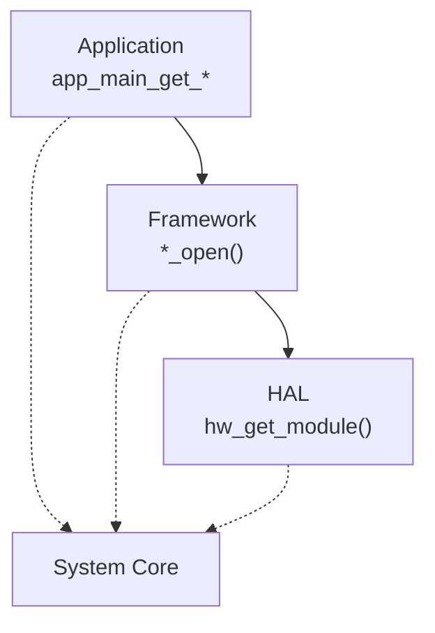

<p align="right"><b>English</b> | <a href="api-index.md">中文</a></p>

# API Reference Index

> **Scope of this document**: API index: public header directories per layer, call relationships, and corresponding documentation entry points. This page is navigation only; it does not repeat interface details.
>
> For interface details see [framework-api.en.md](framework-api.en.md) · [hardware-api.en.md](hardware-api.en.md) · [system-core-api.en.md](system-core-api.en.md).

## 1. Layers and Headers

| Layer | Public header directory | Concept doc | API doc |
|----|----------------|----------|----------|
| Application | `application/app_main/*.h` | [guide/application.en.md](../guide/application.en.md) | `app_main` handles — see application doc |
| Framework | `framework/services/*/include/*.h` | [guide/framework.en.md](../guide/framework.en.md) | [guide/framework-api.en.md](../guide/framework-api.en.md) |
| Framework Gateway | `framework/gateway/*/include/*.h` | guide/framework.en.md | guide/framework-api.en.md |
| Framework Runtime | `framework/runtime/include/*.h` | guide/framework.en.md | guide/framework-api.en.md |
| Hardware HAL | `hardware/include/*.h` | [guide/hardware-hal.en.md](../guide/hardware-hal.en.md) | [guide/hardware-api.en.md](../guide/hardware-api.en.md) |
| System Core | `system/core/include/*.h` | [guide/system-core.en.md](../guide/system-core.en.md) | [guide/system-core-api.en.md](../guide/system-core-api.en.md) |

**Forbidden**: Application / Framework must not include private headers under `hardware/*/hal/<SoC>/`, `hal_*_api.h`, or `*_hw.h`.

## 2. Call Relationships



## 3. Application Handle API

Header: `application/app_main/app_main.h`

| Function | Return type (after cast) |
|------|---------------------|
| `app_main_get_multimedia()` | `multimedia_t*` |
| `app_main_get_network()` | `network_t*` |
| `app_main_get_notification()` | `notification_t*` |
| `app_main_get_nebula()` | `nebula_protocol_t*` |
| `app_main_get_runtime()` | `runtime_bootstrap_t*` |

## 4. Framework Service Entry Points

| Service | Header | Open / close |
|------|--------|-----------|
| Multimedia | `framework/services/multimedia/include/multimedia.h` | `multimedia_open` / `multimedia_close` |
| Network | `framework/services/network/include/network.h` | `network_open` / `network_close` |
| Storage | `framework/services/storage/include/storage.h` | `storage_open` / `storage_close` |
| Device | `framework/services/device/include/device.h` | `device_open` / `device_close` |
| Notification | `framework/services/notification/include/notification.h` | `notification_open` / `notification_close` |
| Nebula | `framework/gateway/nebula_protocol/include/nebula_protocol.h` | `nebula_protocol_open` / `nebula_protocol_close` |
| RTSP | `framework/gateway/rtsp_protocol/include/rtsp_protocol.h` | `rtsp_protocol_open` / `rtsp_protocol_close` |
| Runtime | `framework/runtime/include/runtime_bootstrap.h` | `runtime_bootstrap_open` / `runtime_bootstrap_close` |

Platform init: `framework_init()` (`framework/runtime/include/runtime.h`).

## 5. Hardware HAL Modules

Public headers (`hardware/include/`):

`audio.h` `camera.h` `display.h` `osd.h` `gpu.h` `wifi.h` `ethernet.h` `gpio.h` `input.h` `input_evdev.h` `led.h` `motor.h` `pwm.h` `adc.h` `ir.h` `mmc.h` `efuse.h` `wdt.h` `motion_detect.h` `isp.h` `soc_platform.h` `hardware.h` `header.h` `driver_error.h`

Loading: `hw_get_module()` / `hw_device_open()` (see `hardware.h`).

## 6. System Core

Entry header: `system/core/include/system_core.h`

Common: `log.h` `system_config.h` `system_error.h` `system_thread.h` `system_time.h` `timer.h` `watchdog.h` `ring_buffer.h` `circular_buffer.h`, etc. (27 headers total — see [guide/system-core-api.en.md](../guide/system-core-api.en.md)).

## 7. Unified Error Codes

```c
/* system/core/include/system_error.h */
#define SYSTEM_ERROR_CODE(domain, module, code) ...
```

Each layer’s `*_open()` returns `int`: 0 on success; negative values are errors encoded with `SYSTEM_ERROR_CODE`.

## 8. Extension Guides

| Task | Doc |
|------|------|
| Add tablet App | [Add tablet App](../skills/celestia-application.en.md) |
| Add cloud platform | [Add cloud platform](../skills/celestia-application.en.md) |
| Add Framework service | [Add Framework service](../skills/celestia-framework.en.md) |
| Add SoC | [Add SoC](../skills/celestia-hardware.en.md) |