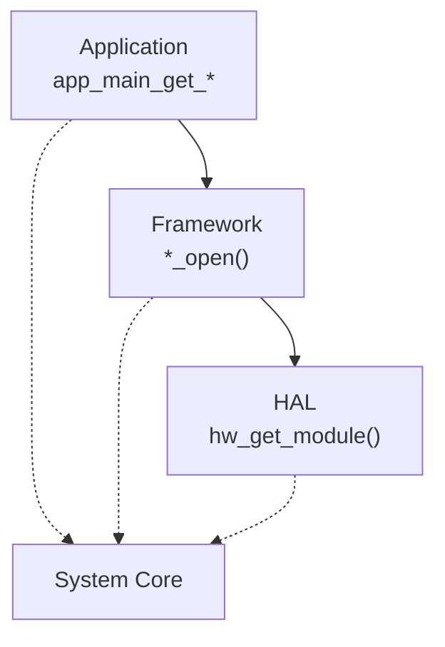

<p align="right"><a href="api-index.en.md">English</a> | <b>中文</b></p>

# API Reference Index

> **本文范围**：API 索引：按层给出公开头文件目录、调用关系与对应文档入口；本页只做导航，不重复接口细节。
>
> 接口细节见 [framework-api.md](framework-api.md) · [hardware-api.md](hardware-api.md) · [system-core-api.md](system-core-api.md)。

## 1. 层次与头文件

| 层 | 公开头文件目录 | 概念文档 | API 文档 |
|----|----------------|----------|----------|
| Application | `application/app_main/*.h` | [guide/application.md](../guide/application.md) | app_main 句柄见 application 文档 |
| Framework | `framework/services/*/include/*.h` | [guide/framework.md](../guide/framework.md) | [guide/framework-api.md](../guide/framework-api.md) |
| Framework Gateway | `framework/gateway/*/include/*.h` | guide/framework.md | guide/framework-api.md |
| Framework Runtime | `framework/runtime/include/*.h` | guide/framework.md | guide/framework-api.md |
| Hardware HAL | `hardware/include/*.h` | [guide/hardware-hal.md](../guide/hardware-hal.md) | [guide/hardware-api.md](../guide/hardware-api.md) |
| System Core | `system/core/include/*.h` | [guide/system-core.md](../guide/system-core.md) | [guide/system-core-api.md](../guide/system-core-api.md) |

**禁止**：Application / Framework 不得 include `hardware/*/hal/<SoC>/` 私有头、`hal_*_api.h`、`*_hw.h`。

## 2. 调用关系



## 3. Application 句柄 API

头文件：`application/app_main/app_main.h`

| 函数 | 返回类型（cast 后） |
|------|---------------------|
| `app_main_get_multimedia()` | `multimedia_t*` |
| `app_main_get_network()` | `network_t*` |
| `app_main_get_notification()` | `notification_t*` |
| `app_main_get_nebula()` | `nebula_protocol_t*` |
| `app_main_get_runtime()` | `runtime_bootstrap_t*` |

## 4. Framework 服务入口

| 服务 | 头文件 | 打开/关闭 |
|------|--------|-----------|
| Multimedia | `framework/services/multimedia/include/multimedia.h` | `multimedia_open` / `multimedia_close` |
| Network | `framework/services/network/include/network.h` | `network_open` / `network_close` |
| Storage | `framework/services/storage/include/storage.h` | `storage_open` / `storage_close` |
| Device | `framework/services/device/include/device.h` | `device_open` / `device_close` |
| Notification | `framework/services/notification/include/notification.h` | `notification_open` / `notification_close` |
| Nebula | `framework/gateway/nebula_protocol/include/nebula_protocol.h` | `nebula_protocol_open` / `nebula_protocol_close` |
| RTSP | `framework/gateway/rtsp_protocol/include/rtsp_protocol.h` | `rtsp_protocol_open` / `rtsp_protocol_close` |
| Runtime | `framework/runtime/include/runtime_bootstrap.h` | `runtime_bootstrap_open` / `runtime_bootstrap_close` |

平台初始化：`framework_init()`（`framework/runtime/include/runtime.h`）。

## 5. Hardware HAL 模块

公开头（`hardware/include/`）：

`audio.h` `camera.h` `display.h` `osd.h` `gpu.h` `wifi.h` `ethernet.h` `gpio.h` `input.h` `input_evdev.h` `led.h` `motor.h` `pwm.h` `adc.h` `ir.h` `mmc.h` `efuse.h` `wdt.h` `motion_detect.h` `isp.h` `soc_platform.h` `hardware.h` `header.h` `driver_error.h`

加载方式：`hw_get_module()` / `hw_device_open()`（见 `hardware.h`）。

## 6. System Core

入口头：`system/core/include/system_core.h`

常用：`log.h` `system_config.h` `system_error.h` `system_thread.h` `system_time.h` `timer.h` `watchdog.h` `ring_buffer.h` `circular_buffer.h` 等（共 27 个头，详见 [guide/system-core-api.md](../guide/system-core-api.md)）。

## 7. 统一错误码

```c
/* system/core/include/system_error.h */
#define SYSTEM_ERROR_CODE(domain, module, code) ...
```

各层 `*_open()` 返回 `int`：0 成功，负值为 `SYSTEM_ERROR_CODE` 编码错误。

## 8. 扩展手册

| 任务 | 文档 |
|------|------|
| 新增 tablet App | [新增 tablet App](../skills/celestia-application.md) |
| 新增云平台 | [新增云平台](../skills/celestia-application.md) |
| 新增 Framework 服务 | [新增 Framework 服务](../skills/celestia-framework.md) |
| 新增 SoC | [新增 SoC](../skills/celestia-hardware.md) |
