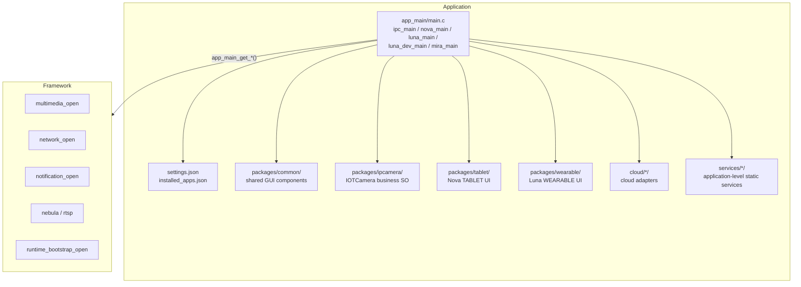

<p align="right"><b>English</b> | <a href="application.md">中文</a></p>

# Application Layer

> **Scope of this document**: Application layer: `app_main` startup chain and `launch_mode`, three package types under `packages/` (IOTCamera / TABLET / WEARABLE), system services and cloud platform adapters, product differences.
>
> Layering and contracts: [Architecture overview](../architecture/overview.en.md); service interfaces: [framework.en.md](framework.en.md); hands-on flow: [celestia-application](../skills/celestia-application.en.md).

## 1. Architecture Overview



**Call constraint**: Application may only obtain Framework handles via `app_main_get_*()`, then include the corresponding public headers and use ops; do not include HAL private headers or Framework internal implementation headers directly.

## 2. Directory Layout

```text
application/
├── app_main/              # Main process: platform startup, config parse, Framework open, GUI / headless split
│   ├── main.c             # Main entry (selected by CONFIG_APP_MAIN_TARGET)
│   ├── app_main.h         # app_main_get_* handle registry
│   ├── app_config.h       # settings.json / SO module loading
│   └── app_gui.h          # wearable GUI entry
├── packages/
│   ├── common/            # Shared GUI for tablet / wearable
│   ├── tablet/            # Nova tablet-class (`TABLET`) apps and launcher
│   ├── wearable/          # Luna wearable-class apps and launcher
│   └── ipcamera/          # IOTCamera device business SO (ipc_cam)
├── cloud/                 # Cloud platform adapter integrations
├── services/              # Application-level static services (e.g. uvc / weather)
└── tests/                 # Application-layer tests
```

There is no top-level `gui/` under application: UI and business code live under `packages/`
(`tablet` / `wearable` / `ipcamera` / `common`).

## 3. Startup Flow

```text
main()
 ├─ app_main_platform_startup()          # framework_init() + notification_open() + input init
 ├─ runtime_bootstrap_open(&runtime)
 ├─ app_main_init()
 ├─ app_main_load_config(path)           # settings.json
 ├─ app_main_run()                       # load modules with type=so
 ├─ app_main_start_framework_modules(headless, gui_config)
 │    ├─ multimedia_open / network_open → app_main_register_*
 │    ├─ app_02_load.sh（UI mode）
 │    └─ tablet: app_lv_open(gui_config) upfront
 ├─ app_gui_run()                        # CONFIG_APP_PACKAGES_WEARABLE
 ├─ tablet_run()                         # CONFIG_APP_PACKAGES_TABLET
 └─ return directly when no GUI          # headless form must keep alive via module_start()
```

Config path priority: `APP_SETTINGS_CONFIG` env → `--config` arg → `./settings.json` → `/etc/config/settings.json`.

## 4. `launch_mode` and Runtime Modules

| `launch_mode` | Behavior |
|---------------|------|
| `ui` | Open GUI; enter `tablet_run()` or `app_gui_run()` |
| `headless` | Start Framework and business modules only; no LVGL |
| `ipcamera` | IOTCamera business form; still follows headless path, often with `packages/ipcamera` |

**Wearable example** (`project/anypi_luna/.../board/PDB_MBD_KM01W_ACTCAM/rootfs/utils/etc/config/settings.json`):

```json
{
  "program": "",
  "launch_mode": "ui",
  "modules": {
    "gui_luna": {
      "enable": true,
      "type": "static",
      "config_path": "/etc/config/settings.json"
    }
  },
  "installed_apps": {
    "schema_version": 1,
    "apps": [
      {"app_id":"camera","install_path":"/usr/apps/camera","enabled":true}
    ]
  }
}
```

**IOTCamera SO example**:

```json
{
  "launch_mode": "headless",
  "modules": {
    "app_runtime": {
      "enable": true,
      "type": "so",
      "so_path": "/mnt/afht/lib/libipc_cam_app.so"
    }
  }
}
```

Generic contract for `type: "so"`: `module_init(const char *)` and `module_start(void)`.

## 5. Public `app_main` API

Header: `application/app_main/app_main.h`

| Function | Description |
|------|------|
| `app_main_platform_startup()` | `framework_init` + `notification_open` |
| `app_main_open_framework_handles()` | `multimedia_open` / `network_open` and register |
| `app_main_start_framework_modules(headless, cfg)` | Open Framework, run UI script, init LVGL in tablet mode |
| `app_main_get_multimedia()` | Returns `multimedia_t *` (caller casts) |
| `app_main_get_network()` | Returns `network_t *` |
| `app_main_get_notification()` | Returns `notification_t *` |
| `app_main_get_nebula()` | Returns `nebula_protocol_t *` |
| `app_main_get_runtime()` | Returns `runtime_bootstrap_t *` |
| `app_main_request_shutdown()` | Request graceful exit |
| `app_main_graceful_teardown()` | Release multimedia / GUI |

Config APIs: `application/app_main/app_config.h` — `app_main_load_config`, `app_main_get_launch_mode_ui`, `app_main_get_gui_config_path`, `app_main_run`.

## 6. `packages/common`

Path: `application/packages/common/`

Shared tablet / wearable GUI code; currently includes:

- `gui_common.c`
- `gui_camera.c`
- `gui_font.c`
- `include/`

Prefer placing cross-product GUI shared code here rather than duplicating in `tablet/` and `wearable/`.

## 7. IOTCamera Application

Path: `application/packages/ipcamera/`

Current layout:

| Directory | Description |
|------|------|
| `ipc_cam/` | Generic camera business SO (luna_dev / mira) |

Constraints:

- No dependency on `packages/common` or LVGL.
- Hooks into `app_main_run()` via `module_init` / `module_start`.
- `module_start()` must block to keep the process alive; otherwise the main process exits after Framework startup.

`ipc_cam` is enabled by `CONFIG_APP_IPCAMERA_IPC_CAM`: both luna_dev and mira use `ipc_cam`.

## 8. TABLET Applications

Path: `application/packages/tablet/`

| Directory | Description |
|------|------|
| `launcher/` | Nova desktop and main entry |
| `ipc_camera/` | IPC camera scenario |
| `camera/` | Local preview / recording |
| `audio_algo/` | Audio algorithm UI |
| `setting/` | System settings |
| `volc_engine/` | Volc Engine UI |
| `clock/` | Clock |
| `file_manager/` | File browser |

Whether an app appears on the desktop is decided by `tablet_app_registry`; data is read from `settings.json` first, with legacy `installed_apps.json` supported.

## 9. WEARABLE Applications

Path: `application/packages/wearable/`

| Directory | Description |
|------|------|
| `launcher/` | Luna desktop and app registry |
| `camera/` | Photo / preview |
| `dashcam/` | Loop recording + RTSP sub-stream |
| `power_keyd/` | Luna long-press power key standalone daemon |

Like tablet, the wearable registry reads `settings.json` first and supports legacy `installed_apps.json`.

## 10. System Services

Path: `application/services/`

| Service | Type | Description |
|------|------|------|
| `uvc/` | static | UVC gadget |
| `weather/` | static | Weather fetch and result callback |

## 11. Cloud Platform Adapters

Path: `application/cloud/`

Current directories:

| Directory | Description |
|------|------|
| `aliyun/` | Implemented adapter |
| `volc_engine/` | Implemented adapter |

Two kinds of entry points:

- Generic `type: "so"` module loading looks for `module_init` / `module_start`
- Cloud adapter business code may also expose its own `*_init` / `*_deinit` entry points

On conflict between docs and code, follow each directory’s `Makefile` and exported symbols.

## 12. Product Differences

| Product | `CONFIG_APP_MAIN_TARGET` | `IOTCamera` | `TABLET` | `WEARABLE` | Typical form |
|------|---------------------------|----------|------------|------------|----------|
| `anypi_nova` | `ipc_main` | n | y | n | Tablet-class (`TABLET`) production |
| `anypi_nova_dev` | `nova_main` | n | y | n | Tablet-class (`TABLET`) EVB |
| `anypi_luna` | `luna_main` | n | n | y | Wearable-class (`WEARABLE`) production |
| `anypi_luna_dev` | `luna_dev_main` | y | n | n | `IOTCamera` EVB |
| `anypi_mira_dev` | `mira_main` | y (ipc_cam) | n | n | `IOTCamera`, aos (Sky39AV130) |

IOTCamera products typically disable `CONFIG_APP_PACKAGES_TABLET` / `CONFIG_APP_PACKAGES_WEARABLE`, enable `CONFIG_APP_PACKAGES_IPCAMERA`, and load the business SO via `settings.json`.

## 13. Further Reading

- [celestia-application.en.md](../skills/celestia-application.en.md) — Add App / cloud / `IOTCamera` SO
- [framework.en.md](framework.en.md) — Framework services
- [deploy.en.md](../quick-start/deploy.en.md) — On-device deployment
- [roles.en.md](../quick-start/roles.en.md) — AI role forms