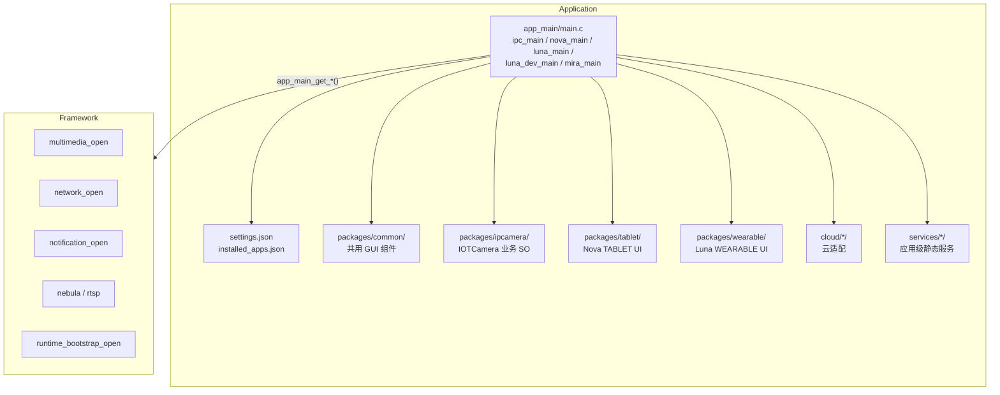

<p align="right"><a href="application.en.md">English</a> | <b>中文</b></p>

# Application Layer

> **本文范围**：应用层：`app_main` 启动链路与 `launch_mode`、`packages/` 三类包（IOTCamera / TABLET / WEARABLE）、系统服务与云平台适配、产品差异。
>
> 分层与契约见 [架构总览](../architecture/overview.md)；服务接口见 [framework.md](framework.md)；实操流程见 [celestia-application](../skills/celestia-application.md)。

## 1. 架构总览



**调用约束**：Application 只能通过 `app_main_get_*()` 取 Framework 句柄，再 include 对应公开头使用 ops；不要直接 include HAL 私有头或 Framework 内部实现头。

## 2. 目录结构

```text
application/
├── app_main/              # 主进程：平台启动、配置解析、Framework 打开、GUI / 无显示分流
│   ├── main.c             # 主程序入口（由 CONFIG_APP_MAIN_TARGET 指定）
│   ├── app_main.h         # app_main_get_* 句柄注册表
│   ├── app_config.h       # settings.json / SO 模块装载
│   └── app_gui.h          # wearable GUI 入口
├── packages/
│   ├── common/            # tablet / wearable 共用 GUI 能力
│   ├── tablet/            # Nova 平板级（`TABLET`）应用与 launcher
│   ├── wearable/          # Luna 穿戴级应用与 launcher
│   └── ipcamera/          # IOTCamera 设备业务 SO（ipc_cam）
├── cloud/                 # 云平台接入适配
├── services/              # 应用级静态服务（如 uvc / weather）
└── tests/                 # 应用层测试
```

应用层没有 `gui/` 目录：界面与业务全部按形态放在 `packages/` 下
（`tablet` / `wearable` / `ipcamera` / `common`）。

## 3. 启动流程

```text
main()
 ├─ app_main_platform_startup()          # framework_init() + notification_open() + input init
 ├─ runtime_bootstrap_open(&runtime)
 ├─ app_main_init()
 ├─ app_main_load_config(path)           # settings.json
 ├─ app_main_run()                       # 加载 modules 中 type=so 的模块
 ├─ app_main_start_framework_modules(headless, gui_config)
 │    ├─ multimedia_open / network_open → app_main_register_*
 │    ├─ app_02_load.sh（UI 模式）
 │    └─ tablet: 预先 app_lv_open(gui_config)
 ├─ app_gui_run()                        # CONFIG_APP_PACKAGES_WEARABLE
 ├─ tablet_run()                         # CONFIG_APP_PACKAGES_TABLET
 └─ 无 GUI 时直接返回                    # 无显示形态需由 module_start() 自行保活
```

配置路径优先级：`APP_SETTINGS_CONFIG` 环境变量 → `--config` 参数 → `./settings.json` → `/etc/config/settings.json`。

## 4. `launch_mode` 与运行时模块

| `launch_mode` | 行为 |
|---------------|------|
| `ui` | 打开 GUI，进入 `tablet_run()` 或 `app_gui_run()` |
| `headless` | 仅启动 Framework 与业务模块，不打开 LVGL |
| `ipcamera` | IOTCamera 业务形态，本质仍按 headless 路径执行，常与 `packages/ipcamera` 配合 |

**wearable 示例**（`project/anypi_luna/.../board/PDB_MBD_KM01W_ACTCAM/rootfs/utils/etc/config/settings.json`）：

```json
{
  "program": "",
  "launch_mode": "ui",
  "modules": {
    "gui_luna": {
      "enable": true,
      "type": "static",
      "config_path": "/etc/config/settings.json"
    }
  },
  "installed_apps": {
    "schema_version": 1,
    "apps": [
      {"app_id":"camera","install_path":"/usr/apps/camera","enabled":true}
    ]
  }
}
```

**IOTCamera SO 示例**：

```json
{
  "launch_mode": "headless",
  "modules": {
    "app_runtime": {
      "enable": true,
      "type": "so",
      "so_path": "/mnt/afht/lib/libipc_cam_app.so"
    }
  }
}
```

`type: "so"` 的通用装载契约是 `module_init(const char *)` 与 `module_start(void)`。

## 5. `app_main` 公开 API

头文件：`application/app_main/app_main.h`

| 函数 | 说明 |
|------|------|
| `app_main_platform_startup()` | `framework_init` + `notification_open` |
| `app_main_open_framework_handles()` | `multimedia_open` / `network_open` 并注册 |
| `app_main_start_framework_modules(headless, cfg)` | 打开 Framework、执行 UI 脚本并在 tablet 模式下初始化 LVGL |
| `app_main_get_multimedia()` | 返回 `multimedia_t *`（调用端自行 cast） |
| `app_main_get_network()` | 返回 `network_t *` |
| `app_main_get_notification()` | 返回 `notification_t *` |
| `app_main_get_nebula()` | 返回 `nebula_protocol_t *` |
| `app_main_get_runtime()` | 返回 `runtime_bootstrap_t *` |
| `app_main_request_shutdown()` | 请求优雅退出 |
| `app_main_graceful_teardown()` | 释放 multimedia / GUI |

配置相关 API 见 `application/app_main/app_config.h`：`app_main_load_config`、`app_main_get_launch_mode_ui`、`app_main_get_gui_config_path`、`app_main_run`。

## 6. `packages/common`

路径：`application/packages/common/`

该目录承载 tablet / wearable 共用 GUI 代码，目前包含：

- `gui_common.c`
- `gui_camera.c`
- `gui_font.c`
- `include/`

跨产品 GUI 公共能力优先放这里，而不是分别复制到 `tablet/` 和 `wearable/`。

## 7. IOTCamera 应用

路径：`application/packages/ipcamera/`

当前目录：

| 目录 | 说明 |
|------|------|
| `ipc_cam/` | 通用摄像机业务 SO（luna_dev / mira） |

形态约束：

- 不依赖 `packages/common` 或 LVGL。
- 通过 `module_init` / `module_start` 接入 `app_main_run()`。
- `module_start()` 需要自行阻塞保活，否则主进程会在 Framework 启动后退出。

`ipc_cam` 由 `CONFIG_APP_IPCAMERA_IPC_CAM` 启用：luna_dev 与 mira 均使用 `ipc_cam`。

## 8. TABLET 应用

路径：`application/packages/tablet/`

| 目录 | 说明 |
|------|------|
| `launcher/` | Nova 桌面与主入口 |
| `ipc_camera/` | IPC 摄像机场景 |
| `camera/` | 本地预览 / 录像 |
| `audio_algo/` | 音频算法 UI |
| `setting/` | 系统设置 |
| `volc_engine/` | 火山引擎 UI |
| `clock/` | 时钟 |
| `file_manager/` | 文件浏览 |

应用是否出现在桌面由 `tablet_app_registry` 决定，数据优先从 `settings.json` 读取，兼容旧的 `installed_apps.json`。

## 9. WEARABLE 应用

路径：`application/packages/wearable/`

| 目录 | 说明 |
|------|------|
| `launcher/` | Luna 桌面与应用注册表 |
| `camera/` | 拍照 / 预览 |
| `dashcam/` | 循环录像 + RTSP 子码流 |
| `power_keyd/` | Luna 长按电源键独立守护进程 |

与 tablet 类似，wearable 注册表也优先读取 `settings.json`，兼容旧 `installed_apps.json`。

## 10. 系统服务

路径：`application/services/`

| 服务 | 形态 | 说明 |
|------|------|------|
| `uvc/` | static | UVC gadget |
| `weather/` | static | 天气请求与结果回调 |

## 11. 云平台适配

路径：`application/cloud/`

当前目录状态：

| 目录 | 说明 |
|------|------|
| `aliyun/` | 已实现适配 |
| `volc_engine/` | 已实现适配 |

注意区分两类入口：

- 通用 `type: "so"` 模块装载查找的是 `module_init` / `module_start`
- 云适配业务内部还可能有各自的 `*_init` / `*_deinit` 入口

文档与代码冲突时，以各目录内实际 `Makefile` 和导出符号为准。

## 12. 产品差异

| 产品 | `CONFIG_APP_MAIN_TARGET` | `IOTCamera` | `TABLET` | `WEARABLE` | 典型形态 |
|------|---------------------------|----------|------------|------------|----------|
| `anypi_nova` | `ipc_main` | n | y | n | 平板级（`TABLET`）量产 |
| `anypi_nova_dev` | `nova_main` | n | y | n | 平板级（`TABLET`） EVB |
| `anypi_luna` | `luna_main` | n | n | y | 穿戴级（`WEARABLE`）量产 |
| `anypi_luna_dev` | `luna_dev_main` | y | n | n | `IOTCamera` EVB |
| `anypi_mira_dev` | `mira_main` | y（ipc_cam） | n | n | `IOTCamera`，aos（Sky39AV130） |

IOTCamera 产品通常是：关闭 `CONFIG_APP_PACKAGES_TABLET` / `CONFIG_APP_PACKAGES_WEARABLE`，开启 `CONFIG_APP_PACKAGES_IPCAMERA`，再由 `settings.json` 装载业务 SO。

## 13. 扩展阅读

- [celestia-application.md](../skills/celestia-application.md) - 新增 App / cloud / `IOTCamera` SO
- [framework.md](framework.md) - Framework 服务
- [deploy.md](../quick-start/deploy.md) - 上板部署
- [roles.md](../quick-start/roles.md) - AI 角色填写表
