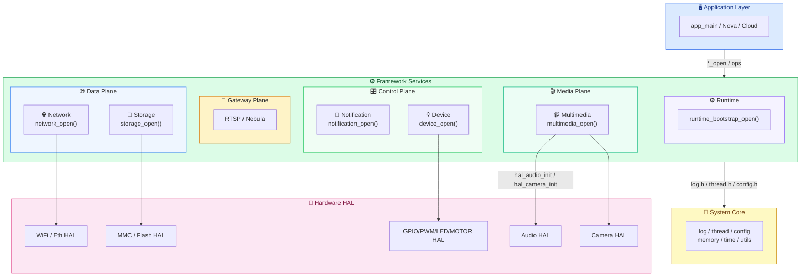
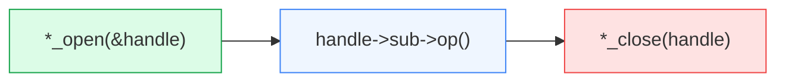
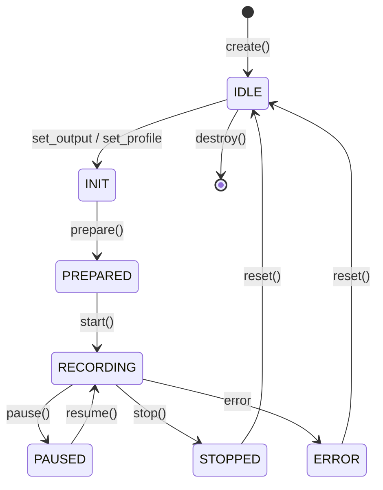
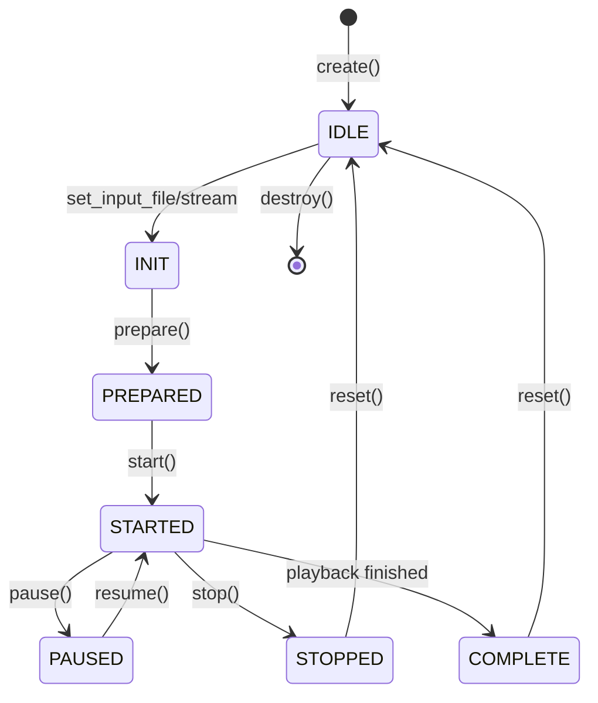
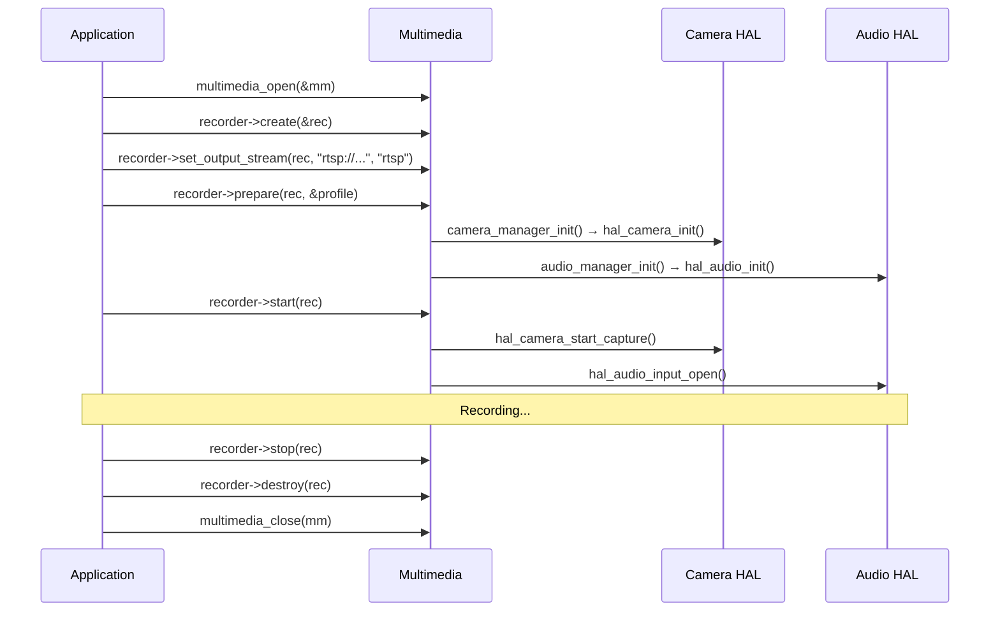
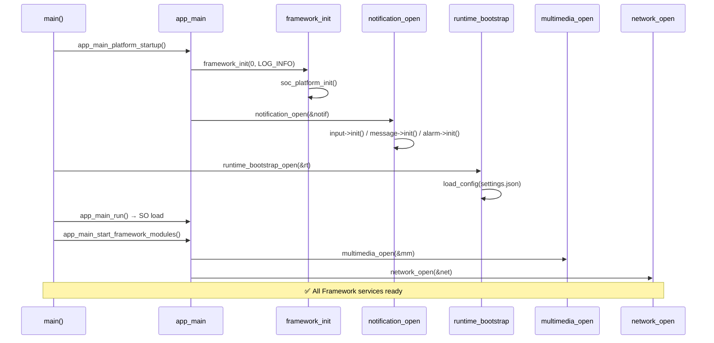
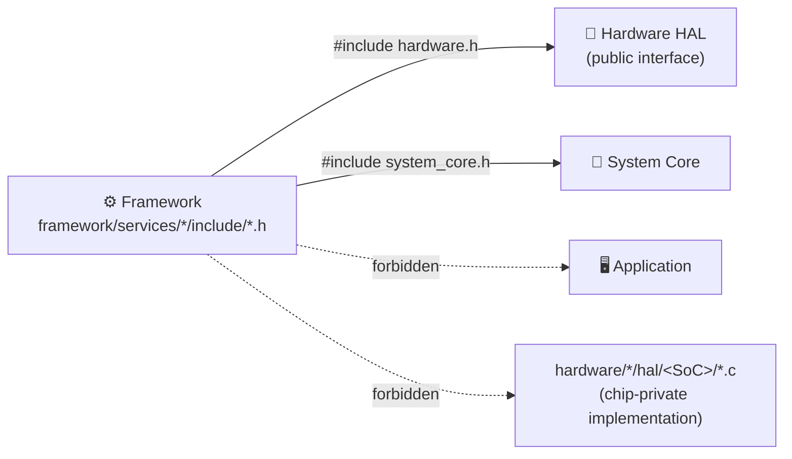

<p align="right"><b>English</b> | <a href="framework.md">中文</a></p>

# Framework Services

> **Scope of this document**: Framework service layer: service inventory and responsibilities, unified lifecycle (`*_open()` → ops → `*_close()`), typical call flows per service, and dependency boundaries.
>
> Per-function signatures: [framework-api.en.md](framework-api.en.md); HAL contracts below: [hardware-hal.en.md](hardware-hal.en.md).

---

## 1. Service Overview



ASCII fallback:

```
┌─ 🖥️ Application (app_main / Nova / Cloud) ─────────────────────┐
└──────────┬───────────────────────────────────────────────────────┘
           │ *_open / ops
┌──────────▼───────────────────────────────────────────────────────┐
│  ⚙️ Framework Services                                            │
│  ┌───────────────┐ ┌────────────┐ ┌───────────┐ ┌──────────────┐ │
│  │ 🎬 Media       │ │ 🎛️ Control  │ │ 🌐 Data    │ │ 🔗 Gateway    │ │
│  │ Multimedia    │ │ Notification│ │ Network   │ │ RTSP / Nebula│ │
│  │               │ │ Device      │ │ Storage   │ │              │ │
│  └───────────────┘ └────────────┘ └───────────┘ └──────────────┘ │
│  ⚙️ Runtime (bootstrap / console / ota / security)                │
└──────────┬─────────────────────────────┬─────────────────────────┘
           │ log/thread/config           │ hal_*_init / hw_module_t
           ▼                             ▼
  🔧 System Core                     🔌 Hardware HAL
```

### 1.1 Service Matrix (Application ↔ Framework ↔ HAL)

| Framework service | Public header | Key HAL / peripherals | Typical app use |
|---|---|---|---|
| 📹 **Multimedia** | `multimedia.h` | Audio / Camera / Display / OSD / GPU | Recording, live streaming, photos, voice calls |
| 🌐 **Network** | `network.h` | WiFi / Ethernet | Provisioning, NTP, Ping, RTSP push |
| 🔔 **Notification** | `notification.h` | Input / IR | Key events, alarms, message queue |
| 💡 **Device** | `device.h` | GPIO / LED / PWM / Motor / Backlight | PTZ, night vision, backlight, power |
| 💾 **Storage** | `storage.h` | MMC / eFlash | TF card, Flash key-value, file recording |
| 🔗 **Gateway** | `nebula_protocol.h` / RTSP | Network | Cloud protocol, RTSP media server |
| ⚙️ **Runtime** | `runtime.h` | — (cross-Framework) | Config load, CLI console, OTA |

### 1.2 Unified Lifecycle Pattern



All Framework services follow the same pattern: `*_open()` obtains a handle → invoke features through ops → `*_close()` releases resources.

---

## 2. Multimedia Service

**Header**: `framework/services/multimedia/include/multimedia.h`
**Version**: `MULTIMEDIA_VERSION` = 1.0.0 (`MULTIMEDIA_VERSION_MAJOR = 1`)

### 2.1 Service Structure

```c
typedef struct {
    recorder_ops_t *recorder;   /* media recording */
    player_ops_t   *player;     /* media playback */
    camera_ops_t   *camera;     /* direct camera access */
    audio_ops_t    *audio;      /* direct audio access */
    osd_ops_t      *osd;        /* OSD overlay */
    void *reserved[8];
} multimedia_t;
```

### 2.2 Global API

| Signature | Description | Return |
|---|---|---|
| `int multimedia_open(multimedia_t **out)` | Open multimedia service, get handle | 0 success; negative error code |
| `int multimedia_close(multimedia_t *multimedia)` | Close service, release all resources | 0 success |

> `multimedia_open()` does not initialize HAL immediately; camera HAL is lazily initialized on first `stream_reg_client()` or `prepare()`.

### 2.3 Recorder API (`multimedia->recorder`)



| Function | Description |
|---|---|
| `create(handle*)` | Create recorder instance → IDLE |
| `destroy(handle)` | Destroy instance (must stop first) |
| `reset(handle)` | Reset to IDLE |
| `set_profile(handle, profile*)` | Set profile (output_flags + module_flags) |
| `prepare(handle, profile*)` | Synchronously prepare (bind HAL capabilities) |
| `prepare_async(handle, profile*)` | Async prepare; fires `MEDIA_RECORDER_EVENT_PREPARED` when done |
| `start(handle)` | Start recording |
| `stop(handle)` | Stop recording |
| `pause(handle)` | Pause |
| `resume(handle)` | Resume |
| `set_output_file(handle, path)` | Output file path or directory (auto date naming for directories) |
| `set_output_stream(handle, url, protocol)` | Streaming URL (RTSP/RTMP) |
| `set_stream_callback(handle, type, cb, userdata)` | Register raw stream callback |
| `get_video_enc_param(handle, param*)` | Current video encode parameters |
| `get_audio_enc_param(handle, param*)` | Current audio encode parameters |
| `set_volume(handle, vol)` | Recording input volume |
| `set_dynamic_param(handle, param*)` | Dynamic bitrate/frame rate/GOP |
| `set_max_duration(handle, ms)` | Max recording duration |
| `set_max_file_size(handle, bytes)` | Max file size |
| `get_state(handle, state*)` | Query state |
| `is_recording(handle, flag*)` | Whether recording |
| `set_event_callback(handle, cb, userdata)` | Register event callback |

**Profile (`media_recorder_profile_t`):**

| Field | Type | Description |
|---|---|---|
| `output_flags` | `media_output_flags_t` | Combine: `CLOUD/LIVE_STREAM/CARD_STORAGE/PREVIEW/TALK/SPEAKER` |
| `module_flags.enable_video` | int | Enable video |
| `module_flags.enable_audio` | int | Enable audio |
| `module_flags.enable_osd` | int | Enable OSD |
| `module_flags.enable_ai` | int | Enable AI |

**Recording events (`media_recorder_event_t`):**
`PREPARED / STARTED / STOPPED / PAUSED / RESUMED / ERROR / INFO / MAX_DURATION_REACHED / MAX_FILE_SIZE_REACHED`

### 2.4 Player API (`multimedia->player`)



| Function | Description |
|---|---|
| `create(handle*)` | Create player |
| `destroy(handle)` | Destroy |
| `reset(handle)` | Reset to IDLE |
| `set_input_file(handle, path)` | Local file |
| `set_input_stream(handle, url, protocol)` | Network stream |
| `set_realtime_source(handle, cam_id, channel, audio_src)` | Live camera source |
| `prepare(handle)` | Sync prepare |
| `prepare_async(handle)` | Async prepare |
| `start(handle)` | Play |
| `stop(handle)` | Stop |
| `pause(handle)` / `resume(handle)` | Pause / resume |
| `seek(handle, pos_ms)` | Seek (ms) |
| `get_position(handle, pos_ms*)` | Current position |
| `get_duration(handle, dur_ms*)` | Total duration |
| `set_volume(handle, vol)` | Playback volume (0–100) |
| `set_mute(handle, mute)` | Mute |
| `set_playback_speed(handle, speed)` | Speed (0.5x–4.0x) |
| `set_window(handle, win)` | Display window handle |
| `set_video_scaling_mode(handle, mode)` | `SCALE_TO_FIT` / `SCALE_WITH_CROPPING` |
| `set_video_show_callback(handle, cb, user)` | Video frame callback (custom draw) |
| `get_state(handle, state*)` | Query state |
| `is_playing(handle, flag*)` | Whether playing |
| `set_event_callback(handle, cb, userdata)` | Event callback |

### 2.5 Camera API (`multimedia->camera`)

> Direct access to camera streams (subscribe to frames, AI analysis, etc.).

| Function | Description |
|---|---|
| `stream_get_configs(streams**, num*)` | All stream configs (from `fw_video_config.json`) |
| `stream_get_id(cam_id, channel)` | Stream index by camera ID + channel |
| `stream_index_by_name(name, out*)` | Stream index by name |
| `stream_index_by_role(role, out*)` | Stream index by role (main/preview/ai/qr) |
| `stream_get_channel_size(stream, w*, h*)` | Stream resolution |
| `stream_enable(stream, enable)` | Enable/disable stream |
| `stream_reg_client(stream, handle*, cb, user)` | Register stream client (triggers lazy HAL init) |
| `stream_unreg_client(handle)` | Unregister client |
| `stream_get_frame(handle, frame*)` | Sync get frame |
| `stream_force_i_frame(stream)` | Force IDR |
| `stream_set_enc_param(stream, param*)` | Dynamic encode params |
| `capture_picture(stream, param*, data**, size*)` | Snapshot (JPEG/PNG) |
| `set_effect(cam, type, value)` | Picture effects (brightness/contrast/saturation, etc.) |
| `set_ai_enabled(enable)` | Global AI on/off |
| `set_ai_scene(scene_id)` | Switch AI scene |
| `ai_get_config(out*, count*)` | AI configuration |
| `load_config(video_cfg, ai_cfg)` | Reload video/AI config |

**AI target types (`media_ai_target_type_t`):**
`HUMAN_SHAPE / HUMAN_FACE / PET / VEHICLE / NON_MOTOR_VEHICLE / HUMAN_HAND / PACKAGE / CRY / HUMAN_UPPER / FACE_RECO / MOTION`

#### 2.5.1 `fw_video_config.json` — capability set + per-app separation

`fw_video_config.json` describes the **board-level video capability set**: which camera channels the board offers
(`channels[]`: resolution/`max_buffers`/`crop`/`num_slices`, etc.), which stream roles (`streams[]`:
encoding, bitrate, `cirbuf_size` for `main/preview/ai/qr/...`). Framework `config_loader.c` loads it;
it is the data source for `stream_get_configs()` / `stream_index_by_role()`.

**Design principle: each app declares its own usage; configs are not shared.** One app’s record/snapshot/preview layout must not
be stuffed into another app’s config, and two apps must not share one app-level video config. Two equivalent mechanisms:

1. **`app_stream_usage` section** (default): In `fw_video_config.json`, add a section per app declaring
   `roles_used`, whether AI is on, which streams use `stream_reg_client`; add a section for new apps without changing the
   `channels/streams` capability set. Nova uses this—`app_stream_usage` has segments for `ipc_camera / camera_app /
   settings_lv_video_ctrl / settings_qr_scan / volc_app`; Luna’s `fw_video_config.json` has `camera_app / settings_lv_video_ctrl`.
2. **App-private full config + `load_config` switch**: When an app needs incompatible sensor crop/resolution/encode
   vs the capability set, give it a full private video config (`channels/streams`), call
   `multimedia->camera->load_config("<private>", "")` on startup, and on exit `load_config(fw_video_config.json)`
   to restore. Luna dashcam uses this—`app_dashcam_config.json` (main 1920×1080 H.264 record +
   sub 1024×576 H.264 RTSP), independent of camera app’s 1600×1200 H.265 capability set.

File location (board rootfs overlay, **not** under `project/<product>/config/`):
`project/<product>/system/<SoC>/<SDK>/board/<Board>/rootfs/utils/etc/config/fw_video_config.json`.
Luna_dev dashcam private config `app_dashcam_config.json` is on the board overlay too
(`project/anypi_luna_dev/.../board/EVB_MBD_KM01A/rootfs/utils/etc/config/`), installed to `/etc/config/` with rootfs.

### 2.6 Audio API (`multimedia->audio`)

| Function | Description |
|---|---|
| `audio_src_enum(srcs**, num*)` | Enumerate audio sources |
| `stream_get_configs(streams**, num*)` | Audio stream configs |
| `stream_reg_client(stream, handle*, cb, user)` | Subscribe to audio stream |
| `stream_unreg_client(handle)` | Unregister |
| `talk_start(dev)` | Start two-way talk (input+output; AEC prerequisite) |
| `talk_stop(dev)` | Stop talk |
| `talk_send_data(dev, frame*)` | Send talk audio frame |
| `out_set_volume(dev, vol)` | Hardware output volume |
| `play_notice(dev, path)` | Play notice sound (async) |
| `play_notice2(dev, path, wait_ms, vol)` | Play notice (wait + volume) |
| `set_audio_algorithm_enable(dev, alg, enable)` | VAD/AEC/NS/CRY/ASLC/EQ/SSL on/off |
| `set_audio_algorithm_param(dev, alg, name, val, size)` | Algorithm parameters |
| `get_max_amplitude(dev, amp*)` | Max amplitude |

> **AEC note**: AEC is available only after `talk_start()`, with input and output enabled and the same sample rate.

### 2.7 OSD API (`multimedia->osd`)

| Function | Description |
|---|---|
| `set_time_osd(cam, channel, enable)` | Timestamp overlay on/off |
| `set_text_osd(cam, channel, text)` | Text overlay |

### 2.8 Error Codes

| Macro | Description |
|---|---|
| `MULTIMEDIA_OK` | Success (= 0) |
| `MULTIMEDIA_ERROR_INVALID_PARAM` | Invalid parameter |
| `MULTIMEDIA_ERROR_NOT_INIT` | Not initialized |
| `MULTIMEDIA_ERROR_BUSY` | Resource busy |
| `MULTIMEDIA_ERROR_IO` | I/O error |
| `MULTIMEDIA_ERROR_INVALID_STATE` | Invalid state |
| `MULTIMEDIA_ERROR_TIMEOUT` | Timeout |
| `MULTIMEDIA_ERROR_MEMORY` | Out of memory |

### 2.9 Typical Call Flow



---

## 3. Network Service

**Header**: `framework/services/network/include/network.h`
**Version**: `NETWORK_VERSION` = 1.0.0

### 3.1 Service Structure

```c
typedef struct network_t {
    network_wifi_ops_t     *wifi;       /* WiFi */
    network_ethernet_ops_t *ethernet;   /* Ethernet */
    network_ntp_ops_t      *ntp;        /* NTP */
    network_ping_ops_t     *ping;       /* Ping */
    network_rtsp_ops_t     *rtsp;       /* RTSP server control */
    void *reserved[8];
} network_t;
```

### 3.2 Global API

| Function | Description |
|---|---|
| `int network_open(network_t **network)` | Open network service |
| `int network_close(network_t *network)` | Close network service |

### 3.3 WiFi API (`network->wifi`)

**WiFi state (`network_wifi_state_e`):**
`DISABLED / DISABLING / ENABLED / ENABLING / UNKNOWN`

**STA (`network->wifi->station`):**

| Function | Description |
|---|---|
| `connect(config*)` | Connect (SSID + password) |
| `disconnect()` | Disconnect |
| `get_state()` | STA connection state |
| `get_ip(ip)` | IP address |
| `get_mac(mac)` | MAC address |
| `scan(results*, count*)` | Scan APs |

**AP (`network->wifi->ap`):**

| Function | Description |
|---|---|
| `start(config*)` | Start AP |
| `stop()` | Stop AP |
| `get_state()` | AP state |

### 3.4 Ethernet API (`network->ethernet`)

| Function | Description |
|---|---|
| `get_ip(ip)` | Ethernet IP |
| `get_mac(mac)` | Ethernet MAC |
| `get_state()` | Link state |

### 3.5 NTP API (`network->ntp`)

| Function | Description |
|---|---|
| `init()` | Start NTP client |
| `deinit()` | Stop |
| `set_server(ip)` | NTP server IP |

### 3.6 Ping API (`network->ping`)

| Function | Description |
|---|---|
| `ping_ipv4(dest, ttl, seq, timeout)` | IPv4 ping |
| `ping_ipv6(dest, ttl, seq, timeout)` | IPv6 ping |

### 3.7 RTSP API (`network->rtsp`)

| Function | Description |
|---|---|
| `init()` / `deinit()` | Init/deinit RTSP server |
| `start()` / `stop()` | Start/stop RTSP service |
| `set_video_param_callback(cb)` | Video parameter request callback |
| `set_audio_param_callback(cb)` | Audio parameter request callback |
| `set_dev_param_callback(cb)` | Device parameter request callback |

### 3.8 Error Codes (partial)

| Macro | Description |
|---|---|
| `NETWORK_OK` | Success |
| `NETWORK_ERROR_CONNECTION_FAILED` | Connection failed |
| `NETWORK_ERROR_DEVICE_NOT_AVAILABLE` | Device unavailable |
| `NETWORK_ERROR_NETWORK_UNREACHABLE` | Network unreachable |
| `NETWORK_ERROR_INTERFACE_NOT_FOUND` | Interface not found |
| `NETWORK_ERROR_TIMEOUT` | Timeout |

---

## 4. Notification Service

**Header**: `framework/services/notification/include/notification.h`

### 4.1 Service Structure

```c
typedef struct notification_t {
    alarm_ops_t         *alarm;    /* alarm events */
    message_ops_t       *message;  /* system messages */
    message_queue_ops_t *queue;    /* message queue */
    input_ops_t         *input;    /* input events */
} notification_t;
```

### 4.2 Global API

| Function | Description |
|---|---|
| `int notification_open(notification_t **n)` | Open notification service |
| `int notification_close(notification_t *n)` | Close notification service |

### 4.3 Alarm API (`notification->alarm`)

**Alarm types (`alarm_type_t`):**

| Value | Description |
|---|---|
| `ALARM_TYPE_MD` | Motion detection |
| `ALARM_TYPE_MAN_BODY` | Human body |
| `ALARM_TYPE_VOICE` | Voice |
| `ALARM_TYPE_FACE` | Face |
| `ALARM_TYPE_CRY` | Cry |
| `ALARM_TYPE_PREROLL` | Preroll |
| `ALARM_TYPE_VEHICLE_GEN/MOTOR/BIKE` | Vehicle |
| `ALARM_TYPE_ALERTAREA` | Alert area |
| `ALARM_TYPE_TRANSGRESSION` | Line crossing |
| `ALARM_TYPE_PET` | Pet |
| `ALARM_TYPE_PACKAGE` | Package |
| `ALARM_TYPE_CALL_TO_SERVER_S/E` | Call server start/end |

| Function | Description |
|---|---|
| `init()` | Init alarm manager |
| `uninit()` | Deinit |
| `post(type, data, len)` | Post alarm (AI/MD driven) |
| `detach(type)` | Clear alarm type |
| `reg_client(type, cb, user, min_interval_ms)` | Register consumer (min interval debounce) |
| `unreg_client(type, cb)` | Unregister consumer |

### 4.4 Message API (`notification->message`)

**Message types (`message_type_t`):**
`SLEEP / WAKEUP / INVERSION / LSSL / TALK_IN / TALK_OUT / NET_CONNECT`

| Function | Description |
|---|---|
| `init()` | Init message manager |
| `post(type, data, len)` | Post message |
| `reg_client(type, cb, user)` | Subscribe |
| `unreg_client(type, cb)` | Unsubscribe |

### 4.5 Message Queue API (`notification->queue`)

| Function | Description |
|---|---|
| `init()` / `uninit()` | Init/deinit |
| `create(name)` | Create named queue |
| `destroy(name)` | Destroy queue |
| `read(handle, msg, len*, time_ms*)` | Read message |
| `write(handle, msg, len)` | Write message |

### 4.6 Input API (`notification->input`)

**Device types (`input_device_type_t`):**
`KEYPAD / TOUCH / MOUSE / ENCODER / SENSOR_PIR`

**Actions (`input_action_t`):**
`DOWN / UP / REPEAT / LONGPRESS / DOUBLE_CLICK / TRIPLE_CLICK`

**Key codes (`input_keycode_t`, partial):**
`HOME(102) / BACK(158) / MENU(139) / OK(352) / UP/DOWN/LEFT/RIGHT / POWER(116) / TALK(417) / VOLUMEUP/DOWN / CAMERA_SNAP(212)`

| Function | Description |
|---|---|
| `init()` / `deinit()` | Init/deinit input |
| `subscribe(priority, keymask, cb, user)` | Subscribe (higher priority first) |
| `unsubscribe(cb, user)` | Unsubscribe |
| `set_focus(token)` | Focus token (dispatch) |
| `set_debounce_ms(ms)` | Debounce |
| `set_repeat_ms(ms)` | Long-press repeat interval |

---

## 5. Device Service

**Header**: `framework/services/device/include/device.h`
**Version**: `DEVICE_VERSION` = 1.0.0

### 5.1 Global API

| Function | Description |
|---|---|
| `int device_open(device_t **device)` | Open device service |
| `int device_close(device_t *device)` | Close device service |

### 5.2 LED API (`device->led`)

**LED types (`led_type_t`):** `STATUS_RED / STATUS_BLUE / IR / PILOT`
**LED modes (`led_mode_t`):** `OFF / ON / BLINK / BREATHE`
**LED scenes (`led_scene_t`):** `SYSTEM / NORMAL / ALARM / RECORDING / NETWORK / USER`
**LED priority (`led_priority_t`):** `LOW / NORMAL / HIGH / CRITICAL`

| Function | Description |
|---|---|
| `init()` | Init LED manager |
| `deinit()` | Deinit |
| `set_scene(config*)` | Scene config (with priority) |
| `clear_scene(scene)` | Clear scene |
| `get_active_scene(scene*)` | Active scene |
| `set_led(type, mode, brightness)` | Direct LED |
| `set_blink(type, on_ms, off_ms)` | Blink timing |
| `get_led(type, mode*, brightness*)` | LED state |

**Brightness:** `LED_BRIGHTNESS_MIN(0)` ~ `LED_BRIGHTNESS_MAX(255)`, default 128

### 5.3 PTZ API (`device->ptz`)

**Commands (`ptz_cmd_t`):**

| Enum | Description |
|---|---|
| `PTZ_CMD_UP/DOWN/LEFT/RIGHT` | Continuous move |
| `PTZ_CMD_LEFT_UP/RIGHT_UP/LEFT_DOWN/RIGHT_DOWN` | Diagonal |
| `PTZ_CMD_STOP` | Stop |
| `PTZ_CMD_*_STEP` | Single step (UP/DOWN/LEFT/RIGHT) |

**Track mode (`ptz_track_mode_t`):** `DISABLE / MOTION / BODY / PET / VEHICLE`

| Function | Description |
|---|---|
| `init()` | Init PTZ |
| `deinit()` | Deinit |
| `control(cmd, speed)` | PTZ command (speed 0–100) |
| `get_position(pos*)` | Current pan/tilt |
| `set_position(pan, tilt)` | Target position |
| `go_home()` | Home |
| `calibrate()` | Auto calibrate |
| `set_preset(id, name, pan, tilt)` | Save preset |
| `go_preset(id)` | Go to preset |
| `get_preset(id, info*)` | Preset info |
| `set_track_mode(mode)` | Tracking mode |
| `get_track_mode(mode*)` | Get tracking mode |

### 5.4 Power API (`device->power`)

**Suspend mode (`power_manager_suspend_mode_t`):** `NORMAL / DEEP`

| Function | Description |
|---|---|
| `init()` | Init power manager |
| `deinit()` | Deinit |
| `suspend(mode)` | Suspend |
| `wakeup()` | Wake |
| `reboot()` | Reboot |
| `register_suspend_hook(cb, user)` | Pre-suspend hook |
| `register_wakeup_hook(cb, user)` | Post-wake hook |

### 5.5 Night Vision API (`device->night_vision`)

**Mode (`nightvision_mode_t`):** `NORMAL (B/W night) / COLOR (full color)`
**Normal switch (`nightvision_normal_switch_t`):** `DAY / NIGHT / AUTO`
**Color switch (`nightvision_color_switch_t`):** `GRAY / COLOR / SMART`
**State (`nightvision_state_t`):** `DAY / NIGHT_IR / NIGHT_WHITE_LED`

| Function | Description |
|---|---|
| `init()` | Init night vision |
| `deinit()` | Deinit |
| `set_mode(mode)` | NORMAL/COLOR |
| `set_switch(switch_val)` | Switch policy |
| `get_state(state*)` | Night vision state |

### 5.6 Backlight API (`device->backlight`)

| Function | Description |
|---|---|
| `init()` | Init backlight |
| `deinit()` | Deinit |
| `set_brightness(val)` | Brightness (0–255) |
| `get_brightness(val*)` | Get brightness |
| `set_auto(enable)` | Auto brightness |

### 5.7 Device Error Codes

| Macro | Description |
|---|---|
| `DEVICE_ERROR_LED_NOT_FOUND` | LED not found |
| `DEVICE_ERROR_LED_SCENE_CONFLICT` | Scene priority conflict |
| `DEVICE_ERROR_PTZ_NOT_READY` | PTZ not ready |
| `DEVICE_ERROR_PTZ_POSITION_LIMIT` | Angle limit |
| `DEVICE_ERROR_PTZ_MOTOR_FAULT` | Motor fault |
| `DEVICE_ERROR_NV_IRCUT_FAILED` | IR-Cut switch failed |
| `DEVICE_ERROR_BL_PWM_FAILED` | Backlight PWM failed |

---

## 6. Storage Service

**Header**: `framework/services/storage/include/storage.h`
**Version**: 1.0.0

### 6.1 Global API

| Function | Description |
|---|---|
| `int storage_open(storage_t **storage)` | Open storage service |
| `int storage_close(storage_t *storage)` | Close storage service |

### 6.2 TF Card API (`storage->tfcard`)

**Status (`storage_tfcard_status_e`):**
`NOT_PRESENT / PRESENT / MOUNTED / ERROR / FULL`

| Function | Description |
|---|---|
| `init(mount_path)` | Init and mount TF card (default `/mnt/tfcard`) |
| `deinit()` | Deinit |
| `get_status()` | TF card status |
| `get_total_size(size*)` | Total size (bytes) |
| `get_free_size(size*)` | Free space |
| `format()` | Format TF card |

### 6.3 Flash API (`storage->flash`)

| Function | Description |
|---|---|
| `write_from_file(dev, src, offset)` | Write Flash partition from file |
| `read_to_file(dev, dst, offset, len)` | Read Flash to file |
| `erase(dev, offset, len)` | Erase partition |

---

## 7. Runtime Family (`framework/runtime/include/*.h`)

The runtime family is included through umbrella header `runtime.h`:

```c
#include "runtime.h"
/* equivalent to:
 *   runtime_bootstrap.h  console.h  ota.h  otapack.h  reboot_info.h  runtime_error.h
 */
```

### 7.1 Runtime Bootstrap (`runtime_bootstrap.h`)

| Symbol | Prototype | Description |
|---|---|---|
| `runtime_bootstrap_t` | `struct { int (*load_config)(const char*); }` | Instance ops |
| `runtime_bootstrap_init` | `int runtime_bootstrap_init(const char *config_path)` | Direct init (no open) |
| `runtime_bootstrap_open` | `int runtime_bootstrap_open(runtime_bootstrap_t **bs)` | Get instance |
| `runtime_bootstrap_close` | `int runtime_bootstrap_close(runtime_bootstrap_t *bs)` | Release instance |
| `runtime_bootstrap_get_state` | `system_state_e runtime_bootstrap_get_state(void)` | Read state |
| `runtime_bootstrap_set_state` | `int runtime_bootstrap_set_state(system_state_e state)` | Write state |
| `framework_init` | `int framework_init(int soc_mode, int log_level)` | Init SoC platform/Log/Thread/HAL modules |

System state: `system_state_init(0)` / `system_state_sleep(1)` / `system_state_run(2)`.

### 7.2 Console (`console.h`)

Debug terminal and command registration.

| Symbol | Prototype | Description |
|---|---|---|
| `console_init` | `int console_init(const char *cmd_path)` | Start console thread; `NULL` uses default |
| `console_deinit` | `int console_deinit(void)` | Stop |
| `console_loop` | `int console_loop(void)` | Block on stdin commands |
| `console_print` | `int console_print(const char *title_color, const char *title, const char *msg_color, const char *sub_title, const char *fmt, ...)` | Colored output |
| `console_cmd_register` | `int console_cmd_register(const char *cmd, FN_COMMAND fn, const char *help)` | Register command |
| `command_pkt` | `struct { int n; char cmd[32]; char p[16][256]; }` | Command + args |
| `FN_COMMAND` | `int (*)(const command_pkt*, char *ack)` | Command callback |

Constants: `COMMAND_STRING_LEN_MAX=32`, `COMMAND_PARAMS_NUM_MAX=16`, `COMMAND_PARAMS_LEN_MAX=256`.
Color macros: `CONSOLE_ERROR_COLOR / ..._WARN / ..._MSG / ..._DEBUG / ..._INPUT / ..._HIGHLIGHT / ..._MODE_OFF`.

### 7.3 OTA (`ota.h` + `otapack.h`)

Firmware upgrade.

| Symbol | Prototype | Description |
|---|---|---|
| `ota_info_t` | `struct { char cDownloadUrl[256]; int iFwVersion; }` | Upgrade parameters |
| `ota_status_e` | `IDLE(0) / DOWNLIADING(1) / INSTALLING(2) / FAIL(3) / DONE(4)` | Status |
| `ota_init` | `int ota_init(void)` | Init |
| `ota_start` | `int ota_start(ota_info_t info)` | Start download+install |
| `ota_stop` | `int ota_stop(void)` | Stop |
| `ota_get_status` | `ota_status_e ota_get_status(void)` | Query status |
| `ota_get_progress_percent` | `int ota_get_progress_percent(void)` | Progress 0–100 |

**OTA Pack (`otapack.h`) key types:**

| Type | Description |
|---|---|
| `ENCRYPT_TYPE_E` | `ENCRYPT_NONE / AES_CBC128 / AES_CBC192 / AES_CBC256` |
| `MSG_DIGEST_TYPE_E` | `MD_NONE / MD_SHA1 / MD_SHA224 / MD_SHA256 / MD_SHA384 / MD_SHA512` |
| `CHECK_TYPE_E` | `CHECK_TYPE_FILELEN(0) / CHECK_TYPE_CRC32(1)` |
| `OTA_FW_HEADINFO` | Fixed 256-byte header union (Magic/upgradeType/checkType/filelen/checkSum/method_md/method_cipher/iSrcFileLen) |

Constants: `DEFAULT_CIPHER="AES-128-CBC"`, `DEFAULT_MD="SHA1"`, `DEFAULT_KEY="cipherkeycipherkey"`.

### 7.4 Reboot Info (`reboot_info.h`)

Record reboot reason for diagnostics.

| Symbol | Prototype | Description |
|---|---|---|
| `reboot_reason_e` | enum in range `1000~3003` | Device/SDK/cloud reboot families |
| `reboot_param_t` | `struct { reboot_reason_e reason; time_t ts; char message[256]; }` | Reboot record |
| `reboot_info_set` | `int reboot_info_set(reboot_reason_e reason, const char *msg)` | Write reason |
| `reboot_info_get` | `int reboot_info_get(reboot_param_t *info)` | Read last reboot |
| `reboot_info_init` | `int reboot_info_init(void)` | Load from config |
| `reboot_info_refresh_powerdown_time` | `int reboot_info_refresh_powerdown_time(void)` | Refresh power-down timestamp |

**Reason code quick reference:**

| Family | Base | Examples |
|---|---|---|
| Device | `1000` | `POWER_DOWN(1001)`, `CRASH(1002)`, `HWATCHDOG(1003)`, `FACTORY_RESET(1004)`, `ABNORMAL(1005)` |
| SDK | `2000` | `SCHEDULED_MAINTENANCE(2001)`, `SWATCHDOG(2002)` |
| Cloud | `3000` | `CLOUD_REBOOT(3001)`, `CLOUD_UPGRADE(3002)`, `CLOUD_FACTORY_RESET(3003)` |

---

## 8. Gateway Protocol Layer (`framework/gateway/*/include/*.h`)

Gateway provides external protocol services (RTSP, Nebula private protocol + HTTP + Pair), following `_open()`/ops/`_close()` like Services.

### 8.1 RTSP Protocol (`rtsp_protocol.h`)

| Symbol | Prototype | Description |
|---|---|---|
| `rtsp_protocol_t` | `struct { rtsp_protocol_ops_t *ops; multimedia_t *multimedia; rtsp_stream_handle_t stream_handles[8]; ... }` | Context |
| `rtsp_protocol_open` | `int rtsp_protocol_open(rtsp_protocol_t **rtsp)` | Open instance |
| `rtsp_protocol_close` | `int rtsp_protocol_close(rtsp_protocol_t *rtsp)` | Close instance |
| `ops->server->start` | `int (*)(rtsp_protocol_t*)` | Start RTSP server |
| `ops->server->stop` | `int (*)(rtsp_protocol_t*)` | Stop |
| `ops->server->get_status` | `int (*)(rtsp_protocol_t*, bool *is_running)` | Status |
| `rtsp_stream_type_t` | `LIVE(0) / PLAYBACK(1)` | Stream type |
| `rtsp_stream_handle_t` | `{ used; stream_type; channel; video_handle; audio_handle }` | Stream handle |

**Optional app hooks (weak symbols, for multi-protocol coordination):**

```c
void framework_rtsp_on_play_state(int playing, const char *source_token);
```

Error family: `RTSP_PROTOCOL_OK / ..._INVALID_PARAM / ..._NOT_INIT / ..._MEMORY / ..._TIMEOUT / ..._NOT_FOUND / ..._ALREADY_EXISTS / ..._BUSY / ..._IO / ..._OPERATION_FAILED`.

### 8.2 Nebula Protocol (`nebula_protocol.h`)

Version: `NEBULA_PROTOCOL_VERSION` = `MAJOR.MINOR.PATCH` (default `1.0.0`).

```c
typedef struct {
    nebula_network_ops_t *network;   /* private TCP protocol */
    nebula_http_ops_t    *http;      /* HTTP service */
    nebula_pair_ops_t    *pair;      /* pairing */
    void *reserved[8];
} nebula_protocol_t;
```

| Module | ops | Prototype |
|---|---|---|
| Network | `init/deinit/start/stop` | `int (*)(void)` |
|  | `send_to_all_clients` | `int (*)(const void *data, size_t len)` |
|  | `send_to_local_client` | `int (*)(const void *data, size_t len)` |
|  | `start_stream/stop_stream` | `int (*)(nebula_network_handle_t)` |
|  | `link_server_init/deinit` | `int (*)(void)` |
| HTTP | `init/deinit/start/stop` | `int (*)(void)` |
| Pair | `init/deinit` | `int (*)(void)` |
|  | `scan_connect_run` | `int (*)(void *arg)` |
|  | `play_file` | `int (*)(const char *name)` |

Public API:

```c
int nebula_protocol_open (nebula_protocol_t **nebula);
int nebula_protocol_close(nebula_protocol_t  *nebula);

/* Optional app hook: multi-protocol routing */
void framework_nebula_on_link_state(int linked, const char *server_ip, int server_port);
```

Error family: `NEBULA_PROTOCOL_OK / ..._INVALID_PARAM / ..._NOT_INIT / ..._MEMORY / ..._TIMEOUT / ..._NOT_FOUND / ..._ALREADY_EXISTS / ..._BUSY / ..._IO / ..._PERMISSION_DENIED / ..._NOT_SUPPORTED / ..._INVALID_STATE / ..._OPERATION_FAILED`.

---

## 9. Framework Initialization Flow



---

## 10. Dependency Boundaries



| ✅ Allowed | ❌ Forbidden |
|---|---|
| `#include "system_core.h"` / `"log.h"` / `"thread.h"` | Direct `#include` of any `hardware/*/hal/AnyCloud39AV200/*.h` |
| Call HAL through `hardware/include/*.h` | Depend on any `application/` header |
| Limited inter-service calls (no cycles) | Circular dependencies |

---

## 11. Related Guides

- System overview: [architecture/overview.en.md](../architecture/overview.en.md)
- Application: [application.en.md](application.en.md)
- HAL concepts: [hardware-hal.en.md](hardware-hal.en.md)
- HAL API: [hardware-api.en.md](hardware-api.en.md)
- System Core: [system-core.en.md](system-core.en.md)
- Framework API: [framework-api.en.md](framework-api.en.md)
- New service: [Add Framework service](../skills/celestia-framework.en.md)
- Build and BSP: [quick-start/bsp-and-products.en.md](../quick-start/bsp-and-products.en.md)
- API index: [guide/api-index.en.md](api-index.en.md)