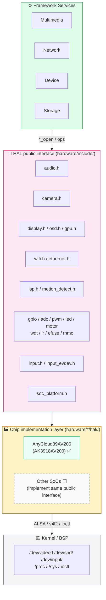
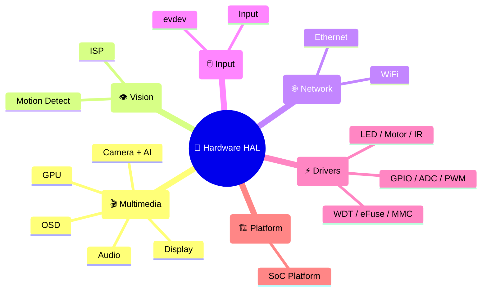
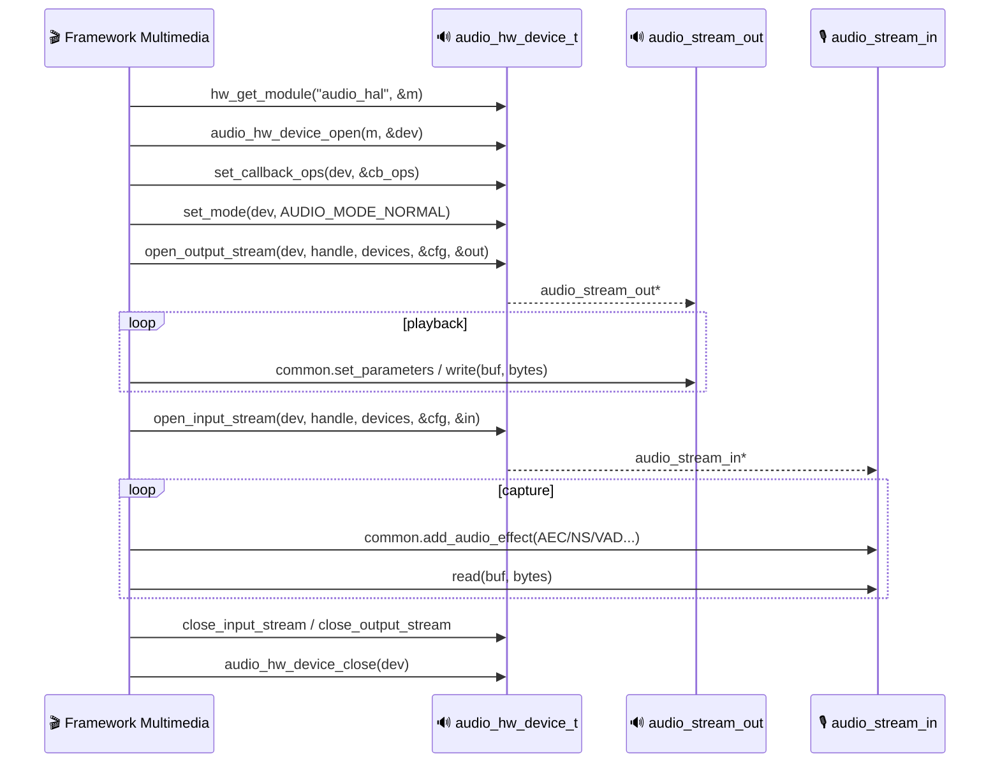
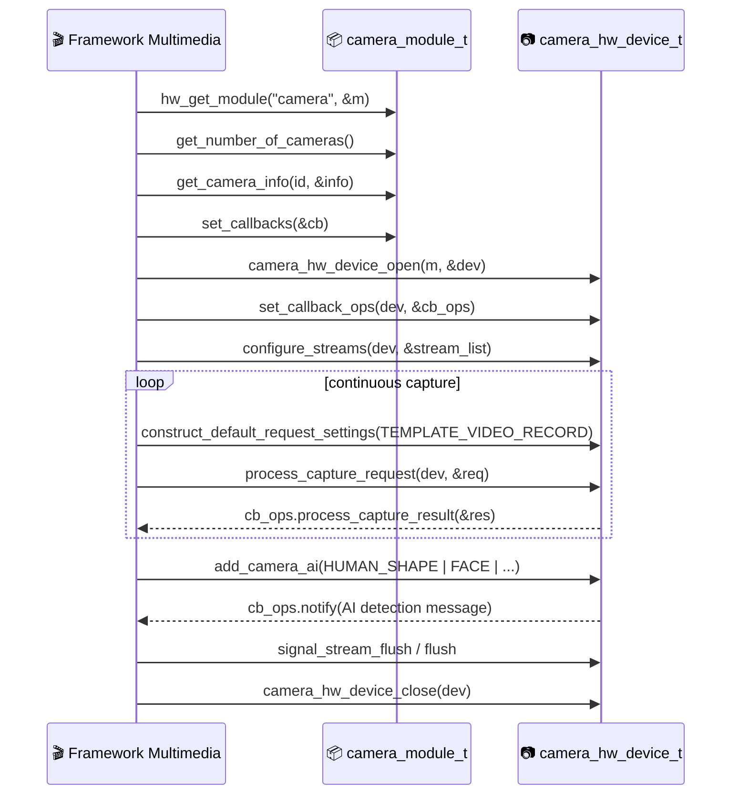
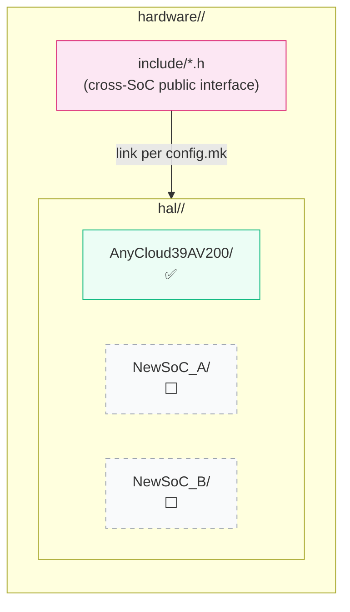
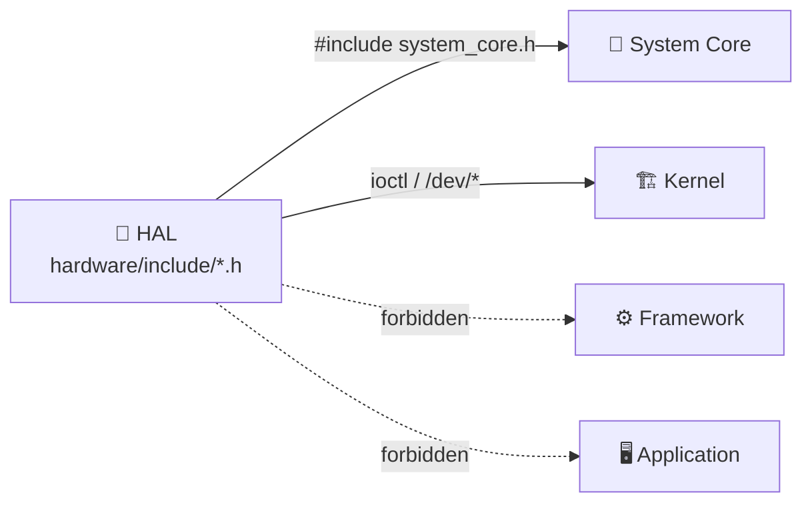

<p align="right"><b>English</b> | <a href="hardware-hal.md">中文</a></p>

# Hardware HAL

> **Scope of this document**: Hardware Abstraction Layer (HAL): the contract in public headers under `hardware/include/`, module inventory and capabilities, multi-SoC directory layout, and minimal steps to add a HAL module or a new SoC.
>
> Per-function signatures: [hardware-api.en.md](hardware-api.en.md); layering, contracts, and runtime model: [Architecture overview](../architecture/overview.en.md); terminology: [Glossary](../glossary.en.md) is the single source of truth.

---

## 1. HAL Overall Architecture



ASCII fallback:

```
┌── ⚙️ Framework Services ──────────────────────────────────────┐
│  Multimedia / Network / Device / Storage                       │
└──────────────┬─────────────────────────────────────────────────┘
               │  *_open / ops calls
┌──────────────▼─────────────────────────────────────────────────┐
│  📜 HAL public interface  (hardware/include/*.h)                        │
│    audio / camera / display / wifi / vision / drivers / soc    │
└──────────────┬─────────────────────────────────────────────────┘
               │  link to HAL implementation for the selected SoC
┌──────────────▼─────────────────────────────────────────────────┐
│  🏭 Chip implementation (hardware/*/hal/<SoC>/)                            │
│    [✅ AnyCloud39AV200]    [⬜ New SoC: extend same public interface]       │
└──────────────┬─────────────────────────────────────────────────┘
               │  ALSA / v4l2 / sysfs / ioctl
┌──────────────▼─────────────────────────────────────────────────┐
│  🏗️ Kernel / BSP   (/dev/video0, /dev/snd/, .ko drivers)        │
└────────────────────────────────────────────────────────────────┘
```

---

## 2. HAL Base Contract (hardware.h)

**Header**: `hardware/include/hardware.h`
**HAL API version**: `HARDWARE_HAL_API_VERSION = 1.0`

### 2.1 Core Data Structures

```c
/* ① Module header (every HAL module must use this as the first field) */
typedef struct hw_module_t {
    uint32_t  tag;                  /* = HARDWARE_MODULE_TAG ('HWMT') */
    uint16_t  module_api_version;   /* module version 0x0100 = v1.0 */
    uint16_t  hal_api_version;      /* HAL interface version */
    const char *id;                 /* module id: audio / camera / ... */
    const char *name;               /* descriptive name */
    const char *author;             /* author */
    struct hw_module_methods_t *methods;   /* must include open() */
    void *dso;                      /* filled when dynamically loaded */
    uint32_t reserved[32-7];
} hw_module_t;

/* ② Method table */
typedef struct hw_module_methods_t {
    int (*open)(const struct hw_module_t *module, const char *id,
                struct hw_device_t **device);
} hw_module_methods_t;

/* ③ Device header (every HAL device must use this as the first field) */
typedef struct hw_device_t {
    uint32_t  tag;                  /* = HARDWARE_DEVICE_TAG ('HWDT') */
    uint32_t  version;
    struct hw_module_t *module;
    uint32_t  reserved[12];
    int (*close)(struct hw_device_t *device);
} hw_device_t;
```

### 2.2 Module Registration Convention

```c
#define HAL_MODULE_INFO_SYM        HMI       /* every HAL must export this global */
#define HAL_MODULE_INFO_SYM_AS_STR "HMI"
```

### 2.3 Module Management API

| Function | Description |
|---|---|
| `int hw_module_init(void)` | Initialize the HAL module management system |
| `int hw_register_module(const hw_module_t *)` | Register a module |
| `int hw_unregister_module(const hw_module_t *)` | Unregister a module |
| `int hw_get_module(const char *id, const hw_module_t **)` | Look up by id |
| `int hw_get_module_by_class(class_id, inst, module**)` | Look up by class + instance |

---

## 3. HAL Module Overview (by Category)



### 3.1 Complete Module List

| Category | Module | Public header | Typical implementation path | Status |
|---|---|---|---|---|
| **🎬 Multimedia** | Audio | `audio.h` | `audio/hal/AnyCloud39AV200/hal_audio.c` (private) | ✅ |
| | Camera + AI | `camera.h` | `camera/hal/AnyCloud39AV200/hal_camera_ai.c` (private) | ✅ |
| | Display | `display.h` | `display/` | ✅ |
| | OSD | `osd.h` | `osd/` | ✅ |
| | GPU | `gpu.h` | `gpu/` | ✅ |
| **👁️ Vision** | ISP | `isp.h` | `vision/isp/` | ✅ |
| | Motion Detect | `motion_detect.h` | `vision/motion_detect/` | ✅ |
| **🌐 Network** | WiFi | `wifi.h` | `network/wifi/` | ✅ |
| | Ethernet | `ethernet.h` | `network/ethernet/` | ✅ |
| **🖱️ Input** | Input | `input.h` | `input/` | ✅ |
| | evdev | `input_evdev.h` | `input/evdev/` | ✅ |
| **⚡ Drivers** | GPIO | `gpio.h` | `driver/gpio/` | ✅ |
| | ADC | `adc.h` | `driver/adc/` | ✅ |
| | PWM | `pwm.h` | `driver/pwm/` | ✅ |
| | LED | `led.h` | `driver/led/` | ✅ |
| | Motor | `motor.h` | `driver/motor/` | ✅ |
| | WDT | `wdt.h` | `driver/wdt/` | ✅ |
| | IR | `ir.h` | `driver/ir/` | ✅ |
| | eFuse | `efuse.h` | `driver/efuse/` | ✅ |
| | Block Device | `mmc.h` | `driver/blkdev/` | ✅ |
| **🏗️ Platform** | SoC Platform | `soc_platform.h` | `soc_platform/` | ✅ |

---

## 4. Audio HAL

> **Single public header**: `hardware/include/audio.h`
> SoC-private implementations (e.g. `hardware/audio/hal/AnyCloud39AV200/hal_audio.c`) are not exported; Framework calls them only through `audio_hw_device_t` ops.

### 4.1 Identity and Entry Points

| Item | Value |
|---|---|
| Module ID | `AUDIO_HARDWARE_MODULE_ID = "audio_hal"` |
| Interface | `AUDIO_HARDWARE_INTERFACE = "audio_hw_if"` |
| Module struct | `struct audio_module { struct hw_module_t common; }` |
| Device struct | `audio_hw_device_t` (12 ops) |
| Open | `audio_hw_device_open(module, &dev)` |
| Close | `audio_hw_device_close(dev)` |
| Module init | `int hw_audio_module_init(void)` |

### 4.2 Call Flow (Framework → `audio.h` public contract)



### 4.3 Key Public Capabilities

| Category | Entry | Description |
|---|---|---|
| **Device routing** | `audio_devices_t` enum | `OUT_SPEAKER/LINE/USB/BUS`, `IN_AMIC/DMIC/LINE/BUS0/BUS1/USB/LOOPBACK` |
| **Operating mode** | `audio_mode_t` + `set_mode` | `NORMAL / MUSIC / CALL` |
| **Effects** | `audio_effect_type_t` bitmask | Audio: ASLC/EQ/AEC/NS/Resample; detection: VAD/CpuCry/NpuCry; SSL: SSL/LSSL/CSSL |
| **Effect results** | `audio_notify_msg_t` | Report detect/SSL results via `audio_callback_ops.notify()` |
| **Channels / format** | `audio_channel_mask_t` / `audio_format_t` | Primarily PCM 16-bit; common containers MP3/AMR/AAC/Opus, etc. |
| **Time-varying playback** | `audio_playback_rate_t` + `set_playback_rate_parameters` | Speed 0.01–20.0, pitch 0.25–4.0 |
| **Stream query** | `audio_stream_t.get_sample_rate/get_buffer_size/get_channels/get_format/get_device` | Generic attributes |
| **Control** | `audio_stream_t.set_parameters("Volume"/"AIParam"/"Vad"/"NpuCry"/"CpuCry"/"Lssl"/"AIReboot", ...)` | Unified key-value control plane |
| **Debug dump** | `audio_stream_t.dump(file_path, file_name, enable)` | Stream capture to file |

> Full fields, ops list, and error codes: [hardware-api.en.md](hardware-api.en.md).

---

## 5. Camera HAL

> **Single public header**: `hardware/include/camera.h`
> SoC-private implementations (e.g. `hardware/camera/hal/AnyCloud39AV200/hal_camera_ai.c`) are not exported; they are used only through `camera_module_t` / `camera_hw_device_t` ops.

### 5.1 Identity and Entry Points

| Item | Value |
|---|---|
| Module ID | `CAMERA_HARDWARE_MODULE_ID = "camera"` |
| Interface | `CAMERA_HARDWARE_INTERFACE = "camera_hw_if"` |
| Module struct | `camera_module_t` (7 module-level ops) |
| Device struct | `camera_hw_device_t` (14 ops) |
| Open | `camera_hw_device_open(module, &dev)` |
| Close | `camera_hw_device_close(dev)` |
| Module init | `int hw_camera_module_init(void)` |

### 5.2 Call Flow (Framework → `camera.h` public contract)



### 5.3 Key Public Capabilities

| Category | Entry | Description |
|---|---|---|
| **Multi-camera** | `camera_id_t` (up to 5), `camera_channel_id_t` (Main/Sub/Third/Fourth) | Multiple sensors + channels |
| **Codec** | `camera_codec_config_t` | AVC / HEVC / MJPEG / YUV / RAW + Profile + Level |
| **Rate control** | `camera_rc_config_t` | CBR / VBR / AVBR / CVBR / FixQP / QPMap |
| **GOP** | `camera_gop_config_t` | GOP length, long-term reference frames |
| **Stream splice** | `camera_stream_format_t` | Single / vertical / horizontal splice |
| **Transform** | `camera_channel_config_t` | Crop + Scale + Rotation + Mirror/Flip |
| **Request templates** | `camera_request_template_t` | Preview / VideoRecord / VideoCall / QRScan / Picture / Metadata / AI / Custom |
| **AI** | `camera_ai_type_t` bitmask | Detection: human shape / face / upper body / gesture / pet / package / flame / vehicle / non-motor vehicle / motion; recognition: face / upper body; anti-spoofing |
| **AI performance** | `camera_ai_performance_t` | LOW / MEDIUM / HIGH / VERY_HIGH / ULTRA |
| **AI tiles** | `enable/disable_camera_ai_tile_overlap` + `camera_ai_tile_overlap_t` | Per-tile detection + overlap ratio |
| **Torch** | `set_torch_mode / torch_mode_status_t` | Flashlight |
| **Notifications** | `camera_callback_ops_t` | `process_capture_result` + `notify` (AI messages / device state changes) |

> Full fields, ops list, AI subtypes, and error codes: [hardware-api.en.md](hardware-api.en.md).

---

## 6. Other HAL Modules at a Glance

### 6.1 Display / OSD / GPU

| Header | Key capabilities |
|---|---|
| `display.h` | Framebuffer output, layer management, resolution switch |
| `osd.h` | Character/graphic overlay (timestamp, text, rectangles) |
| `gpu.h` | Hardware 2D/3D acceleration, color space conversion |

### 6.2 Vision

| Header | Key capabilities |
|---|---|
| `isp.h` | ISP: white balance / exposure / noise reduction / sharpening |
| `motion_detect.h` | Hardware motion detection: multi-region mask + sensitivity |

### 6.3 Network

| Header | Key capabilities |
|---|---|
| `wifi.h` | STA / AP / Scan at driver level |
| `ethernet.h` | Wired Ethernet driver |

### 6.4 Driver Class (peripherals)

| Header | Key capabilities | Typical use |
|---|---|---|
| `gpio.h` | Digital pin input/output/interrupt | Keys, LEDs, reset pins |
| `adc.h` | Analog sampling | Battery, ambient light |
| `pwm.h` | PWM output | Backlight, motor speed |
| `led.h` | Hardware LED control | Status indicators |
| `motor.h` | Stepper / DC motor | PTZ gimbal |
| `wdt.h` | Hardware watchdog timer | Deadlock prevention |
| `ir.h` | IR TX/RX | Remote / alarm |
| `efuse.h` | OTP eFuse read/write | Unique device ID / keys |
| `mmc.h` | MMC/SD block device | TF card low-level driver |

### 6.5 Input / Platform

| Header | Key capabilities |
|---|---|
| `input.h` / `input_evdev.h` | Linux evdev: keys / touch / encoder |
| `soc_platform.h` | Platform init: `soc_platform_init()`, register access, log level |

---

## 7. Multi-SoC Platform Extension

> A design goal of Celestia HAL is **change the chip without changing upper layers**. Per-SoC implementations live under `hardware/<mod>/hal/<SoC>/`; build selection uses the string `CONFIG_SOC_PLATFORM` in `config.mk` (directory name, e.g. `AnyCloud39AV200`). **Not every module has a `hal/<SoC>/` subtree** (see section 7.2).

> **`CONFIG_SOC_PLATFORM` and `CONFIG_HW_SOC_PLATFORM` are different—do not confuse them**: the former is a string selecting the SoC directory; the latter is `y` and only enables the `soc_platform` module itself.

### 7.1 Directory Model



### 7.2 Directory Layout and Existing Platforms

**Per-SoC directories (`hal/<SoC>/`)**: `audio`, `camera`, `osd`, `gpu`, `vision/isp` (HAL under submodule: `vision/isp/hal/<SoC>/`), `vision/motion_detect`, `soc_platform`, `driver/ir`, `driver/motor`.

**Flat implementation (no `hal/<SoC>/`, files like `<mod>_hw.c` / `fb_hw.c`)**: `display` (`display_hw.c` / `fb_hw.c`), `network/wifi`, `network/ethernet`, `network/net`, `input` (`input_module.c` + flat `evdev/`), `driver/{adc,blkdev,efuse,gpio,led,pwm,wdt}`.

> Note: `driver/` is organized by peripheral (`adc/ blkdev/ efuse/ gpio/ ir/ led/ motor/ pwm/ wdt/`); there is no `driver/hal/` and no `driver/mmc/`—MMC lives in `driver/blkdev/mmc.c`. `network/` = `wifi/ ethernet/ net/` (includes `net/`); WiFi vendor code is in `network/wifi/aic8800/` and `network/wifi/wpa/`.

**Existing SoC directories**:

| SoC directory | Chip | SDK version | Where used | Status |
|---|---|---|---|---|
| `AnyCloud39AV200` | AK3918AV200 | V1.04 | Various `hal/<SoC>/` (primary) | ✅ Primary |
| `AnyCloud39AV100_V2` | AK3918AV100 V2 | V2.05 (V2.04 also in use) | `hal/` under `audio/camera/osd/gpu/vision/soc_platform/...` | ✅ (anypi_luna family) |
| `Sky39AV130` | AK3918AV130 | V1.01 | `hal/` under `audio/camera/vision/isp/vision/motion_detect/soc_platform/driver/ir` | ✅ (anypi_mira_dev, aos) |
| `Sky37Ev2` | — | — | Only `gpu/hal/Sky37Ev2/` | ⚠️ Partial (GPU only) |

Five products: `anypi_nova` (AV200 / V1.04), `anypi_nova_dev` (AV200 / V1.04), `anypi_luna` (AV100_V2 / V2.05), `anypi_luna_dev` (AV100_V2 / V2.04), `anypi_mira_dev` (Sky39AV130 / V1.01). Without `--product-name`, interactive selection with caching.

### 7.3 Minimal Steps to Add a New SoC

| Step | Action | Files / directories |
|---|---|---|
| ① | Place chip SDK | `system/<NewSoC>/<SDK_Ver>/` |
| ② | **For each enabled module with `hal/<SoC>/`** add implementation | `hardware/<module>/hal/<NewSoC>/` (use baseline SoC as reference) |
| ③ | Implement `soc_platform` (+ IPU weak stubs) | `hardware/soc_platform/hal/<NewSoC>/` |
| ④ | `config.mk`: select SoC / enable `CONFIG_HW_*` | `CONFIG_SOC_PLATFORM=<NewSoC>`, `CONFIG_SOC_SDK_VERSION` |
| ⑤ | Board DTS / boot scripts / new product | `project/<proj>/.../board/<Board>/` |
| ⑥ | system/core (only when adding new module numbers) | Append `HARDWARE_MODULE_*` in `system_error.h` |
| ⑦ | Build and board test L1→L5 | `./build.sh --product-name <p>` |

Module list and boundaries: [Adding a SoC](../skills/celestia-hardware.en.md#new-soc-chip-sdk--per-module-hal), [roles §4](../quick-start/roles.en.md#4-new-soc-port-developer).

---

## 8. Adding a HAL Module — Minimal Skeleton

```c
/* my_hal.c ── minimal HAL skeleton (also a template for a new SoC module) */
#include "hardware.h"
#include "system_core.h"

#define LOG_TAG "MY_HAL"

static int my_hal_open(const struct hw_module_t *module, const char *id,
                       struct hw_device_t **device);

static struct hw_module_methods_t my_hal_methods = {
    .open = my_hal_open,
};

/* Must be named HAL_MODULE_INFO_SYM = HMI */
struct hw_module_t HAL_MODULE_INFO_SYM = {
    .tag                = HARDWARE_MODULE_TAG,
    .module_api_version = HARDWARE_MODULE_API_VERSION(1, 0),
    .hal_api_version    = HARDWARE_HAL_API_VERSION,
    .id                 = "my_module",
    .name               = "My HAL Module",
    .author             = "Celestia",
    .methods            = &my_hal_methods,
};

typedef struct {
    struct hw_device_t common;   /* must be the first field */
    int fd;
} my_device_t;

static int my_hal_close(struct hw_device_t *device) {
    my_device_t *d = (my_device_t *)device;
    if (d->fd >= 0) close(d->fd);
    free(d);
    return 0;
}

static int my_hal_open(const struct hw_module_t *module, const char *id,
                       struct hw_device_t **device) {
    my_device_t *d = calloc(1, sizeof(*d));
    if (!d) return -ENOMEM;
    d->common.tag     = HARDWARE_DEVICE_TAG;
    d->common.version = HARDWARE_DEVICE_API_VERSION(1, 0);
    d->common.module  = (struct hw_module_t *)module;
    d->common.close   = my_hal_close;

    d->fd = open("/dev/my_device", O_RDWR);
    if (d->fd < 0) { free(d); return -errno; }
    *device = &d->common;
    return 0;
}
```

**Makefile integration**: Each module has its own `hardware/<mod>/Makefile` (not a central `hardware/Makefile`), following a common pattern: `include $(COMPILATION_RULES)`, with `MODULE_ROOT`/`SRCS`/`INCLUDE` (or `HARDWARE_INCLUDE`); sources collected via `$(wildcard $(SRC_DIR)/*.c) $(wildcard $(SRC_DIR)/hal/$(CONFIG_SOC_PLATFORM)/*.c)`; include paths add `-I$(MODULE_ROOT)/../include` and `-I$(SYSTEM_ROOT)/$(CONFIG_SOC_PLATFORM)/include` (SDK headers). There is also a header copy step `$(shell cp -f $(MODULE_ROOT)/../include/<mod>.h $(MODULES_INCLUDE))`. Modules are gated by `CONFIG_HW_*` in `config.mk` (`=` assignment), and `hardware/hardware.c` conditionally calls `hw_<mod>_module_init()` with `#if CONFIG_HW_*`—**SoC selection is driven by Makefile + `CONFIG_SOC_PLATFORM`; `hardware.c` does not `#ifdef` per SoC**.
**Tests**: Under `hardware/tests/`, write minimal tests following `adc.c` / `gpio.c`.

---

## 9. Dependency Boundaries



| ✅ Allowed | ❌ Forbidden |
|---|---|
| Use public `hardware/include/*.h` | `#include "framework/*/include/*.h"` |
| `#include "system_core.h"` | Depend on `application/` |
| Access `/dev/*` / sysfs / ioctl | Circular dependencies between HAL modules |

---

## 10. Related Guides

- System overview: [architecture/overview.en.md](../architecture/overview.en.md)
- Framework: [framework.en.md](framework.en.md)
- HAL API: [hardware-api.en.md](hardware-api.en.md)
- New SoC: [Adding a SoC](../skills/celestia-hardware.en.md)
- System Core: [system-core.en.md](system-core.en.md)
- Build and BSP: [quick-start/bsp-and-products.en.md](../quick-start/bsp-and-products.en.md)
- API index: [guide/api-index.en.md](api-index.en.md)