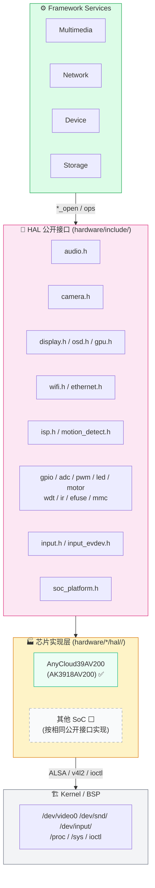
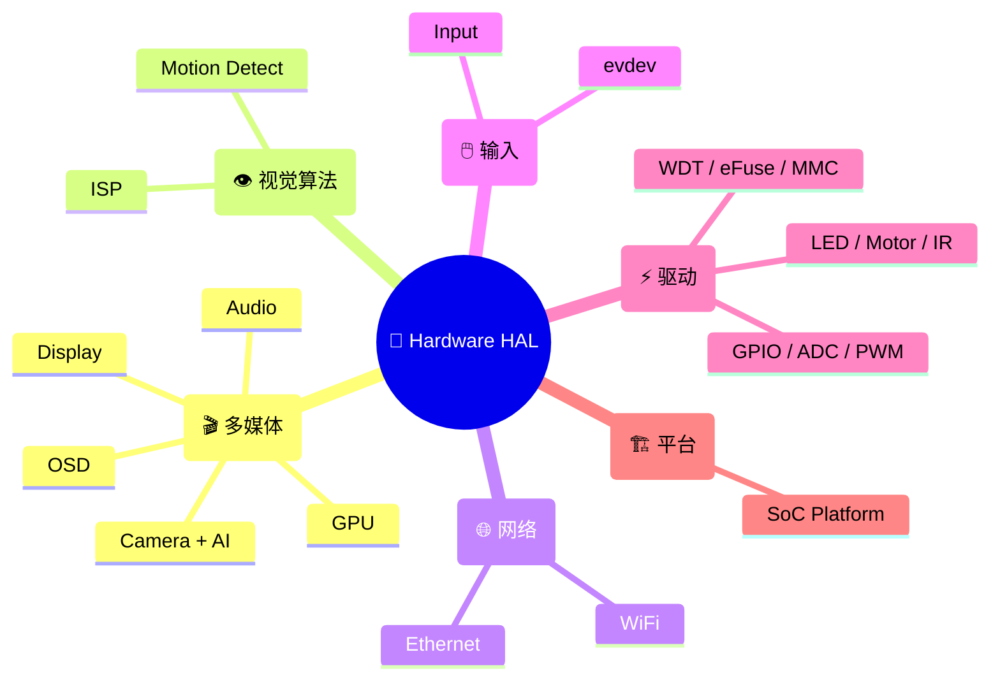
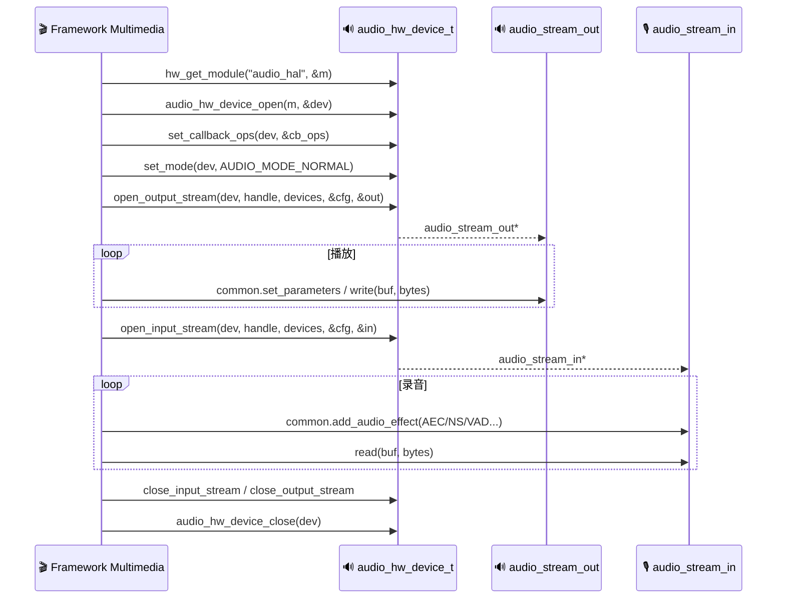
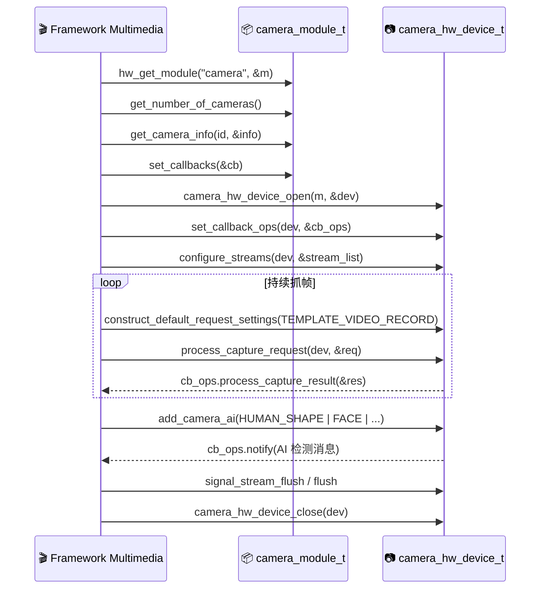
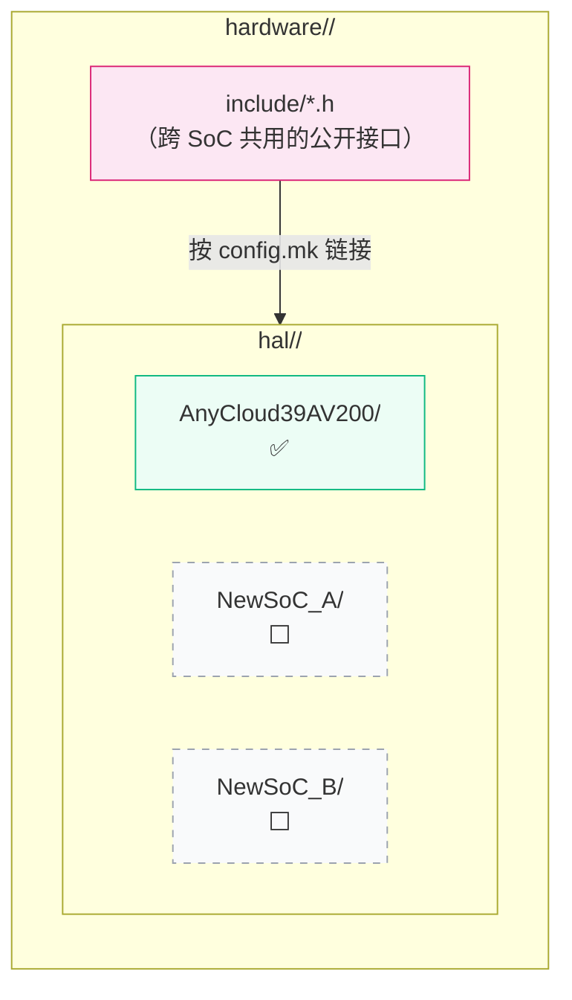
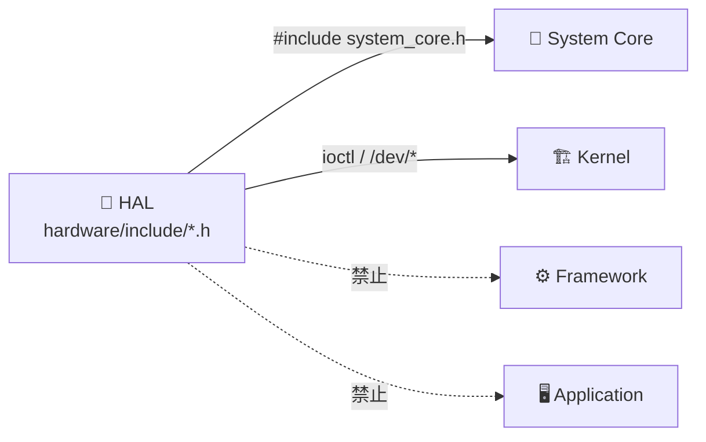

<p align="right"><a href="hardware-hal.en.md">English</a> | <b>中文</b></p>

# Hardware HAL

> **本文范围**：硬件适配层（HAL）：公开头 `hardware/include/` 的契约、模块清单与能力、多 SoC 目录组织，以及新增 HAL 模块 / 新 SoC 的最小步骤。
>
> 逐函数签名见 [hardware-api.md](hardware-api.md)；分层、契约与运行期模型见 [架构总览](../architecture/overview.md)；术语以 [术语与命名对照表](../glossary.md) 为唯一解释源。

---

## 1. HAL 总体架构



ASCII 备用：

```
┌── ⚙️ Framework Services ──────────────────────────────────────┐
│  Multimedia / Network / Device / Storage                       │
└──────────────┬─────────────────────────────────────────────────┘
               │  *_open / ops 调用
┌──────────────▼─────────────────────────────────────────────────┐
│  📜 HAL 公开接口  (hardware/include/*.h)                        │
│    audio / camera / display / wifi / vision / drivers / soc    │
└──────────────┬─────────────────────────────────────────────────┘
               │  链接到对应 SoC 的 HAL 实现
┌──────────────▼─────────────────────────────────────────────────┐
│  🏭 芯片实现 (hardware/*/hal/<SoC>/)                            │
│    [✅ AnyCloud39AV200]    [⬜ 新 SoC 按同一公开接口扩展]       │
└──────────────┬─────────────────────────────────────────────────┘
               │  ALSA / v4l2 / sysfs / ioctl
┌──────────────▼─────────────────────────────────────────────────┐
│  🏗️ Kernel / BSP   (/dev/video0, /dev/snd/, .ko drivers)        │
└────────────────────────────────────────────────────────────────┘
```

---

## 2. HAL 基础契约（hardware.h）

**头文件**：`hardware/include/hardware.h`
**HAL API 版本**：`HARDWARE_HAL_API_VERSION = 1.0`

### 2.1 核心数据结构

```c
/* ① 模块头（每个 HAL 模块必须作为首字段）*/
typedef struct hw_module_t {
    uint32_t  tag;                  /* = HARDWARE_MODULE_TAG ('HWMT') */
    uint16_t  module_api_version;   /* 模块版本 0x0100 = v1.0 */
    uint16_t  hal_api_version;      /* HAL 接口版本 */
    const char *id;                 /* 模块 id：audio / camera / ... */
    const char *name;               /* 描述名 */
    const char *author;             /* 作者 */
    struct hw_module_methods_t *methods;   /* 必须含 open() */
    void *dso;                      /* 动态加载时填充 */
    uint32_t reserved[32-7];
} hw_module_t;

/* ② 方法表 */
typedef struct hw_module_methods_t {
    int (*open)(const struct hw_module_t *module, const char *id,
                struct hw_device_t **device);
} hw_module_methods_t;

/* ③ 设备头（每个 HAL device 必须作为首字段）*/
typedef struct hw_device_t {
    uint32_t  tag;                  /* = HARDWARE_DEVICE_TAG ('HWDT') */
    uint32_t  version;
    struct hw_module_t *module;
    uint32_t  reserved[12];
    int (*close)(struct hw_device_t *device);
} hw_device_t;
```

### 2.2 模块注册约定

```c
#define HAL_MODULE_INFO_SYM        HMI       /* 每个 HAL 必须导出此全局变量 */
#define HAL_MODULE_INFO_SYM_AS_STR "HMI"
```

### 2.3 模块管理 API

| 函数 | 说明 |
|---|---|
| `int hw_module_init(void)` | 初始化 HAL 模块管理系统 |
| `int hw_register_module(const hw_module_t *)` | 注册一个模块 |
| `int hw_unregister_module(const hw_module_t *)` | 注销模块 |
| `int hw_get_module(const char *id, const hw_module_t **)` | 按 id 查找 |
| `int hw_get_module_by_class(class_id, inst, module**)` | 按类 + 实例查找 |

---

## 3. HAL 模块总览（按类别）



### 3.1 模块完整清单

| 分类 | 模块 | 公开头文件 | 典型实现路径 | 状态 |
|---|---|---|---|---|
| **🎬 多媒体** | Audio | `audio.h` | `audio/hal/AnyCloud39AV200/hal_audio.c`（私有实现） | ✅ |
| | Camera + AI | `camera.h` | `camera/hal/AnyCloud39AV200/hal_camera_ai.c`（私有实现） | ✅ |
| | Display | `display.h` | `display/` | ✅ |
| | OSD | `osd.h` | `osd/` | ✅ |
| | GPU | `gpu.h` | `gpu/` | ✅ |
| **👁️ 视觉** | ISP | `isp.h` | `vision/isp/` | ✅ |
| | Motion Detect | `motion_detect.h` | `vision/motion_detect/` | ✅ |
| **🌐 网络** | WiFi | `wifi.h` | `network/wifi/` | ✅ |
| | Ethernet | `ethernet.h` | `network/ethernet/` | ✅ |
| **🖱️ 输入** | Input | `input.h` | `input/` | ✅ |
| | evdev | `input_evdev.h` | `input/evdev/` | ✅ |
| **⚡ 驱动** | GPIO | `gpio.h` | `driver/gpio/` | ✅ |
| | ADC | `adc.h` | `driver/adc/` | ✅ |
| | PWM | `pwm.h` | `driver/pwm/` | ✅ |
| | LED | `led.h` | `driver/led/` | ✅ |
| | Motor | `motor.h` | `driver/motor/` | ✅ |
| | WDT | `wdt.h` | `driver/wdt/` | ✅ |
| | IR | `ir.h` | `driver/ir/` | ✅ |
| | eFuse | `efuse.h` | `driver/efuse/` | ✅ |
| | Block Device | `mmc.h` | `driver/blkdev/` | ✅ |
| **🏗️ 平台** | SoC Platform | `soc_platform.h` | `soc_platform/` | ✅ |

---

## 4. Audio HAL

> **对外头文件（唯一）**：`hardware/include/audio.h`
> SoC 侧私有实现（如 `hardware/audio/hal/AnyCloud39AV200/hal_audio.c`）不对外，只通过 `audio_hw_device_t` ops 间接调用。

### 4.1 标识与入口

| 项 | 值 |
|---|---|
| Module ID | `AUDIO_HARDWARE_MODULE_ID = "audio_hal"` |
| Interface | `AUDIO_HARDWARE_INTERFACE = "audio_hw_if"` |
| 模块结构 | `struct audio_module { struct hw_module_t common; }` |
| 设备结构 | `audio_hw_device_t`（12 个 ops） |
| 打开 | `audio_hw_device_open(module, &dev)` |
| 关闭 | `audio_hw_device_close(dev)` |
| 模块初始化 | `int hw_audio_module_init(void)` |

### 4.2 调用流程（Framework → `audio.h` 对外契约）



### 4.3 关键公开能力一览

| 类别 | 入口 | 说明 |
|---|---|---|
| **设备路由** | `audio_devices_t` 枚举 | `OUT_SPEAKER/LINE/USB/BUS`、`IN_AMIC/DMIC/LINE/BUS0/BUS1/USB/LOOPBACK` |
| **工作模式** | `audio_mode_t` + `set_mode` | `NORMAL / MUSIC / CALL` |
| **效果处理** | `audio_effect_type_t` 位掩码 | 声音：ASLC/EQ/AEC/NS/Resample；检测：VAD/CpuCry/NpuCry；声源：SSL/LSSL/CSSL |
| **效果结果** | `audio_notify_msg_t` | 通过 `audio_callback_ops.notify()` 上报 detect/SSL 结果 |
| **声道/格式** | `audio_channel_mask_t` / `audio_format_t` | PCM 16-bit 为主；支持 MP3/AMR/AAC/Opus 等常见封装 |
| **时变回放** | `audio_playback_rate_t` + `set_playback_rate_parameters` | 速度 0.01~20.0，Pitch 0.25~4.0 |
| **流状态查询** | `audio_stream_t.get_sample_rate/get_buffer_size/get_channels/get_format/get_device` | 通用属性 |
| **控制** | `audio_stream_t.set_parameters("Volume"/"AIParam"/"Vad"/"NpuCry"/"CpuCry"/"Lssl"/"AIReboot", ...)` | 统一键值控制面 |
| **落盘调试** | `audio_stream_t.dump(file_path, file_name, enable)` | 流数据抓包 |

> 完整字段、ops 清单与错误码见 [hardware-api.md](hardware-api.md)。

---

## 5. Camera HAL

> **对外头文件（唯一）**：`hardware/include/camera.h`
> SoC 侧私有实现（如 `hardware/camera/hal/AnyCloud39AV200/hal_camera_ai.c`）不对外，只通过 `camera_module_t` / `camera_hw_device_t` ops 间接调用。

### 5.1 标识与入口

| 项 | 值 |
|---|---|
| Module ID | `CAMERA_HARDWARE_MODULE_ID = "camera"` |
| Interface | `CAMERA_HARDWARE_INTERFACE = "camera_hw_if"` |
| 模块结构 | `camera_module_t`（含 7 个模块级 ops） |
| 设备结构 | `camera_hw_device_t`（14 个 ops） |
| 打开 | `camera_hw_device_open(module, &dev)` |
| 关闭 | `camera_hw_device_close(dev)` |
| 模块初始化 | `int hw_camera_module_init(void)` |

### 5.2 调用流程（Framework → `camera.h` 对外契约）



### 5.3 关键公开能力一览

| 类别 | 入口 | 说明 |
|---|---|---|
| **多摄管理** | `camera_id_t`（最多 5 路）、`camera_channel_id_t`（Main/Sub/Third/Fourth） | 多 Sensor + 多通道 |
| **编解码** | `camera_codec_config_t` | AVC / HEVC / MJPEG / YUV / RAW + Profile + Level |
| **码率控制** | `camera_rc_config_t` | CBR / VBR / AVBR / CVBR / FixQP / QPMap |
| **GOP** | `camera_gop_config_t` | GOP 长度、长期参考帧 |
| **流拼接** | `camera_stream_format_t` | 单路 / 垂直 / 水平 splice |
| **变换** | `camera_channel_config_t` | Crop + Scale + Rotation + Mirror/Flip |
| **请求模板** | `camera_request_template_t` | Preview / VideoRecord / VideoCall / QRScan / Picture / Metadata / AI / Custom |
| **AI 能力** | `camera_ai_type_t` 位掩码 | 检测：人形 / 人脸 / 上半身 / 手势 / 宠物 / 包裹 / 火焰 / 车辆 / 非机动车 / 运动；识别：人脸 / 上半身；抗欺骗 |
| **AI 性能** | `camera_ai_performance_t` | LOW / MEDIUM / HIGH / VERY_HIGH / ULTRA |
| **AI 区块** | `enable/disable_camera_ai_tile_overlap` + `camera_ai_tile_overlap_t` | 按 Tile 切分检测 + 重叠率 |
| **Torch** | `set_torch_mode / torch_mode_status_t` | 闪光灯 |
| **通知** | `camera_callback_ops_t` | `process_capture_result` + `notify`（AI 消息 / 设备状态变更）|

> 完整字段、ops 清单、AI 子类与错误码见 [hardware-api.md](hardware-api.md)。

---

## 6. 其他 HAL 模块快览

### 6.1 Display / OSD / GPU

| 头文件 | 关键能力 |
|---|---|
| `display.h` | 帧缓冲输出、图层管理、分辨率切换 |
| `osd.h` | 字符/图形叠加（时间戳、文字、矩形框）|
| `gpu.h` | 硬件 2D/3D 加速、颜色空间转换 |

### 6.2 视觉

| 头文件 | 关键能力 |
|---|---|
| `isp.h` | 图像信号处理：白平衡 / 曝光 / 降噪 / 锐化 |
| `motion_detect.h` | 硬件移动侦测：多区域掩码 + 灵敏度 |

### 6.3 网络

| 头文件 | 关键能力 |
|---|---|
| `wifi.h` | STA / AP / Scan 驱动级操作 |
| `ethernet.h` | 有线以太网驱动 |

### 6.4 驱动类（按硬件外设）

| 头文件 | 关键能力 | 典型用途 |
|---|---|---|
| `gpio.h` | 数字引脚输入/输出/中断 | 按键、LED、复位脚 |
| `adc.h` | 模拟信号采样 | 电量检测、光敏 |
| `pwm.h` | 脉宽调制输出 | 背光、电机调速 |
| `led.h` | 硬件 LED 控制 | 状态指示灯 |
| `motor.h` | 步进电机 / 直流电机 | PTZ 云台 |
| `wdt.h` | 硬件看门狗定时器 | 防死锁 |
| `ir.h` | 红外发射/接收 | 遥控 / 报警 |
| `efuse.h` | OTP 熔断保险丝读写 | 设备唯一 ID / 密钥 |
| `mmc.h` | MMC/SD 块设备访问 | TF 卡底层驱动 |

### 6.5 输入 / 平台

| 头文件 | 关键能力 |
|---|---|
| `input.h` / `input_evdev.h` | Linux evdev 适配：按键 / 触摸 / 编码器 |
| `soc_platform.h` | 平台级初始化：`soc_platform_init()`、寄存器访问、日志级别 |

---

## 7. 多 SoC 平台扩展

> Celestia 的 HAL 设计目标之一是**换芯片不改上层**。实现按 SoC 分目录存放的模块，其 `hardware/<mod>/hal/<SoC>/` 独立存放一份实现，通过 `config.mk` 中的字符串变量 `CONFIG_SOC_PLATFORM`（目录名，如 `AnyCloud39AV200`）在构建时选择；**注意并非所有模块都有 `hal/<SoC>/` 子目录**（见 §7.2）。

> **`CONFIG_SOC_PLATFORM` 与 `CONFIG_HW_SOC_PLATFORM` 是两件事，勿混淆**：前者是字符串，选定 SoC 目录；后者取值 `y`，仅用于启用 `soc_platform` 模块本身。

### 7.1 目录组织模型



### 7.2 目录组织与现有平台

**按 SoC 分目录（`hal/<SoC>/`）的模块**：`audio`、`camera`、`osd`、`gpu`、`vision/isp`（hal 位于子模块下：`vision/isp/hal/<SoC>/`）、`vision/motion_detect`、`soc_platform`、`driver/ir`、`driver/motor`。

**扁平实现（无 `hal/<SoC>/`，直接 `<mod>_hw.c` / `fb_hw.c` 等）**：`display`（`display_hw.c` / `fb_hw.c`）、`network/wifi`、`network/ethernet`、`network/net`、`input`（`input_module.c` + `evdev/` 扁平）、`driver/{adc,blkdev,efuse,gpio,led,pwm,wdt}`。

> 说明：`driver/` 下为按外设划分的顶层目录（`adc/ blkdev/ efuse/ gpio/ ir/ led/ motor/ pwm/ wdt/`），不存在 `driver/hal/`，也不存在 `driver/mmc/`——MMC 实现位于 `driver/blkdev/mmc.c`。`network/` = `wifi/ ethernet/ net/`（含 `net/`）；WiFi 厂商代码在 `network/wifi/aic8800/` 与 `network/wifi/wpa/`。

**现有 SoC 目录**：

| SoC 目录名 | 对应芯片 | SDK 版本 | 出现位置 | 状态 |
|---|---|---|---|---|
| `AnyCloud39AV200` | AK3918AV200 | V1.04 | 各 `hal/<SoC>/`（主力） | ✅ 主力支持 |
| `AnyCloud39AV100_V2` | AK3918AV100 V2 | V2.05（V2.04 亦在用） | `audio/camera/osd/gpu/vision/soc_platform/...` 的 `hal/` | ✅（anypi_luna 系） |
| `Sky39AV130` | AK3918AV130 | V1.01 | `audio/camera/vision/isp/vision/motion_detect/soc_platform/driver/ir` 的 `hal/` | ✅（anypi_mira_dev，aos） |
| `Sky37Ev2` | — | — | 仅 `gpu/hal/Sky37Ev2/` | ⚠️ 部分（仅 GPU） |

对应五个产品：`anypi_nova`（AV200 / V1.04）、`anypi_nova_dev`（AV200 / V1.04）、`anypi_luna`（AV100_V2 / V2.05）、`anypi_luna_dev`（AV100_V2 / V2.04）、`anypi_mira_dev`（Sky39AV130 / V1.01）。未传 `--product-name` 时交互选择并缓存。

### 7.3 新增 SoC 的最小步骤

| 步骤 | 动作 | 文件/目录 |
|---|---|---|
| ① | 放置芯片 SDK | `system/<NewSoC>/<SDK_Ver>/` |
| ② | **对每个启用且有 `hal/<SoC>/` 的模块**新建实现 | `hardware/<module>/hal/<NewSoC>/`（参考基线 SoC） |
| ③ | 实现 `soc_platform`（+ IPU 弱桩） | `hardware/soc_platform/hal/<NewSoC>/` |
| ④ | `config.mk` 选 SoC / 开 `CONFIG_HW_*` | `CONFIG_SOC_PLATFORM=<NewSoC>`、`CONFIG_SOC_SDK_VERSION` |
| ⑤ | 板级 DTS / 启动脚本 / 新产品 | `project/<proj>/.../board/<Board>/` |
| ⑥ | system/core（仅新模块号时） | `system_error.h` 追加 `HARDWARE_MODULE_*` |
| ⑦ | 构建并 L1→L5 上板 | `./build.sh --product-name <p>` |

模块清单与边界见 [celestia-hardware 新增 SoC](../skills/celestia-hardware.md#新增-soc芯片-sdk--逐模块-hal)、[roles §4](../quick-start/roles.md#4-新芯片移植开发者)。

---

## 8. 新增 HAL 模块 — 最小骨架

```c
/* my_hal.c ── 最小 HAL 实现骨架（也作为新 SoC 下对应模块的模板）*/
#include "hardware.h"
#include "system_core.h"

#define LOG_TAG "MY_HAL"

static int my_hal_open(const struct hw_module_t *module, const char *id,
                       struct hw_device_t **device);

static struct hw_module_methods_t my_hal_methods = {
    .open = my_hal_open,
};

/* 必须命名为 HAL_MODULE_INFO_SYM = HMI */
struct hw_module_t HAL_MODULE_INFO_SYM = {
    .tag                = HARDWARE_MODULE_TAG,
    .module_api_version = HARDWARE_MODULE_API_VERSION(1, 0),
    .hal_api_version    = HARDWARE_HAL_API_VERSION,
    .id                 = "my_module",
    .name               = "My HAL Module",
    .author             = "Celestia",
    .methods            = &my_hal_methods,
};

typedef struct {
    struct hw_device_t common;   /* 必须是第一个字段 */
    int fd;
} my_device_t;

static int my_hal_close(struct hw_device_t *device) {
    my_device_t *d = (my_device_t *)device;
    if (d->fd >= 0) close(d->fd);
    free(d);
    return 0;
}

static int my_hal_open(const struct hw_module_t *module, const char *id,
                       struct hw_device_t **device) {
    my_device_t *d = calloc(1, sizeof(*d));
    if (!d) return -ENOMEM;
    d->common.tag     = HARDWARE_DEVICE_TAG;
    d->common.version = HARDWARE_DEVICE_API_VERSION(1, 0);
    d->common.module  = (struct hw_module_t *)module;
    d->common.close   = my_hal_close;

    d->fd = open("/dev/my_device", O_RDWR);
    if (d->fd < 0) { free(d); return -errno; }
    *device = &d->common;
    return 0;
}
```

**Makefile 集成**：每个模块自带 `hardware/<mod>/Makefile`（非集中式 `hardware/Makefile`），遵循统一范式：`include $(COMPILATION_RULES)`，用 `MODULE_ROOT`/`SRCS`/`INCLUDE`（或 `HARDWARE_INCLUDE`）变量；源文件按 `$(wildcard $(SRC_DIR)/*.c) $(wildcard $(SRC_DIR)/hal/$(CONFIG_SOC_PLATFORM)/*.c)` 收集，头文件搜索路径加 `-I$(MODULE_ROOT)/../include` 与 `-I$(SYSTEM_ROOT)/$(CONFIG_SOC_PLATFORM)/include`（SDK 头）。另有头文件拷贝步骤 `$(shell cp -f $(MODULE_ROOT)/../include/<mod>.h $(MODULES_INCLUDE))`。模块整体由 `config.mk` 的 `CONFIG_HW_*` 开关控制（`=` 赋值），并在 `hardware/hardware.c` 中以 `#if CONFIG_HW_*` 条件调用对应 `hw_<mod>_module_init()`——**SoC 选择由 Makefile + `CONFIG_SOC_PLATFORM` 驱动，`hardware.c` 内不做 SoC 的 `#ifdef`**。
**测试验证**：`hardware/tests/` 下参考 `adc.c` / `gpio.c` 写最小测试。

---

## 9. 依赖边界



| ✅ 允许 | ❌ 禁止 |
|---|---|
| 使用 `hardware/include/*.h` 公开接口 | `#include "framework/*/include/*.h"` |
| `#include "system_core.h"` | 依赖 `application/` |
| 访问 `/dev/*` / sysfs / ioctl | 循环依赖其他 HAL 模块 |

---

## 10. 相关分册

- 系统总览：[architecture/overview.md](../architecture/overview.md)
- Framework：[framework.md](framework.md)
- HAL API：[hardware-api.md](hardware-api.md)
- 新增 SoC：[新增 SoC](../skills/celestia-hardware.md)
- System Core：[system-core.md](system-core.md)
- 构建与 BSP：[quick-start/bsp-and-products.md](../quick-start/bsp-and-products.md)
- API 索引：[guide/api-index.md](api-index.md)
