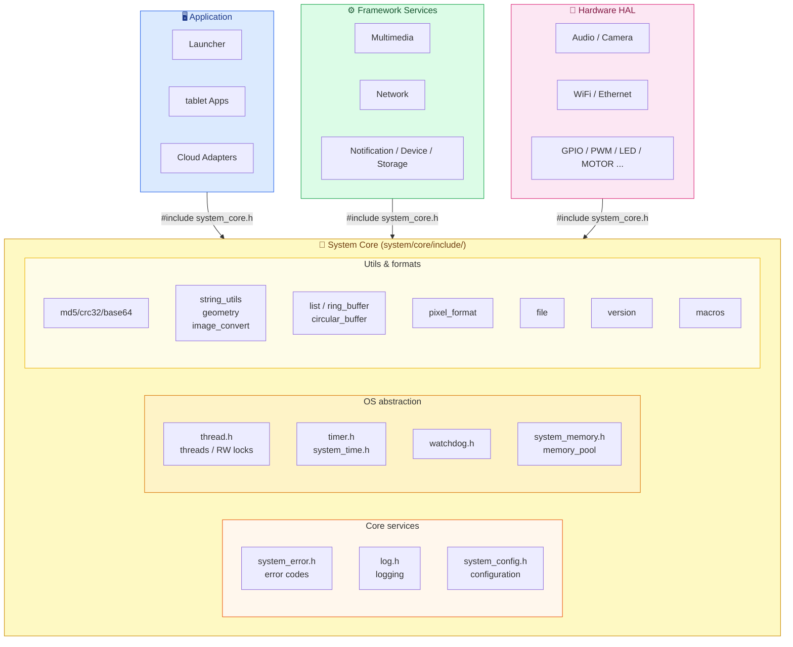
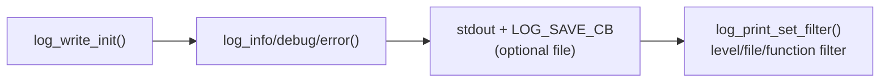
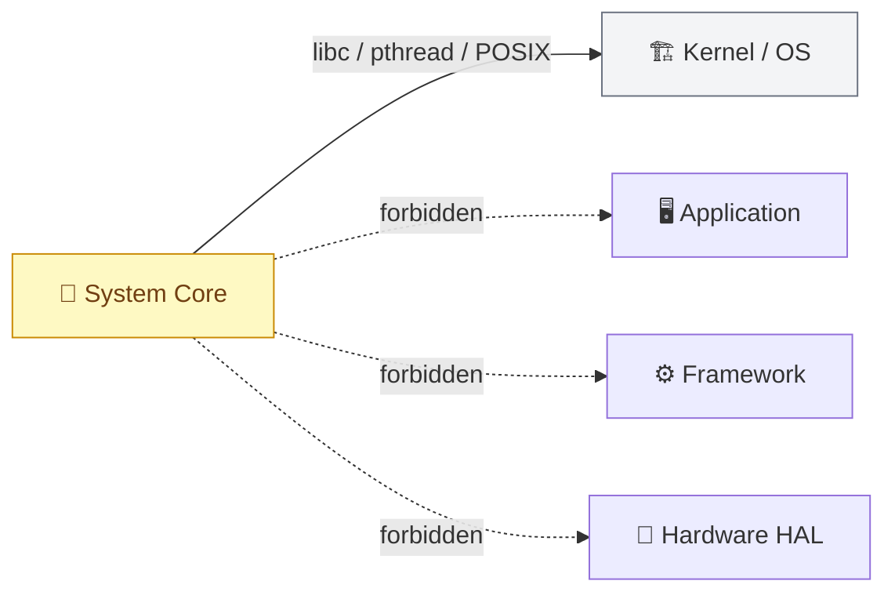

<p align="right"><b>English</b> | <a href="system-core.md">中文</a></p>

# System Core

> **Scope of this document**: System Core: horizontally shared foundations—error code system, logging, configuration, threads and locks, time and timers, memory, containers, and utilities.
>
> Per-function signatures: [system-core-api.en.md](system-core-api.en.md); layering, contracts, and runtime model: [Architecture overview](../architecture/overview.en.md); terminology: [Glossary](../glossary.en.md) is the single source of truth.

---

## 1. Horizontal Shared Role



ASCII fallback:

```
           🖥️ Application ───┐
           ⚙️ Framework   ─── ├──► #include "system_core.h"
           🔌 HAL         ───┘
                                  ┌───────────────────────────────┐
                                  │  🔧 System Core                │
                                  │ ┌──────────┬────────────────┐ │
                                  │ │ Core     │ error/log/config │ │
                                  │ │ OS abs   │ thread/timer/mem │ │
                                  │ │ Utils    │ md5/crc32/str/… │ │
                                  │ └──────────┴────────────────┘ │
                                  └───────────────────────────────┘
```

### 1.1 Horizontal Dependency Rules

| Rule | Description |
|---|---|
| ✅ **Allowed** | Application / Framework / HAL may all `#include "system_core.h"` |
| ✅ **Allowed** | System Core may depend on `libc / pthread / Linux syscalls` |
| ❌ **Forbidden** | System Core must not depend on Application / Framework / HAL headers |
| ❌ **Forbidden** | No circular dependencies between System Core submodules |
| ❌ **Forbidden** | HAL must not depend on Framework, even though both use System Core |

### 1.2 Selective Submodule Import

`system_core.h` provides `SYSTEM_CORE_IMPORT_*` macros to compile only needed submodules:

```c
#define SYSTEM_CORE_IMPORT_ALL 1   /* default: import all */

/* Example: disable specific modules */
#define SYSTEM_CORE_IMPORT_CONFIG       0   /* disable config */
#define SYSTEM_CORE_IMPORT_WATCHDOG     0   /* disable watchdog */
#include "system_core.h"
```

> ⚠️ `system_core.h` is a **partial aggregate**: even with `SYSTEM_CORE_IMPORT_ALL=1`, it only pulls in `system_types.h / system_error.h / system_version.h / gthread.h` plus config / log / system_thread / system_time / timer / string_utils / geometry / image_convert / base64 / crc32 / md5 / circular_buffer / system_memory / watchdog. These headers are **not** auto-included; include them directly: `system_macros.h`, `system_assert.h`, `system_debug.h`, `system_reentry.h`, `system_file.h`, `system_pixel_format.h`, `list.h`, `ring_buffer.h`.

---

## 2. Error Code System (system_error.h)

**Header**: `system/core/include/system_error.h`

### 2.1 Error Code Layout

```
 Bit 31    Bit 30-24    Bit 23-16    Bit 15-0
  sign      Domain       Module       Code
 1=error   SYSTEM=0x00  CORE=0x00   0x0001-0xFFFF
            FW    =0x01  CONFIG=0x01
            HW    =0x02  LOG  =0x02
                         THREAD=0x03
                         ...
```

```c
/* Error code builder */
#define SYSTEM_ERROR_CODE(domain, module, code)  \
    (-(((domain) << 24) | ((module) << 16) | (code)))
```

> Module-specific codes (`LOG_ERROR_*`, `CONFIG_ERROR_*`, `THREAD_ERROR_*`, etc.) are **defined inline in each module’s public header** (e.g. `log.h`, `system_config.h`, `system_thread.h`), assembled using `SYSTEM_DOMAIN` and `SYSTEM_MODULE_*` from `system_error.h`; `system_error.h` centralizes domain/module tables and generic `ERROR_*` codes.

### 2.2 Domains

| Macro | Value | Layer |
|---|---|---|
| `SYSTEM_DOMAIN` | 0x00 | system/core |
| `FRAMEWORK_DOMAIN` | 0x01 | Framework |
| `HARDWARE_DOMAIN` | 0x02 | Hardware HAL |

### 2.3 System Domain Module Codes

| Macro | Value | Module |
|---|---|---|
| `SYSTEM_MODULE_CORE` | 0x00 | Core |
| `SYSTEM_MODULE_CONFIG` | 0x01 | Configuration |
| `SYSTEM_MODULE_LOG` | 0x02 | Logging |
| `SYSTEM_MODULE_THREAD` | 0x03 | Threads |
| `SYSTEM_MODULE_MEMORY` | 0x04 | Memory |
| `SYSTEM_MODULE_STORAGE` | 0x05 | Storage |
| `SYSTEM_MODULE_TIME` | 0x06 | Time |
| `SYSTEM_MODULE_CRYPTO` | 0x07 | Crypto |
| `SYSTEM_MODULE_UTILS` | 0x08 | Utils |
| `SYSTEM_MODULE_WATCHDOG` | 0x09 | Watchdog |
| `SYSTEM_MODULE_SOC_PLATFORM` | 0x0A | SoC platform |

### 2.4 Framework Domain Module Codes

| Macro | Value | Module |
|---|---|---|
| `FRAMEWORK_MODULE_NETWORK` | 0x00 | Network |
| `FRAMEWORK_MODULE_NOTIFICATION` | 0x01 | Notification |
| `FRAMEWORK_MODULE_MULTIMEDIA` | 0x02 | Multimedia |
| `FRAMEWORK_MODULE_RUNTIME` | 0x03 | Runtime |
| `FRAMEWORK_MODULE_DEVICE` | 0x04 | Device |
| `FRAMEWORK_MODULE_UI` | 0x05 | UI |
| `FRAMEWORK_MODULE_AI` | 0x06 | AI |
| `FRAMEWORK_MODULE_STORAGE` | 0x07 | Storage |

### 2.5 Generic Error Codes (all modules)

| Macro | Value | Description |
|---|---|---|
| `SYSTEM_SUCCESS` | 0 | Success |
| `ERROR_INVALID_PARAM` | 0x0001 | Invalid parameter |
| `ERROR_NOT_INIT` | 0x0002 | Not initialized |
| `ERROR_MEMORY` | 0x0003 | Out of memory |
| `ERROR_TIMEOUT` | 0x0004 | Timeout |
| `ERROR_NOT_FOUND` | 0x0005 | Not found |
| `ERROR_ALREADY_EXISTS` | 0x0006 | Already exists |
| `ERROR_BUSY` | 0x0007 | Busy |
| `ERROR_IO` | 0x0008 | I/O error |
| `ERROR_NOT_SUPPORTED` | 0x0009 | Not supported |
| `ERROR_INVALID_STATE` | 0x000A | Invalid state |
| `ERROR_OPERATION_FAILED` | 0x000B | Operation failed |
| `ERROR_DEVICE_NOT_AVAILABLE` | 0x000C | Device unavailable |
| `ERROR_CONFIG_ERROR` | 0x000D | Configuration error |

---

## 3. Logging (log.h)

**Header**: `system/core/include/log.h`
**Version**: SYSTEM_CORE_VERSION 0.12.0

### 3.1 Log Levels (highest to lowest priority)

| Enum | Value | Use |
|---|---|---|
| `LOG_FATAL` | -1 | Fatal; terminates process |
| `LOG_ERROR` | 0 | Error (functional failure) |
| `LOG_WARNING` | 1 | Warning |
| `LOG_INFO` | 2 | Important normal info (e.g. watchdog feed) |
| `LOG_DEBUG` | 3 | Debug |
| `LOG_VERBOSE` | 4 | Verbose trace |

### 3.2 Logging Macros (recommended)

```c
#define LOG_TAG "MY_MODULE"   /* per file; appears in log prefix */

log_error(fmt, ...)   /* error */
log_warn(fmt, ...)    /* warning */
log_info(fmt, ...)    /* info */
log_debug(fmt, ...)   /* debug */
log_verbose(fmt, ...) /* verbose */
```

`define LOG_TAG` before `#include "log.h"` in each file.

### 3.3 Low-Level API

| Signature | Description |
|---|---|
| `int log_print_base(level, tag, file, fun, line, fmt, ...)` | Low-level print (macros fill file/fun/line) |
| `void log_set_level(int level)` | Runtime log level |
| `int log_print_set_filter(log_filter_info *info)` | Fine filter (level/file/function/line/keyword) |
| `int log_print_set_cb(LOG_PRINT_CB cb)` | Custom print callback |
| `int log_print_set_save_file_cb(LOG_SAVE_CB cb)` | Log save callback |
| `char *log_get_save_path(void)` | Log save path |
| `int log_write_init(void)` | Start log-to-file thread |
| `int log_write_deinit(void)` | Stop log-to-file thread |

### 3.4 Usage Flow



---

## 4. Configuration (system_config.h)

**Header**: `system/core/include/system_config.h`
**Implementation**: Wraps iniparser for INI read/write.

### 4.1 Direct iniparser API

| Signature | Description |
|---|---|
| `dictionary *iniparser_load(const char *ininame)` | Load INI as dictionary |
| `void iniparser_freedict(dictionary *d)` | Free dictionary |
| `int iniparser_getnsec(const dictionary *d)` | Section count |
| `const char *iniparser_getsecname(d, n)` | Section name by index |
| `int iniparser_getsecnkeys(d, s)` | Key count in section |
| `const char *iniparser_getstring(d, key, def)` | String value |
| `int iniparser_getint(d, key, notfound)` | Integer |
| `long int iniparser_getlongint(d, key, notfound)` | Long integer |
| `double iniparser_getdouble(d, key, notfound)` | Double |
| `int iniparser_getboolean(d, key, notfound)` | Boolean |
| `int iniparser_set(d, entry, val)` | Set string |
| `int iniparser_seti(d, entry, val)` | Set integer |
| `int iniparser_set_double(d, entry, val)` | Set double |
| `void iniparser_unset(d, entry)` | Remove entry |
| `int iniparser_find_entry(d, entry)` | Entry exists |
| `void iniparser_dump_ini(d, FILE*)` | Dump as INI |

### 4.2 Path Management API (higher level)

| Signature | Description |
|---|---|
| `int config_set_default_path(const char *path)` | Default config directory |
| `const char *config_get_default_path(void)` | Get default path |
| `int config_resolve_path(dir, name, out, out_size)` | Build full config path |

### 4.3 INI Example

```ini
[general]
version = 1.0.0
log_level = 3

[network]
ssid = MyWiFi
timeout_ms = 5000
```

**Read example**:
```c
dictionary *d = iniparser_load("/etc/config/my.ini");
int level = iniparser_getint(d, "general:log_level", 3);
const char *ssid = iniparser_getstring(d, "network:ssid", "");
iniparser_freedict(d);
```

---

## 5. Threads (thread.h)

**Header**: `system/core/include/thread.h`

### 5.1 Thread Management API

| Signature | Description | Return |
|---|---|---|
| `int thread_init(void)` | Init thread module | 0 success |
| `int thread_deinit(void)` | Deinit | 0 success |
| `int thread_create(handle*, func, param, name, stack, prio)` | Create thread | 0 success; negative on error |
| `int thread_destroy(int handle)` | Destroy thread (join) | 0 success |
| `int thread_get_info(buf, buf_len)` | All threads info string | 0 success |
| `int thread_check_in(int handle)` | Thread alive | 1 = alive |

### 5.2 Thread Macros (recommended)

```c
/* 1. Declare thread variable */
THREAD_RUN_DEF(MyThread)

/* 2. Start thread */
THREAD_RUN_START(MyThread, my_thread_func, param, 4096, 10)

/* 3. Check status */
if (THREAD_RUN_CHECK(MyThread)) { /* running */ }

/* 4. Stop thread */
THREAD_RUN_STOP(MyThread)
```

### 5.3 Read-Write Lock API

| Signature | Description |
|---|---|
| `rw_lock_t *rw_lock_create(void)` | Create RW lock |
| `void rw_lock_destroy(rw_lock_t *lock)` | Destroy |
| `void rw_lock_read_lock(rw_lock_t *lock)` | Read lock (shared) |
| `int rw_lock_try_read_lock(rw_lock_t *lock)` | Try read lock |
| `void rw_lock_read_unlock(rw_lock_t *lock)` | Unlock read |
| `void rw_lock_write_lock(rw_lock_t *lock)` | Write lock (exclusive) |
| `int rw_lock_try_write_lock(rw_lock_t *lock)` | Try write lock |
| `void rw_lock_write_unlock(rw_lock_t *lock)` | Unlock write |

---

## 6. Time and Timers

**Headers**: `system_time.h` + `timer.h`

### 6.1 System Time API (system_time.h)

| Signature | Description | Return |
|---|---|---|
| `long long system_get_sys_run_time64(void)` | System uptime (ms) | Milliseconds |
| `long long system_get_utc_time64(void)` | UTC timestamp (ms) | Ms timestamp |

### 6.2 Timer API (timer.h)

| Signature | Description |
|---|---|
| `int timer_init(void)` | Init timer module |
| `int timer_create(handle*, cb, user, period_ms, repeat)` | Create software timer |
| `int timer_start(int handle)` | Start |
| `int timer_stop(int handle)` | Stop |
| `int timer_destroy(int handle)` | Destroy |
| `int timer_reset(int handle, period_ms)` | Reset period |

---

## 7. Watchdog (watchdog.h)

**Header**: `system/core/include/watchdog.h`

### 7.1 API

| Signature | Description | Return |
|---|---|---|
| `int watchdog_init(int timeout_sec)` | Init watchdog (uses default if timeout &lt; default) | 0 success |
| `int watchdog_deinit(void)` | Stop feed thread, close device | 0 success |
| `void watchdog_reboot_device(void)` | Reboot now (after 3 s) | — |

### 7.2 Error Codes

| Macro | Description |
|---|---|
| `WATCHDOG_OK` | Success |
| `WATCHDOG_ERROR_INVALID_PARAM` | Invalid (timeout ≤ 0) |
| `WATCHDOG_ERROR_NOT_INIT` | Not initialized |
| `WATCHDOG_ERROR_INIT_FAILED` | Init failed (open device) |
| `WATCHDOG_ERROR_FEED_FAILED` | Feed failed |

---

## 8. Memory Management (system_memory.h)

**Header**: `system/core/include/system_memory.h`

Memory pools and helpers to reduce fragmentation from frequent malloc/free.

| Signature | Description |
|---|---|
| `void *system_malloc(size_t size)` | Allocate (with debug tracking) |
| `void system_free(void *ptr)` | Free |
| `void *system_calloc(n, size)` | Calloc |
| `void *system_realloc(ptr, size)` | Realloc |
| `void system_memory_dump(void)` | Print memory stats |

---

## 9. Crypto / Checksums

### 9.1 MD5 (md5.h)

| Signature | Description |
|---|---|
| `void MD5Init(MD5_CTX *ctx)` | Init MD5 context |
| `void MD5Update(ctx, data, len)` | Update |
| `void MD5Final(unsigned char digest[16], ctx)` | Finalize, 16-byte digest |
| `void md5_string(const char *str, char *out)` | String MD5 hex (33 bytes) |

### 9.2 CRC32 (crc32.h)

| Signature | Description |
|---|---|
| `uint32_t crc32(uint32_t crc, const void *buf, size_t len)` | CRC32 (incremental) |
| `uint32_t crc32_of_file(const char *path)` | File CRC32 |

### 9.3 Base64 (base64.h)

| Signature | Description |
|---|---|
| `int base64_encode(src, src_len, dst, dst_len)` | Encode |
| `int base64_decode(src, src_len, dst, dst_len)` | Decode |

---

## 10. Utility Functions

### 10.1 Strings (string_utils.h)

| Signature | Description |
|---|---|
| `int str_split(str, delim, parts[], max_parts)` | Split string |
| `int str_trim(str)` | Trim whitespace |
| `int str_to_int(str, val*)` | Safe string to int |
| `int str_to_float(str, val*)` | Safe string to float |

### 10.2 Geometry (geometry.h)

> `rect_t` is defined in `system_pixel_format.h` (`geometry.h` includes it). `geometry.h` does **not** define `rect_t` and has **no** IoU / `rect_contains` APIs.

| Type / function | Description |
|---|---|
| `uv_rect_t` | UV-normalized rectangle (`double x, y, width, height`, range `[0,1]`) |
| `int rect_right(const rect_t *r)` | Right edge = `x + w` |
| `int rect_bottom(const rect_t *r)` | Bottom edge = `y + h` |
| `int rect_intersection(src1, src2, dst)` | Intersection; **returns 1 if overlap, 0 if none** (zeros `dst` when none) |
| `int rect_to_uv_rect(src, max_w, max_h, dst)` | Pixel rect → UV rect |
| `float percent_to_real_value(min, middle, max, percent)` | Three-segment linear percent map |
| `double percent_to_value(percent, value_list, count)` | Percent to value table |

### 10.3 Image Format Conversion (image_convert.h)

> Only **YUV420SP (NV12 family) ↔ packed RGB scanline (rgbline)** swap plus ROI scale/copy; **no** JPEG codec in system/core—no `image_rgb24_to_jpeg` etc.

| Signature | Description |
|---|---|
| `int yuv420sp_roi_resize(in, w, h, x1, y1, rw, rh, ow, oh, out)` | YUV420SP ROI resize |
| `int yuv420sp_roi_copy(in, w, h, ox, oy, ow, oh, out)` | YUV420SP ROI copy |
| `int yuv420sp_roi_resize_rgbline_version1(...)` / `_version2` | YUV420SP ROI resize to RGB scanline (v2: 4-byte writes) |
| `int rgbline_to_yuv_420sp(pin, w, h, pout)` | RGB scanline → YUV420SP |
| `int rgbline_roi_resize_version1/2/3(...)` | RGB scanline ROI resize (v3 test) |
| `void save_rgbline_and_yuv(rgb_data, path, h, w, count)` | Debug: save RGB lines and YUV |

### 10.4 Pixel Format (system_pixel_format.h)

| Macro / enum | Description |
|---|---|
| `PIX_FMT_NV12` | NV12 (YUV 4:2:0 semi-planar) |
| `PIX_FMT_YV12` | YV12 (YUV 4:2:0 planar) |
| `PIX_FMT_RGB24` | RGB24 |
| `PIX_FMT_RGBA32` | RGBA32 |
| `PIX_FMT_JPEG` | JPEG |

---

## 11. Container Data Structures

### 11.1 Doubly Linked List (list.h)

```c
/* Embed struct list_head in your struct for zero-copy lists */
struct list_head { struct list_head *next, *prev; };

INIT_LIST_HEAD(head)          /* init */
list_add(entry, head)         /* insert after head */
list_add_tail(entry, head)    /* insert before head */
list_del(entry)               /* remove */
list_empty(head)              /* empty */
list_for_each(pos, head)      /* iterate */
list_entry(ptr, type, member) /* container_of */
```

### 11.2 Ring Buffer (ring_buffer.h)

| Function | Description |
|---|---|
| `ring_buffer_t *ring_buffer_create(capacity)` | Create |
| `void ring_buffer_destroy(rb)` | Destroy |
| `int ring_buffer_write(rb, data, len)` | Write |
| `int ring_buffer_read(rb, buf, len)` | Read |
| `int ring_buffer_available(rb)` | Readable bytes |

### 11.3 Circular Buffer (circular_buffer.h)

| Function | Description |
|---|---|
| `int circular_buffer_init(cb, size)` | Init |
| `int circular_buffer_push(cb, data, len)` | Push (overwrite old) |
| `int circular_buffer_pop(cb, buf, len)` | Pop |
| `int circular_buffer_size(cb)` | Stored bytes |

---

## 12. General Macros (system_macros.h)

| Macro | Description |
|---|---|
| `MAX(x, y)` | Maximum |
| `MIN(x, y)` | Minimum |
| `PARAM_IN_RANGE(val, min, max)` | Clamp |
| `ARRAY_SIZE(arr)` | Array length |
| `ALIGN(val, align)` | Align up |
| `OFFSETOF(type, member)` | Member offset |

---

## 13. Version Info (system_version.h)

| Macro | Value | Description |
|---|---|---|
| `SYSTEM_CORE_VERSION_MAJOR` | 0 | Major |
| `SYSTEM_CORE_VERSION_MINOR` | 12 | Minor |
| `SYSTEM_CORE_VERSION_PATCH` | 0 | Patch |
| `SYSTEM_CORE_VERSION_CODE` | `(0 << 16)\|(12 << 8)\|0` | Numeric version |

```c
#if SYSTEM_CORE_VERSION_CODE >= SYSTEM_CORE_VERSION_PACK(0, 12, 0)
    /* use new features */
#endif
```

---

## 14. File Utilities (system_file.h)

| Signature | Description |
|---|---|
| `int system_file_exists(const char *path)` | File exists |
| `int system_file_size(path, size*)` | File size |
| `int system_file_copy(src, dst)` | Copy file |
| `int system_dir_create(path, mode)` | Create directory tree |
| `int system_dir_exists(path)` | Directory exists |

---

## 15. Helper Headers

These are **macro/type** headers used with other modules; no standalone object lifecycle.

### 15.1 `system_types.h` — base types and callbacks

| Symbol | Description |
|---|---|
| `SYSTEM_SUCCESS` | Unified success `0` |
| `SYSTEM_true/false` / `TRUE/FALSE` | Boolean aliases |
| `SYSTEM_COMPARE_FUNCTION` / `SYSTEM_COMPARE_DATA_FUNCTION` | Sort/search compare |
| `SYSTEM_EQUAL_FUNCTION` | Equality compare |
| `SYSTEM_DESTROY_NOTIFY_FUNCTION` | `void (*)(void*)` |
| `SYSTEM_FUNC_FUNCTION` | `void (*)(void *data, void *user_data)` |
| `SYSTEM_HASH_FUNCTION` / `SYSTEM_HASH_FOREACH_FUNCTION` | Hash table callbacks |

### 15.2 `system_assert.h` — assertions and expectations

| Macro | Semantics |
|---|---|
| `SYSTEM_ASSERT(exp)` | Failure → `exit(1)` |
| `SYSTEM_ASSERT_TRUE/FALSE(cond)` | Assert true/false |
| `SYSTEM_TEST(cond, verbose)` | Test condition, return `SYSTEM_true/false` |
| `SYSTEM_EXPECT(cond)` | Non-fatal red message |
| `SYSTEM_EXPECT_RETURN / ..._VAL(ret)` | Non-fatal + return |
| `SYSTEM_EXPECT_JUMP(cond, label)` | goto |
| `SYSTEM_EXPECT_BREAK / ..._CONTINUE` | Loop control |
| `SYSTEM_EXPECT_VERBOSE_*` | Verbose failure |
| `SYSTEM_CHECK0_RET_ERROR(expr)` | Non-zero return + log |

### 15.3 `system_reentry.h` — reentry guard

| Macro | Semantics |
|---|---|
| `REENTRY_INIT(Module)` | Static counter (top of `.c`) |
| `REENTRY_START(Module)` | Counter +1 |
| `REENTRY_STOP(Module)` | Reset counter |
| `REENTRY_CHECK(Module)` | Non-zero → log error, `return 0` |
| `REENTRY_CHECK_NO_PRINT(Module)` | Same without print |
| `REENTRY_GET_INIT_STATUS(Module)` | Read counter |
| `REENTRY_CHECK_INIT_RETURN(Module)` | Counter 0 → `return -1` |
| `REENTRY_CHECK_INIT_RETURN_NULL(Module)` | Counter 0 → `return NULL` |

> Include `log.h` and `#define LOG_TAG "Xxx"` before use.

### 15.4 `system_debug.h` — checkpoint print

| Macro | Semantics |
|---|---|
| `SYSTEM_CHECK_POINT()` | Print `-- @ file:line` |

### 15.5 `gthread.h` — GLib-style thread abstraction (lightweight)

| Symbol | Prototype | Description |
|---|---|---|
| `GThread*` | opaque | Thread handle |
| `GThreadFunc` | `void* (*)(void *data)` | Entry |
| `GMutex` / `GRecMutex` / `GRWLock` / `GCond` | types | Mutex/recursive/RW lock/cond |
| `g_thread_new` | `GThread* g_thread_new(const char *name, GThreadFunc fn, void *data)` | Create |
| `g_thread_join` | `void* g_thread_join(GThread *t)` | Join |
| `g_mutex_init/clear/lock/unlock/trylock` | `void/int (*)(GMutex*)` | Mutex ops |

> Complements `thread.h` `system_thread_*`: closer to GLib API for third-party or compatibility code.

---

## 16. Dependency Boundaries



| ✅ Allowed | ❌ Forbidden |
|---|---|
| C standard library (libc) | Framework (`framework/`) |
| Linux POSIX | HAL (`hardware/`) |
| Submodule includes via headers (no cycles) | `application/` |

**Build output**: system/core builds both `libsystem_core.so` and `libsystem_core.a` (see `system/core/Makefile` `STATIC_LIB` / `DYNAMIC_LIB`); upper layers link as needed.

**Compile-time check**:
```bash
# system/core must not include framework/hardware/application
grep -r "#include.*framework\|#include.*hardware\|#include.*application" \
    system/core/ --include="*.h" --include="*.c"
```

---

## 17. Related Guides

- System overview: [architecture/overview.en.md](../architecture/overview.en.md)
- Application: [application.en.md](application.en.md)
- Framework: [framework.en.md](framework.en.md)
- HAL: [hardware-hal.en.md](hardware-hal.en.md)
- HAL API: [hardware-api.en.md](hardware-api.en.md)
- System Core API: [system-core-api.en.md](system-core-api.en.md)
- Build and BSP: [quick-start/bsp-and-products.en.md](../quick-start/bsp-and-products.en.md)
- API index: [guide/api-index.en.md](api-index.en.md)