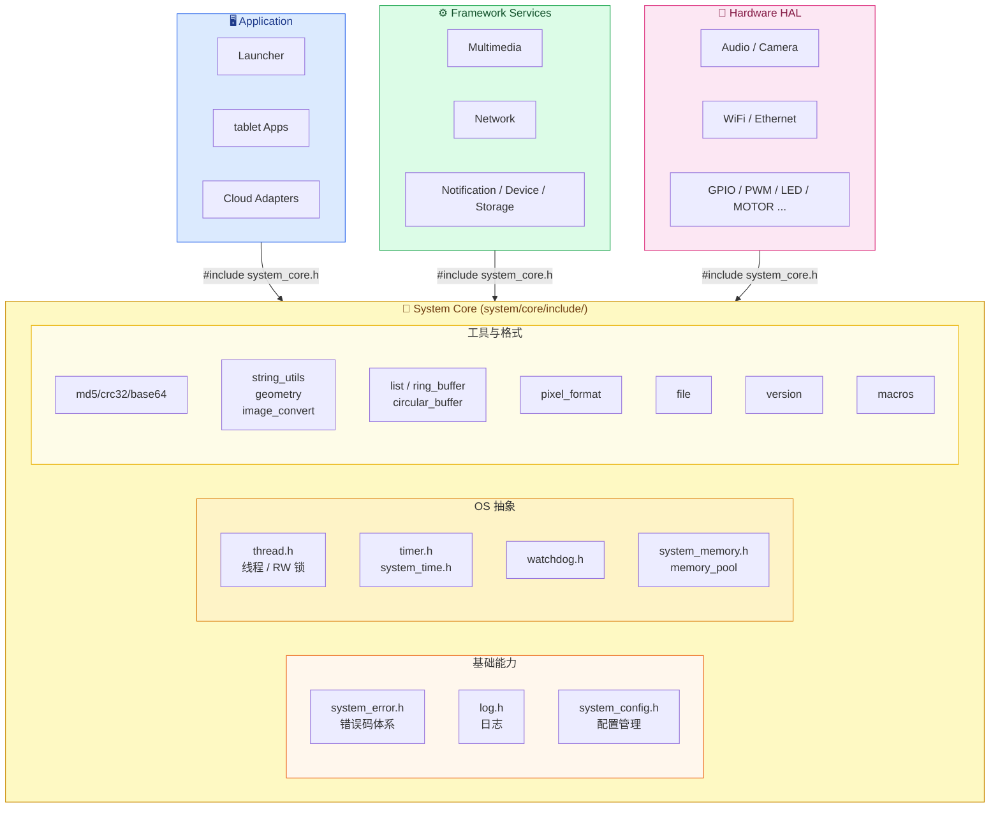
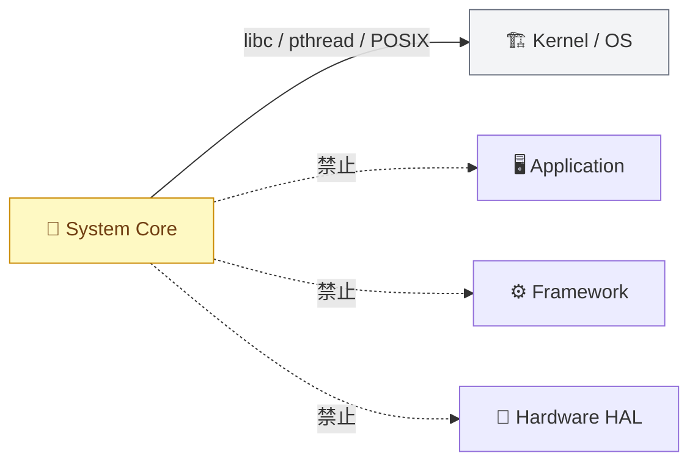

<p align="right"><a href="system-core.en.md">English</a> | <b>中文</b></p>

# System Core

> **本文范围**：System Core：被各层横向共享的基础能力 —— 错误码体系、日志、配置管理、线程与锁、时间定时器、内存、容器与工具函数。
>
> 逐函数签名见 [system-core-api.md](system-core-api.md)；分层、契约与运行期模型见 [架构总览](../architecture/overview.md)；术语以 [术语与命名对照表](../glossary.md) 为唯一解释源。

---

## 1. 横向共享定位



ASCII 备用：

```
           🖥️ Application ───┐
           ⚙️ Framework   ─── ├──► #include "system_core.h"
           🔌 HAL         ───┘
                                  ┌───────────────────────────────┐
                                  │  🔧 System Core                │
                                  │ ┌──────────┬────────────────┐ │
                                  │ │ 基础能力  │ error/log/config │ │
                                  │ │ OS 抽象  │ thread/timer/mem │ │
                                  │ │ 工具/格式 │ md5/crc32/str/… │ │
                                  │ └──────────┴────────────────┘ │
                                  └───────────────────────────────┘
```

### 1.1 横向依赖规则

| 规则 | 说明 |
|---|---|
| ✅ **允许** | Application / Framework / HAL 都可以 `#include "system_core.h"` |
| ✅ **允许** | System Core 依赖 `libc / pthread / Linux 系统调用` |
| ❌ **禁止** | System Core 反向依赖 Application / Framework / HAL 的任何头文件 |
| ❌ **禁止** | System Core 内部子模块之间循环依赖 |
| ❌ **禁止** | HAL 直接依赖 Framework，即便它们都依赖 System Core |

### 1.2 子模块选择性引入

`system_core.h` 提供 `SYSTEM_CORE_IMPORT_*` 宏，可只编译需要的子模块：

```c
#define SYSTEM_CORE_IMPORT_ALL 1   /* 默认全部引入 */

/* 选择性关闭示例 */
#define SYSTEM_CORE_IMPORT_CONFIG       0   /* 关闭 config 模块 */
#define SYSTEM_CORE_IMPORT_WATCHDOG     0   /* 关闭 watchdog 模块 */
#include "system_core.h"
```

> ⚠️ `system_core.h` 的聚合是**部分聚合**：即使 `SYSTEM_CORE_IMPORT_ALL=1`，它也只会引入 `system_types.h / system_error.h / system_version.h / gthread.h` 以及 config / log / system_thread / system_time / timer / string_utils / geometry / image_convert / base64 / crc32 / md5 / circular_buffer / system_memory / watchdog。下列头文件**不会**被自动带入，需要直接 `#include`：`system_macros.h`、`system_assert.h`、`system_debug.h`、`system_reentry.h`、`system_file.h`、`system_pixel_format.h`、`list.h`、`ring_buffer.h`。

---

## 2. 错误码体系（system_error.h）

**头文件**：`system/core/include/system_error.h`

### 2.1 错误码结构

```
 Bit 31    Bit 30-24    Bit 23-16    Bit 15-0
  符号位     Domain       Module       Code
  1=error   SYSTEM=0x00  CORE=0x00   0x0001-0xFFFF
            FW    =0x01  CONFIG=0x01
            HW    =0x02  LOG  =0x02
                         THREAD=0x03
                         ...
```

```c
/* 错误码生成宏 */
#define SYSTEM_ERROR_CODE(domain, module, code)  \
    (-(((domain) << 24) | ((module) << 16) | (code)))
```

> 各模块的专用错误码（`LOG_ERROR_*`、`CONFIG_ERROR_*`、`THREAD_ERROR_*` 等）**内联定义在各模块自己的公共头文件**中（如 `log.h`、`system_config.h`、`system_thread.h`），通过引用 `system_error.h` 里的 `SYSTEM_DOMAIN` 与 `SYSTEM_MODULE_*` 表组装；`system_error.h` 只集中维护域码 / 模块码表与通用 `ERROR_*` 码。

### 2.2 域定义

| 宏 | 值 | 层次 |
|---|---|---|
| `SYSTEM_DOMAIN` | 0x00 | system/core 层 |
| `FRAMEWORK_DOMAIN` | 0x01 | Framework 层 |
| `HARDWARE_DOMAIN` | 0x02 | Hardware HAL 层 |

### 2.3 System Domain 模块码

| 宏 | 值 | 模块 |
|---|---|---|
| `SYSTEM_MODULE_CORE` | 0x00 | 核心 |
| `SYSTEM_MODULE_CONFIG` | 0x01 | 配置管理 |
| `SYSTEM_MODULE_LOG` | 0x02 | 日志 |
| `SYSTEM_MODULE_THREAD` | 0x03 | 线程 |
| `SYSTEM_MODULE_MEMORY` | 0x04 | 内存 |
| `SYSTEM_MODULE_STORAGE` | 0x05 | 存储 |
| `SYSTEM_MODULE_TIME` | 0x06 | 时间 |
| `SYSTEM_MODULE_CRYPTO` | 0x07 | 加解密 |
| `SYSTEM_MODULE_UTILS` | 0x08 | 工具 |
| `SYSTEM_MODULE_WATCHDOG` | 0x09 | 看门狗 |
| `SYSTEM_MODULE_SOC_PLATFORM` | 0x0A | SoC 平台 |

### 2.4 Framework Domain 模块码

| 宏 | 值 | 模块 |
|---|---|---|
| `FRAMEWORK_MODULE_NETWORK` | 0x00 | 网络 |
| `FRAMEWORK_MODULE_NOTIFICATION` | 0x01 | 通知 |
| `FRAMEWORK_MODULE_MULTIMEDIA` | 0x02 | 多媒体 |
| `FRAMEWORK_MODULE_RUNTIME` | 0x03 | 运行时 |
| `FRAMEWORK_MODULE_DEVICE` | 0x04 | 设备服务 |
| `FRAMEWORK_MODULE_UI` | 0x05 | UI 模块 |
| `FRAMEWORK_MODULE_AI` | 0x06 | AI 模块 |
| `FRAMEWORK_MODULE_STORAGE` | 0x07 | 存储服务 |

### 2.5 通用错误码（所有模块共用）

| 宏 | 值 | 说明 |
|---|---|---|
| `SYSTEM_SUCCESS` | 0 | 成功 |
| `ERROR_INVALID_PARAM` | 0x0001 | 参数无效 |
| `ERROR_NOT_INIT` | 0x0002 | 未初始化 |
| `ERROR_MEMORY` | 0x0003 | 内存不足 |
| `ERROR_TIMEOUT` | 0x0004 | 超时 |
| `ERROR_NOT_FOUND` | 0x0005 | 未找到 |
| `ERROR_ALREADY_EXISTS` | 0x0006 | 已存在 |
| `ERROR_BUSY` | 0x0007 | 资源忙 |
| `ERROR_IO` | 0x0008 | IO 错误 |
| `ERROR_NOT_SUPPORTED` | 0x0009 | 不支持 |
| `ERROR_INVALID_STATE` | 0x000A | 状态错误 |
| `ERROR_OPERATION_FAILED` | 0x000B | 操作失败 |
| `ERROR_DEVICE_NOT_AVAILABLE` | 0x000C | 设备不可用 |
| `ERROR_CONFIG_ERROR` | 0x000D | 配置错误 |

---

## 3. 日志（log.h）

**头文件**：`system/core/include/log.h`
**版本**：SYSTEM_CORE_VERSION 0.12.0

### 3.1 日志级别（优先级从高到低）

| 枚举 | 值 | 用途 |
|---|---|---|
| `LOG_FATAL` | -1 | 致命错误，导致进程终止 |
| `LOG_ERROR` | 0 | 错误（系统功能失败）|
| `LOG_WARNING` | 1 | 警告 |
| `LOG_INFO` | 2 | 正常但重要的信息（如喂狗）|
| `LOG_DEBUG` | 3 | 调试信息 |
| `LOG_VERBOSE` | 4 | 详细跟踪 |

### 3.2 日志宏（推荐使用）

```c
#define LOG_TAG "MY_MODULE"   /* 每个文件定义，出现在日志前缀 */

log_error(fmt, ...)   /* 错误 */
log_warn(fmt, ...)    /* 警告 */
log_info(fmt, ...)    /* 信息 */
log_debug(fmt, ...)   /* 调试 */
log_verbose(fmt, ...)  /* 详细 */
```

`LOG_TAG` 须在每个文件 `#include "log.h"` 之前 `#define`。

### 3.3 底层 API

| 函数签名 | 说明 |
|---|---|
| `int log_print_base(level, tag, file, fun, line, fmt, ...)` | 底层日志打印（宏自动填充 file/fun/line）|
| `void log_set_level(int level)` | 运行时动态设置日志级别 |
| `int log_print_set_filter(log_filter_info *info)` | 设置精细过滤（级别/文件/函数/行号/关键字）|
| `int log_print_set_cb(LOG_PRINT_CB cb)` | 注册自定义打印回调 |
| `int log_print_set_save_file_cb(LOG_SAVE_CB cb)` | 注册日志保存回调 |
| `char *log_get_save_path(void)` | 获取日志保存路径 |
| `int log_write_init(void)` | 启动日志写文件线程 |
| `int log_write_deinit(void)` | 停止日志写文件线程 |

### 3.4 使用流程


---

## 4. 配置管理（system_config.h）

**头文件**：`system/core/include/system_config.h`
**实现**：封装 iniparser 库，支持 INI 格式文件的读写。

### 4.1 iniparser 直接 API

| 函数签名 | 说明 |
|---|---|
| `dictionary *iniparser_load(const char *ininame)` | 加载 INI 文件为字典 |
| `void iniparser_freedict(dictionary *d)` | 释放字典 |
| `int iniparser_getnsec(const dictionary *d)` | 获取 section 数量 |
| `const char *iniparser_getsecname(d, n)` | 按序号获取 section 名 |
| `int iniparser_getsecnkeys(d, s)` | 获取 section 中 key 数量 |
| `const char *iniparser_getstring(d, key, def)` | 读取字符串值 |
| `int iniparser_getint(d, key, notfound)` | 读取整数值 |
| `long int iniparser_getlongint(d, key, notfound)` | 读取长整数 |
| `double iniparser_getdouble(d, key, notfound)` | 读取浮点值 |
| `int iniparser_getboolean(d, key, notfound)` | 读取布尔值 |
| `int iniparser_set(d, entry, val)` | 写入字符串值 |
| `int iniparser_seti(d, entry, val)` | 写入整数值 |
| `int iniparser_set_double(d, entry, val)` | 写入浮点值 |
| `void iniparser_unset(d, entry)` | 删除条目 |
| `int iniparser_find_entry(d, entry)` | 判断条目是否存在 |
| `void iniparser_dump_ini(d, FILE*)` | 将字典输出为 INI 格式 |

### 4.2 路径管理 API（高层封装）

| 函数签名 | 说明 |
|---|---|
| `int config_set_default_path(const char *path)` | 设置默认配置目录 |
| `const char *config_get_default_path(void)` | 获取默认配置目录 |
| `int config_resolve_path(dir, name, out, out_size)` | 组合完整配置文件路径 |

### 4.3 INI 文件格式示例

```ini
[general]
version = 1.0.0
log_level = 3

[network]
ssid = MyWiFi
timeout_ms = 5000
```

**读取示例**：
```c
dictionary *d = iniparser_load("/etc/config/my.ini");
int level = iniparser_getint(d, "general:log_level", 3);
const char *ssid = iniparser_getstring(d, "network:ssid", "");
iniparser_freedict(d);
```

---

## 5. 线程（thread.h）

**头文件**：`system/core/include/thread.h`

### 5.1 线程管理 API

| 函数签名 | 说明 | 返回值 |
|---|---|---|
| `int thread_init(void)` | 初始化线程模块 | 0 成功 |
| `int thread_deinit(void)` | 反初始化 | 0 成功 |
| `int thread_create(handle*, func, param, name, stack, prio)` | 创建线程 | 0 成功；负数错误 |
| `int thread_destroy(int handle)` | 销毁线程（join）| 0 成功 |
| `int thread_get_info(buf, buf_len)` | 获取所有线程信息字符串 | 0 成功 |
| `int thread_check_in(int handle)` | 查询线程是否存活 | 1=存活 |

### 5.2 线程宏（推荐使用）

```c
/* 1. 声明线程变量 */
THREAD_RUN_DEF(MyThread)

/* 2. 启动线程 */
THREAD_RUN_START(MyThread, my_thread_func, param, 4096, 10)

/* 3. 检查线程状态 */
if (THREAD_RUN_CHECK(MyThread)) { /* 线程在运行 */ }

/* 4. 停止线程 */
THREAD_RUN_STOP(MyThread)
```

### 5.3 读写锁 API

| 函数签名 | 说明 |
|---|---|
| `rw_lock_t *rw_lock_create(void)` | 创建读写锁 |
| `void rw_lock_destroy(rw_lock_t *lock)` | 销毁读写锁 |
| `void rw_lock_read_lock(rw_lock_t *lock)` | 加读锁（共享）|
| `int rw_lock_try_read_lock(rw_lock_t *lock)` | 尝试加读锁 |
| `void rw_lock_read_unlock(rw_lock_t *lock)` | 释放读锁 |
| `void rw_lock_write_lock(rw_lock_t *lock)` | 加写锁（独占）|
| `int rw_lock_try_write_lock(rw_lock_t *lock)` | 尝试加写锁 |
| `void rw_lock_write_unlock(rw_lock_t *lock)` | 释放写锁 |

---

## 6. 时间与定时器

**头文件**：`system_time.h` + `timer.h`

### 6.1 系统时间 API（system_time.h）

| 函数签名 | 说明 | 返回值 |
|---|---|---|
| `long long system_get_sys_run_time64(void)` | 获取系统运行时间（ms）| 毫秒值 |
| `long long system_get_utc_time64(void)` | 获取 UTC 时间戳（ms）| 毫秒时间戳 |

### 6.2 定时器 API（timer.h）

| 函数签名 | 说明 |
|---|---|
| `int timer_init(void)` | 初始化定时器模块 |
| `int timer_create(handle*, cb, user, period_ms, repeat)` | 创建软件定时器 |
| `int timer_start(int handle)` | 启动定时器 |
| `int timer_stop(int handle)` | 停止定时器 |
| `int timer_destroy(int handle)` | 销毁定时器 |
| `int timer_reset(int handle, period_ms)` | 重设定时器周期 |

---

## 7. 看门狗（watchdog.h）

**头文件**：`system/core/include/watchdog.h`

### 7.1 API

| 函数签名 | 说明 | 返回值 |
|---|---|---|
| `int watchdog_init(int timeout_sec)` | 初始化看门狗（timeout < 默认值时用默认值）| 0 成功 |
| `int watchdog_deinit(void)` | 停止看门狗喂狗线程，关闭设备 | 0 成功 |
| `void watchdog_reboot_device(void)` | 立即触发重启（3 秒后执行）| — |

### 7.2 错误码

| 宏 | 说明 |
|---|---|
| `WATCHDOG_OK` | 成功 |
| `WATCHDOG_ERROR_INVALID_PARAM` | 参数无效（timeout ≤ 0）|
| `WATCHDOG_ERROR_NOT_INIT` | 未初始化 |
| `WATCHDOG_ERROR_INIT_FAILED` | 初始化失败（设备打开失败）|
| `WATCHDOG_ERROR_FEED_FAILED` | 喂狗失败 |

---

## 8. 内存管理（system_memory.h）

**头文件**：`system/core/include/system_memory.h`

提供内存池与辅助分配接口，防止频繁 malloc/free 导致的内存碎片。

| 函数签名 | 说明 |
|---|---|
| `void *system_malloc(size_t size)` | 分配内存（含调试跟踪）|
| `void system_free(void *ptr)` | 释放内存 |
| `void *system_calloc(n, size)` | 清零分配 |
| `void *system_realloc(ptr, size)` | 重新分配 |
| `void system_memory_dump(void)` | 打印当前内存使用统计 |

---

## 9. 加解密/校验（crypto）

### 9.1 MD5（md5.h）

| 函数签名 | 说明 |
|---|---|
| `void MD5Init(MD5_CTX *ctx)` | 初始化 MD5 上下文 |
| `void MD5Update(ctx, data, len)` | 追加数据 |
| `void MD5Final(unsigned char digest[16], ctx)` | 完成，获取 16 字节摘要 |
| `void md5_string(const char *str, char *out)` | 字符串 MD5 输出十六进制（33字节）|

### 9.2 CRC32（crc32.h）

| 函数签名 | 说明 |
|---|---|
| `uint32_t crc32(uint32_t crc, const void *buf, size_t len)` | 计算 CRC32（可续算）|
| `uint32_t crc32_of_file(const char *path)` | 计算文件 CRC32 |

### 9.3 Base64（base64.h）

| 函数签名 | 说明 |
|---|---|
| `int base64_encode(src, src_len, dst, dst_len)` | Base64 编码 |
| `int base64_decode(src, src_len, dst, dst_len)` | Base64 解码 |

---

## 10. 工具函数

### 10.1 字符串（string_utils.h）

| 函数签名 | 说明 |
|---|---|
| `int str_split(str, delim, parts[], max_parts)` | 字符串分割 |
| `int str_trim(str)` | 去除首尾空白 |
| `int str_to_int(str, val*)` | 安全字符串转整数 |
| `int str_to_float(str, val*)` | 安全字符串转浮点 |

### 10.2 几何（geometry.h）

> `rect_t` 实际定义在 `system_pixel_format.h`（`geometry.h` 通过 `#include "system_pixel_format.h"` 引入），`geometry.h` 本身**不**定义 `rect_t`，也**没有** IoU / `rect_contains` 接口。

| 类型/函数 | 说明 |
|---|---|
| `uv_rect_t` | UV 归一化矩形（`double x, y, width, height`，范围 `[0,1]`）|
| `int rect_right(const rect_t *r)` | 右边界 = `x + w` |
| `int rect_bottom(const rect_t *r)` | 下边界 = `y + h` |
| `int rect_intersection(src1, src2, dst)` | 求两矩形交集；**返回 1 表示有重叠、0 表示无重叠**（无重叠时 `dst` 置零）|
| `int rect_to_uv_rect(src, max_w, max_h, dst)` | 像素矩形归一化为 UV 矩形 |
| `float percent_to_real_value(min, middle, max, percent)` | 三段线性百分比映射 |
| `double percent_to_value(percent, value_list, count)` | 按百分比索引到值表 |

### 10.3 图像格式转换（image_convert.h）

> 仅提供 **YUV420SP（NV12 系）↔ packed RGB 扫描行（rgbline）** 互换及 ROI 缩放/拷贝；system/core 内**没有**任何 JPEG 编解码，不存在 `image_rgb24_to_jpeg` 之类接口。

| 函数签名 | 说明 |
|---|---|
| `int yuv420sp_roi_resize(in, w, h, x1, y1, rw, rh, ow, oh, out)` | YUV420SP ROI 缩放 |
| `int yuv420sp_roi_copy(in, w, h, ox, oy, ow, oh, out)` | YUV420SP ROI 拷贝 |
| `int yuv420sp_roi_resize_rgbline_version1(...)` / `_version2` | YUV420SP ROI 缩放并转 RGB 扫描行（v2 为 4 字节写）|
| `int rgbline_to_yuv_420sp(pin, w, h, pout)` | RGB 扫描行 → YUV420SP |
| `int rgbline_roi_resize_version1/2/3(...)` | RGB 扫描行 ROI 缩放（v3 为测试版）|
| `void save_rgbline_and_yuv(rgb_data, path, h, w, count)` | 调试用：落盘 RGB 行与 YUV 数据 |

### 10.4 像素格式（system_pixel_format.h）

| 宏/枚举 | 说明 |
|---|---|
| `PIX_FMT_NV12` | NV12 (YUV 4:2:0 semi-planar) |
| `PIX_FMT_YV12` | YV12 (YUV 4:2:0 planar) |
| `PIX_FMT_RGB24` | RGB24 |
| `PIX_FMT_RGBA32` | RGBA32 |
| `PIX_FMT_JPEG` | JPEG |

---

## 11. 容器数据结构

### 11.1 双向链表（list.h）

```c
/* 将 struct list_head 嵌入业务结构，零拷贝链表 */
struct list_head { struct list_head *next, *prev; };

INIT_LIST_HEAD(head)          /* 初始化 */
list_add(entry, head)         /* 头插 */
list_add_tail(entry, head)    /* 尾插 */
list_del(entry)               /* 删除 */
list_empty(head)              /* 判空 */
list_for_each(pos, head)      /* 遍历 */
list_entry(ptr, type, member) /* 从成员指针获取结构体指针 */
```

### 11.2 环形缓冲区（ring_buffer.h）

| 函数 | 说明 |
|---|---|
| `ring_buffer_t *ring_buffer_create(capacity)` | 创建环形缓冲 |
| `void ring_buffer_destroy(rb)` | 销毁 |
| `int ring_buffer_write(rb, data, len)` | 写入 |
| `int ring_buffer_read(rb, buf, len)` | 读取 |
| `int ring_buffer_available(rb)` | 可读字节数 |

### 11.3 循环缓冲区（circular_buffer.h）

| 函数 | 说明 |
|---|---|
| `int circular_buffer_init(cb, size)` | 初始化 |
| `int circular_buffer_push(cb, data, len)` | 推入（覆盖旧数据）|
| `int circular_buffer_pop(cb, buf, len)` | 弹出 |
| `int circular_buffer_size(cb)` | 当前存储字节数 |

---

## 12. 通用宏（system_macros.h）

| 宏 | 说明 |
|---|---|
| `MAX(x, y)` | 取较大值 |
| `MIN(x, y)` | 取较小值 |
| `PARAM_IN_RANGE(val, min, max)` | 值限幅 |
| `ARRAY_SIZE(arr)` | 数组长度 |
| `ALIGN(val, align)` | 向上对齐 |
| `OFFSETOF(type, member)` | 成员偏移 |

---

## 13. 版本信息（system_version.h）

| 宏 | 值 | 说明 |
|---|---|---|
| `SYSTEM_CORE_VERSION_MAJOR` | 0 | 主版本 |
| `SYSTEM_CORE_VERSION_MINOR` | 12 | 次版本 |
| `SYSTEM_CORE_VERSION_PATCH` | 0 | 修订版 |
| `SYSTEM_CORE_VERSION_CODE` | `(0 << 16)\|(12 << 8)\|0` | 数值版本（用于比较）|

```c
#if SYSTEM_CORE_VERSION_CODE >= SYSTEM_CORE_VERSION_PACK(0, 12, 0)
    /* 使用新特性 */
#endif
```

---

## 14. 文件工具（system_file.h）

| 函数签名 | 说明 |
|---|---|
| `int system_file_exists(const char *path)` | 文件是否存在 |
| `int system_file_size(path, size*)` | 获取文件大小 |
| `int system_file_copy(src, dst)` | 文件拷贝 |
| `int system_dir_create(path, mode)` | 递归创建目录 |
| `int system_dir_exists(path)` | 目录是否存在 |

---

## 15. 辅助头文件（Helpers）

以下头文件为**宏/类型定义**型，用于配合其它模块，不含独立对象生命周期。

### 15.1 `system_types.h` — 基础类型与函数指针

| 符号 | 说明 |
|---|---|
| `SYSTEM_SUCCESS` | 统一成功返回值 `0` |
| `SYSTEM_true/false` / `TRUE/FALSE` | 布尔常量别名 |
| `SYSTEM_COMPARE_FUNCTION` / `SYSTEM_COMPARE_DATA_FUNCTION` | `int (*)(const void*, const void*[, void *user_data])` — 排序/查找比较 |
| `SYSTEM_EQUAL_FUNCTION` | `int (*)(const void*, const void*)` |
| `SYSTEM_DESTROY_NOTIFY_FUNCTION` | `void (*)(void*)` |
| `SYSTEM_FUNC_FUNCTION` | `void (*)(void *data, void *user_data)` |
| `SYSTEM_HASH_FUNCTION` / `SYSTEM_HASH_FOREACH_FUNCTION` | 哈希表函数族 |

### 15.2 `system_assert.h` — 断言与期望

| 宏 | 语义 |
|---|---|
| `SYSTEM_ASSERT(exp)` | 失败则 `exit(1)` |
| `SYSTEM_ASSERT_TRUE/FALSE(cond)` | 等价于 `ASSERT`/`ASSERT(!cond)` |
| `SYSTEM_TEST(cond, verbose)` | 条件测试，返回 `SYSTEM_true/false` |
| `SYSTEM_EXPECT(cond)` | 条件不满足输出红色提示（非致命） |
| `SYSTEM_EXPECT_RETURN / ..._VAL(ret)` | 非致命检查+返回 |
| `SYSTEM_EXPECT_JUMP(cond, label)` | 跳转 goto |
| `SYSTEM_EXPECT_BREAK / ..._CONTINUE` | 循环控制 |
| `SYSTEM_EXPECT_VERBOSE_*` | 与上一族对应，失败时打印详情 |
| `SYSTEM_CHECK0_RET_ERROR(expr)` | 若返回值非 0 直接 `return iRet` 并打印 |

### 15.3 `system_reentry.h` — 重入保护

| 宏 | 语义 |
|---|---|
| `REENTRY_INIT(Module)` | 声明静态计数器（放在 `.c` 文件顶） |
| `REENTRY_START(Module)` | 计数 `+1` |
| `REENTRY_STOP(Module)` | 归零 |
| `REENTRY_CHECK(Module)` | 计数非 0 时打印错误并 `return 0` |
| `REENTRY_CHECK_NO_PRINT(Module)` | 同上但不打印 |
| `REENTRY_GET_INIT_STATUS(Module)` | 读计数 |
| `REENTRY_CHECK_INIT_RETURN(Module)` | 计数为 0 → `return -1` |
| `REENTRY_CHECK_INIT_RETURN_NULL(Module)` | 计数为 0 → `return NULL` |

> 使用前需包含 `log.h` 并 `#define LOG_TAG "Xxx"`。

### 15.4 `system_debug.h` — 断点打印

| 宏 | 语义 |
|---|---|
| `SYSTEM_CHECK_POINT()` | 打印 `-- @ file:line` 便于调试跟踪 |

### 15.5 `gthread.h` — GLib 风格线程抽象（轻量）

| 符号 | 原型 | 说明 |
|---|---|---|
| `GThread*` | opaque | 线程句柄 |
| `GThreadFunc` | `void* (*)(void *data)` | 线程入口 |
| `GMutex` / `GRecMutex` / `GRWLock` / `GCond` | 类型 | Mutex/递归/读写锁/条件变量 |
| `g_thread_new` | `GThread* g_thread_new(const char *name, GThreadFunc fn, void *data)` | 创建 |
| `g_thread_join` | `void* g_thread_join(GThread *t)` | 等待 |
| `g_mutex_init/clear/lock/unlock/trylock` | `void/int (*)(GMutex*)` | 互斥操作 |

> 与 `thread.h` 的 `system_thread_*` 抽象互补：`gthread.h` 更接近 GLib API 风格，供第三方库或兼容代码使用。

---

## 16. 依赖边界



| ✅ 允许 | ❌ 禁止 |
|---|---|
| 依赖 C 标准库（libc）| 依赖 Framework（`framework/`）|
| 依赖 Linux POSIX API | 依赖 HAL（`hardware/`）|
| `system_core` 子模块相互引用（仅通过头文件）| 依赖 `application/` |

**构建产物**：system/core 同时产出动态库 `libsystem_core.so` 与静态库 `libsystem_core.a`（见 `system/core/Makefile` 的 `STATIC_LIB` / `DYNAMIC_LIB`），上层可按需链接。

**编译期检查**：
```bash
# system/core 不得出现 framework/hardware/application 的 include
grep -r "#include.*framework\|#include.*hardware\|#include.*application" \
    system/core/ --include="*.h" --include="*.c"
```

---

## 17. 相关分册

- 系统总览：[architecture/overview.md](../architecture/overview.md)
- 应用层：[application.md](application.md)
- Framework：[framework.md](framework.md)
- HAL：[hardware-hal.md](hardware-hal.md)
- HAL API：[hardware-api.md](hardware-api.md)
- System Core API：[system-core-api.md](system-core-api.md)
- 构建与 BSP：[quick-start/bsp-and-products.md](../quick-start/bsp-and-products.md)
- API 索引：[guide/api-index.md](api-index.md)
