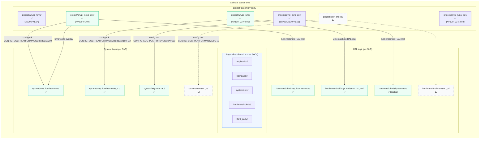
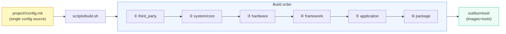
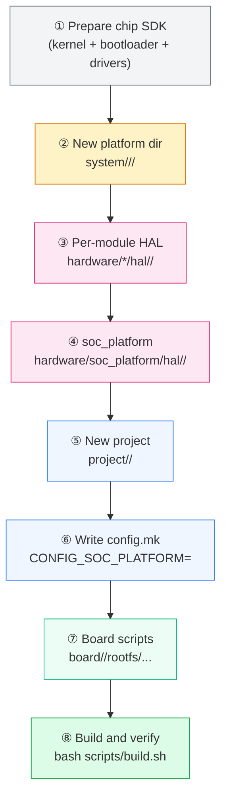

<p align="right"><b>English</b> | <a href="bsp-and-products.md">中文</a></p>

# Build & BSP

---

## 1. Celestia project assembly model

Celestia uses a **"project composition + SoC separation"** design: the same Celestia tree can be assembled into images for different SoCs, boards, and form factors via different `project/` directories.



ASCII fallback:

```
Celestia source tree
├── application/          ← shared across SoCs (all App and Cloud)
├── framework/            ← shared across SoCs (services)
├── system/core/          ← shared across SoCs (common utilities)
├── hardware/
│   ├── include/          ← public API (shared across SoCs)
│   └── <module>/hal/
│       ├── AnyCloud39AV200/      ✅ Nova SoC
│       ├── AnyCloud39AV100_V2/   ✅ wearable SoC
│       ├── Sky39AV130/           ✅ Mira SoC (partial modules)
│       └── NewSoC_A/             ⬜ to extend
├── system/
│   ├── AnyCloud39AV200/V1.04/    ✅ Nova vendor PDK (V1.03 may also exist)
│   ├── AnyCloud39AV100_V2/V2.05/ ✅ Luna (V2.04 also exists)
│   ├── Sky39AV130/V1.01/         ✅ Mira (aos)
│   └── NewSoC_A/                 ⬜
├── third_party/          ← shared across SoCs
└── project/
    ├── anypi_nova/       ✅ Production Nova → AV200 V1.04 / ipc_main
    ├── anypi_nova_dev/   ✅ EVB → AV200 V1.04 / nova_main
    ├── anypi_luna/       ✅ Luna wearable → AV100_V2 V2.05 / luna_main
    ├── anypi_luna_dev/   ✅ IOTCamera → AV100_V2 V2.04 / luna_dev_main
    ├── anypi_mira_dev/       ✅ IOTCamera → Sky39AV130 V1.01 / mira_main (aos)
    └── new_project/      ⬜
```

### 1.1 Three responsibilities of a project

| Responsibility | File / path |
|---|---|
| **Pick platform** | `CONFIG_SOC_PLATFORM=...` in `project/<proj>/config.mk` |
| **Pick board** | `CONFIG_BOARD=...` in `project/<proj>/config.mk` |
| **Board-level resources** | `project/<proj>/system/<SoC>/<SDK>/board/<Board>/rootfs/...` |

---

## 2. Build pipeline



---

## 3. Config entry — project/\<proj\>/config.mk

At startup, `scripts/build.sh` parses all `CONFIG_*` variables from `project/<proj>/config.mk` and auto-generates `project/<proj>/include/config.h` for C conditional compile. Product selection: `--product-name` → cache `out/.build_product_name` → interactive list of `project/*` (non-interactive runs must pass `--product-name` explicitly).

### 3.1 SoC / board core variables

| Variable | anypi_nova | anypi_nova_dev | anypi_luna | anypi_luna_dev | anypi_mira_dev |
|------|------------|----------------|------------|----------------|------------|
| `CONFIG_SOC_PLATFORM` | `AnyCloud39AV200` | `AnyCloud39AV200` | `AnyCloud39AV100_V2` | `AnyCloud39AV100_V2` | `Sky39AV130` |
| `CONFIG_SOC_SDK_VERSION` | `V1.04` | `V1.04` | `V2.05` | `V2.04` | `V1.01` |
| `CONFIG_OS_NAME` | `linux` | `linux` | `linux` | `linux` | `aos` |
| `CONFIG_BOARD` | `PDB_MBD_AK3918AV200_ACTCAM` | `EVB_MBD_AK3918AV200` | `PDB_MBD_KM01W_ACTCAM` | `EVB_MBD_KM01A` | `EVB_CBD_AK3918AV130` |
| `CONFIG_APP_MAIN_TARGET` | `ipc_main` | `nova_main` | `luna_main` | `luna_dev_main` | `mira_main` |
| `CONFIG_WIFI_TYPE` | `atbm6162` | — (board-level) | `aic8800` | `atbm6032` | — |
| `CONFIG_CELESTIA_FASTSYS` | `y` | `y` | `n` | `n` | `n` |

> anypi_mira_dev (aos) uses project `setup_toolchain.sh` for `arm-none-eabi-` (alios); `build.sh` sources it when `CONFIG_OS_NAME=aos`.

### 3.2 Application layer switches

| Variable | anypi_nova | anypi_nova_dev | anypi_luna | anypi_luna_dev | Notes |
|------|------------|----------------|------------|----------------|------|
| `CONFIG_APP_MAIN_ENTRY` | y | y | y | y | Enable app_main |
| `CONFIG_APP_PACKAGES_TABLET` | **y** | **y** | n | n | tablet GUI (mutually exclusive with wearable) |
| `CONFIG_APP_PACKAGES_WEARABLE` | n | n | **y** | n | `WEARABLE` GUI |
| `CONFIG_APP_PACKAGES_IPCAMERA` | n | n | n | **y** | `IOTCamera` |
| `CONFIG_APP_WEARABLE_CAMERA` | — | — | **y** | — | wearable Camera SO |
| `CONFIG_APP_IPC_CAMERA` | y | y | — | — | IPC camera |
| `CONFIG_APP_CAMERA` | y | y | — | — | Camera app |
| `CONFIG_APP_CLOUD_VOLC` | y | y | n | n | Volcengine cloud SO |
| `CONFIG_APP_RTSP` | y | y | n | y | RTSP protocol |
| `CONFIG_APP_NEBULA` | y | y | n | y | Nebula protocol |
| `CONFIG_APP_UVC` | n | n | n | n | UVC service (as needed) |

> IOTCamera products: `anypi_mira_dev` enables `CONFIG_APP_RTSP`/`CONFIG_APP_NEBULA` and uses `ipc_cam`. See each `project/*/config.mk`.

### 3.3 Framework layer switches (selected)

| Variable | Value | Notes |
|---|---|---|
| `CONFIG_FW_MULTIMEDIA` | y | Multimedia service |
| `CONFIG_FW_MULTIMEDIA_CAMERA_AI` | y | Camera AI inference |
| `CONFIG_FW_MULTIMEDIA_FORMAT_MP4 / AVI` | y | Container formats |
| `CONFIG_FW_NETWORK / WIFI / ETHERNET` | y | Network modules |
| `CONFIG_FW_NOTIFICATION / INPUT / ALARM` | y | Notification modules |
| `CONFIG_FW_DEVICE_PTZ / LED / POWER / BACKLIGHT` | y | Device submodules |
| `CONFIG_FW_DEVICE_IPCAMERA_NIGHTVISION` | y | Night vision |
| `CONFIG_FW_STORAGE` | y | Storage service |
| `CONFIG_FW_GUI_LVGL` | y | LVGL GUI |
| `CONFIG_FW_RUNTIME_BOOTSTRAP` | y | Runtime bootstrap |
| `CONFIG_FW_RUNTIME_CONSOLE` | y | Console commands |
| `GDB_DEBUG` | 0 | GDB support |

### 3.4 Hardware layer switches (selected)

| Variable | Value | Notes |
|---|---|---|
| `CONFIG_HW_SOC_PLATFORM` | y | SoC platform abstraction (always on) |
| `CONFIG_HW_AUDIO / CAMERA / DISPLAY / OSD / GPU` | y | Multimedia HAL |
| `CONFIG_HW_VISION_ISP / MOTION_DETECT` | y | Vision HAL |
| `CONFIG_HW_WIFI / ETHERNET` | y | Network HAL |
| `CONFIG_HW_INPUT_TOUCH / KEYBOARD` | y | Input HAL |
| `CONFIG_HW_DRIVER_GPIO / ADC / PWM / MOTOR / LED / IR / WDT / EFUSE / BLKDEV / MMC` | y | Driver HAL |

### 3.5 Third-party libraries (selected)

| Library | Version | Use |
|---|---|---|
| lvgl | 9.3.0 | GUI framework |
| ffmpeg | 7.0 (minimal) | Audio/video codecs |
| mbedtls | 2.28.10 | Security / crypto |
| openssl | 3.1.5 | TLS |
| curl | 8.3.0 | HTTP client |
| libwebsockets | 4.4 | WebSocket |
| cjson | 1.7.15 | JSON |
| iniparser | vendored (version unspecified) | INI config |
| zxing | — | QR decode |
| freetype | 2.12.0 | Fonts |
| libjpeg / libpng | 9e / 1.6.43 | Image decode |
| zlib | 1.3.1 | Compression |
| tslib | 1.22 | Touch calibration |
| iconv | 1.15 | Encoding conversion |

> Actual `third_party/` dirs: `asr` `awtk` `cjson` `curl` `ffmpeg` `freetype` `iconv` `iniparser` `jerryscript` `jpeg` `jpegdec` `libpng` `libwebsockets` `lvgl` `mbedtls` `minIni` `openssl` `tslib` `zlib` `zxing`. `xmlparser` and `libh264` removed (see `third_party/THIRD_PARTY_NOTICES.md`: xmlparser unused repo-wide; libh264 duplicated FFmpeg; H.264 decode via FFmpeg).

---

## 4. Build script usage

**Entry**: `scripts/build.sh` (or repo root `build.sh`, same content)

```bash
# No product: interactive project/* choice, writes out/.build_product_name; next run can omit flag
bash scripts/build.sh

# Specify product
bash scripts/build.sh --product-name anypi_nova
bash scripts/build.sh --product-name anypi_nova_dev
bash scripts/build.sh --product-name anypi_luna
bash scripts/build.sh --product-name anypi_luna_dev
bash scripts/build.sh --product-name anypi_mira_dev

# Per-layer build
bash scripts/build.sh --system-core         # system/core only
bash scripts/build.sh --third-party         # all third_party
bash scripts/build.sh --third-party lvgl    # lvgl only
bash scripts/build.sh --hardware            # HAL only
bash scripts/build.sh --framework           # Framework only
bash scripts/build.sh --application         # Application only
bash scripts/build.sh --kernel              # Kernel / BSP only
bash scripts/build.sh --package             # package only (skip compile)

# Combine and parallelize
bash scripts/build.sh -f -a --jobs 4        # framework + application, 4 threads
bash scripts/build.sh --build-level RELEASE --package

# Module-precise build
bash scripts/build.sh --build-module FW_MULTIMEDIA

# Clean
bash scripts/build.sh --clean               # clean + full build
bash scripts/build.sh -c -f                 # clean + framework only

# Release output
bash scripts/build.sh --release
bash scripts/build.sh --release /path/to/dir
```

> **Product selection**: Without `--product-name`, use cache if present, else interactive `project/*` and write `out/.build_product_name`. CI / non-TTY must pass `--product-name`.

### Build dependency chain

```text
① third_party  → no deps
② system/core  → third_party (cjson headers)
③ hardware     → system/core + SOC SDK
④ framework    → third_party (lvgl/cjson) + system/core + hardware
⑤ application  → framework + system/core
⑥ package      → ①~⑤ all done
```

> `build_framework()` and `build_system_core()` check for `liblvgl.a` / `cJSON.h` at startup and trigger `build_third_party()` if missing.

---

## 5. Output directory layout

```text
out/
├── build/                 ← intermediates (.o / .a / temp)
│   ├── system/core/
│   ├── hardware/
│   ├── framework/
│   ├── application/
│   └── third_party/
├── install/               ← unified install tree (for package)
│   ├── system/core/
│   ├── hardware/
│   ├── framework/
│   ├── application/
│   └── third_party/
├── release/               ← --release publish dir
└── burntool/              ← burn tool + images (after package)
```

---

## 6. Main artifacts

### 6.1 Main executables

| Artifact | Source | On-device path |
|---|---|---|
| `ipc_main` | `application/app_main/` | `/usr/sbin/ipc_main` (anypi_nova) |
| `nova_main` | `application/app_main/` | `/usr/sbin/nova_main` (anypi_nova_dev) |
| `luna_main` | `application/app_main/` | `/usr/sbin/luna_main` (anypi_luna) |
| `luna_dev_main` | `application/app_main/` | `/usr/sbin/luna_dev_main` (anypi_luna_dev) |
| `mira_main` | `application/app_main/` | `/usr/sbin/mira_main` (anypi_mira_dev, aos) |

### 6.2 Framework shared libraries (sample)

| SO file | Source |
|---|---|
| `libmultimedia.so` | `framework/services/multimedia/` |
| `libnetwork.so` | `framework/services/network/` |
| `libnotification.so` | `framework/services/notification/` |
| `libdevice.so` | `framework/services/device/` |
| `libstorage.so` | `framework/services/storage/` |
| `libnebula_protocol.so` | `framework/gateway/nebula_protocol/` |
| `librtsp_protocol.so` | `framework/gateway/rtsp_protocol/` |

### 6.3 Application SO (as enabled)

| SO file | Enable switch | Notes |
|---|---|---|
| `libcamera_app.so` | `CONFIG_APP_WEARABLE_CAMERA=y` | wearable Camera sub-app (anypi_luna only) |
| `libvolc_engine_app.so` | `CONFIG_APP_CLOUD_VOLC=y` | Volcengine cloud platform |

### 6.4 Image files (after package)

| File | Notes |
|---|---|
| `uImage` | Normal Linux kernel image |
| `fastsys_uImage` | Fast-boot kernel (when FASTSYS=y) |
| `initfs.img` | initramfs |
| `*.dtb` | Device tree (auto-selected from board features; see 6.5) |
| `env_av200_*.img` | Environment partition image |
| `dss_anyka_av200_fastsys_sc450ai.bin` | DSS image |
| `burnfile.md5` | MD5 for all images |

### 6.5 DTB selection matrix

#### anypi_nova_dev (AnyCloud39AV200)

`package.sh` picks DTB from:

| FASTSYS | LCD | DMIC | DTB file |
|:-:|:-:|:-:|---|
| y | y | y | `EVB_CBDM_KM02X_FASTSYS_LCD_DMIC_V1.0.0.dtb` |
| y | y | n | `EVB_CBDM_KM02X_FASTSYS_LCD_V1.0.0.dtb` |
| n | y | y | `EVB_CBDM_KM02X_LCD_DMIC_V1.0.0.dtb` |
| n | y | n | `EVB_CBDM_KM02X_LCD_V1.0.0.dtb` |
| n | n | — | `EVB_CBDM_KM02X_V1.0.0.dtb` |

#### anypi_luna (AnyCloud39AV100_V2)

Wearable DTB is set directly in board `config.mk` as `CONFIG_DTB_NAME`:

| DTB file | Notes |
|---|---|
| `EVB_CBDM_KM01A_V1.0.0.dtb` | KM01A ActionCam board |

---

## 7. Current BSP — AnyCloud39AV200

### 7.1 Key components

| Component | Path | Notes |
|---|---|---|
| Linux kernel | `system/AnyCloud39AV200/V1.04/os/kernel/` | Linux 5.10.111 |
| Device tree | `…/boot/dts/anyka/` | AK3918AV200 board DTS |
| Kernel modules | `rootfs/lib/modules/*.ko` | Camera / audio / ISP / NPU |
| Board boot script | `board/EVB_MBD_AK3918AV200/rootfs/utils/etc/config/app_01_start.sh` | Driver load |
| SoC platform abstraction | `hardware/soc_platform/AnyCloud39AV200/` | `soc_platform_init()` |

### 7.2 Directory layout

```text
project/anypi_nova_dev/system/AnyCloud39AV200/V1.04/
├── board/
│   └── EVB_MBD_AK3918AV200/
│       ├── config.mk                                  ← board config
│       ├── rootfs/utils/etc/config/
│       │   └── app_01_start.sh                         ← board boot script
│       └── os/kernel/arch/.../boot/dts/anyka/          ← device tree
├── patch/rootfs/utils/                                 ← generic patch overlay
├── patch_fastsys/rootfs/utils/                         ← fast-boot patch overlay
└── tools/burntool/                                     ← burn tool
```

### 7.3 rootfs overlay order

```text
① SOC base rootfs
② board/EVB_MBD_AK3918AV200/rootfs/utils/   ← board-specific
③ patch/rootfs/utils/                        ← generic patch
④ patch_fastsys/rootfs/utils/                ← fast-boot patch (FASTSYS=y only)
```

Later layers override earlier ones.

### 7.4 Board boot script (excerpt)

**File**: `app_01_start.sh`

```bash
# ① Touchscreen env
export TSLIB_CONFFILE=/etc/config/ts.rgb.conf
export TSLIB_TSDEVICE=/dev/input/event1

# ② Input drivers
insmod /usr/modules/ak_saradc.ko
insmod /usr/modules/ak_adc_key.ko
insmod /usr/modules/ts_ft5426g.ko

# ③ Display drivers
insmod /usr/modules/ak_ipu.ko
insmod /usr/modules/fb.ko
insmod /usr/modules/ak_lcd.ko

# ④ Network
/usr/sbin/wifi_driver.sh sta &

# ⑤ Camera + video encode
/usr/sbin/gc5603.sh
insmod /usr/modules/ak_venc_adapter.ko
insmod /usr/modules/ak_venc_bridge.ko
insmod /lib/modules/5.10.111/.../firmware_class.ko path=/usr/model/

# ⑥ Audio
insmod /usr/modules/ak_pcm.ko

# ⑦ NPU
insmod /usr/modules/ak_npu.ko

# ⑧ Main process (matches CONFIG_APP_MAIN_TARGET)
# nova_dev → /usr/sbin/nova_main &
# nova → /usr/sbin/ipc_main & or start_nova_main.sh
```

Boot script must launch the binary named like `CONFIG_APP_MAIN_TARGET` (e.g. anypi_nova → `ipc_main`, anypi_nova_dev → `nova_main`).

---

## 8. Current BSP — AnyCloud39AV100_V2 (wearable line)

### 8.1 Key components

| Component | Path / value | Notes |
|---|---|---|
| Chip family | KM01A | `CONFIG_CHIP_SERIES` |
| SDK version | V2.05 | `system/AnyCloud39AV100_V2/V2.05/` (anypi_luna_dev still V2.04) |
| Board | `PDB_MBD_KM01W_ACTCAM` | ActionCam board |
| Toolchain | `arm-anycloud-linux-uclibcgnueabi-` | uClibc GCC cross-compile |
| WiFi | aic8800 | `CONFIG_WIFI_TYPE` |
| DTB | `EVB_CBDM_KM01A_V1.0.0` | `CONFIG_DTB_NAME` |
| Sensor | sc200ai | `CONFIG_SENSOR_NAME` |
| Display | 240x240 | Wearable (`WEARABLE`) form factor (`app_globle_config.h`) |
| Project assembly | `project/anypi_luna/config.mk` | Wearable build config entry |

### 8.2 Directory layout

```text
project/anypi_luna/
├── config.mk                                              ← build config entry
├── Makefile / build_soc_system.sh / package.sh
├── include/
│   ├── config.h                                           ← auto-generated
│   ├── app_globle_config.h                                ← 240x240 display params
│   ├── app_product_config.h                               ← product deltas
│   └── lv_conf.h                                          ← LVGL config
└── system/AnyCloud39AV100_V2/
    ├── V2.05/                                             ← current SDK overlay
    │   ├── board/PDB_MBD_KM01W_ACTCAM/
    │   │   ├── config.mk                                  ← board (DTB/WiFi/Sensor)
    │   │   ├── os/kernel/...                              ← board DTS
    │   │   └── rootfs/utils/etc/config/                   ← settings.json / fw_*.json etc.
    │   └── patch/...
    └── V2.04/                                             ← legacy overlay (kept)
```

### 8.3 Product comparison (five products)

| Dimension | anypi_nova | anypi_nova_dev | anypi_luna | anypi_luna_dev | anypi_mira_dev |
|---|---|---|---|---|---|
| SoC | AnyCloud39AV200 | AnyCloud39AV200 | AnyCloud39AV100_V2 | AnyCloud39AV100_V2 | Sky39AV130 |
| SDK | V1.04 | V1.04 | V2.05 | V2.04 | V1.01 |
| Board | PDB_MBD_AK3918AV200_ACTCAM | EVB_MBD_AK3918AV200 | PDB_MBD_KM01W_ACTCAM | EVB_MBD_KM01A | EVB_CBD_AK3918AV130 |
| Display | 800×480 | 1024×600 | 240×240 | none | none |
| Main binary | `ipc_main` | `nova_main` | `luna_main` | `luna_dev_main` | `mira_main` |
| Packages | `TABLET=y` | `TABLET=y` | `WEARABLE=y` | `IPCAMERA=y` | `IPCAMERA=y` |
| OS / toolchain | linux / `riscv64-anyka-linux-musl-` | same | linux / `arm-anycloud-linux-uclibcgnueabi-` | same | aos / `arm-none-eabi-` |
| Business SO / cloud | multi-cloud (volc/aliyun etc.) | same | — | `ipc_cam` | `ipc_cam` |
| Protocols | RTSP / Nebula | same | off by default | RTSP / Nebula | RTSP / Nebula |

---

## 9. Full flow for a new SoC platform (reference)



| Step | Key action | Output |
|---|---|---|
| ① Prepare SDK | Get kernel + toolchain + drivers + headers from vendor | `system/<NewSoC>/<SDK_Ver>/` |
| ② Platform dir | Lay out `{os,tools,…}` per SDK; board overlay still in `project/` | Platform source root |
| ③ **Per-module HAL** | For each enabled module with `hal/<SoC>/`, add `hardware/<m>/hal/<NewSoC>/` aligned to `hardware/include/*.h` | Per-module SoC impl |
| ④ SoC abstraction | `soc_platform/hal/<NewSoC>/`: `soc_platform_init()` etc.; weak stubs if no IPU | bring-up |
| ⑤ New project | `cp -r` baseline product | `project/<new>/` |
| ⑥ Edit config.mk | `CONFIG_SOC_PLATFORM` / `CONFIG_SOC_SDK_VERSION` / needed `CONFIG_HW_*` | Build entry |
| ⑦ Board scripts | DTS + `insmod` list in boot script | board overlay |
| ⑧ Build verify | `./build.sh --product-name <p>`; L1→L5 | image + on-board |

> **Usually unchanged**: Application / Framework / `hardware/include/`.
> **system/core**: leave as-is when only adding HAL for existing modules; append `HARDWARE_MODULE_*` in `system_error.h` only for **brand-new** HAL modules (see [celestia-system-core](../skills/celestia-system-core.en.md)).
> Per-module checklist and AI worksheets: [roles.en.md Section 4](roles.en.md#4-new-soc-port-developer), [celestia-hardware](../skills/celestia-hardware.en.md#new-soc-chip-sdk--per-module-hal).
> **RTOS/AOS chips** (SDK user space only `.a`, e.g. Sky39AV130/mira): beyond the above, POSIX compat shims, `.so`→`.a` static link, and BSP kernel patches — see [celestia-aos-port](../skills/celestia-aos-port.en.md) (port Linux products to AOS).

---

## 10. Deploy and on-board

### 9.1 Standard deploy paths

| Artifact | Device path |
|---|---|
| `CONFIG_APP_MAIN_TARGET` | `/usr/sbin/<suffix>_main` (`ipc_main` / `nova_main` / `luna_main` / `luna_dev_main` / `mira_main`) |
| Framework / Third-Party `.so` | `/usr/lib/` or `/lib/` |
| Cloud adapter SO | `/usr/lib/lib*_app.so` |
| Config files | `/etc/config/` |
| Fonts / images | `/usr/gui/font/` etc. |
| Driver modules | `/usr/modules/` |
| NPU models | `/usr/model/` |

### 9.2 Runtime config lookup order

```text
① Env var APP_SETTINGS_CONFIG
② CLI --config /path/to/settings.json
③ settings.json in cwd
④ Default /etc/config/settings.json
```

### 9.3 On-board startup

```bash
# 1. Load drivers (BSP init at boot runs this)
sh /etc/config/app_01_start.sh

# 2. Start main process (name = CONFIG_APP_MAIN_TARGET)
/usr/sbin/ipc_main &
# or /usr/sbin/nova_main & /usr/sbin/luna_main & /usr/sbin/luna_dev_main & /usr/sbin/mira_main &

# 3. Verify logs (after framework_init)
#    Key log: "[LAUNCHER] platform startup ok"
```

---

## 11. First on-board verification checklist

| # | Item | Method | Expected |
|---|---|---|---|
| 1 | Driver load | `lsmod` | `ak_pcm` `ak_npu` `fb` etc. present |
| 2 | Camera device | `ls /dev/video*` | `/dev/video0` exists |
| 3 | Audio device | `ls /dev/snd/` | PCM / control devices |
| 4 | Display device | `ls /dev/fb*` | `/dev/fb0` exists |
| 5 | Touch device | `ls /dev/input/` | event devices present |
| 6 | Network ready | `ifconfig wlan0` | wlan0 exists and UP |
| 7 | Main process start | `/usr/sbin/<CONFIG_APP_MAIN_TARGET> &` | No immediate crash |
| 8 | Framework init | Log watch | `[LAUNCHER] platform startup ok` |
| 9 | Services up | Log watch | `multimedia_open` / `network_open` return 0 |
| 10 | RTSP stream | VLC `rtsp://<IP>/live` | Normal video |

---

## 12. FAQ

| Issue | Investigation |
|---|---|
| `config.mk not found` | Confirm `project/<proj>/config.mk` exists; pass `PRODUCT_NAME=<proj>` |
| `liblvgl.a not found` | Build third_party first: `bash scripts/build.sh -t lvgl` |
| Main crashes on start | Drivers not all loaded; `strace /usr/sbin/<CONFIG_APP_MAIN_TARGET>` for missing SO |
| RTSP no video | Camera driver issue; `gc5603.sh` not run; `multimedia_open()` non-zero |
| Touch dead | `ts_ft5426g.ko` not loaded; wrong `TSLIB_TSDEVICE` event |
| SoC switch build fail | Check `hardware/*/hal/<NewSoC>/` implements all public APIs; reference `AnyCloud39AV200/` |

---

## 13. Related docs

- System overview: [architecture/overview.en.md](../architecture/overview.en.md)
- Quick start: [Quick Start](../README.en.md)
- Framework services: [guide/framework.en.md](../guide/framework.en.md) / [guide/framework-api.en.md](../guide/framework-api.en.md)
- HAL API and extension: [guide/hardware-hal.en.md](../guide/hardware-hal.en.md) / [guide/hardware-api.en.md](../guide/hardware-api.en.md) (new SoC flow in Section 9 of this doc)
- Application and launch modes: [guide/application.en.md](../guide/application.en.md)
- System Core: [guide/system-core.en.md](../guide/system-core.en.md) / [guide/system-core-api.en.md](../guide/system-core-api.en.md)
- Role-based guide: [roles.en.md](roles.en.md)