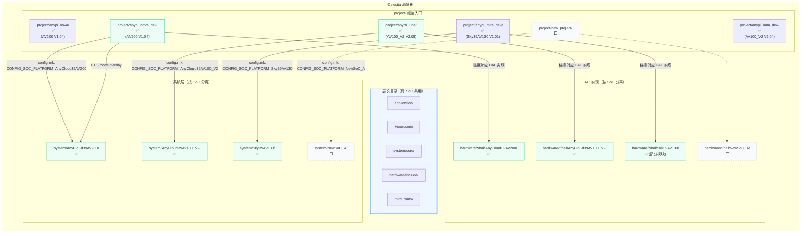
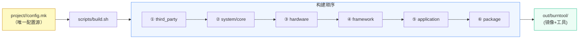
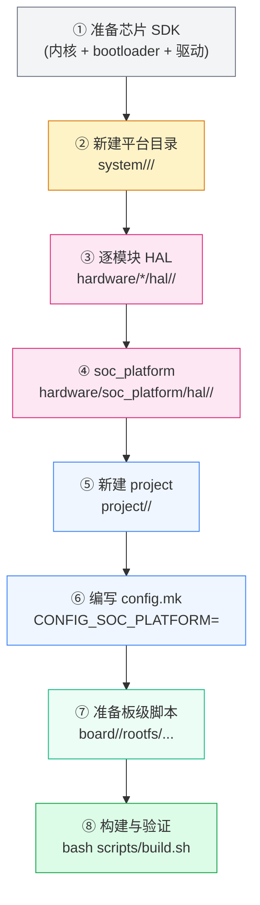

<p align="right"><a href="bsp-and-products.en.md">English</a> | <b>中文</b></p>

# Build & BSP

---

## 1. Celestia Project 组装模型

Celestia 采用 **"project 组合 + SoC 分离"** 设计：同一份 Celestia 源码通过不同的 `project/` 目录可以组装出针对不同 SoC / 不同板型 / 不同形态的镜像。



ASCII 备用：

```
Celestia 源码树
├── application/          ← 跨 SoC 共用（所有 App 和 Cloud）
├── framework/            ← 跨 SoC 共用（服务层）
├── system/core/          ← 跨 SoC 共用（公共能力）
├── hardware/
│   ├── include/          ← 公开接口（跨 SoC 共用）
│   └── <module>/hal/
│       ├── AnyCloud39AV200/      ✅ Nova SoC
│       ├── AnyCloud39AV100_V2/   ✅ wearable SoC
│       ├── Sky39AV130/           ✅ Mira SoC（部分模块）
│       └── NewSoC_A/             ⬜ 待扩展
├── system/
│   ├── AnyCloud39AV200/V1.04/    ✅ Nova 厂商 PDK（另可能有 V1.03）
│   ├── AnyCloud39AV100_V2/V2.05/ ✅ Luna（V2.04 亦存在）
│   ├── Sky39AV130/V1.01/         ✅ Mira（aos）
│   └── NewSoC_A/                 ⬜
├── third_party/          ← 跨 SoC 共用
└── project/
    ├── anypi_nova/       ✅ 量产 Nova → AV200 V1.04 / ipc_main
    ├── anypi_nova_dev/   ✅ EVB → AV200 V1.04 / nova_main
    ├── anypi_luna/       ✅ Luna 穿戴级 → AV100_V2 V2.05 / luna_main
    ├── anypi_luna_dev/   ✅ IOTCamera → AV100_V2 V2.04 / luna_dev_main
    ├── anypi_mira_dev/       ✅ IOTCamera → Sky39AV130 V1.01 / mira_main（aos）
    └── new_project/      ⬜
```

### 1.1 Project 的三大职责

| 职责 | 文件 / 路径 |
|---|---|
| **选平台** | `project/<proj>/config.mk` 中 `CONFIG_SOC_PLATFORM=...` |
| **选板型** | `project/<proj>/config.mk` 中 `CONFIG_BOARD=...` |
| **装板级资源** | `project/<proj>/system/<SoC>/<SDK>/board/<Board>/rootfs/...` |

---

## 2. 构建管线



---

## 3. 配置入口 — project/\<proj\>/config.mk

`scripts/build.sh` 启动时从 `project/<proj>/config.mk` 解析所有 `CONFIG_*` 变量，并自动生成 `project/<proj>/include/config.h` 供 C 代码条件编译。产品选择：`--product-name` → 缓存 `out/.build_product_name` → 交互列出 `project/*`（非交互必须显式指定）。

### 3.1 SoC / 板型核心变量

| 变量 | anypi_nova | anypi_nova_dev | anypi_luna | anypi_luna_dev | anypi_mira_dev |
|------|------------|----------------|------------|----------------|------------|
| `CONFIG_SOC_PLATFORM` | `AnyCloud39AV200` | `AnyCloud39AV200` | `AnyCloud39AV100_V2` | `AnyCloud39AV100_V2` | `Sky39AV130` |
| `CONFIG_SOC_SDK_VERSION` | `V1.04` | `V1.04` | `V2.05` | `V2.04` | `V1.01` |
| `CONFIG_OS_NAME` | `linux` | `linux` | `linux` | `linux` | `aos` |
| `CONFIG_BOARD` | `PDB_MBD_AK3918AV200_ACTCAM` | `EVB_MBD_AK3918AV200` | `PDB_MBD_KM01W_ACTCAM` | `EVB_MBD_KM01A` | `EVB_CBD_AK3918AV130` |
| `CONFIG_APP_MAIN_TARGET` | `ipc_main` | `nova_main` | `luna_main` | `luna_dev_main` | `mira_main` |
| `CONFIG_WIFI_TYPE` | `atbm6162` | —（板级） | `aic8800` | `atbm6032` | — |
| `CONFIG_CELESTIA_FASTSYS` | `y` | `y` | `n` | `n` | `n` |

> anypi_mira_dev（aos）通过项目自带 `setup_toolchain.sh` 提供 `arm-none-eabi-`（alios）工具链，`build.sh` 检测到 `CONFIG_OS_NAME=aos` 时自动 source。

### 3.2 Application 层开关

| 变量 | anypi_nova | anypi_nova_dev | anypi_luna | anypi_luna_dev | 说明 |
|------|------------|----------------|------------|----------------|------|
| `CONFIG_APP_MAIN_ENTRY` | y | y | y | y | 启用 app_main |
| `CONFIG_APP_PACKAGES_TABLET` | **y** | **y** | n | n | tablet GUI（与 wearable 互斥）|
| `CONFIG_APP_PACKAGES_WEARABLE` | n | n | **y** | n | `WEARABLE`（穿戴级） GUI |
| `CONFIG_APP_PACKAGES_IPCAMERA` | n | n | n | **y** | `IOTCamera` |
| `CONFIG_APP_WEARABLE_CAMERA` | — | — | **y** | — | wearable Camera SO |
| `CONFIG_APP_IPC_CAMERA` | y | y | — | — | IPC 摄像机 |
| `CONFIG_APP_CAMERA` | y | y | — | — | 相机 App |
| `CONFIG_APP_CLOUD_VOLC` | y | y | n | n | 火山引擎云 SO |
| `CONFIG_APP_RTSP` | y | y | n | y | RTSP 协议 |
| `CONFIG_APP_NEBULA` | y | y | n | y | Nebula 协议 |
| `CONFIG_APP_UVC` | n | n | n | n | UVC 服务（按需）|

> IOTCamera 产品：`anypi_mira_dev` 开 `CONFIG_APP_RTSP`/`CONFIG_APP_NEBULA`，走 `ipc_cam`。以各 `project/*/config.mk` 为准。

### 3.3 Framework 层开关（精选）

| 变量 | 值 | 说明 |
|---|---|---|
| `CONFIG_FW_MULTIMEDIA` | y | 多媒体服务 |
| `CONFIG_FW_MULTIMEDIA_CAMERA_AI` | y | 摄像头 AI 推理 |
| `CONFIG_FW_MULTIMEDIA_FORMAT_MP4 / AVI` | y | 容器格式 |
| `CONFIG_FW_NETWORK / WIFI / ETHERNET` | y | 网络模块 |
| `CONFIG_FW_NOTIFICATION / INPUT / ALARM` | y | 通知模块 |
| `CONFIG_FW_DEVICE_PTZ / LED / POWER / BACKLIGHT` | y | 设备子模块 |
| `CONFIG_FW_DEVICE_IPCAMERA_NIGHTVISION` | y | 夜视 |
| `CONFIG_FW_STORAGE` | y | 存储服务 |
| `CONFIG_FW_GUI_LVGL` | y | LVGL GUI |
| `CONFIG_FW_RUNTIME_BOOTSTRAP` | y | Runtime bootstrap |
| `CONFIG_FW_RUNTIME_CONSOLE` | y | 控制台命令 |
| `GDB_DEBUG` | 0 | GDB 支持 |

### 3.4 Hardware 层开关（精选）

| 变量 | 值 | 说明 |
|---|---|---|
| `CONFIG_HW_SOC_PLATFORM` | y | SoC 平台抽象（永远启用）|
| `CONFIG_HW_AUDIO / CAMERA / DISPLAY / OSD / GPU` | y | 多媒体 HAL |
| `CONFIG_HW_VISION_ISP / MOTION_DETECT` | y | 视觉 HAL |
| `CONFIG_HW_WIFI / ETHERNET` | y | 网络 HAL |
| `CONFIG_HW_INPUT_TOUCH / KEYBOARD` | y | 输入 HAL |
| `CONFIG_HW_DRIVER_GPIO / ADC / PWM / MOTOR / LED / IR / WDT / EFUSE / BLKDEV / MMC` | y | 驱动 HAL |

### 3.5 Third-Party 库（精选）

| 库 | 版本 | 用途 |
|---|---|---|
| lvgl | 9.3.0 | GUI 框架 |
| ffmpeg | 7.0 (minimal) | 音视频编解码 |
| mbedtls | 2.28.10 | 安全 / 加密 |
| openssl | 3.1.5 | TLS |
| curl | 8.3.0 | HTTP 客户端 |
| libwebsockets | 4.4 | WebSocket |
| cjson | 1.7.15 | JSON |
| iniparser | 内置（vendored，版本未指定） | INI 配置 |
| zxing | — | 二维码识别 |
| freetype | 2.12.0 | 字体 |
| libjpeg / libpng | 9e / 1.6.43 | 图像解码 |
| zlib | 1.3.1 | 压缩 |
| tslib | 1.22 | 触摸校准 |
| iconv | 1.15 | 编码转换 |

> `third_party/` 实际目录：`asr` `awtk` `cjson` `curl` `ffmpeg` `freetype` `iconv` `iniparser` `jerryscript` `jpeg` `jpegdec` `libpng` `libwebsockets` `lvgl` `mbedtls` `minIni` `openssl` `tslib` `zlib` `zxing`。`xmlparser` 与 `libh264` 已移除（见 `third_party/THIRD_PARTY_NOTICES.md`：xmlparser 全仓库无引用；libh264 实为 FFmpeg 重复代码，H.264 解码由 FFmpeg 提供）。

---

## 4. 构建脚本用法

**入口**：`scripts/build.sh`（或仓库根 `build.sh`，内容相同）

```bash
# 未指定产品：交互选择 project/*，写入 out/.build_product_name，下次可直接运行
bash scripts/build.sh

# 指定产品
bash scripts/build.sh --product-name anypi_nova
bash scripts/build.sh --product-name anypi_nova_dev
bash scripts/build.sh --product-name anypi_luna
bash scripts/build.sh --product-name anypi_luna_dev
bash scripts/build.sh --product-name anypi_mira_dev

# 按层构建
bash scripts/build.sh --system-core         # 只构建 system/core
bash scripts/build.sh --third-party         # 全部 third_party
bash scripts/build.sh --third-party lvgl    # 只构建 lvgl
bash scripts/build.sh --hardware            # 只 HAL
bash scripts/build.sh --framework           # 只 Framework
bash scripts/build.sh --application         # 只 Application
bash scripts/build.sh --kernel              # 只 Kernel / BSP
bash scripts/build.sh --package             # 只打包（跳过编译）

# 组合与并行
bash scripts/build.sh -f -a --jobs 4        # framework + application，4 线程
bash scripts/build.sh --build-level RELEASE --package

# 按模块精确构建
bash scripts/build.sh --build-module FW_MULTIMEDIA

# 清理
bash scripts/build.sh --clean               # clean + 全量
bash scripts/build.sh -c -f                 # clean + 只 framework

# Release 输出
bash scripts/build.sh --release
bash scripts/build.sh --release /path/to/dir
```

> **产品选择**：未传 `--product-name` 时，有缓存则用缓存，否则交互选择 `project/*` 并写入 `out/.build_product_name`。CI / 非 TTY 必须传 `--product-name`。

### 构建依赖链

```text
① third_party  → 无依赖
② system/core  → third_party (cjson 头文件)
③ hardware     → system/core + SOC SDK
④ framework    → third_party (lvgl/cjson) + system/core + hardware
⑤ application  → framework + system/core
⑥ package      → ①~⑤ 全部完成
```

> `build_framework()` 和 `build_system_core()` 在启动时自动检查 `liblvgl.a` / `cJSON.h` 是否存在，缺失则先触发 `build_third_party()`。

---

## 5. 产物目录结构

```text
out/
├── build/                 ← 中间产物（.o / .a / 临时）
│   ├── system/core/
│   ├── hardware/
│   ├── framework/
│   ├── application/
│   └── third_party/
├── install/               ← 统一安装目录（供 package 打包）
│   ├── system/core/
│   ├── hardware/
│   ├── framework/
│   ├── application/
│   └── third_party/
├── release/               ← --release 发布目录
└── burntool/              ← 烧录工具 + 镜像（package 后生成）
```

---

## 6. 主要产物

### 6.1 主可执行体

| 产物 | 来源 | 设备部署路径 |
|---|---|---|
| `ipc_main` | `application/app_main/` | `/usr/sbin/ipc_main`（anypi_nova）|
| `nova_main` | `application/app_main/` | `/usr/sbin/nova_main`（anypi_nova_dev）|
| `luna_main` | `application/app_main/` | `/usr/sbin/luna_main`（anypi_luna）|
| `luna_dev_main` | `application/app_main/` | `/usr/sbin/luna_dev_main`（anypi_luna_dev）|
| `mira_main` | `application/app_main/` | `/usr/sbin/mira_main`（anypi_mira_dev，aos）|

### 6.2 Framework 动态库（节选）

| SO 文件 | 来源 |
|---|---|
| `libmultimedia.so` | `framework/services/multimedia/` |
| `libnetwork.so` | `framework/services/network/` |
| `libnotification.so` | `framework/services/notification/` |
| `libdevice.so` | `framework/services/device/` |
| `libstorage.so` | `framework/services/storage/` |
| `libnebula_protocol.so` | `framework/gateway/nebula_protocol/` |
| `librtsp_protocol.so` | `framework/gateway/rtsp_protocol/` |

### 6.3 Application SO（按需）

| SO 文件 | 启用开关 | 说明 |
|---|---|---|
| `libcamera_app.so` | `CONFIG_APP_WEARABLE_CAMERA=y` | wearable Camera 子应用（仅 anypi_luna）|
| `libvolc_engine_app.so` | `CONFIG_APP_CLOUD_VOLC=y` | 火山引擎云平台 |

### 6.4 镜像文件（package 后）

| 文件 | 说明 |
|---|---|
| `uImage` | 普通 Linux 内核镜像 |
| `fastsys_uImage` | 快速启动内核（FASTSYS=y 时用）|
| `initfs.img` | initramfs |
| `*.dtb` | 设备树（根据板型特性自动选择，见 6.5）|
| `env_av200_*.img` | 环境变量分区镜像 |
| `dss_anyka_av200_fastsys_sc450ai.bin` | DSS 镜像 |
| `burnfile.md5` | 所有镜像的 MD5 校验文件 |

### 6.5 DTB 选择矩阵

#### anypi_nova_dev（AnyCloud39AV200）

`package.sh` 根据以下条件自动选择 DTB：

| FASTSYS | LCD | DMIC | DTB 文件 |
|:-:|:-:|:-:|---|
| y | y | y | `EVB_CBDM_KM02X_FASTSYS_LCD_DMIC_V1.0.0.dtb` |
| y | y | n | `EVB_CBDM_KM02X_FASTSYS_LCD_V1.0.0.dtb` |
| n | y | y | `EVB_CBDM_KM02X_LCD_DMIC_V1.0.0.dtb` |
| n | y | n | `EVB_CBDM_KM02X_LCD_V1.0.0.dtb` |
| n | n | — | `EVB_CBDM_KM02X_V1.0.0.dtb` |

#### anypi_luna（AnyCloud39AV100_V2）

wearable 的 DTB 由板级 `config.mk` 中 `CONFIG_DTB_NAME` 直接指定：

| DTB 文件 | 说明 |
|---|---|
| `EVB_CBDM_KM01A_V1.0.0.dtb` | KM01A ActionCam 板型 |

---

## 7. 当前 BSP — AnyCloud39AV200

### 7.1 关键组件

| 组件 | 路径 | 说明 |
|---|---|---|
| Linux 内核 | `system/AnyCloud39AV200/V1.04/os/kernel/` | Linux 5.10.111 |
| 设备树 | `…/boot/dts/anyka/` | AK3918AV200 板级 DTS |
| 内核模块 | `rootfs/lib/modules/*.ko` | 相机 / 音频 / ISP / NPU |
| 板级启动脚本 | `board/EVB_MBD_AK3918AV200/rootfs/utils/etc/config/app_01_start.sh` | 驱动加载 |
| SoC 平台抽象 | `hardware/soc_platform/AnyCloud39AV200/` | `soc_platform_init()` |

### 7.2 目录结构

```text
project/anypi_nova_dev/system/AnyCloud39AV200/V1.04/
├── board/
│   └── EVB_MBD_AK3918AV200/
│       ├── config.mk                                  ← 板级配置
│       ├── rootfs/utils/etc/config/
│       │   └── app_01_start.sh                         ← 板级启动脚本
│       └── os/kernel/arch/.../boot/dts/anyka/          ← 设备树
├── patch/rootfs/utils/                                 ← 通用 patch overlay
├── patch_fastsys/rootfs/utils/                         ← 快速启动 patch overlay
└── tools/burntool/                                     ← 烧录工具
```

### 7.3 rootfs 叠加顺序

```text
① SOC 基础 rootfs
② board/EVB_MBD_AK3918AV200/rootfs/utils/   ← 板型特定
③ patch/rootfs/utils/                        ← 通用 patch
④ patch_fastsys/rootfs/utils/                ← 快速启动 patch（仅 FASTSYS=y）
```

后者覆盖前者。

### 7.4 板级启动脚本（节选）

**文件**：`app_01_start.sh`

```bash
# ① 触摸屏环境变量
export TSLIB_CONFFILE=/etc/config/ts.rgb.conf
export TSLIB_TSDEVICE=/dev/input/event1

# ② 输入设备驱动
insmod /usr/modules/ak_saradc.ko
insmod /usr/modules/ak_adc_key.ko
insmod /usr/modules/ts_ft5426g.ko

# ③ 显示驱动
insmod /usr/modules/ak_ipu.ko
insmod /usr/modules/fb.ko
insmod /usr/modules/ak_lcd.ko

# ④ 网络
/usr/sbin/wifi_driver.sh sta &

# ⑤ 摄像头 + 视频编码
/usr/sbin/gc5603.sh
insmod /usr/modules/ak_venc_adapter.ko
insmod /usr/modules/ak_venc_bridge.ko
insmod /lib/modules/5.10.111/.../firmware_class.ko path=/usr/model/

# ⑥ 音频
insmod /usr/modules/ak_pcm.ko

# ⑦ NPU
insmod /usr/modules/ak_npu.ko

# ⑧ 主进程（与 CONFIG_APP_MAIN_TARGET 一致）
# nova_dev → /usr/sbin/nova_main &
# nova → /usr/sbin/ipc_main & 或 start_nova_main.sh
```

启动脚本须拉起与 `CONFIG_APP_MAIN_TARGET` 同名的二进制（如 anypi_nova 用 `ipc_main`，anypi_nova_dev 用 `nova_main`）。

---

## 8. 当前 BSP — AnyCloud39AV100_V2（wearable 产品线）

### 8.1 关键组件

| 组件 | 路径 / 值 | 说明 |
|---|---|---|
| 芯片系列 | KM01A | `CONFIG_CHIP_SERIES` |
| SDK 版本 | V2.05 | `system/AnyCloud39AV100_V2/V2.05/`（anypi_luna_dev 仍为 V2.04）|
| 板型 | `PDB_MBD_KM01W_ACTCAM` | ActionCam 板型 |
| 工具链 | `arm-anycloud-linux-uclibcgnueabi-` | uClibc GCC 交叉编译 |
| WiFi | aic8800 | `CONFIG_WIFI_TYPE` |
| DTB | `EVB_CBDM_KM01A_V1.0.0` | `CONFIG_DTB_NAME` |
| Sensor | sc200ai | `CONFIG_SENSOR_NAME` |
| 屏幕 | 240x240 | 穿戴级（`WEARABLE`）产品形态（`app_globle_config.h`）|
| 项目装配 | `project/anypi_luna/config.mk` | wearable 构建配置总入口 |

### 8.2 目录结构

```text
project/anypi_luna/
├── config.mk                                              ← 构建配置总入口
├── Makefile / build_soc_system.sh / package.sh
├── include/
│   ├── config.h                                           ← 自动生成
│   ├── app_globle_config.h                                ← 240x240 屏幕参数
│   ├── app_product_config.h                               ← 产品差异配置
│   └── lv_conf.h                                          ← LVGL 配置
└── system/AnyCloud39AV100_V2/
    ├── V2.05/                                             ← 当前 SDK overlay
    │   ├── board/PDB_MBD_KM01W_ACTCAM/
    │   │   ├── config.mk                                  ← 板级配置（DTB/WiFi/Sensor）
    │   │   ├── os/kernel/...                              ← 板级 DTS
    │   │   └── rootfs/utils/etc/config/                   ← settings.json / fw_*.json 等
    │   └── patch/...
    └── V2.04/                                             ← 旧 overlay（历史保留）
```

### 8.3 产品对比（五产品）

| 维度 | anypi_nova | anypi_nova_dev | anypi_luna | anypi_luna_dev | anypi_mira_dev |
|---|---|---|---|---|---|
| SoC | AnyCloud39AV200 | AnyCloud39AV200 | AnyCloud39AV100_V2 | AnyCloud39AV100_V2 | Sky39AV130 |
| SDK | V1.04 | V1.04 | V2.05 | V2.04 | V1.01 |
| Board | PDB_MBD_AK3918AV200_ACTCAM | EVB_MBD_AK3918AV200 | PDB_MBD_KM01W_ACTCAM | EVB_MBD_KM01A | EVB_CBD_AK3918AV130 |
| 屏幕 | 800×480 | 1024×600 | 240×240 | 无显示 | 无显示 |
| 主程序 | `ipc_main` | `nova_main` | `luna_main` | `luna_dev_main` | `mira_main` |
| Packages | `TABLET=y` | `TABLET=y` | `WEARABLE=y` | `IPCAMERA=y` | `IPCAMERA=y` |
| OS / 工具链 | linux / `riscv64-anyka-linux-musl-` | 同左 | linux / `arm-anycloud-linux-uclibcgnueabi-` | 同左 | aos / `arm-none-eabi-` |
| 业务 SO / 云 | 多云（volc/aliyun 等） | 同左 | — | `ipc_cam` | `ipc_cam` |
| 协议 | RTSP / Nebula | 同左 | 默认关闭 | RTSP / Nebula | RTSP / Nebula |

---

## 9. 新增 SoC 平台的完整流程（参考）



| 步骤 | 关键动作 | 产出 |
|---|---|---|
| ① 准备 SDK | 与原厂取得 kernel + 工具链 + 驱动 + 头文件 | `system/<NewSoC>/<SDK_Ver>/` |
| ② 平台目录 | 按 SDK 布局放置 `{os,tools,…}`；板级 overlay 仍在 `project/` | 平台源码根 |
| ③ **逐模块 HAL** | 对每个启用且有 `hal/<SoC>/` 的模块建 `hardware/<m>/hal/<NewSoC>/`，对齐 `hardware/include/*.h` | 各模块 SoC 实现 |
| ④ SoC 抽象 | `soc_platform/hal/<NewSoC>/`：`soc_platform_init()` 等；缺 IPU 用弱桩 | bring-up |
| ⑤ 新建 project | `cp -r` 基线产品 | `project/<new>/` |
| ⑥ 改 config.mk | `CONFIG_SOC_PLATFORM` / `CONFIG_SOC_SDK_VERSION` / 所需 `CONFIG_HW_*` | 构建入口 |
| ⑦ 板级脚本 | DTS + 启动脚本 `insmod` 列表 | board overlay |
| ⑧ 构建验证 | `./build.sh --product-name <p>`；L1→L5 | 镜像 + 上板 |

> **通常无需改**：Application / Framework / `hardware/include/`。
> **system/core**：仅为已有模块补新 SoC HAL 时**不动**；新增**全新** HAL 模块时才在 `system_error.h` 追加 `HARDWARE_MODULE_*`（见 [celestia-system-core](../skills/celestia-system-core.md)）。
> 逐模块清单与 AI 工作表：[roles.md §4](roles.md#4-新芯片移植开发者)、[celestia-hardware](../skills/celestia-hardware.md#新增-soc芯片-sdk--逐模块-hal)。
> **RTOS/AOS 芯片**（SDK 用户态只产 `.a`，如 Sky39AV130/mira）：上述流程之外还需 POSIX compat 垫片、`.so`→`.a` 静态链接与 BSP 内核补丁，走 [celestia-aos-port](../skills/celestia-aos-port.md)（Linux 产品移植 AOS）。

---

## 10. 部署与上板

### 9.1 标准部署路径

| 产物 | 设备路径 |
|---|---|
| `CONFIG_APP_MAIN_TARGET` | `/usr/sbin/<suffix>_main`（`ipc_main` / `nova_main` / `luna_main` / `luna_dev_main` / `mira_main`）|
| Framework / Third-Party `.so` | `/usr/lib/` 或 `/lib/` |
| Cloud 适配 SO | `/usr/lib/lib*_app.so` |
| 配置文件 | `/etc/config/` |
| 字体 / 图片资源 | `/usr/gui/font/` 等 |
| 驱动模块 | `/usr/modules/` |
| NPU 模型 | `/usr/model/` |

### 9.2 运行时配置查找顺序

```text
① 环境变量 APP_SETTINGS_CONFIG
② 命令行参数 --config /path/to/settings.json
③ 当前目录 settings.json
④ 默认路径 /etc/config/settings.json
```

### 9.3 上板启动

```bash
# 1. 加载驱动（开机时由 BSP init 自动执行）
sh /etc/config/app_01_start.sh

# 2. 启动主进程（名 = CONFIG_APP_MAIN_TARGET）
/usr/sbin/ipc_main &
# 或 /usr/sbin/nova_main & /usr/sbin/luna_main & /usr/sbin/luna_dev_main & /usr/sbin/mira_main &

# 3. 验证日志（framework_init 成功后打印）
#    关键日志："[LAUNCHER] platform startup ok"
```

---

## 11. 首次上板验证清单

| # | 验证项 | 方法 | 期望结果 |
|---|---|---|---|
| 1 | 驱动加载 | `lsmod` | 看到 `ak_pcm` `ak_npu` `fb` 等模块 |
| 2 | 摄像头设备 | `ls /dev/video*` | `/dev/video0` 存在 |
| 3 | 音频设备 | `ls /dev/snd/` | PCM / Control 设备存在 |
| 4 | 显示设备 | `ls /dev/fb*` | `/dev/fb0` 存在 |
| 5 | 触摸设备 | `ls /dev/input/` | 存在 event 设备 |
| 6 | 网络就绪 | `ifconfig wlan0` | wlan0 存在且 UP |
| 7 | 主进程启动 | `/usr/sbin/<CONFIG_APP_MAIN_TARGET> &` | 无立即崩溃 |
| 8 | Framework 初始化 | 日志观察 | `[LAUNCHER] platform startup ok` |
| 9 | 服务可用 | 日志观察 | `multimedia_open` / `network_open` 返回 0 |
| 10 | RTSP 流 | VLC 拉流 `rtsp://<IP>/live` | 正常视频输出 |

---

## 12. 常见问题

| 问题 | 排查 |
|---|---|
| `config.mk not found` | 确认 `project/<proj>/config.mk` 存在；传 `PRODUCT_NAME=<proj>` 参数 |
| `liblvgl.a not found` | 先构建 third_party：`bash scripts/build.sh -t lvgl` |
| 主进程启动即崩溃 | 驱动未全部加载；`strace /usr/sbin/<CONFIG_APP_MAIN_TARGET>` 查缺失 SO |
| RTSP 无画面 | 摄像头驱动异常；`gc5603.sh` 未执行；`multimedia_open()` 返回非 0 |
| 触摸不响应 | `ts_ft5426g.ko` 未加载；`TSLIB_TSDEVICE` 指向错误 event |
| 换 SoC 编译失败 | 检查 `hardware/*/hal/<NewSoC>/` 是否实现了所有公开接口；参考 `AnyCloud39AV200/` |

---

## 13. 相关分册

- 系统总览：[architecture/overview.md](../architecture/overview.md)
- 快速上手：[Quick Start](../README.md)
- Framework 服务：[guide/framework.md](../guide/framework.md) / [guide/framework-api.md](../guide/framework-api.md)
- HAL 接口与扩展：[guide/hardware-hal.md](../guide/hardware-hal.md) / [guide/hardware-api.md](../guide/hardware-api.md)（新增 SoC 流程见本文 §9）
- 应用层与启动形态：[guide/application.md](../guide/application.md)
- System Core：[guide/system-core.md](../guide/system-core.md) / [guide/system-core-api.md](../guide/system-core-api.md)
- 按角色导读：[roles.md](roles.md)
